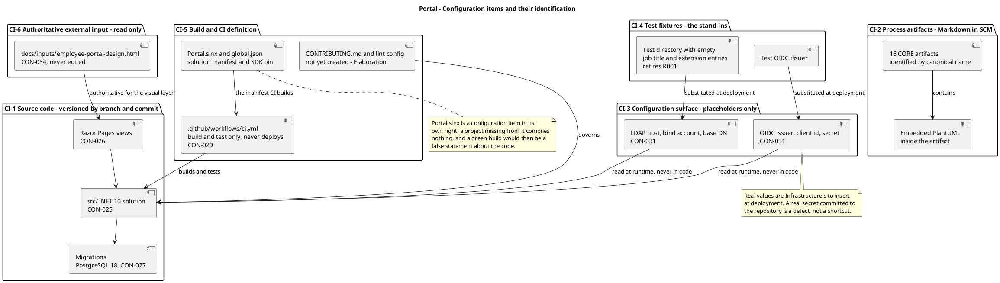
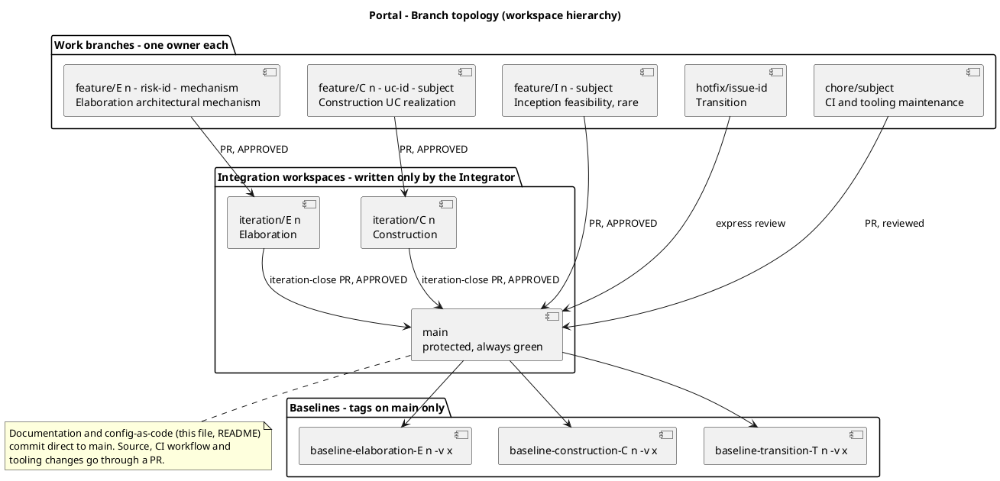
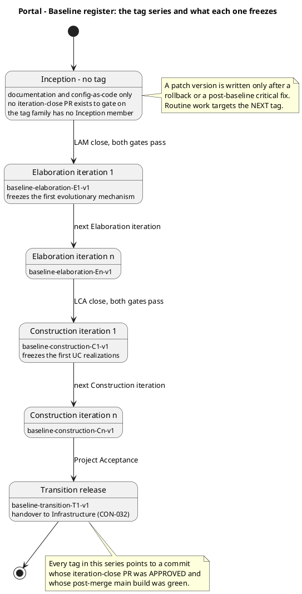
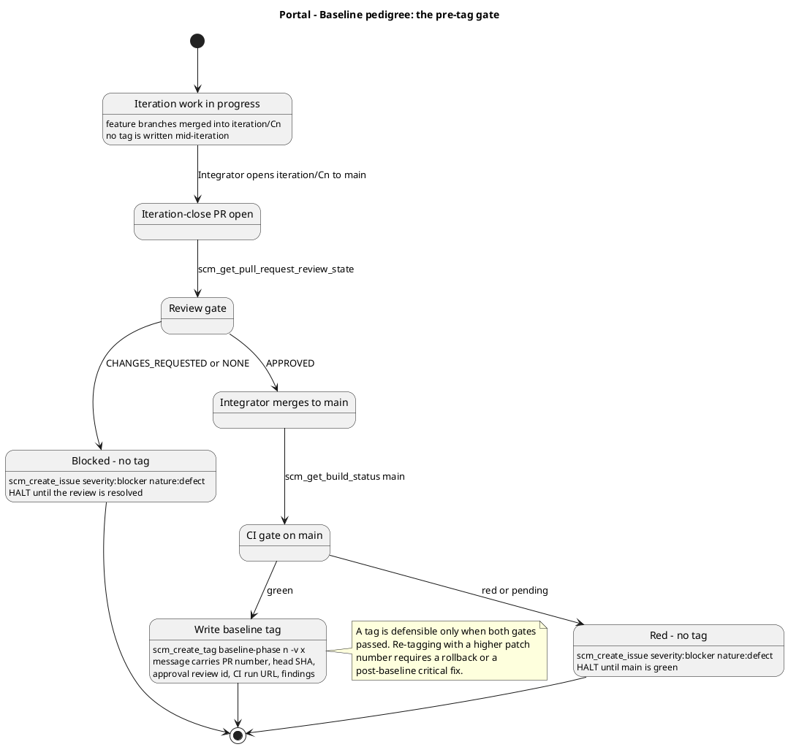
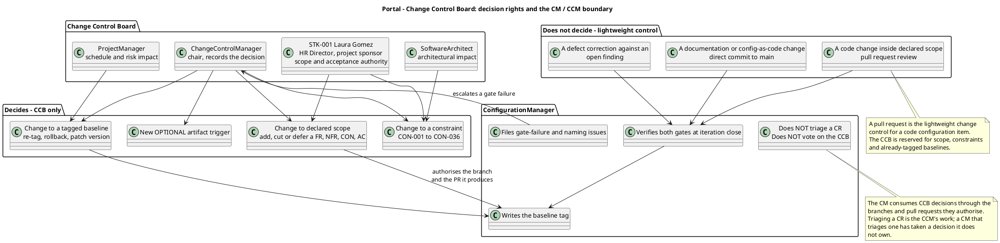
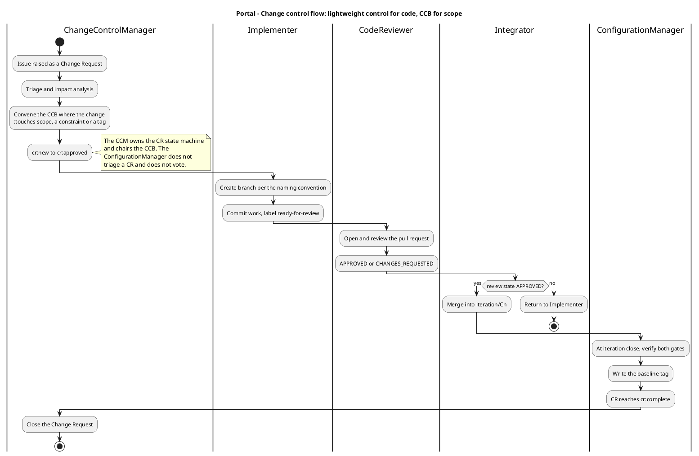
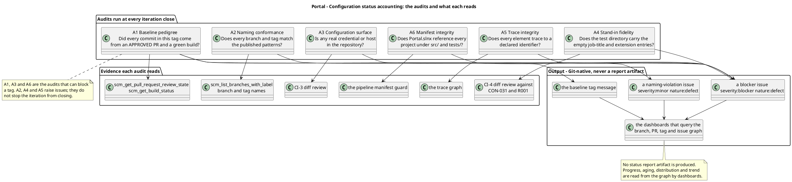

# Branching and Baseline Strategy — Portal

**Owner:** ConfigurationManager. **Status:** Inception, iteration 2.

This file is the configuration-management model of the project expressed as code. It defines what a
configuration item is, how branches and baselines are named, which gates a baseline must pass, who
decides a change, and how conformance is audited. It is documentation: it is committed direct to
`main`, never opened as a pull request.

## Configuration items

Six classes of configuration item are under version control. Everything the project produces falls
into one of them; anything that falls into none is not a configuration item and is not baselined.

| CI class | Identification | Baseline unit |
|---|---|---|
| CI-1 Source code | file path + commit SHA | the commit the tag points to |
| CI-2 Process artifacts | canonical artifact name; every change is a commit | the commit the tag points to |
| CI-3 Configuration surface | key name in configuration; values are placeholders per CON-031 | the commit the tag points to |
| CI-4 Test fixtures | fixture path in the test tree | the commit the tag points to |
| CI-5 Build and CI definition | `.github/workflows/*`, `Portal.slnx`, `global.json`, `CONTRIBUTING.md`, lint config | the commit the tag points to |
| CI-6 Authoritative external input | `docs/inputs/employee-portal-design.html` | read-only; never edited, never re-baselined |

CI-3 and CI-4 are the pair that carries the project's integration risk. CON-031 makes the stand-ins
the team's entire integration surface, and the stand-in directory must carry entries whose job title
or extension is empty — those entries are what retire R001. A stand-in without them is a fixture
defect, not a test gap.

`Portal.slnx` is a configuration item in its own right, not a build detail. A project that exists
under `src/` or `tests/` but is absent from the manifest compiles nothing, and the build then reports
success about code it never read. The pipeline enforces the manifest against the source tree on every
run, so the manifest cannot drift silently.

## Branch topology

Three levels: work branches, integration workspaces, and `main`. Only the Integrator writes
`iteration/*` and `main`. No other role pushes to either.

### Naming conventions

| Branch | Pattern | Base | Merges into |
|---|---|---|---|
| Inception feasibility | `feature/I{n}-{subject}` | `main` | `main` via PR |
| Elaboration mechanism | `feature/E{n}-{risk-id}[-{mechanism}]` | `iteration/E{n}` | `iteration/E{n}` via PR |
| Construction feature | `feature/C{n}-{uc-id}-{subject}` | `iteration/C{n}` | `iteration/C{n}` via PR |
| Integration workspace | `iteration/E{n}` \| `iteration/C{n}` | `main` | `main` via iteration-close PR |
| Transition hotfix | `hotfix/{issue-id}` | `main` | `main`, express review |
| Maintenance | `chore/{subject}` | `main` | `main` via PR |

A branch that matches no pattern is surfaced as an SCM issue labelled `severity:minor` +
`nature:defect` + `naming-violation`. It is never renamed in place: renaming rewrites history that
other roles may already reference.

### Per-phase model

- **Inception — documentation only.** No implementation code. A feasibility mechanism, if genuinely
  required to reduce risk, is built evolutionarily in `src/` on `feature/I{n}-{subject}` — never as
  throwaway sample code. This iteration requires none: the declared risks are retired by testing
  against stand-ins (CON-031), not by a prototype.
- **Elaboration — evolutionary architectural mechanism.** The architectural prototype becomes the
  Construction baseline; it is not throwaway. A technical risk is retired either by analysis (the
  SoftwareArchitect reasons feasibility, no code) or by building the real mechanism in `src/` on
  `feature/E{n}-{risk-id}[-{mechanism}]` based on `iteration/E{n}`. The Architect records the choice
  as a process fact — `analysis-only`, `single-mechanism` or `candidates`. The Code Reviewer opens and
  reviews each mechanism PR as production code; the Integrator merges the APPROVED mechanism into
  `iteration/E{n}`. For competing candidates the Architect selects the winner and the Integrator
  closes the loser's PR. At LAM close the Integrator opens `iteration/E{n} → main`. There is no
  `samples/poc/` directory and no ephemeral `poc/*` branch.
- **Construction — feature branches.** UC realizations on `feature/C{n}-{uc-id}-{subject}` based on
  `iteration/C{n}`. The Code Reviewer reviews, the Integrator merges APPROVED into `iteration/C{n}`
  and opens `iteration/C{n} → main` at IOC.
- **Transition — hotfixes.** `hotfix/{issue-id}` from `main`, express review, merge to `main` with a
  patch baseline tag.

### Cross-phase invariants

1. Only the Integrator writes `iteration/*` and `main`.
2. `ready-for-review` is the Implementer → Code Reviewer handoff label. A branch carrying it and no
   pull request is waiting for one.
3. A baseline tag freezes only an APPROVED and CI-green commit.
4. Documentation and config-as-code commit direct to `main`; source, CI workflow and tooling changes
   go through a pull request.

## Baselines

One baseline per iteration close, never mid-iteration. A tag is defensible only when both gates pass.

### Baseline register

| Tag | Written at | What it freezes |
|---|---|---|
| `baseline-elaboration-E{n}-v{x}` | Elaboration iteration close (LAM) | the evolutionary architectural mechanism merged into `iteration/E{n}` |
| `baseline-construction-C{n}-v{x}` | Construction iteration close (IOC) | the UC realizations merged into `iteration/C{n}` |
| `baseline-transition-T{n}-v{x}` | Transition release | the release handed to Infrastructure (CON-032) |

`x` starts at 1 and is incremented only after a rollback or a post-baseline critical fix applied to
the iteration branch. Routine iteration work targets the next iteration's tag, not a re-tag of the
previous one.

### Pre-tag gate

### Tag message contract

The tag message is the audit record. It carries the iteration-close PR number and head commit SHA,
the Architect approval review id, the `main` CI run URL at tag time, and any notable finding — a
naming violation, a deferred item, a re-tag justification. A tag message reading only the word
baseline is a defect: it claims a pedigree it does not evidence.

## Change control

### Change Control Board

| Decision | Authority | Record |
|---|---|---|
| Add, cut or defer a declared FR, NFR, CON, AC or BG | STK-001, on the ChangeControlManager's recommendation | the Change Request issue |
| Change a constraint (CON-001 to CON-036) | STK-001 with the SoftwareArchitect's impact assessment | the Change Request issue |
| Re-tag, roll back, or increment a baseline patch version | ChangeControlManager with the ProjectManager | the tag message |
| Fire an OPTIONAL artifact trigger | ChangeControlManager, recorded in the Development Case | the Development Case |
| Merge a code change inside declared scope | CodeReviewer, by pull request approval | the pull request |
| Commit a documentation or config-as-code change | the owning role, direct to `main` | the commit |

The board is convened only for the first four rows. The last two are lightweight control and do not
reach it.

### Lightweight control for code

A pull request is the lightweight change control for a code configuration item. The CCB is reserved
for changes to declared scope, to a constraint, or to a baseline already tagged.

### CM / CCM boundary

The ChangeControlManager owns the Change Request state machine and chairs the CCB. The
ConfigurationManager consumes those decisions through the branches and pull requests they authorize,
and does not triage change requests, does not vote, and does not close a CR.

## Audit procedures

| Audit | Question it answers | Mechanism | Blocks a tag |
|---|---|---|---|
| A1 Baseline pedigree | Did every commit in this tag come from an APPROVED PR and a green build? | the two gates above, recorded in the tag message | Yes |
| A2 Naming conformance | Does every branch and tag match the conventions? | `scm_list_branches_with_label` sweep each iteration close; violations filed as `naming-violation` issues | No |
| A3 Configuration surface | Is any real credential or host in the repository? | review of CI-3 changes; a real value committed is a defect | Yes |
| A4 Stand-in fidelity | Does the test directory carry the empty job title and extension entries? | review of CI-4 changes against CON-031 and R001 | No |
| A5 Trace integrity | Does every element trace to a declared identifier? | artifact review; the trace graph is the record | No |
| A6 Manifest integrity | Does the solution manifest reference every project under `src/` and `tests/`? | the pipeline's manifest guard, on every run | Yes |

Status and measurement data — progress, aging, distribution, trends — is read from the branch, pull
request, tag and issue graph by dashboards. No status report artifact is produced.

## Tooling

| Capability | Tool | State |
|---|---|---|
| Version control | hosted SCM provider (CON-029) | available |
| Build and test CI | `.github/workflows/ci.yml` on the hosted provider | committed and green on `main`; build and test only, never deploys (CON-029) |
| Solution manifest and SDK pin | `Portal.slnx`, `global.json` (SDK 10.0.100, rollForward latestFeature) | committed; the pipeline fails if a project under `src/` or `tests/` is missing from the manifest |
| Build | .NET 10 SDK (CON-025) | available |
| Database | PostgreSQL 18 (CON-027) | available |
| Modeling | Markdown with embedded PlantUML in SCM | available; no modeling tool procured |
| Identity and directory stand-ins | team-built per CON-031 | not yet created — Elaboration |
| Test framework | not declared by the stakeholder | gap — TestManager selects it in Elaboration |
| `CONTRIBUTING.md` and lint configuration | not yet created | gap — Elaboration |

CI covers all branch families — `main`, `iteration/**`, `feature/**`, `chore/**`, `hotfix/**` — on
both push and pull request, runs build and test only, and never deploys (CON-029). Deployment is
Infrastructure's (CON-032).

## Inception status

No baseline tag is written in Inception. The architecture is not stable, no iteration-close pull
request exists to gate on, and the tag family itself has no Inception member — the first tag this
project writes is `baseline-elaboration-E1-v1`, at the Elaboration iteration close.

The pipeline is live. The build observed on `main` at the moment of writing is run `39940359296`,
success, 2026-10-23 10:36:57Z to 10:37:48Z. It builds one web project and one test project — a
skeleton — so a green result proves the pipeline runs and the manifest guard holds, not that the
product works. The CI gate becomes a real gate on a baseline when the first mechanism lands in
Elaboration.
