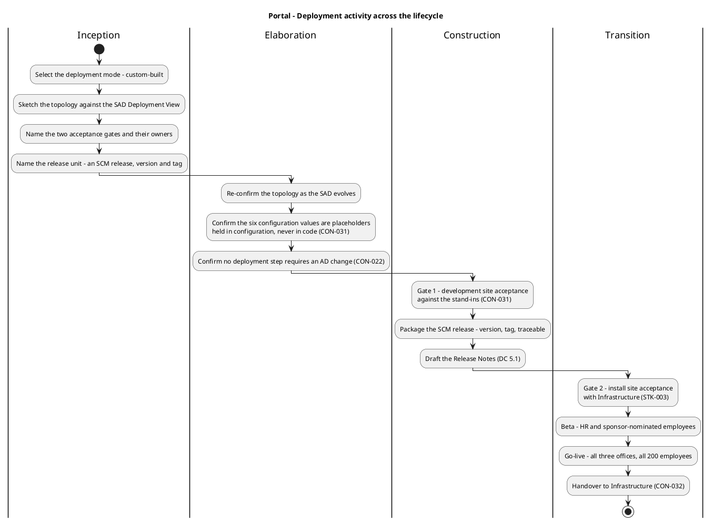
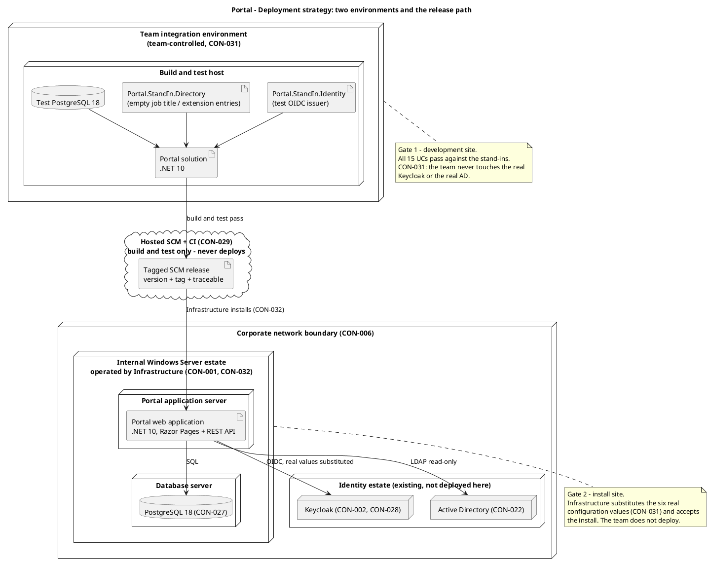
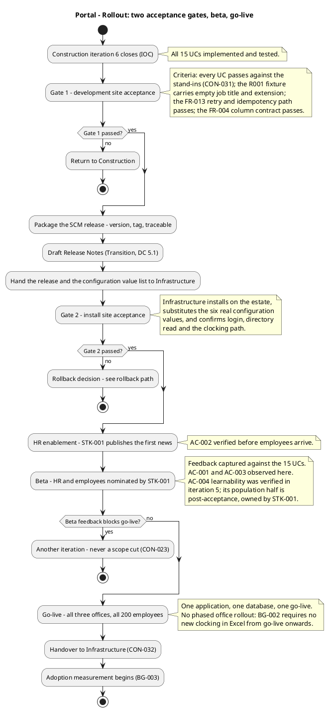
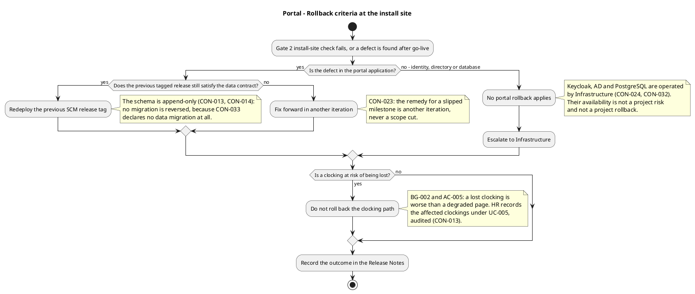

# Portal — Deployment Strategy (Inception baseline)

## Document Control

- **Phase:** Inception
- **Status:** Draft — iteration 2, submitted for review
- **Milestone Target:** End of Inception (not yet achieved)

## Deployment mode

**Custom-built.** The portal is built for one organization, installed on that organization's own
estate, and operated by that organization's own infrastructure team. It is not shrink-wrapped (there
is no second customer, no licence, no installer product) and not downloadable (there is no public
distribution channel and no self-service install).

| Mode | Verdict | Basis |
|---|---|---|
| Custom-built | **Selected** | CON-001 — one .NET application on the internal Windows Server estate; CON-032 — Infrastructure operates it after handover; CON-006 — reachable only from the internal network |
| Shrink-wrapped | Rejected | No second customer, no packaging for distribution, no licence or activation concern |
| Downloadable | Rejected | No public channel; CON-006 forbids access from outside the corporate network |

**What the mode decides, and what it forbids.** Because the product is custom-built for one estate,
there is no version-compatibility matrix, no upgrade path from an earlier release, no installer
wizard and no self-service configuration. There is exactly one installation, performed once, by the
team that already operates the servers. Any deployment artefact that assumes a customer installing
the product themselves is wrong for this project.

## Target user community

| Community | Size | What they receive | Basis |
|---|---|---|---|
| Cuba Corp employees | 200 people, 3 offices | Clock in/out, own monthly history, news reading and filtering, directory search | STK-004, FR-001, FR-002, FR-010, FR-011 |
| HR department | STK-001 and the HR AD group | All clockings, CSV export, correction and insertion, news lifecycle, worker category | STK-001, CON-008, FR-003 to FR-009, FR-012 |
| Infrastructure team | STK-003 | The installed, operable application and the configuration values they substitute | STK-003, CON-031, CON-032 |

**Two authorization levels, and no third.** CON-008 gives exactly two: members of the HR AD group,
and everyone else. The deployment does not create, seed or migrate any user, group or role — the
identity comes from the existing Keycloak and AD, and the portal holds no user table (CON-004).

**No user population is provisioned at deployment.** There is no account creation step, no invitation
step and no password step in the deployment procedure. An employee who can log in to the corporate
network can use the portal; one who cannot, cannot. This is the whole of the access provisioning.

## Deployment activities across the lifecycle

Deployment is a discipline that runs across all four phases, not a Transition-only activity. What
changes per phase is the depth, not the presence.

| Phase | Deployment work | Exit condition |
|---|---|---|
| Inception | Mode, target community, topology sketch, gate names, release unit | This document baselined |
| Elaboration | Re-confirm topology against the evolving SAD; confirm the configuration surface is six placeholders and no AD change is required | Topology and configuration surface stable enough to build against |
| Construction | Gate 1 acceptance; package the tagged release; draft the Release Notes | Gate 1 passed and a tag exists |
| Transition | Gate 2 acceptance; beta; go-live; handover | Infrastructure accepts operation (CON-032) |

**The Release Notes are a Transition deliverable (DC §5.1) and are not drafted earlier.** What
Inception fixes is the specification the Transition draft must meet — the content requirements are
in the Support material section below.

## Target environments

Two environments, and no third. A separate staging environment is not declared and is not added: the
scale is non-binding, there is one application node, and a third environment would be a second place
for configuration to drift without retiring any risk.

| Environment | Purpose | Who operates it | What is real there |
|---|---|---|---|
| Team integration environment | Build, test and Gate 1 acceptance | The team | Nothing external: a test OIDC issuer and a test directory stand in for Keycloak and AD (CON-031) |
| Production estate | Gate 2 acceptance, beta, go-live and operation | Infrastructure (CON-032) | The real Keycloak, the real AD, the real PostgreSQL 18 instance |

**The hosted CI is not an environment.** CON-029 makes it a development toolchain: it builds and
tests, it never deploys, and it never holds production data or credentials. It is drawn outside the
corporate boundary for that reason, and it is not a runtime dependency of the portal.

**Keycloak and AD are not deployed by this project.** They are existing systems inside the corporate
network (CON-028), operated by Infrastructure (CON-024). The deployment procedure configures the
portal to point at them; it does not install, configure or modify them, and it requires no AD change
(CON-022).

## Release unit and bill of materials

**The release unit is an SCM release: a version, a tag, and the code at that tag.** Nothing is
shipped as a loose file. The tag is what Infrastructure installs and what a rollback returns to.

| Item | Delivered as | Basis |
|---|---|---|
| Portal web application (.NET 10, Razor Pages + REST API) | Build output of the tagged release | CON-025, CON-026 |
| Database schema | Migrations in the tagged release, applied at install | CON-027 |
| Configuration value list — six placeholders to be replaced | Documented in the Release Notes; values supplied by Infrastructure | CON-031 |
| Release Notes | Transition deliverable, handover-oriented | DC §5.1, CON-032 |
| User Documentation — employee-facing and HR-facing | Construction deliverable, TechnicalWriter primary | DC §5.1 |
| Dependency lock files | In the repository at the tag — this is the BOM | — |

**The six configuration values are the whole of the install-time configuration:** OIDC issuer, client
id, client secret, LDAP host, bind account, base DN. They are placeholders in the repository and are
never committed with real values (CON-031). A release that requires a seventh value is a release
whose configuration surface changed, and that is a Change Request, not an install note.

**Not in the bill of materials, because the scope excludes them:** no Keycloak realm export, no
client provisioning script, no AD schema change, no data migration (CON-033), no backup tooling
(CON-035), no training material (AC-004 requires the portal be learnable with no training), no
installer product.

## Two-gate acceptance

Two gates, with different criteria and different owners. A single gate at production is not
sufficient: the development site proves the use cases work, and the install site proves the
configuration substitution works. They fail for different reasons and must be judged separately.

| | Gate 1 — development site | Gate 2 — install site |
|---|---|---|
| **Where** | Team integration environment | Production estate |
| **Who judges** | TestManager, with the Reviewer | Infrastructure (STK-003), with HR (STK-001) |
| **What is proven** | Every use case works against the stand-ins (CON-031) | The real configuration values work: login, directory read, clocking write |
| **Criteria** | All 15 UCs pass; the R001 fixture carries empty job title and extension entries; the FR-013 retry and idempotency path passes; the FR-004 column contract passes; no exclusion from the Vision's list appears in the build | Login through the real Keycloak succeeds; the directory reads the real AD; a clocking is recorded and visible; the CSV export produces the eight columns; the audit rows are readable directly from the database |
| **Failure means** | Return to Construction | Rollback decision — see below |

**Gate 2 is not a formality that can be waived.** It is the only point at which the placeholder
configuration is replaced by real values, and the only point at which the portal meets the real AD
whose attribute gaps are R001. A Gate 2 that is skipped leaves the real-AD case unobserved in
production.

## Beta program

Beta is a structured feedback mechanism, not a QA activity. QA happens before Gate 1; beta happens
after Gate 2 and asks a different question: can these people do their job with this product.

| Element | Decision |
|---|---|
| **Participants** | The HR department (STK-001 and the HR AD group) plus a group of employees nominated by STK-001 across the three offices. The employee group is chosen by the sponsor, not by the team — the team has no basis for choosing who represents 200 people |
| **Duration** | Bounded by the Transition iteration. It ends when the exit criteria are met or when the sponsor calls go-live |
| **Feedback mechanism** | A single channel owned by STK-001, with each report tagged to the use case it concerns (UC-001 to UC-015). A report that cannot be tagged to a use case is either a defect in an existing one or a request outside declared scope — and the second is a Change Request, not a beta finding |
| **What beta measures** | AC-001 (clocking unaided), AC-003 (a colleague's phone or email found in under 10 seconds), and the first reading of BG-003 adoption. Beta closes neither half of AC-004: its learnability half is verified in iteration 5 by the untrained-user check in the iteration that implements UC-001, and its 80%-of-population half is a post-Project-Acceptance measure owned by STK-001 against BG-003's three-month window. Beta supplies the first observation that measure will use; it does not close it |
| **Exit criteria** | No open beta finding against UC-001, UC-004, UC-011 or UC-013 — the four use cases carrying the declared acceptance criteria and the highest risk. Findings against other use cases are triaged: a defect blocks go-live, a request becomes a Change Request |
| **What beta does not do** | It does not re-open declared scope. A beta finding that asks for an excluded capability (a self-service correction screen, an audit view, a permission screen, a news archive) is a Change Request to the CCM, never a beta fix (CON-023) |

**R002 is the risk beta exists to measure.** Adoption is not a technical property and cannot be
tested; it can only be observed. Beta is where the first observation happens, and BG-003's 80% target
is measured after go-live, not during beta.

**AC-004 is not a beta exit criterion, and that is deliberate.** A criterion whose window opens at
go-live cannot be closed by the activity that precedes go-live. Beta's job is to confirm that an
untrained person can complete a clocking — the learnability half — and to leave the population
measure to the point where it can actually be read.

## Rollout approach

**One go-live, all three offices, all 200 employees.** There is no phased office rollout and no
pilot-then-expand. The reason is a declared business goal, not a preference: BG-002 requires that no
shared Excel sheet records a new clocking, and a phased rollout would leave some offices on Excel
while others are on the portal — which is the exact condition BG-002 exists to end. A partial rollout
would also split the clocking ledger across two systems for the duration, and CON-011's one-pair-per-
day rule has no meaning across a split.

**HR is enabled before employees arrive.** AC-002 requires an HR Administrator to publish a news item
without technical assistance, and the first thing 200 employees will see is an empty news area. HR
publishes the first item during Gate 2 acceptance, which verifies AC-002 and gives the portal content
on day one.

**No training rollout is scheduled, and that is a declared fact rather than an omission.** AC-004
requires 80% of employees to complete a clocking with no prior training. A training programme would
contradict the acceptance criterion it is meant to support. The support material is the User
Documentation and the one-press interaction itself.

**No data migration step exists.** CON-033 declares none: the portal starts empty and records
clockings from go-live onwards. The historical Excel sheets stay on the shared drive as a read-only
archive. A deployment procedure containing an import step is wrong for this project.

## Rollback criteria

Rollback is a decision with named criteria, taken at a named point, by a named person. It is not
"revert if something looks wrong".

| Trigger | Rollback action | Who decides |
|---|---|---|
| Gate 2 fails on configuration substitution (login, directory read or clocking write does not work with the real values) | Do not open the portal to employees. Correct the configuration with Infrastructure and re-run Gate 2. No code rollback, because no code is at fault | Infrastructure with the team |
| A defect after go-live makes a use case unusable and no fix is available within the iteration | Redeploy the previous tagged release | Infrastructure, on the team's recommendation |
| A defect affects the clocking path | **No rollback of the clocking path.** HR records the affected clockings under UC-005, audited with who, when, previous value and reason (CON-013). A lost clocking is worse than a degraded page (BG-002, AC-005) | STK-001 with the team |
| Keycloak, AD or PostgreSQL is unavailable | No portal rollback. Escalate to Infrastructure — these are not project risks (CON-024) and not project rollbacks | Infrastructure |
| A beta finding asks for an excluded capability | No rollback and no fix. A Change Request to the CCM (CON-023) | ChangeControlManager |

**Rollback is safe here for a specific reason.** The clocking schema is an append-only event log —
no UPDATE and no DELETE path exists on it (CON-013) — and the portal owns no copy of any employee
(CON-021, CON-003). A previous release tag can therefore be redeployed without reversing a migration
or reconciling data: there is no migration to reverse because CON-033 declares none, and no employee
data to reconcile because the portal never held any. A rollback that spans a schema change is not
available and is not needed, because the schema only ever grows by insertion.

**Rollback is not a scope lever.** A rollback that would defer a declared use case is not available:
CON-023 forbids cutting or deferring declared scope, and the remedy for a slipped milestone is
another iteration.

## Support material

| Material | Owner | Phase | What it must contain for deployment |
|---|---|---|---|
| Release Notes | DeploymentManager | Transition (DC §5.1) | The version and tag; the six configuration values to substitute; the install steps; the known issues; the Gate 1 and Gate 2 verdicts; the use cases delivered, by UC identifier |
| User Documentation — employee-facing | TechnicalWriter (primary), DeploymentManager contributes the operations section | Construction (DC §5.1) | Clocking, own history, news reading and filtering, directory search. Must not describe a self-service correction screen (CON-017) or an audit view screen (NFR-005) |
| User Documentation — HR-facing | TechnicalWriter (primary) | Construction | All clockings, CSV export, correction and insertion, news lifecycle, worker category. Must not describe a permission administration screen (CON-008) or a news archive screen |
| Installation and configuration guide | DeploymentManager, inside the Release Notes | Transition | The six values, where they live, and that Infrastructure supplies them (CON-031) |

**No training material is a deliverable.** AC-004 requires the portal be learnable with no prior
training; producing a training course would be a deliverable the acceptance criterion argues against.

**No operations runbook beyond the install is a deliverable.** CON-032 hands the running system to
Infrastructure, who already operate AD, Keycloak and the server estate. Monitoring and patching are
their existing practice, not a document this project writes.

## Deployment risks

| Risk | How it lands at deployment | Deployment response |
|---|---|---|
| R001 — LDAP attribute gaps | The real AD is met for the first time at Gate 2. Empty job titles and extensions will appear in the directory and in the CSV | R001 is retired in iteration 3, not at Gate 2: the empty-attribute case of UC-011 and UC-004 is executed against the stand-in directory, which carries entries with empty job title and extension. Gate 2 re-confirms the same case against the real AD. The empty case is the designed case — the field renders blank and the row survives — and HR is told which attributes are unfilled across the offices |
| R002 — adoption | The rollout is the moment the habit either changes or does not | One go-live for all three offices (BG-002 leaves no Excel fallback), HR publishes the first news before employees arrive, and beta measures the first adoption reading |
| R003 — the CON-031 human validation gate | Gate 2 depends on Infrastructure and HR being available | Gate 2 is scheduled inside the Transition iteration and its queue time is reported apart from agent time. If it exceeds its ceiling the process suspends and the ProjectManager escalates; the remedy is another iteration (CON-023) |
| R008 — wrong client clock | The recorded time is the press time, so a wrong workstation clock is recorded as fact | The confirmation shows the recorded time, so the error is visible at the moment it happens; HR corrects under UC-005, audited (CON-013) |

**No deployment risk is registered for Keycloak, AD or PostgreSQL availability.** CON-024 excludes
them, and CON-035 covers backups as Infrastructure's existing practice.

## What this document is not

| Artifact | Status | Reason |
|---|---|---|
| Deployment Model | `[OMITTED: Deployment Model — trigger not fired]` | The Development Case records the trigger as not fired: one internal Windows Server estate, no cloud, no containers, no clustering, no load balancing, no migration. Deployment is a section of the Software Architecture Document, and the topology above operationalizes that section rather than restating it |
| Release Notes | `[OMITTED: Release Notes — enters at Transition per DC §5.1]` | Not producible in Inception. The content requirements are fixed above so the Transition draft has a specification to meet |
| User Documentation | `[OMITTED: User Documentation — enters at Construction per DC §5.1]` | Not producible in Inception. The deployment-relevant content requirements are fixed above |

**The topology is not redefined here.** The Software Architecture Document's Deployment View is the
authoritative statement of nodes, artefacts and communication paths, including CON-028's requirement
that Keycloak sit inside the corporate network. This document adds the strategy the topology does not
carry: mode, environments, gates, beta, rollout and rollback.
