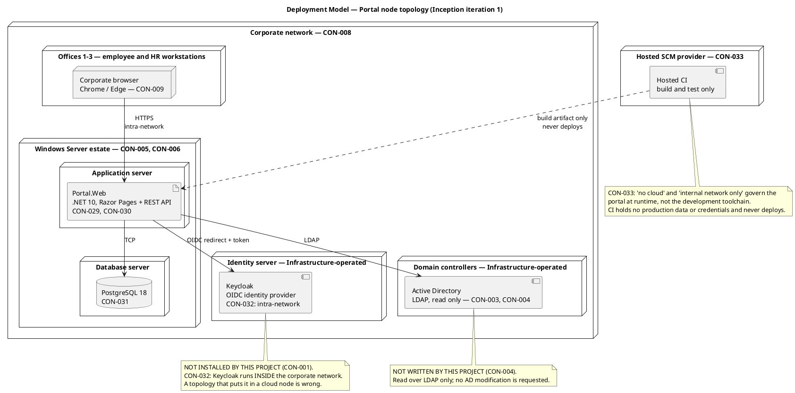
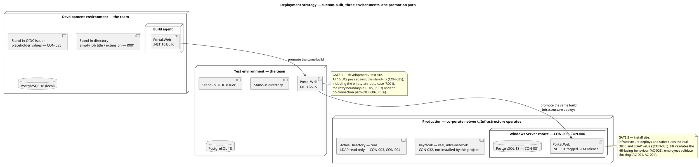
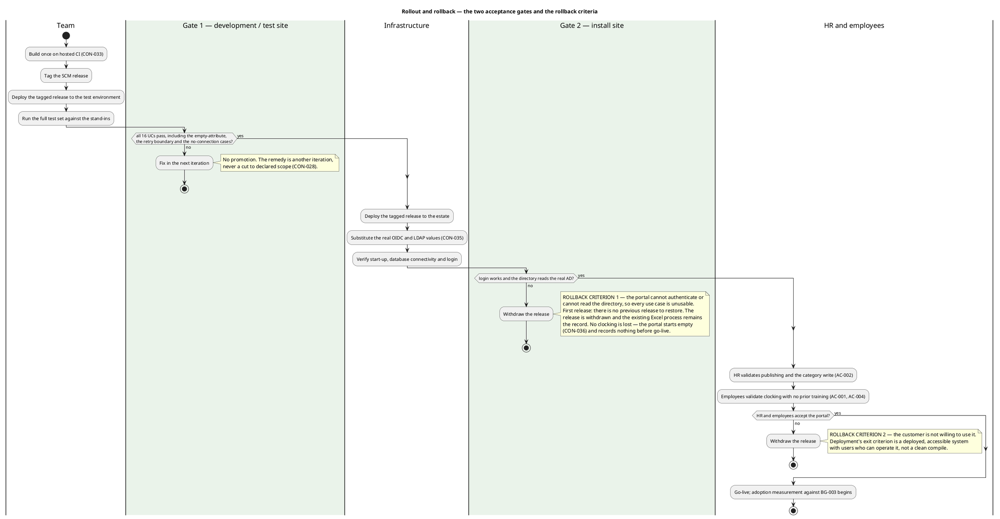
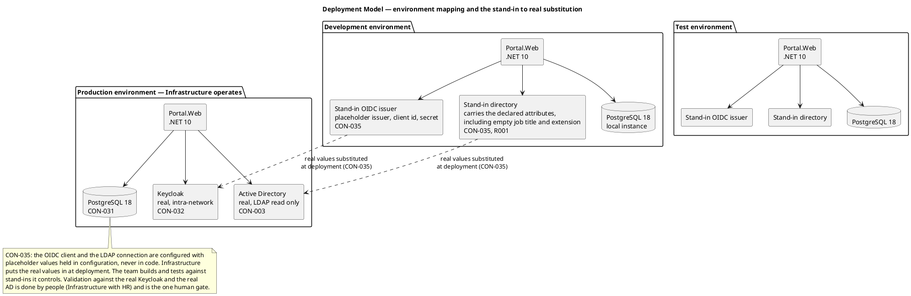

## Document Control

- Phase: Inception
- Status: Draft — iteration 1, submitted for review
- Milestone Target: End of Inception (Lifecycle Objectives) — NOT YET ACHIEVED

## Deployment Topology
The Development Case records the Deployment Model's §5.2 trigger as FIRED: the deployment view is genuinely multi-node and multi-environment. This document is the deployment view in full; the Software Architecture Document carries the same topology in its Deployment View section and this document is its authoritative form.

### What this project installs, and what it does not

| Node | Operated by | Installed by this project | Declared by |
|---|---|---|---|
| Corporate browser (Chrome / Edge) | The employee's workstation | Nothing. The clocking page script is served with the page. No installable app, no service worker, no client cache (CON-039). | CON-009, CON-039 |
| Application server | Infrastructure | The .NET 10 application — Razor Pages and the REST endpoints. | CON-005, CON-006, CON-029, CON-030 |
| Database server | Infrastructure | Nothing. Infrastructure installs PostgreSQL 18 on the estate it already operates. | CON-031 |
| Identity server | Infrastructure | **Nothing.** Keycloak is not ours to deploy (CON-001). It runs inside the corporate network (CON-032); the portal is an OIDC client of it. | CON-001, CON-032 |
| Domain controllers | Infrastructure | **Nothing.** The portal reads AD over LDAP and never writes to it (CON-003, CON-004). | CON-003, CON-004 |
| Hosted SCM provider | The workspace's configured provider | The repository, and the CI that builds and tests. CI never holds production data or credentials and never deploys (CON-033). | CON-033 |

**Two negative facts this topology records.** Keycloak is not installed by this project, and no write reaches Active Directory. Both are declared constraints (CON-001, CON-004) and both are the basis of Infrastructure's acceptance (CON-006). A topology that omits them invites a later reader to add them.

**No cloud node carries the portal.** CON-008 restricts the portal to the internal corporate network. The hosted CI node is drawn outside the corporate network boundary because it is the development toolchain, not the runtime (CON-033).

**No Keycloak node is drawn as something we install.** CON-032 places Keycloak inside the corporate network and states that a deployment view putting it in a cloud node contradicts the constraint. It is drawn as an Infrastructure-operated intra-network node, and the portal's only relationship to it is the OIDC redirect.

### Deployment mode and strategy

**Mode: custom-built.** Selected at Inception; it drives every packaging decision in this document.

| Mode | Verdict | Reason |
|---|---|---|
| Custom-built | **Selected** | One internal application for one organization, deployed by Infrastructure on the estate it already operates (CON-005, CON-006). The user community is fixed and known (STK-004 — 200 employees across 3 offices) and the target machines are the corporate browsers already in place (CON-009). |
| Shrink-wrapped | Rejected | There is no third-party distribution and no unknown target machine. An installer for a machine the team does not control would duplicate what Infrastructure already does. |
| Downloadable | Rejected | CON-008 restricts the portal to the internal corporate network. There is no public distribution channel, and no user installs anything — CON-039 forbids an installable app. |

**Strategy: build once, promote the same build, deploy at the install site by Infrastructure.** The team builds and tests against stand-ins it controls (CON-035); Infrastructure substitutes the real OIDC and LDAP values at deployment. CI never deploys (CON-033).

**What the strategy does not include, by declaration.** No data migration (CON-036) — the portal starts empty and the historical Excel sheets stay on the shared drive as a read-only archive. No backup or restore procedure (CON-038) — Infrastructure's existing practice covers the PostgreSQL instance in restorable form. No Keycloak work of any kind (CON-001) — no realm design, no client provisioning, no Keycloak node installed by this project. No write to Active Directory (CON-004).

### Rollout approach and rollback criteria

Two acceptance gates, in order. The first is at the development/test site and is the team's; the second is at the install site and is Infrastructure's and the users'. A release that fails a gate is not promoted.

| Gate | Site | Who runs it | What it certifies | Evidence |
|---|---|---|---|---|
| Gate 1 — development / test site | Test environment, against the stand-ins | The team | All 16 use cases pass, including the empty-attribute directory case (R001), the retry boundary and the beyond-5-minute path (AC-005, R003), and the no-connection message (NFR-006, R006) | The test set run against the stand-in issuer and the stand-in directory (CON-035) |
| Gate 2 — install site | Production, on the estate | Infrastructure deploys; HR and employees validate | Login works against the real Keycloak, the directory reads the real AD, HR publishes without technical assistance (AC-002), and an employee clocks in and out without help (AC-001) | Infrastructure's deployment verification; HR's and the employees' acceptance |

**Gate 2 must be a formality.** Every declared acceptance criterion is a runtime criterion and is exercised at Gate 1 against the stand-ins. Gate 2 confirms the substitution of the real values, not the behaviour of the use cases. If Gate 2 finds a use case failing, the cause is a stand-in-versus-real difference — R001 (LDAP attribute completeness), R005 (claim shape) or R008 (estate performance) — and the remedy is another iteration, never a cut to declared scope (CON-028).

**Rollback criteria.** The portal is a first release: there is no previous release to restore, and the portal starts empty (CON-036). Rollback therefore means withdrawing the release, not reverting to an earlier version.

| # | Criterion | Consequence | Why this is the criterion |
|---|---|---|---|
| 1 | The portal cannot authenticate, or cannot read the directory | Withdraw the release. The existing Excel process remains the record for new clockings. | Every use case depends on the identity level and the directory read. A portal that cannot authenticate is unusable by all 200 employees. |
| 2 | HR or the employees are not willing to use it | Withdraw the release. | Deployment's exit criterion is a deployed, accessible system with users who can operate it — not a clean compile. |
| 3 | A clocking press is lost on the real network beyond the declared retry window | **Not a rollback criterion.** The declared remedy is that the employee reports the clocking to HR, who corrects or inserts it (UC-005, AC-005), and the correction is audited (NFR-004). | AC-005 declares the beyond-5-minute path as a report-to-HR case, not a failure of the release. |

**No clocking is lost by a rollback.** The portal records nothing before go-live (CON-036), so withdrawing the release returns the organization to the process it uses today. BG-002's elimination of Excel applies to new clockings recorded in the portal, and a withdrawn release records none.

**Pilot before full rollout.** Gate 2 is run with a pilot group at the install site before the portal is opened to all 200 employees. This is a deployment sequencing decision inside the declared scope — it adds no use case, no screen and no requirement. It is how the declared acceptance criteria are measured: AC-004 (80% complete at least one clocking with no prior training) and BG-003 (80% adoption within three months) are measurements taken on real users, and a pilot surfaces an adoption problem while it is still cheap to answer. R002 (clocking adoption) is the risk this addresses.

**No training material is planned.** AC-001 and AC-004 require the clocking act to work with no help and no prior training, and FR-001 reduces it to one button whose label follows the employee's status. A training programme would contradict the declared criterion rather than serve it. The support material is the Release Notes (Transition) and the User Documentation (Transition, TechnicalWriter).

## Nodes and Connectors

### Nodes

| Node | Type | Environment | Declared by |
|---|---|---|---|
| Corporate browser | Execution environment — Chrome / Edge | Production | CON-009 |
| Application server | Execution environment — .NET 10 runtime | Development, test, production | CON-005, CON-006, CON-029 |
| Database server | Execution environment — PostgreSQL 18 | Development, test, production | CON-031 |
| Identity server | Execution environment — Keycloak | Production (Infrastructure-operated) | CON-001, CON-032 |
| Domain controllers | Execution environment — Active Directory | Production (Infrastructure-operated) | CON-003 |
| Hosted SCM provider | Execution environment — hosted CI | Development toolchain | CON-033 |

### Connectors

| Connector | From | To | Protocol | Properties | Declared by |
|---|---|---|---|---|---|
| Page and API traffic | Corporate browser | Application server | HTTPS | Intra-network only; no interface crosses the corporate boundary | CON-008, CON-009 |
| Data access | Application server | Database server | TCP | Transactional; the audit write shares the caller's transaction | CON-031, NFR-004 |
| Authentication | Application server | Identity server | OIDC redirect + token | Intra-network; login works with no internet link | CON-001, CON-032 |
| Directory read | Application server | Domain controllers | LDAP | Read only; no write reaches AD | CON-003, CON-004 |
| Build and test | Hosted CI | Application server | Artifact only | CI never deploys; Infrastructure deploys | CON-033 |

### Deployment artifacts

| Artifact | Node | Contents | Declared by |
|---|---|---|---|
| `Portal.Web` | Application server | The .NET 10 application: Razor Pages, the REST endpoints, the domain components, the identity and audit mechanisms, the data access layer. One deployable (ADR-001). | CON-029, CON-030 |
| Configuration | Application server | Placeholder OIDC and LDAP values — issuer, client id, client secret, LDAP host, bind account, base DN. Held in configuration, never in code. Infrastructure substitutes the real values at deployment. | CON-035 |
| Database schema | Database server | The four tables plus the audit table. No employee table exists. | CON-003, CON-022, CON-031 |

**No migration artifact.** CON-036 declares there is no data migration: the portal starts empty and records clockings from go-live onwards. The historical Excel sheets stay on the shared drive as a read-only archive and are not imported. No import path and no migration script is deployed.

**No backup artifact.** CON-038 declares Infrastructure's existing server-backup practice already covers this PostgreSQL instance in restorable form, confirmed in writing with a verified restore test. No backup tooling and no restore procedure is part of this project.

## Environment Mapping

Three environments are declared. Development and test run against stand-ins the team controls; production runs against the real Keycloak and the real Active Directory, whose values Infrastructure substitutes at deployment.

| Environment | Identity provider | Directory | Database | Who operates it |
|---|---|---|---|---|
| Development | Stand-in OIDC issuer with placeholder values | Stand-in directory carrying the declared attributes, including entries with empty job title and extension | Local PostgreSQL 18 | The team |
| Test | Stand-in OIDC issuer | Stand-in directory | PostgreSQL 18 | The team |
| Production | The real Keycloak, intra-network (CON-032) | The real Active Directory, read over LDAP (CON-003) | PostgreSQL 18 on the estate (CON-031) | Infrastructure |

### The stand-in to real substitution

| Configuration value | Development and test | Production | Substituted by |
|---|---|---|---|
| OIDC issuer | Placeholder | The real Keycloak issuer | Infrastructure at deployment (CON-035) |
| OIDC client id | Placeholder | The registered client id (CON-002) | Infrastructure at deployment |
| OIDC client secret | Placeholder | The real secret | Infrastructure at deployment |
| LDAP host | Placeholder | The real domain controller | Infrastructure at deployment |
| LDAP bind account | Placeholder | The real bind account | Infrastructure at deployment |
| LDAP base DN | Placeholder | The real base DN | Infrastructure at deployment |

**No credential is committed.** Every value above is a configuration entry with a placeholder in the repository (CON-035). This is what makes the stand-in strategy possible and is the project's answer to R001 and R005: the empty-attribute case and the claim shape are exercised in test, not discovered in production.

### The one human gate

Validation against the real Keycloak and the real Active Directory is performed by people — Infrastructure with HR — and its feedback must reach the team before Elaboration closes (CON-035). It is not team work to plan and it is not a deployment step this project performs. The Development Case bounds it in the Risk List with a ceiling of 14 days, after which the process suspends and nothing is auto-filled. CON-028 grants the remedy in advance: if that validation delays a milestone, the remedy is another iteration, never a cut to declared scope.

### Environment-specific behaviour

| Behaviour | Development and test | Production |
|---|---|---|
| Authentication | Against the stand-in issuer | Against the real Keycloak (CON-001) |
| Directory read | Against the stand-in directory | Against the real AD (CON-003) |
| No-connection message (NFR-006) | Exercised by making the stand-in source unreachable | Shown when the corporate network is unavailable |
| Clocking retry (FR-016) | Exercised by blocking the POST on demand | The real corporate network |
| Availability and performance (NFR-001, NFR-002, NFR-003) | Not measurable on the target estate | Measured on the estate Infrastructure operates |

**R008 is recorded here as a deployment fact.** The declared performance and availability budgets are stated against the corporate network and the existing Windows Server estate. The team cannot measure them on the target estate; Infrastructure operates it. The budgets are therefore treated as design constraints, not as measurements, and the Software Architecture Document records the tactics that serve them.
