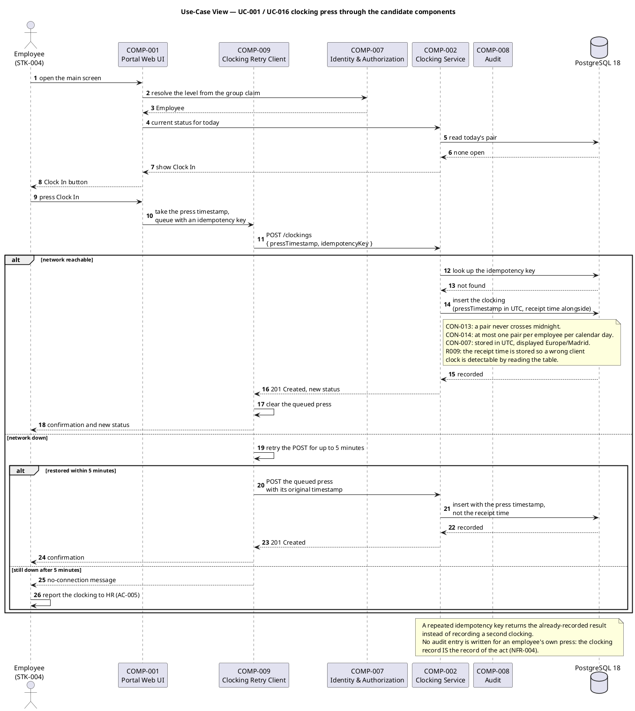
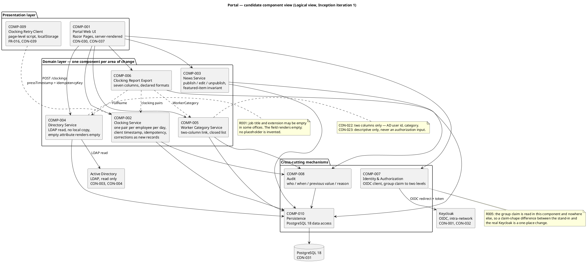
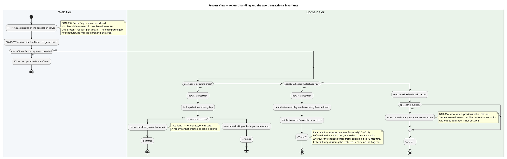
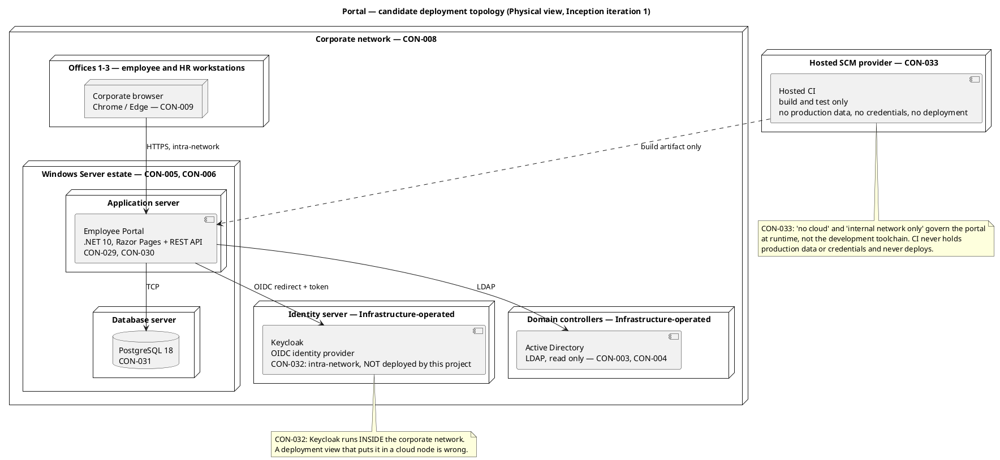
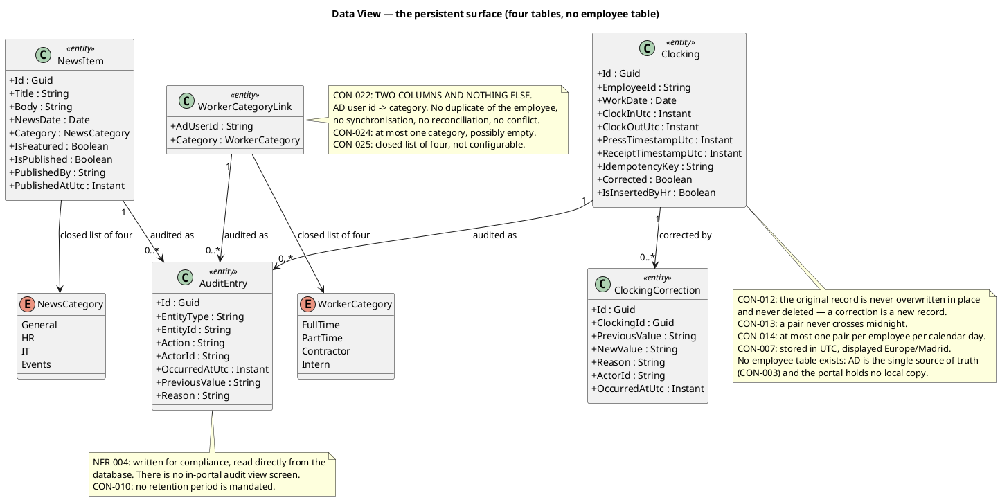

## Document Control

- Phase: Inception
- Status: Draft — iteration 1, submitted for review
- Milestone Target: End of Inception (Lifecycle Objectives) — NOT YET ACHIEVED

## Architectural Representation

This is a **candidate architecture** for Inception iteration 1: a sketch sufficient to surface the architectural risks and to let the Project Manager plan Elaboration. It is not a baseline. The Logical and Deployment views are sketched; the Process, Implementation and Data views are carried at the level the declared scope forces and are baselined in Elaboration.

The architecture is described by five views. Each view is a slice cut through the same model, showing only the elements with system-wide impact.

| View | Diagram in this document | What it fixes |
|---|---|---|
| Logical | Component view | The decomposition into components and the interfaces between them |
| Process | Process view | Request handling, and the two invariants that must hold under concurrency |
| Deployment | Deployment topology | Which node each executable runs on, and which nodes this project does not install |
| Implementation | Implementation view | The source layout the Implementer builds into |
| Data | Data view | The persistent surface — four tables and no employee table |
| Use-Case | Clocking sequence | The top architecturally significant scenario realized through the components |

### Architectural decisions

Eight decisions carry the architecture. Each records the alternatives that were considered and rejected, because a decision without its alternatives cannot be revisited safely.

#### ADR-001 — Architectural style: layered, server-rendered, one deployable

| Field | Value |
|---|---|
| Context | CON-029 fixes .NET 10 with a REST API; CON-030 fixes Razor Pages and states that "no SPA" means no client-side framework and no client-side router. CON-005 and CON-006 fix a single .NET application on the existing Windows Server estate. The declared population is 200 employees (STK-004) and the declared load is one clocking pair per employee per day (CON-014). |
| Decision | A layered architecture — presentation, domain, cross-cutting mechanisms, persistence — deployed as **one .NET 10 application** that serves server-rendered Razor Pages and exposes the REST endpoints the pages call. |
| Alternatives considered | (a) SPA front end with a separate API service — rejected: CON-030 excludes a client-side framework and a client-side router, and the declared load does not justify the second deployable. (b) Microservices split by functional area — rejected: it multiplies deployables on an estate Infrastructure operates (CON-006) and buys nothing at 200 users. (c) Event-driven with a message broker — rejected: no asynchronous, cross-service or scheduled behaviour is declared; the CSV export is initiated by HR, not by a clock. |
| Trade-offs | A single deployable couples the release of the three functional areas. Accepted: the three areas are delivered together and Infrastructure operates one application, which is what CON-006 records as the basis of their acceptance. |
| Consequences | One build, one deployment unit, one connection pool. The REST API exists because FR-016 requires the clocking page to POST from a page-level script (CON-030) — it is not a public API and no other consumer is declared. |
| Status | Accepted |

#### ADR-002 — Decomposition by area of change, not by feature or by layer

| Field | Value |
|---|---|
| Context | The Use-Case Model annotates four use cases `Volatility: Medium` — UC-004 (the export column set), UC-013 and UC-014 (R001, LDAP attribute completeness), UC-016 (the retry window is a declared parameter). The remaining twelve are `Low`, fixed by a declared business rule. |
| Decision | The domain layer is decomposed into **five components, each encapsulating one decision likely to change**: Clocking Service, News Service, Directory Service, Worker Category Service, Clocking Report Export. Presentation, identity/authorization, audit and persistence are separate components because each is a mechanism shared by many use cases. |
| Alternatives considered | (a) One component per functional area (Clocking / News / Directory) — rejected: it merges the export's volatile column set into the clocking record, so a format change touches the record. (b) One component per use case — rejected: sixteen components for sixteen use cases is a feature list, not a decomposition; UC-007, UC-008 and UC-009 all read the same news data. (c) Decomposition by layer only (Presentation / Application / Infrastructure) — rejected: layers alone are not a decomposition; they name no area of change and every requirement change would ripple across all of them. |
| Trade-offs | The export component depends on three others (clocking pairs, FullName, WorkerCategory). Accepted: the dependency is read-only and one-directional, and it is what keeps the declared CSV format (CON-017) out of the clocking record. |
| Consequences | A change to the CSV column set is a change in COMP-006 alone. A change to the retry window is a change in COMP-009 alone. A change in how a category is stored is a change in COMP-005 alone. |
| Status | Accepted |

#### ADR-003 — Persistence: PostgreSQL 18, four tables, and no employee table

| Field | Value |
|---|---|
| Context | CON-031 pins PostgreSQL 18 (major pinned, patch floating) and Infrastructure installs it on the estate. CON-003 makes Active Directory the single source of truth for employee data and forbids a local copy. CON-022 fixes the category link at two columns and nothing else. CON-036 declares there is no data migration. |
| Decision | A relational schema of **four tables** — clocking, clocking correction, news item, worker category link — plus an audit table. **No employee table exists.** Employee fields are read from AD over LDAP at request time. |
| Alternatives considered | (a) A local employee table synchronised from AD — rejected: CON-003 forbids a local copy and CON-022 forbids a duplicate of the employee; a sync job would also create the reconciliation and conflict-resolution work the scope statement excludes. (b) A document store — rejected: the declared data is small, relational and rule-bound (CON-013 to CON-017), and CON-031 pins a relational engine. (c) Storing the category on a local employee row — rejected: CON-022 requires a link keyed by AD user id, two columns only. |
| Trade-offs | Every directory read and every export resolves names from AD, so the directory and the export depend on AD being reachable. Accepted and declared: NFR-006 requires the no-connection message for exactly this reason, and CON-003 accepts the dependency as the price of a single home for employee data. |
| Consequences | No sync job, no reconciliation screen, no conflict resolution, no import path. An orphaned category link degrades to the declared empty case (CON-024) rather than to an error. |
| Status | Accepted |

#### ADR-004 — Identity and authorization: OIDC client of the existing Keycloak, one component reads the claim

| Field | Value |
|---|---|
| Context | CON-001 makes the portal an OIDC client of the existing Keycloak, which federates AD; CON-002 records that the client is already registered, so login is testable from day one. CON-032 places Keycloak inside the corporate network. NFR-005 declares exactly two levels derived from AD group membership, with no role matrix and no permission screen. CON-035 requires the team to work against a stand-in issuer. R005 records that a claim-shape difference between the stand-in and the real Keycloak would surface only at the human validation. |
| Decision | Authentication is an OIDC client of the existing Keycloak. **COMP-007 Identity & Authorization is the only component that reads the group claim**, and it returns one of exactly two levels. Every other component receives a resolved level, never a raw claim. |
| Alternatives considered | (a) Reading the group claim in each page or service — rejected: it spreads the one thing R005 says may differ across sixteen use cases. (b) A local role table or permission model — rejected: NFR-005 declares no role matrix and no permission screen. (c) Deriving the level from the worker category — rejected: CON-023 states the category is descriptive and does NOT drive access control. |
| Trade-offs | One component becomes a single point of authorization logic. Accepted: that is the point — a claim-shape difference is a one-place configuration change, which is the mitigation R005 records. |
| Consequences | The stand-in issuer is configured to emit the declared claim shape. If the human validation reports a different shape, the mapping is corrected in COMP-007 and the affected use cases are re-tested. |
| Status | Accepted |

#### ADR-005 — Clocking timestamp authority: the client's press time, with an idempotency key

| Field | Value |
|---|---|
| Context | FR-016 requires the server to accept the timestamp the client sends — the time the employee pressed the button, not the time the server received it — and to reject duplicates by an idempotency key. AC-005 requires a press made during a network drop of up to 5 minutes not to be lost. CON-013 and CON-014 make two presses by the same employee non-conflicting. R009 records that a wrong client clock records a wrong clocking. |
| Decision | The clocking record stores the **client-supplied press timestamp as the clocking time**, the **receipt timestamp alongside it**, and the **idempotency key**. A repeated key returns the already-recorded result instead of inserting a second record. |
| Alternatives considered | (a) Server receipt time as the clocking time — rejected: it contradicts FR-016 and would record the moment the network returned, not the moment the employee pressed. (b) A client-side conflict-resolution or merge step — rejected: CON-013 and CON-014 make two presses non-conflicting, so there is nothing to reconcile; the scope statement excludes conflict resolution explicitly. (c) Rejecting a press whose timestamp is implausible — rejected: no threshold is declared, and inventing one would reject a legitimate press after a long network drop. |
| Trade-offs | A wrong client clock is recorded as a wrong clocking. Accepted and bounded: storing the receipt time makes the discrepancy detectable by reading the table (R009), and CON-013/CON-014 bound the exposure to one pair for one employee on one day. |
| Consequences | The clocking POST is a single insert with no external call on the critical path, which is what NFR-002 (under 1 second) is designed against. |
| Status | Accepted |

#### ADR-006 — Audit written in the same transaction as the act it records

| Field | Value |
|---|---|
| Context | NFR-004 requires an audit entry for news publication, edit and unpublish; for any change to a worker's category; and for every clocking HR corrects or inserts, carrying who, when, previous value and reason. The audit is read directly from the database and there is no in-portal view. R004 records that a missing entry is invisible to every user. |
| Decision | The audit entry is written **inside the same database transaction as the operation it records**. An audited operation that commits without its audit row is not possible. |
| Alternatives considered | (a) A separate audit write after the operation commits — rejected: a failure between the two leaves an unaudited change, which is exactly the R004 failure mode and is invisible. (b) An in-portal audit view — rejected: NFR-004 states there is no audit view screen. (c) An external log sink — rejected: no such system is declared, and CON-010 states the audit is read from the database. |
| Trade-offs | The audit write is on the critical path of every audited operation. Accepted: the audited operations are HR-initiated and low-frequency, and none of them carries the NFR-002 one-second budget, which applies to the employee's clocking press. |
| Consequences | The audit table is never edited in place. An employee's own clocking press writes no audit entry — the clocking record is the record of that act (NFR-004). |
| Status | Accepted |

#### ADR-007 — The featured-item invariant is enforced in the transaction, not in the screen

| Field | Value |
|---|---|
| Context | CON-019 declares that at most one news item is featured at any moment and states explicitly that this is a system invariant, not a screen convention — it must hold wherever the change comes from. CON-020 adds that unpublishing the featured item un-features it and promotes no other item. |
| Decision | Clearing the previous featured flag and setting the new one happen **in one transaction**, in the News Service. Unpublishing a featured item clears the flag in the same transaction. |
| Alternatives considered | (a) Enforcing the invariant in the publish and edit screens — rejected: CON-019 says it must hold wherever the change comes from, and a screen-level rule is bypassed by any other path. (b) A database partial unique index on the featured flag — considered and rejected as the primary mechanism: it enforces the invariant but turns a legitimate un-feature-then-feature sequence into a constraint violation the caller must handle. The transaction is the mechanism; the index is a defence the Designer may add. |
| Trade-offs | The News Service serialises featured-flag changes. Accepted: featuring is an HR action taken a few times a month, and the declared load carries it without contention. |
| Consequences | UC-010 and UC-012 both reach the same invariant through the same component. No rule promotes an item by itself (CON-018). |
| Status | Accepted |

#### ADR-008 — Employee data is read from AD at request time; nothing is cached

| Field | Value |
|---|---|
| Context | CON-003 makes AD the single source of truth and forbids a local copy. NFR-006 requires the directory and the news to show a no-connection message when the network is unavailable. CON-039 forbids a client cache of the directory or the news. R001 records that job title and extension may be empty in some offices. |
| Decision | The Directory Service queries AD over LDAP **on each request**. No server-side cache, no client-side cache, no local copy. An attribute that is empty in AD renders empty; no placeholder is substituted. |
| Alternatives considered | (a) A short-lived server-side cache of directory results — rejected: it is a local copy of employee data by another name, and it would serve stale data after an AD change with no invalidation path declared. (b) A client-side cache — rejected: CON-039 forbids it. (c) A nightly extract — rejected: CON-003 forbids a local copy and CON-036 declares no migration or extract. |
| Trade-offs | Every directory search and every export pays an LDAP round trip, and the directory is unavailable when AD is. Accepted and declared: NFR-006 exists precisely to make that failure visible rather than silent, and CON-003 accepts the dependency. |
| Consequences | The no-connection path is a first-class behaviour, not an error page. R006 records that it is the least-exercised path, and the mitigation is to assert it in the iteration that implements the directory and the news. |
| Status | Accepted |

### Analysis mechanisms

The mechanisms the architecture must provide, named by the capability they provide and the properties they must hold. Where the stakeholder declared a technology, the declared technology is recorded at the declared version; where none was declared, no product is named.

| Mechanism | Capability it must provide | Properties it must hold | Realized by | Declared technology |
|---|---|---|---|---|
| Persistence | Durable storage of clockings, corrections, news items, the category link and audit entries | Transactional; relational; supports the declared date and time semantics (CON-007, CON-013); installed and backed up by Infrastructure (CON-031, CON-038) | COMP-010 | PostgreSQL 18 — major pinned, patch floating (CON-031) |
| Authentication | Establish the user's identity and return the identity and group claims | OIDC; intra-network; federates AD; not deployed by this project (CON-001, CON-032) | COMP-007 | The existing Keycloak (CON-001) |
| Authorization | Resolve exactly two levels from AD group membership | Two levels only; no role matrix; no per-category rule; the claim is read in one place (NFR-005, CON-023) | COMP-007 | — (no product declared; the mechanism is a claim mapping) |
| Directory read | Resolve name, job title, department, office, email and extension | Read-only; no local copy; empty attribute renders empty; no write to AD (CON-003, CON-004, R001) | COMP-004 | LDAP against the existing Active Directory (CON-003) |
| Audit | Record who, when, previous value and reason for the declared events | Written in the same transaction as the act; never edited in place; read directly from the database; no in-portal view (NFR-004, CON-010) | COMP-008 | — (no product declared; the mechanism is a table and a transactional write) |
| Idempotent write | Accept a repeated clocking press without recording a second clocking | Keyed by a client-supplied idempotency key; returns the already-recorded result (FR-016) | COMP-002 | — (no product declared) |
| Client-side retry | Hold a press and retry it for up to 5 minutes | Bounded to 5 minutes; clocking only; no PWA, no service worker, no other client cache (FR-016, CON-039) | COMP-009 | — (no product declared; a page-level script per CON-030) |
| CSV generation | Produce the declared seven-column export | Declared column order and formats; empty rather than zero; one row per employee per day with a clocking (FR-004, CON-015 to CON-017) | COMP-006 | — (no product declared) |
| Configuration | Hold the OIDC and LDAP endpoints outside the code | Placeholder values in configuration, never in code; real values substituted by Infrastructure at deployment (CON-035) | COMP-007, COMP-004 | — (no product declared) |

### Version policy

Two technologies were declared by the stakeholder and are anchored here. Both are platform pins, not package references: the enterprise version policy records them as `framework` pins, and the package registry correctly reports no such package id — the policy is the source of truth and it governs over any registry "latest".

| Technology | Pinned version | Declared by | Governs |
|---|---|---|---|
| .NET | 10 | CON-029 (backend, REST API), CON-030 (Razor Pages on the same runtime) | The application runtime and the Razor Pages front end |
| PostgreSQL | 18 — major pinned, patch floating | CON-031 | The database engine Infrastructure installs |

No other version is consequential for this project, and none was invented. No third-party library version is pinned at Inception: no library is declared, and the Designer pins one only where a declared requirement forces it.

## Architectural Goals and Constraints

### Goals the architecture serves

| Goal | Architectural consequence |
|---|---|
| BG-001 Reduce HR management time by 50% | The HR operations are single-screen actions: one button for the employee, one control for the category, one export for the month. No HR operation requires a second system. |
| BG-002 Eliminate 100% of Excel usage for recording new clockings | The portal is the only place a new clocking is recorded. There is no export-to-Excel path and no parallel spreadsheet workflow in the design. |
| BG-003 80% employee adoption within 3 months | The clocking act is one button whose label follows the employee's status (FR-001), on the main screen, with no training — which is what AC-001 and AC-004 measure. |

### Constraints that bound the architecture

| Constraint | Architectural consequence |
|---|---|
| CON-001, CON-002, CON-032 | Authentication is an OIDC client of the existing Keycloak, which runs inside the corporate network and is not deployed by this project. No realm design, no client provisioning, no Keycloak node in the deployment topology as something we install. |
| CON-003, CON-004 | AD is the single source of truth for employee data; the portal reads it over LDAP and never writes to it. No employee table, no sync job, no reconciliation screen. |
| CON-005, CON-006 | One .NET application on the existing Windows Server estate. Infrastructure's acceptance rests on exactly this. |
| CON-007 | Clockings stored in UTC, displayed in Europe/Madrid. No multi-timezone case and no normalisation to design. |
| CON-008, CON-009 | Reachable only from the internal corporate network, from current Chrome and Edge. |
| CON-010 | No external compliance regime and no retention period. The audit is read ad hoc from the database. |
| CON-011 to CON-017 | The clocking and export business rules: sAMAccountName as EmployeeId, no pair crossing midnight, one pair per employee per day, one row per employee per day with a clocking, empty rather than zero, and the declared formats. |
| CON-018 to CON-021 | The news rules: featuring is manual, at most one item featured, unpublishing un-features, and no hard delete. |
| CON-022 to CON-025 | The category link is two columns keyed by AD user id; the category is descriptive and never an authorization input; at most one category, possibly empty; a closed list of four values. |
| CON-029, CON-030, CON-031 | .NET 10, Razor Pages with no client-side framework or router, PostgreSQL 18. |
| CON-033 | Build and test run on the hosted CI of the configured SCM provider; CI holds no production data or credentials and never deploys. |
| CON-035 | The OIDC client and the LDAP connection are configured with placeholder values, never in code. The team works against stand-ins. |
| CON-036, CON-038 | No data migration and no backup design. The portal starts empty; Infrastructure's existing practice covers the database. |
| CON-037 | `docs/inputs/employee-portal-design.html` is mandatory and authoritative for the UI visual layer. |
| CON-039 | No offline mode beyond the clocking retry: no PWA, no service worker, no installable app, no client cache of the directory or the news. |

### Non-functional requirements the architecture must satisfy

| NFR | Architectural tactic |
|---|---|
| NFR-001 Page load under 3 seconds | Server-rendered Razor Pages with no client-side framework (CON-030), so the page weight is markup and CSS. No client-side data fetch on the critical path. |
| NFR-002 Clocking response under 1 second | The clocking POST is a single insert with no external call on the critical path. The identity level is resolved from the token already in hand, not by a fresh round trip. |
| NFR-003 Availability Mon–Fri 07:00–19:00 | One application on the estate Infrastructure operates (CON-006). No 24/7 obligation, so no clustering or failover design is introduced. |
| NFR-004 Audit trail | COMP-008 writes the audit entry in the same transaction as the act (ADR-006). |
| NFR-005 Two-level authorization | COMP-007 is the only reader of the group claim (ADR-004). |
| NFR-006 No-connection message | The directory and the news read their source at request time and render the message when it is unreachable (ADR-008). Nothing is cached, so there is no stale path. |

## Use-Case View

The Use-Case view validates the other four: it shows the architecturally significant scenarios realized through the components. The clocking scenario is realized below because it is the one that exercises the most components and carries the most declared rules.

### Architecturally significant use cases, prioritized for Elaboration planning

Priority is architectural significance — risk, coverage and criticality — not business priority. All sixteen use cases are `Must` (the Use-Case Model records that a reduction in scope is a Change Request, not a priority decision).

| Rank | UC | Why it is architecturally significant | Risks it exercises | Components it forces |
|---|---|---|---|---|
| 1 | UC-001 Clock In and Clock Out | The only write the employee makes; carries the client-supplied timestamp, the idempotency key and the one-pair-per-day rule. Forces the clocking record, the identity level and the persistence mechanism. | R003, R009 | COMP-001, COMP-002, COMP-007, COMP-009, COMP-010 |
| 2 | UC-016 Clock In/Out Survives a Network Drop | The only client-side behaviour in the system and the only recoverability mechanism the portal provides. Forces the retry component and the idempotent write. | R003 | COMP-009, COMP-002 |
| 3 | UC-004 Export Monthly Clocking Report as CSV | The most volatile use case and the artifact HR hands downstream. Forces the export component and the AD read at export time. | R007, R001 | COMP-006, COMP-002, COMP-004, COMP-005 |
| 4 | UC-014 View Directory Entry | Forces the LDAP read with no local copy and the empty-attribute case. | R001, R006 | COMP-004, COMP-005 |
| 5 | UC-015 Assign or Clear Worker Category | The only write the portal makes about a person, and the only audited write keyed by an AD identifier. | R005, R010 | COMP-005, COMP-008, COMP-007 |
| 6 | UC-010 Feature or Un-feature a News Item | Carries the one system invariant that must hold wherever the change comes from. | — | COMP-003 |
| 7 | UC-005 Correct or Insert a Clocking | Forces the correction-as-new-record rule and the audit write in the same transaction. | R004 | COMP-002, COMP-008 |
| 8 | UC-013 Search Employee Directory | Forces the LDAP query path and the no-connection path. | R001, R006 | COMP-004 |
| 9 | UC-006, UC-011, UC-012 | The audited news operations; each forces the audit write. | R004 | COMP-003, COMP-008 |
| 10 | UC-002, UC-003, UC-007, UC-008, UC-009 | Read paths over the same components; they add no new architectural element. | R006 | COMP-001, COMP-002, COMP-003 |

**Elaboration sequencing consequence.** Ranks 1–5 are the use cases whose components must be built and integrated first, because each forces a mechanism the others depend on: the clocking record and the idempotent write (1, 2), the export and the AD read (3, 4), and the audited category write (5). Ranks 6–10 reuse those mechanisms and can follow.

### UC-001 / UC-016 realized through the components

## Logical View

The Logical view is the decomposition: the components, the interfaces between them, and the area of change each encapsulates.

### Components and the area of change each encapsulates

| Component | Responsibility | Area of change it encapsulates | Use cases it realizes |
|---|---|---|---|
| COMP-001 Portal Web UI | Render the pages: main page (clocking button, featured banner, news list with filter), clocking history, directory, and the HR views. Implements the mandatory design reference (CON-037). | The visual layer — the design reference is authoritative and may be revised by the stakeholder | UC-001 to UC-015 (presentation) |
| COMP-002 Clocking Service | Record a clocking press with the client-supplied timestamp and the idempotency key; hold the one-pair-per-day rule; record HR corrections as new records. | The clocking record's rules — CON-013, CON-014, CON-012 | UC-001, UC-002, UC-003, UC-005, UC-016 |
| COMP-003 News Service | Publish, edit, unpublish and feature news items; hold the at-most-one-featured invariant. | The news lifecycle and the featured-item invariant — CON-018 to CON-021 | UC-006, UC-007, UC-008, UC-009, UC-010, UC-011, UC-012 |
| COMP-004 Directory Service | Read employee data from AD over LDAP; render an empty attribute as empty; show the no-connection message. | The AD read and the empty-attribute case — R001, CON-003, NFR-006 | UC-013, UC-014 |
| COMP-005 Worker Category Service | Hold the two-column link keyed by AD user id; offer the closed list of four values; assign or clear. | The category link's shape and the closed list — CON-022, CON-024, CON-025 | UC-014, UC-015 |
| COMP-006 Clocking Report Export | Produce the monthly CSV with the seven declared columns and formats. | The export format — the most volatile declared surface (R007, CON-017) | UC-004 |
| COMP-007 Identity & Authorization | Be the OIDC client of the existing Keycloak; resolve the group claim into exactly two levels. | The claim shape and the level mapping — R005, NFR-005 | All sixteen (cross-cutting) |
| COMP-008 Audit | Write the audit entry in the same transaction as the act it records. | The set of audited events and the fields each carries — NFR-004 | UC-005, UC-006, UC-011, UC-012, UC-015 |
| COMP-009 Clocking Retry Client | Hold a press in localStorage with an idempotency key and retry the POST for up to 5 minutes. | The retry window — a declared parameter (FR-016, CON-039) | UC-016 |
| COMP-010 Persistence | Provide transactional data access to PostgreSQL 18. | The database engine and its access layer — CON-031 | All (cross-cutting) |

### Interfaces

Every component boundary is defined by an interface. No component reaches into another's data.

| Interface | Provided by | Contract | Consumed by |
|---|---|---|---|
| INT-001 Clocking API | COMP-002 | `POST /clockings` accepts `{ pressTimestamp, idempotencyKey }`; records the press timestamp, not the receipt time; returns the already-recorded result for a repeated key. `GET` returns the caller's own status and month. | COMP-001, COMP-009 |
| INT-002 News API | COMP-003 | Publish, edit, unpublish and set the featured flag. Setting the flag clears the previous one in the same transaction. | COMP-001 |
| INT-003 Directory Query | COMP-004 | Search by name, department or office; return the six AD-sourced fields with empty values preserved as empty. | COMP-001, COMP-006 |
| INT-004 Category Link | COMP-005 | Read the category for an AD user id; assign or clear it. The list is closed to four values. | COMP-001, COMP-006 |
| INT-005 Export Generator | COMP-006 | Given a calendar month, produce the seven-column CSV in the declared order and formats. | COMP-001 |
| INT-006 Authorization Level | COMP-007 | Given the authenticated principal, return exactly one of two levels. The raw claim never leaves this interface. | COMP-001, COMP-002, COMP-003, COMP-005, COMP-006 |
| INT-007 Audit Write | COMP-008 | Record an audited event with who, when, previous value and reason, inside the caller's transaction. | COMP-002, COMP-003, COMP-005 |
| INT-008 Data Access | COMP-010 | Transactional unit of work over the declared tables. | COMP-002, COMP-003, COMP-004, COMP-005, COMP-006, COMP-008 |

## Process View

The system is a single .NET application serving requests. No background job, scheduler, message broker or long-running task is declared, so the Process view is about request handling and the two invariants that must hold when two requests interleave.

### Concurrency and the two invariants

| Invariant | Declared by | Where it is enforced | Why not elsewhere |
|---|---|---|---|
| One press, one record — a repeated idempotency key cannot create a second clocking | FR-016 | COMP-002, inside the transaction, on the idempotency key | A check in the page would not survive a retry that arrives after the page has moved on |
| At most one news item featured | CON-019 | COMP-003, inside the transaction that changes the flag | CON-019 states it must hold wherever the change comes from; a screen-level rule is bypassed by any other path |

**No conflict resolution exists, by declaration.** CON-013 (a pair never crosses midnight) and CON-014 (at most one pair per employee per calendar day) mean two clocking presses by the same employee cannot conflict. There is nothing to reconcile, so no reconciliation component, no merge rule and no conflict screen is designed. The scope statement excludes them explicitly.

**No scheduled work.** No time-trigger actor is declared. The CSV export is initiated by HR, not by a clock. No batch job, no nightly extract and no recurring report exists in the design.

**Fault tolerance.** NFR-003 requires availability Mon–Fri 07:00–19:00 with fault tolerance within the corporate network, and states that 24/7 is not required. The architecture meets this with one application on the estate Infrastructure operates (CON-006) and no clustering design. The only recoverability mechanism the portal itself provides is the clocking retry (COMP-009); beyond its 5-minute window the declared remedy is that the employee reports the clocking to HR, who corrects or inserts it (UC-005).

## Deployment View

### Nodes and what this project installs

| Node | Operated by | What this project installs there | Declared by |
|---|---|---|---|
| Corporate browser (Chrome / Edge) | The employee's workstation | Nothing. The clocking page script is served with the page; no installable app, no service worker (CON-039). | CON-009, CON-039 |
| Application server | Infrastructure | The .NET 10 application — Razor Pages and the REST endpoints. | CON-005, CON-006, CON-029, CON-030 |
| Database server | Infrastructure | Nothing. Infrastructure installs PostgreSQL 18 on the estate it already operates. | CON-031 |
| Identity server | Infrastructure | **Nothing.** Keycloak is not ours to deploy (CON-001). It runs inside the corporate network (CON-032) and the portal is an OIDC client of it. | CON-001, CON-032 |
| Domain controllers | Infrastructure | **Nothing.** The portal reads AD over LDAP and never writes to it (CON-003, CON-004). | CON-003, CON-004 |
| Hosted SCM provider | The workspace's configured provider | The repository, and the CI that builds and tests. CI never holds production data or credentials and never deploys (CON-033). | CON-033 |

**Two negative facts the topology records.** Keycloak is not installed by this project, and no write reaches Active Directory. Both are declared constraints (CON-001, CON-004) and both are the basis of Infrastructure's acceptance (CON-006). A topology that omits them invites a later reader to add them.

**No cloud node carries the portal.** CON-008 restricts the portal to the internal corporate network. The hosted CI node is the development toolchain, not the runtime (CON-033), and it is drawn outside the corporate network boundary for exactly that reason.

## Implementation View

The source layout the Implementer builds into. It follows the component decomposition so that a component boundary in the Logical view is a directory boundary in the repository.

| Layer | Directory | Contents | Components |
|---|---|---|---|
| Presentation | `src/Portal.Web/Pages/` | Razor Pages: main page, clocking history, directory, HR views. Page-level scripts live beside their page. | COMP-001, COMP-009 |
| Presentation | `src/Portal.Web/Pages/Shared/` | Layout and components implementing the mandatory design reference (CON-037). | COMP-001 |
| API | `src/Portal.Web/Api/` | The REST endpoints the pages call — the clocking endpoint above all (FR-016). | COMP-002, COMP-003, COMP-005, COMP-006 |
| Domain | `src/Portal.Domain/Clocking/` | Clocking rules: one pair per day, no midnight crossing, corrections as new records. | COMP-002 |
| Domain | `src/Portal.Domain/News/` | News lifecycle and the featured-item invariant. | COMP-003 |
| Domain | `src/Portal.Domain/Directory/` | The LDAP read and the empty-attribute handling. | COMP-004 |
| Domain | `src/Portal.Domain/Categories/` | The two-column link and the closed list of four. | COMP-005 |
| Domain | `src/Portal.Domain/Reporting/` | The CSV export and its declared formats. | COMP-006 |
| Mechanisms | `src/Portal.Infrastructure/Identity/` | The OIDC client and the group-claim-to-level mapping. | COMP-007 |
| Mechanisms | `src/Portal.Infrastructure/Audit/` | The transactional audit write. | COMP-008 |
| Mechanisms | `src/Portal.Infrastructure/Persistence/` | Data access and migrations. | COMP-010 |
| Configuration | `src/Portal.Web/appsettings*.json` | Placeholder OIDC and LDAP values, never in code (CON-035). | COMP-004, COMP-007 |
| Tests | `tests/` | Unit and integration tests, run against the stand-in issuer and the stand-in directory (CON-035). | All |

**Build and test.** One solution, one build, one deployable (ADR-001). Build and test run on the hosted CI of the configured SCM provider (CON-033); CI holds no production data or credentials and never deploys — Infrastructure deploys. The CI pipeline definition is gap G-1 in the Development Case and closes in Elaboration iteration 1.

**Configuration, never code.** The OIDC issuer, client id, client secret, LDAP host, bind account and base DN are configuration values with placeholders committed (CON-035). Infrastructure substitutes the real values at deployment. This is what makes the stand-in strategy possible and is the project's answer to R001 and R005.

## Data View

The persistent surface is four tables plus the audit table. There is no employee table: AD is the single source of truth (CON-003) and the portal holds no local copy.

### What is deliberately absent

| Absent | Why |
|---|---|
| Employee table | CON-003 makes AD the single source of truth and forbids a local copy. |
| Category column on an employee row | CON-022 requires a link keyed by AD user id, two columns and nothing else. |
| Sync, reconciliation or conflict table | CON-003, CON-022 and the scope statement exclude them; there is nothing to reconcile. |
| Migration or import table | CON-036 declares there is no data migration. The portal starts empty. |
| Role, permission or role-matrix table | NFR-005 declares two levels from AD group membership, no role matrix and no permission screen. |
| Category lookup table | CON-025 fixes a closed list of four values, not configurable. The list is an enumeration, not data. |
| News archive table | The scope statement excludes a news archive screen; unpublishing hides an item and never deletes it (CON-021). |

**Data design ownership.** The table identifiers (`TBL-NNN`), the physical schema, the indexes and the migrations belong to the Database Designer in the Design Model. This view fixes the persistent surface the architecture requires; it does not pre-empt the physical design.

## Size and Performance

| NFR | Threshold | Architectural tactic | Where it is measured |
|---|---|---|---|
| NFR-001 | Any page under 3 seconds on the corporate network | Server-rendered Razor Pages with no client-side framework or router (CON-030), so the page weight is markup and CSS. No client-side data fetch on the critical path. The directory and news pages read their source once per request. | On the corporate network (CON-008). R008 records that the team cannot measure it on the target estate; the budgets are treated as design constraints. |
| NFR-002 | Clock in/out under 1 second | The clocking POST is a single insert with no external call on the critical path. The identity level comes from the token already in hand, not a fresh round trip. The idempotency lookup is a keyed read. | On the operation, not on the page load that precedes it. |
| NFR-003 | Available Mon–Fri 07:00–19:00 | One application on the estate Infrastructure operates (CON-006). No 24/7 obligation, so no clustering or failover design is introduced. | On the estate. |

**Declared load.** 200 employees (STK-004) across 3 offices, one clocking pair per employee per calendar day (CON-014). No throughput target and no resource-usage target is declared, and none is invented. The declared stack carries this load without a scaling design, and no horizontal-scaling, caching or queueing mechanism is introduced.

**No size estimate is stated.** Work is not sized in person-weeks, person-days or story points — those units are not producible here. Iteration spend is recorded from measurement after the phase closes (CON-034), and no phase is forecast before it closes.

## Quality

Each quality attribute the stakeholder declared is mapped to the architectural tactic that addresses it, and each risk in the Risk List is mapped to the component whose design must respond to it.

### Quality attributes and tactics

| Quality attribute | Declared requirement | Architectural tactic |
|---|---|---|
| Performance | NFR-001, NFR-002 | Server-rendered pages; a single-insert clocking path with no external call on the critical path. |
| Availability | NFR-003 | One application on the estate Infrastructure operates; no 24/7 obligation, so no clustering design. |
| Reliability / recoverability | AC-005, FR-016 | The clocking retry (COMP-009) with an idempotency key; beyond 5 minutes the declared remedy is HR correction (UC-005). |
| Security | CON-001, CON-002, NFR-005 | OIDC against the existing Keycloak; two levels resolved in one component; no credential in code (CON-035). |
| Auditability | NFR-004, CON-010 | The audit entry is written in the same transaction as the act (ADR-006). |
| Usability | AC-001 to AC-004, CON-037 | One button whose label follows the employee's status; the mandatory design reference implemented as the visual layer. |
| Maintainability | CON-035, CON-025 | External endpoints configured, never coded; the category list deliberately not configurable. |
| Testability | CON-035 | Every use case is testable against the stand-in issuer and the stand-in directory, including the empty-attribute case. |
| Data integrity | CON-012, CON-013, CON-014, CON-019 | Corrections as new records; the one-pair-per-day rule and the featured-item invariant enforced in transactions. |

### Risk to architectural response

| Risk | Magnitude | Component whose design responds | Architectural response |
|---|---|---|---|
| R001 LDAP attribute completeness | 9 | COMP-004 | The empty attribute renders empty; no placeholder is invented. The stand-in directory carries entries with empty job title and extension, so the case is a test, not a production discovery. |
| R003 Retry window not exercisable on the real network | 9 | COMP-009, COMP-002 | The retry is isolated in one component and the write is idempotent, so the behaviour is exercisable against a stand-in that fails on demand. |
| R005 Authorization claim shape | 9 | COMP-007 | The group claim is read in one component and nowhere else, so a claim-shape difference is a one-place configuration change. |
| R007 CSV export consumed downstream | 9 | COMP-006 | The export is isolated in its own component, so a format change does not touch the clocking record. |
| R004 Audit trail has no in-portal view | 8 | COMP-008 | The audit write is in the same transaction as the act, so an unaudited change cannot commit. |
| R002 Clocking adoption | 6 | COMP-001 | One button whose label follows the status, on the main screen, with no training. |
| R008 Availability and performance not measurable on the estate | 6 | COMP-001, COMP-002 | The budgets are treated as design constraints: server-rendered pages, a single-insert clocking path. |
| R009 Client-supplied timestamp | 6 | COMP-002 | The receipt timestamp is stored alongside the press timestamp, so a wrong client clock is detectable by reading the table. |
| R011 Drift from the mandatory UI design reference | 6 | COMP-001 | The design reference is the visual layer's authority; the rendered pages are compared against it as a review finding. |
| R006 No-connection path least exercised | 4 | COMP-004, COMP-003 | The path is asserted in the iteration that implements the directory and the news, by making the stand-in source unreachable. |
| R010 Category link keyed by AD user id | 4 | COMP-005 | An orphaned link degrades to the declared empty case (CON-024) rather than to an error. |

### Architectural Proof-of-Concept

[OMITTED: Architectural Proof-of-Concept — the Development Case records the §5.2 trigger as NOT FIRED: no technical risk requires empirical validation. R001 is validated by reading the stand-in directory carrying the declared attributes including entries with empty job title or extension (CON-035) — a test, not a proof of concept. R003 and R005 are exercised against stand-ins the team controls. R002 is an adoption risk with no technical mechanism. The clocking retry is a bounded localStorage queue with an idempotency key, and CON-013 and CON-014 make two presses non-conflicting, so no architectural uncertainty remains to be retired empirically.]

### Architectural risks carried into Elaboration

| Risk | Why it is architectural rather than a design detail | What Elaboration must show |
|---|---|---|
| R005 | The authorization level is derived from a claim the team can only exercise against a stand-in. If the claim shape differs, the difference lands in the one component every use case depends on. | The level resolves correctly against the stand-in, and the mapping is confined to COMP-007. |
| R003 | The retry is the only client-side behaviour and the only recoverability mechanism the portal provides. | A press survives a blocked POST, arrives with its original timestamp, and is rejected as a duplicate on replay. |
| R001 | The directory's field set is declared and cannot be reduced; an empty attribute must render empty rather than be filled. | The directory and the export render empty attributes as empty against a stand-in carrying them. |
| R007 | The export's format is declared in FR-004 and is the artifact HR hands downstream. | Every declared formatting rule is asserted, including empty rather than zero and no row for a day with no clocking. |

## Traceability

| Element | Traces From | Link Type | Traces To |
|---|---|---|---|
| COMP-001 | UC-001, UC-002, UC-003, UC-004, UC-005, UC-006, UC-007, UC-008, UC-009, UC-010, UC-011, UC-012, UC-013, UC-014, UC-015 | Derives | — |
| COMP-002 | UC-001, UC-002, UC-003, UC-005, UC-016 | Derives | — |
| COMP-003 | UC-006, UC-007, UC-008, UC-009, UC-010, UC-011, UC-012 | Derives | — |
| COMP-004 | UC-013, UC-014 | Derives | — |
| COMP-005 | UC-014, UC-015 | Derives | — |
| COMP-006 | UC-004 | Derives | — |
| COMP-007 | UC-001, UC-002, UC-003, UC-004, UC-005, UC-006, UC-007, UC-008, UC-009, UC-010, UC-011, UC-012, UC-013, UC-014, UC-015, UC-016 | Derives | — |
| COMP-008 | UC-005, UC-006, UC-011, UC-012, UC-015 | Derives | — |
| COMP-009 | UC-016 | Derives | — |
| COMP-010 | UC-001, UC-002, UC-003, UC-004, UC-005, UC-006, UC-007, UC-008, UC-009, UC-010, UC-011, UC-012, UC-013, UC-014, UC-015, UC-016 | Derives | — |
