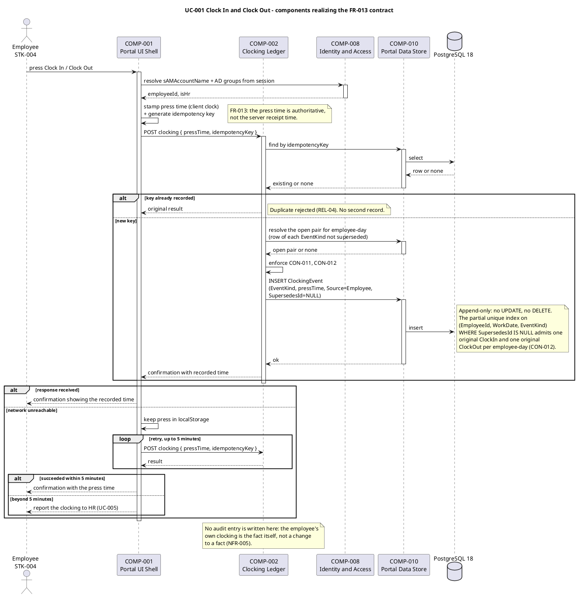
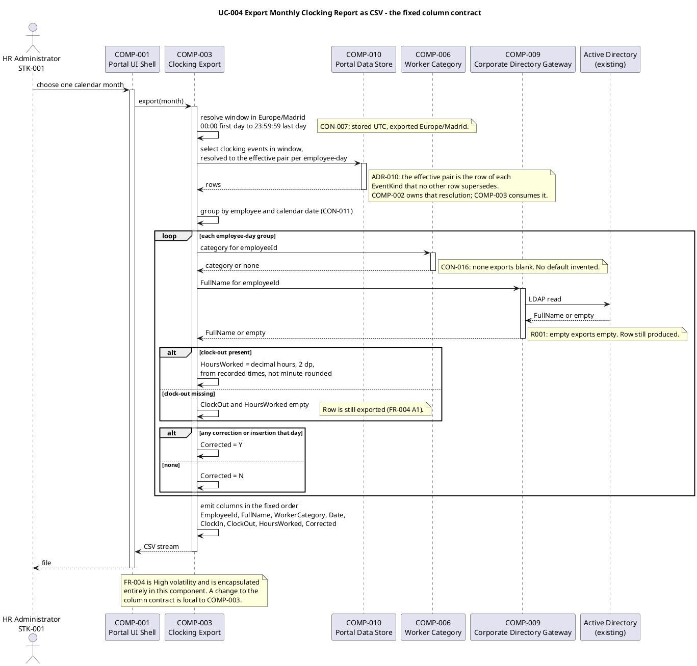
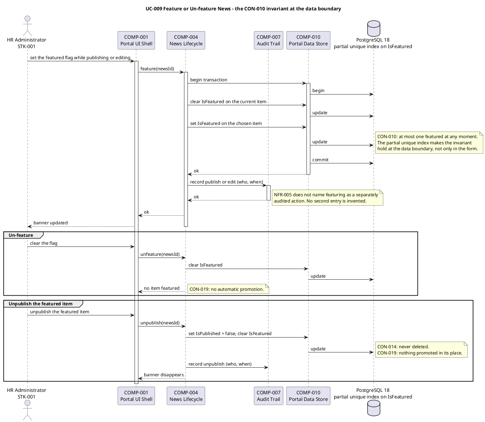
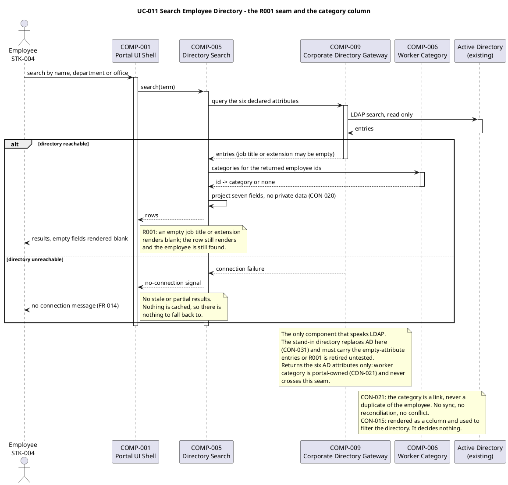
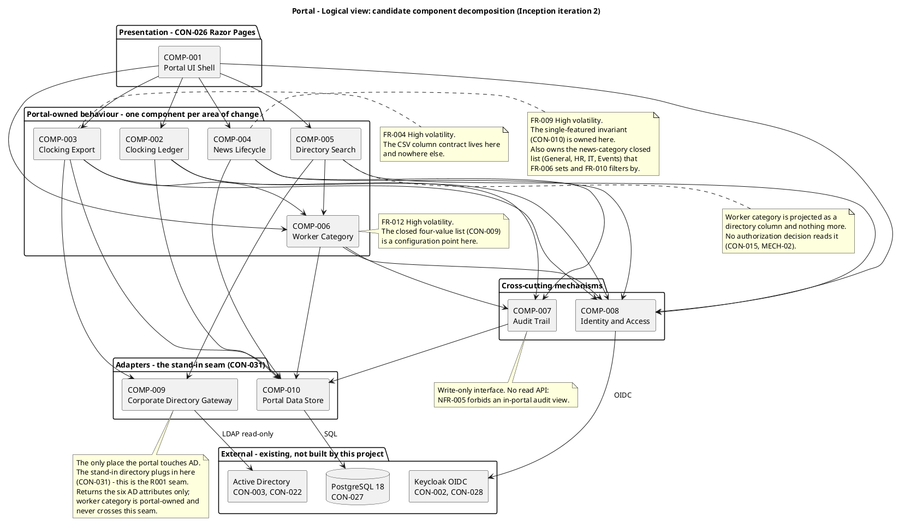
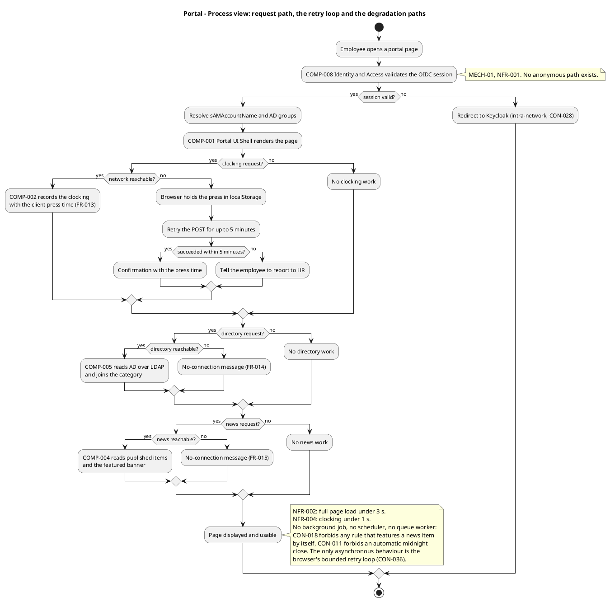
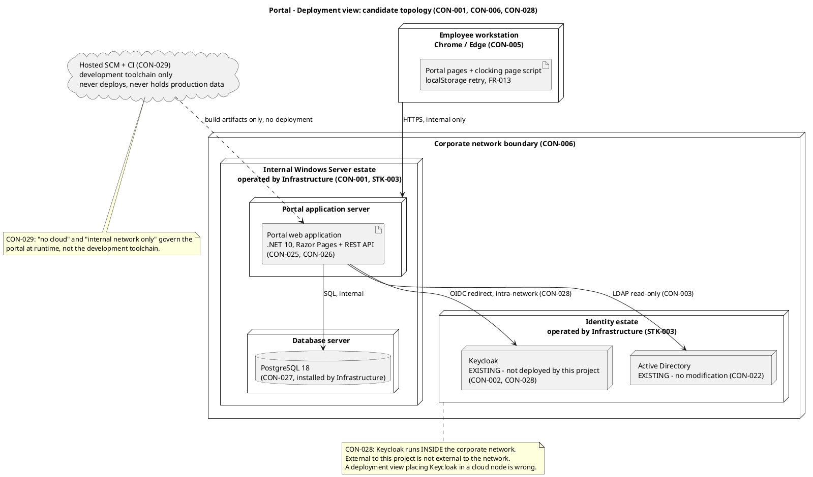
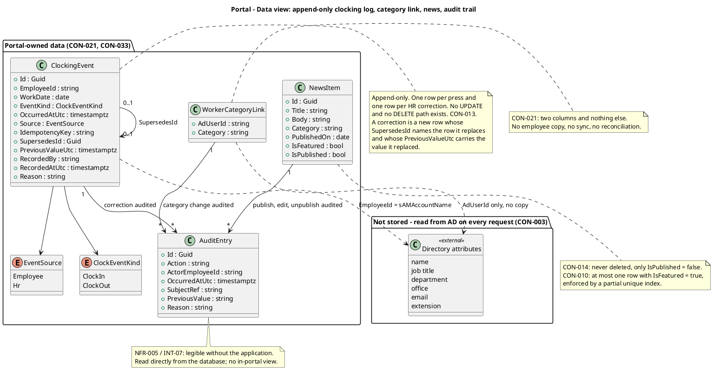
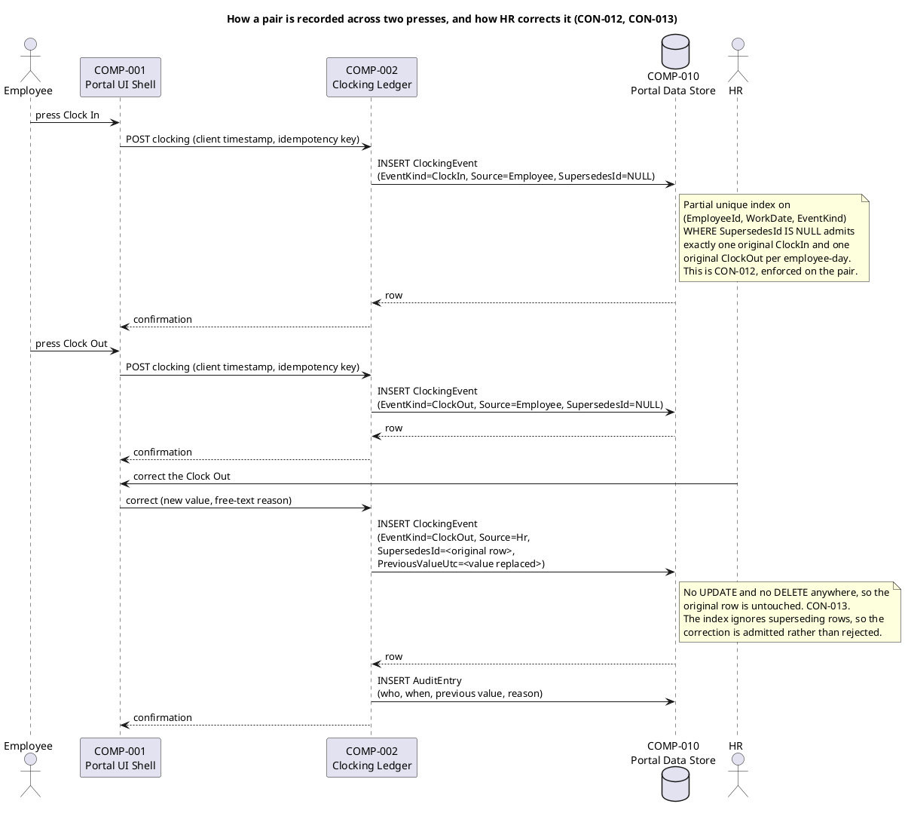

## Document Control
- **Phase:** Inception
- **Status:** Draft — iteration 2, submitted for review
- **Milestone Target:** End of Inception (not yet achieved)
## Architectural Representation
This document is the 4+1 view model of the Portal, expressed as UML. Each view is a slice cut through
the same model, illuminating only the elements with system-wide impact. Inception owes a **candidate**
architecture: the decomposition, the mechanisms and the decisions that would be expensive to reverse.
Elaboration baselines it against an executable prototype.

| View | Question it answers | Diagram in this document | Primary readers |
|---|---|---|---|
| Logical | What are the parts, and what does each one encapsulate? | Component diagram, Logical View | Designer, Implementer |
| Process | What runs concurrently, and what happens when something is unreachable? | Activity diagram, Process View | Implementer, TestDesigner |
| Deployment | Where do the executables run, and what crosses a network boundary? | Deployment diagram, Deployment View | DeploymentManager, STK-003 |
| Implementation | How is the source organized, and where is the configuration seam? | Project structure table, Implementation View | Implementer, ConfigurationManager |
| Data | What does the portal own, and what does it only read? | Class diagram plus a sequence diagram showing how a pair is recorded and corrected, Data View | DatabaseDesigner |
| Use-Case | Does the architecture actually carry the significant scenarios? | Four sequence diagrams, Use-Case View | All stakeholders |

**Notation.** UML 2.5. Components are `COMP-NNN`; the only label family this document mints. Use cases
(`UC-NNN`), mechanisms (`MECH-NN`), interfaces (`INT-NN`), risks (`RNNN`) and constraints (`CON-NNN`)
are referenced from the Use-Case Model, the Supplementary Specification and the Risk List — never
redefined here. Tables are named, not numbered: `TBL-NNN` belongs to the DatabaseDesigner.

**What is deliberately absent.** No class-level design (Designer, Elaboration), no physical schema
(DatabaseDesigner), no screen inventory (UserInterfaceDesigner). Inception's architecture is a sketch
of structure and mechanism, and a sketch that pretends to be a baseline is worse than an honest one.
## Architectural Goals and Constraints
### Architecturally significant requirements

The FURPS+ lens, applied to the declared scope. Only requirements that shape structure appear here; a
requirement that a single component satisfies locally is design detail.

| Requirement | Why it is architecturally significant | Architectural response |
|---|---|---|
| FR-013, AC-005 | The client, not the server, is authoritative for the recorded time. This inverts the normal request model and forces a decision about where the retry lives | The press time and idempotency key are stamped in the browser; the retry is a bounded client-side loop (ADR-008) |
| FR-004 | A fixed external contract consumed outside the portal, invisible to the portal's own tests, and High volatility | Encapsulated in a dedicated component (ADR-005) |
| FR-009, CON-010 | A system invariant that must hold "wherever the change comes from", not only in the HR form | Enforced twice: in the transition and at the data boundary (ADR-006) |
| FR-012, CON-009, CON-021 | The only write the portal makes about a person, over a closed value list, stored as a link | A two-column table and a configuration-point value set (ADR-007) |
| FR-011, R001 | The directory reads attributes that may be empty across three offices | One LDAP gateway, tolerant of empty values, with a single stand-in seam (ADR-004) |
| NFR-001, CON-002, CON-008 | Every function requires an authenticated corporate identity, and authorization has exactly two levels | One identity component resolving a two-valued level per request (ADR-003) |
| NFR-005, CON-013, CON-014 | The audit trail is read directly from the database by people outside the portal, and originals are never overwritten | Append-only audit tables, legible without the application (ADR-002) |
| CON-012, CON-013 | Two rules that constrain the same record from opposite directions: one pair per employee-day, and no original ever overwritten | An append-only clocking event log with CON-012 enforced on the originals only (ADR-010) |
| NFR-002, NFR-004 | A 3-second page load and a 1-second clocking, on a server-rendered stack | Server-rendered pages, no client framework, indexed clocking lookups (Size and Performance) |
| CON-031 | The team's entire integration surface is stand-ins it controls | Two stand-in projects behind the two adapter seams (ADR-009) |

### Use cases prioritized by architectural significance

For the ProjectManager to plan from. Significance is risk × coverage × criticality, not business
priority — all fifteen are Must (CON-023 forbids using priority as a scope lever).

| Rank | UC | Significance driver | Risk carried | Design in |
|---|---|---|---|---|
| 1 | UC-001 Clock In and Clock Out | The client-timestamp and idempotency contract inverts the request model | R008 | Elaboration iteration 2 |
| 2 | UC-011 Search Employee Directory | The LDAP read and the empty-attribute case | R001, R004 | Elaboration iteration 2 |
| 3 | UC-004 Export Monthly Clocking Report as CSV | A fixed external contract, High volatility | R006 | Elaboration iteration 2 |
| 4 | UC-009 Feature or Un-feature News | A system invariant that must hold at the data boundary | — | Elaboration iteration 2 |
| 5 | UC-012 Assign or Clear Worker Category | The only write about a person; closed value list | R005 | Elaboration iteration 3 |
| 6 | UC-013 Retry Clocking Through a Network Drop | The bounded retry loop and duplicate rejection | R008 | Elaboration iteration 3 |
| 7 | UC-005 Correct or Insert Clocking | Immutability plus the audit trail | — | Elaboration iteration 3 |
| 8 | UC-003, UC-002 | Read paths over the clocking ledger | — | Elaboration iteration 3 |
| 9 | UC-006, UC-007, UC-008 | The news lifecycle and its audit entries | — | Elaboration iteration 3 |
| 10 | UC-010, UC-014, UC-015 | Read paths and the two degradation messages | — | Elaboration iteration 3 |

### Constraint conformance

Every architectural constraint, and where this document shows it satisfied. A constraint that appears
in no section is an unproven constraint.

| Constraint | Where satisfied |
|---|---|
| CON-001 .NET on the internal Windows Server estate | Deployment View — one application node on the estate |
| CON-002 OIDC client of the existing Keycloak | Logical View COMP-008; ADR-003 |
| CON-003 AD fields read-only over LDAP, no local copy | Logical View COMP-009; Data View — no employee table exists |
| CON-004 EmployeeId is sAMAccountName, no mapping table | Logical View COMP-008; Data View — `EmployeeId` is a string column, not a foreign key |
| CON-005 Chrome and Edge | Deployment View — the workstation node |
| CON-006 Internal network only | Deployment View — no public endpoint |
| CON-007 Europe/Madrid, UTC storage | Data View — `timestamptz` columns; conversion at the export and display boundary only |
| CON-008 Two AD-group levels | Logical View COMP-008; ADR-003 |
| CON-009 Closed four-value category list | Logical View COMP-006; ADR-007 |
| CON-010 At most one featured item | Logical View COMP-004; Data View partial unique index on the featured flag where published; ADR-006 |
| CON-011 Pair never crosses midnight | Logical View COMP-002; Data View — `WorkDate` is a column written at Clock In, and a Clock Out is only accepted for the open `WorkDate` |
| CON-012 One pair per employee per day | Logical View COMP-002; Data View — partial unique index on `(EmployeeId, WorkDate, EventKind)` where `SupersedesId IS NULL`; ADR-010 |
| CON-013 Originals never overwritten or deleted | Data View — no UPDATE and no DELETE path on `ClockingEvent`; a correction is an INSERT naming the row it supersedes and carrying `PreviousValueUtc`; ADR-002, ADR-010 |
| CON-014 News never deleted | Data View — `IsPublished` flag, no delete path; ADR-002 |
| CON-015 Category drives no access decision | Logical View — the worker-category boundary table: read by COMP-003 and COMP-005 only, never by COMP-008 |
| CON-016 At most one category, may be empty | Data View — one row per `AdUserId`, nullable `Category` |
| CON-017 No self-service correction screen | Logical View — no component offers a correction operation to the employee level |
| CON-018 Featuring is manual only | Process View — no scheduler, no background job |
| CON-019 Unpublish promotes nothing | Logical View COMP-004; ADR-006 |
| CON-020 Corporate data only | Logical View COMP-005 — the projection is the six declared attributes plus category |
| CON-021 Category stored as a link, two columns | Data View `WorkerCategoryLink`; ADR-007 |
| CON-022 No AD modification | Logical View COMP-009 — read-only operations only |
| CON-025 .NET 10, REST API | Implementation View; version policy below |
| CON-026 Razor Pages, no SPA | Logical View COMP-001; Implementation View |
| CON-027 PostgreSQL 18 | Deployment View; Data View; version policy below |
| CON-028 Keycloak inside the corporate network | Deployment View — Keycloak sits in the identity-estate node inside the boundary |
| CON-031 Stand-ins, never the real AD or Keycloak | Logical View COMP-009 and COMP-008 seams; Implementation View; ADR-009 |
| CON-034 Design file mandatory and authoritative | Implementation View — the UI layer is built to the reference |
| CON-036 Retry is one action, one queue, one entity | Logical View COMP-001; ADR-008 — no reconciliation, no conflict resolution |
| CON-023, CON-024, CON-029, CON-030, CON-032, CON-035 | Not architectural: risk governance, toolchain boundary, measurement, handover and backups. Recorded in the Risk List, the Development Case and the Supplementary Specification |

### Technology stack

The stack is the stakeholder's, not the team's. Both pins come from the enterprise version policy;
neither is a version chosen here.

| Layer | Technology | Version | Basis |
|---|---|---|---|
| Runtime | .NET | 10 | CON-025; version policy pin `framework/.NET = 10` |
| Web | Razor Pages with a REST API surface | ships with the runtime | CON-026 |
| Database | PostgreSQL | 18 | CON-027; version policy pin `framework/PostgreSQL = 18`; major pinned, patch floats |
| Browser | Current Chrome and Edge | — | CON-005 |
| Identity | Existing Keycloak, OIDC client | — | CON-002, CON-028 |
| Directory | Existing Active Directory over LDAP | — | CON-003, CON-022 |

**No package-level pin exists, and none is invented.** The version policy declares two framework pins
and no NuGet, npm or PyPI package. The frontend is Razor Pages, so no client-side framework pin
applies. A package added in Elaboration is resolved against the policy at that moment, and the
resolved version is recorded here — never taken from memory and never advanced past a pin.

### Architecture Decision Records

#### ADR-001 — Architectural style: one layered application, decomposed by area of change

**Context.** 200 employees across 3 offices, one internal Windows Server estate, .NET 10 with Razor
Pages and PostgreSQL 18, 15 use cases, 36 constraints. Scale is explicitly non-binding. Three
requirements are High volatility (FR-004, FR-009, FR-012).

**Decision.** A single deployable .NET 10 application, layered presentation → portal-owned behaviour →
cross-cutting mechanisms → adapters, with the behaviour layer decomposed into one component per area
of change. Components are in-process modules behind interfaces, not network services.

**Alternatives considered.**
- *Microservices per capability area* — rejected. There is no scale driver and no independent
  deployment driver; it would put a network boundary between the clocking write and its audit entry,
  which turns a local transaction into a distributed one, and it contradicts CON-001 (one estate) and
  CON-032 (Infrastructure operates one application).
- *A single layer with no internal boundaries* — rejected. The three High-volatility areas would leak
  into the clocking and directory code, and a change to the CSV contract would ripple.
- *SPA plus API* — rejected by CON-026.

**Consequences.** One deployment unit, one database, one process. Component boundaries are enforced by
project structure and interfaces, not by the network — so they are only as real as the discipline that
keeps them. A change to FR-004 is local to COMP-003.

#### ADR-002 — Persistence: one relational store, append-only records, invariants in the schema

**Context.** CON-027 pins PostgreSQL 18. CON-013 forbids overwriting or deleting a clocking original.
CON-014 forbids deleting news. NFR-005 and INT-07 require the audit trail to be read **directly from
the database** by people outside the portal.

**Decision.** One relational database. COMP-010 is the only component that speaks SQL. Every record
the portal owns is append-only: a change is a new row that names the row it supersedes, never an
UPDATE and never a DELETE. The audit trail is append-only and its columns are legible without the
application: action, actor, timestamp, subject, previous value, reason. Immutability is enforced by
the absence of an update or delete path in the schema, not only by the service layer.

**Alternatives considered.**
- *Event sourcing* — rejected. It is a state-reconstruction mechanism, and the audit trail here is a
  compliance record. Four entities do not justify the machinery.
- *Audit written to application log files* — rejected. INT-07 requires it read from the database.
- *A repository abstraction per entity* — rejected as premature; it adds indirection without a second
  implementation to justify it.
- *Mutable rows with a history table* — rejected. It makes the current value and its history two
  things that can disagree, and CON-013's "never overwritten in place" is then a rule the code must
  remember rather than a property of the schema.

**Consequences.** The DatabaseDesigner owns the physical shape of the invariants, and a schema change
is an architectural change. A direct database write cannot violate CON-010, CON-012 or CON-013. The
cost is that reading current state is a query over the log rather than a column read — accepted,
because the log is small and indexed on the columns the queries use.

#### ADR-003 — Identity and authorization: OIDC, two levels, one decision point

**Context.** NFR-001 requires an authenticated corporate identity for every function. CON-008 gives
exactly two levels from AD group membership. CON-004 forbids a mapping table. CON-028 places Keycloak
inside the corporate network.

**Decision.** COMP-008 is the only component that validates a session. It exposes two values to the
rest of the application: the employeeId (sAMAccountName, read from the session) and a two-valued level
(Hr or Employee). No role matrix, no permission table, no per-use-case authorization logic.

**Alternatives considered.**
- *A local user table* — rejected. CON-004 forbids a mapping table and CON-003 forbids a local copy.
- *Keycloak realm or client work* — excluded by the declared scope.
- *Authorization checked inside each use case* — rejected. Two levels are one decision, and scattering
  it invites a third level nobody declared.

**Consequences.** A third level requires a Change Request and a change in one component. The
authorization decision is testable in one place.

#### ADR-004 — Directory access: one read-only LDAP gateway, no cache

**Context.** CON-003 makes the six directory attributes read-only with no local copy. CON-020 limits
the projection to corporate data. CON-021 forbids duplicating the employee. FR-014 requires a
no-connection message rather than stale results. R001 says the attributes may be empty across offices.

**Decision.** COMP-009 is the only component that speaks LDAP. It returns the six declared attributes,
tolerates empty values, and holds no cache. The stand-in directory replaces it at exactly one seam.

**Alternatives considered.**
- *Cache the directory for performance* — rejected. FR-014 and FR-015 require a no-connection message,
  and a cache would produce stale results that look authoritative. NFR-002 is met without it at this
  scale.
- *Synchronise a local employee table* — excluded by the declared scope.
- *Let each component query AD* — rejected. R001 needs one place where the empty-attribute case is
  exercised, and two query paths would be two places to get it wrong.

**Consequences.** R001 is retired by testing one seam. A directory outage degrades exactly two
components and nothing else.

#### ADR-005 — The FR-004 export contract is encapsulated in a dedicated component

**Context.** FR-004 fixes eight columns in an exact order with derived values, is consumed by HR
outside the portal, and is High volatility. R006 records the risk of a misread derivation.

**Decision.** COMP-003 owns the column order, every derivation and the Corrected flag. No other
component knows the column set. The export streams; it does not materialise a report.

**Alternatives considered.**
- *Export directly from the clocking query* — rejected. The contract would leak into COMP-002 and a
  format change would ripple through the ledger.
- *A report engine or template* — rejected. One fixed format does not justify it.

**Consequences.** A contract change is local to one component and one test. The Test Case asserts the
contract at COMP-003's boundary, which is the only place it exists.

#### ADR-006 — The single-featured invariant is enforced at the data boundary as well as in the transition

**Context.** CON-010 requires at most one featured item "wherever the change comes from, not only in
the HR form". FR-009 is High volatility. CON-019 requires that unpublishing the featured item promotes
nothing.

**Decision.** Two independent enforcements. COMP-004 performs the clear-then-set transition inside one
transaction, and the schema carries a partial unique index on the featured flag restricted to
published rows. Unpublishing clears the flag in the same statement that hides the item.

**Alternatives considered.**
- *Application check only* — rejected. CON-010 says wherever the change comes from, which includes a
  direct database write.
- *A separate single-row "featured" table* — viable, but it adds an entity to model a boolean and
  creates a second place where the item and its featured state can disagree. Rejected as
  disproportionate.

**Consequences.** A direct database write cannot create two featured items. The invariant survives a
bug in COMP-004.

#### ADR-007 — Worker category: a two-column link, with the closed list as a configuration point

**Context.** CON-021 fixes the local table at two columns and forbids duplicating the employee.
CON-009 makes the value set a closed list of four, not configurable, with no screen to create or
rename. CON-016 allows empty. FR-012 is High volatility.

**Decision.** One table, two columns: the AD user id and the category. The four values are a validated
configuration set read in one place, not constants scattered through the code. There is no foreign key
to an employee table, because no employee table exists.

**Alternatives considered.**
- *A category lookup table* — rejected. CON-009 says the list is not configurable and there is no
  screen to create or rename; a table invites a fifth value that no Change Request approved.
- *Store the category on a local employee copy* — excluded by CON-021.

**Consequences.** A fifth value requires a Change Request and a change in one place. The category is
read by exactly two components (COMP-003, COMP-005) and by no authorization decision (CON-015).

#### ADR-008 — The clocking retry is a bounded browser-side loop, not a server-side queue

**Context.** FR-013 requires the server to accept the timestamp the client sends, to retry for up to
5 minutes while the corporate network is down, and to reject duplicates by idempotency key. CON-036
says one action, one queue, one entity. AC-005 makes it an acceptance criterion.

**Decision.** The browser stamps the press time and generates the idempotency key, holds the pending
press in localStorage, and retries the POST for a bounded 5 minutes. The server records the client
timestamp and returns the original result for a repeated key. No server-side queue, no background
worker, no outbox.

**Alternatives considered.**
- *A server-side outbox or queue* — rejected on the physics of the failure. The outage is the network
  between the browser and the server, so a server-side queue never receives the press it is meant to
  protect.
- *A service worker or PWA* — excluded by the declared scope.
- *Server receipt time* — violates FR-013 and would make the audit trail record something that did not
  happen.

**Consequences.** R008 (a wrong client clock) is accepted under CON-023 and mitigated by showing the
recorded time in the confirmation, so the error is visible at the moment it happens. The retry is one
action, one queue, one entity — nothing to reconcile.

#### ADR-009 — Stand-ins are the integration surface, behind two adapter seams

**Context.** CON-031 forbids the team from touching the real Keycloak or the real AD, requires
placeholder configuration values never in code, and makes "every use case works correctly against the
stand-ins" the definition of done. R001 is retired only if the stand-in directory carries empty
job-title and extension entries (R004).

**Decision.** Two adapter components (COMP-008 for OIDC, COMP-009 for LDAP) are the only code that
touches the external systems. Both are configured from configuration with placeholder values. The
stand-ins are separate projects in the solution, never in the production path.

**Alternatives considered.**
- *Test against the real Keycloak and AD* — forbidden by CON-031, and the validation is human work by
  Infrastructure with HR.
- *Mock at the component level only* — rejected. It would not exercise the LDAP projection or the OIDC
  claim mapping, which is exactly where R001 lives.

**Consequences.** The team's definition of done is testable without the real systems. R001 stays open
until the fixture carries the empty entries.

#### ADR-010 — A clocking pair is an append-only event log, with CON-012 enforced on the originals

**Context.** CON-012 permits at most one clocking pair per employee per calendar day. CON-013 forbids
overwriting or deleting an original and requires a correction to record who, when, the previous value
and a reason. A pair is produced by two separate presses, and HR may later correct or insert either
half. A single mutable row holding both `ClockIn` and `ClockOut` cannot satisfy both rules: recording
the Clock Out is an in-place UPDATE that CON-013 forbids, and a correction written as a new row is
rejected by a unique index on `(EmployeeId, WorkDate)`.

**Decision.** `ClockingEvent` is append-only. Each press inserts one row carrying `EventKind`
(ClockIn or ClockOut), the client `OccurredAtUtc`, and `Source` (Employee or Hr). An HR correction or
insertion inserts one further row with `Source = Hr`, `SupersedesId` naming the row it replaces,
`PreviousValueUtc` carrying the value replaced, `RecordedBy`, `RecordedAtUtc` and `Reason`. No UPDATE
and no DELETE path exists. CON-012 is enforced by a **partial** unique index on
`(EmployeeId, WorkDate, EventKind)` restricted to `SupersedesId IS NULL`, so it constrains the
originals — one ClockIn and one ClockOut per employee-day — and admits every superseding row. The
effective pair is the row of each `EventKind` that no other row names in `SupersedesId`; `HoursWorked`
and the FR-004 `Corrected` flag are derived from that query.

**Alternatives considered.**
- *One row per pair, with the Clock Out written as an UPDATE* — rejected. It is the shape CON-013
  forbids, and it loses the previous value unless a second history table is added.
- *One row per pair plus a separate correction table* — rejected. Two tables describing one fact, and
  the pair's current value becomes a join whose correctness depends on the code remembering to apply
  the correction.
- *One row per pair, with a correction as a new row and CON-012 relaxed to a non-unique index* — 
  rejected. It moves CON-012 from the schema into the service layer, and CON-012 is a statement about
  the data.
- *A `PreviousValue` column on the pair row* — rejected. It is an in-place UPDATE by another name.

**Consequences.** CON-012 and CON-013 hold simultaneously and both are enforced by the schema. The
cost is that current state is a query rather than a column read, and that the export and the history
views must resolve supersession — which is why COMP-002 owns that query and COMP-003 consumes it
rather than re-deriving it. A correction is never lost and never overwrites: the full sequence of
presses and corrections for an employee-day is readable directly from the table, which is what
NFR-005's "read directly from the database" requires.

## Use-Case View
The Use-Case view validates the other four. Four scenarios are drawn because they are the four places
where a wrong structural decision would be expensive to reverse; each one exercises a different part
of the architecture.

| Scenario | Validates | Components exercised |
|---|---|---|
| UC-001 Clock In and Clock Out | The Logical, Process and Data views under the FR-013 contract | COMP-001, COMP-002, COMP-008, COMP-010 |
| UC-004 Export Monthly Clocking Report as CSV | The Logical and Data views under a fixed external contract | COMP-001, COMP-003, COMP-006, COMP-009, COMP-010 |
| UC-009 Feature or Un-feature News | The Data view under a system invariant | COMP-001, COMP-004, COMP-007, COMP-010 |
| UC-011 Search Employee Directory | The Logical and Deployment views across the LDAP boundary | COMP-001, COMP-005, COMP-006, COMP-009 |

### UC-001 Clock In and Clock Out

**What this validates.** The retry lives in COMP-001, not in COMP-002 — the server never holds a
pending press, which is what CON-036 means by one action, one queue, one entity. The idempotency check
precedes the pair rules, so a retried press cannot be rejected as a second pair. COMP-002 writes no
audit entry, which is the NFR-005 boundary. The write is an INSERT and never an UPDATE, so the same
scenario that records a Clock Out also satisfies CON-013.

### UC-004 Export Monthly Clocking Report as CSV

**What this validates.** COMP-003 depends on COMP-006 and COMP-009 but on neither COMP-002 nor
COMP-004 — the export reads the ledger through the data store and derives everything else itself. The
Corrected flag is derived from the presence of a `Source = Hr` row, not stored as a column on the
clocking, which is what keeps CON-013's append-only rule compatible with FR-004.

### UC-009 Feature or Un-feature News

**What this validates.** The invariant is enforced in two places and the audit entry is written once.
COMP-004 is the only component that changes the featured flag, and the schema refuses a second
featured row even if COMP-004 is wrong. The news-category closed list (General, HR, IT, Events) is
owned here too, and is a different list from the worker category — no component reads one to decide
anything about the other.

### UC-011 Search Employee Directory

**What this validates.** The category join is a second, local read — the directory is never written to
and never copied. The unreachable branch returns a signal, not an empty list, which is what makes
FR-014 distinguishable from "no match" at the UI. The category is read here as a column and a filter
and for no access decision, which is the CON-015 boundary the architecture has to keep visible.

## Logical View
The decomposition. Each component encapsulates **one area of change** — a decision likely to change,
hidden from every other component. The three High-volatility requirements each own a component; the
cross-cutting mechanisms are components because they are reused by many; the two adapters exist so the
external systems have exactly one seam each.

### Component catalogue

| COMP | Responsibility | Area of change it encapsulates | Offers | Requires | Realizes |
|---|---|---|---|---|---|
| COMP-001 Portal UI Shell | Razor Pages host, page rendering, and the page-level clocking script including the localStorage retry queue | The browser-side behaviour of the clocking press (FR-013, CON-036) | Page routes; the clocking POST endpoint | COMP-002, COMP-003, COMP-004, COMP-005, COMP-006, COMP-008 | UC-001, UC-013, UC-014, UC-015 |
| COMP-002 Clocking Ledger | Appends clocking events, enforces the pair rules, serves own and all-employee history, appends HR corrections | The clocking integrity rules (CON-011, CON-012, CON-013) | Record a clocking; read a month; read all; correct or insert | COMP-010, COMP-007, COMP-008 | UC-001, UC-002, UC-003, UC-005 |
| COMP-003 Clocking Export | Produces the monthly CSV: window, grouping, derivations, column order, Corrected flag | The FR-004 column contract — the most volatile element in the system | Export a month as CSV | COMP-010, COMP-006, COMP-009, COMP-008 | UC-004 |
| COMP-004 News Lifecycle | Publish, edit, unpublish, feature; owns the single-featured invariant, the never-delete rule, and the news-category closed list | The news lifecycle policy (CON-010, CON-014, CON-018, CON-019) and the news-category value set (FR-006, FR-010) | Publish; edit; unpublish; feature; read published and featured; filter by news category | COMP-010, COMP-007, COMP-008 | UC-006, UC-007, UC-008, UC-009, UC-010 |
| COMP-005 Directory Search | Searches the directory, projects the seven fields including the category column, degrades to a no-connection message | The directory projection and its degradation (CON-003, CON-020, FR-014) | Search by name, department or office | COMP-009, COMP-006, COMP-008 | UC-011, UC-014 |
| COMP-006 Worker Category | Assigns, clears and reads the category link; owns the closed value set | The category value set and its storage shape (CON-009, CON-016, CON-021) | Read a category; assign; clear | COMP-010, COMP-007, COMP-008 | UC-012 |
| COMP-007 Audit Trail | Writes the five audited actions; append-only; no read API | The audit record shape (NFR-005, CON-013) | Record an audited action | COMP-010 | — (mechanism) |
| COMP-008 Identity and Access | Validates the OIDC session; resolves employeeId and the two-valued level | The identity and authorization mechanism (NFR-001, CON-002, CON-008) | Current identity; current level | Keycloak (external) | — (mechanism) |
| COMP-009 Corporate Directory Gateway | The only LDAP client; returns the six declared AD attributes, tolerating empty values | The AD access mechanism and the stand-in seam (CON-003, CON-022, CON-031) | Read attributes for a search term; read one employee's full name | Active Directory (external) | UC-004, UC-011 |
| COMP-010 Portal Data Store | The only SQL client; transactions; the schema's invariants | The persistence mechanism (CON-027, CON-013, CON-014) | Transactional read and write over the four owned tables | PostgreSQL (external) | — (mechanism) |

### Analysis and design mechanisms

The mechanisms the domain components rely on. Each is named by the capability it provides and the
properties it must hold; the product is named only where the stakeholder declared one.

| Mechanism | Capability | Properties it must hold | Component | Source |
|---|---|---|---|---|
| MECH-01 Authenticated corporate identity | Every request carries a validated corporate identity | No anonymous path; the session supplies sAMAccountName and AD group membership; the OIDC redirect is intra-network | COMP-008 | NFR-001, CON-002, CON-004, CON-028 |
| MECH-02 Two-level authorization | A single decision point yielding Hr or Employee | Exactly two levels; no role matrix; no permission table; no rule reads worker category | COMP-008 | CON-008, CON-015 |
| MECH-03 Audit trail write | Append-only record of the five audited actions | Legible without the application; carries actor, timestamp, subject, previous value, reason; no read API | COMP-007 | NFR-005, CON-013, INT-07 |
| MECH-04 Directory read | Read-only access to the six declared attributes | No cache, no local copy, no write-back; tolerates empty values; one seam for the stand-in | COMP-009 | CON-003, CON-020, CON-022, CON-031 |
| MECH-05 Persistence | Transactional storage of the four owned tables | Invariants enforced in the schema; originals never overwritten; news never deleted | COMP-010 | CON-027, CON-013, CON-014 |
| MECH-06 Idempotent clocking submission | A repeated press produces one record | Key generated client-side; a repeated key returns the original result; the client timestamp is authoritative | COMP-001, COMP-002 | FR-013, REL-03, REL-04 |
| MECH-07 Bounded client retry | A press survives a network outage of up to 5 minutes | Held in localStorage; bounded at 5 minutes; clocking only; no server queue | COMP-001 | FR-013, CON-036, AC-005 |
| MECH-08 Degradation signal | A no-connection message instead of stale data | Distinguishable from an empty result; nothing cached to fall back to | COMP-005, COMP-004 | FR-014, FR-015 |

**MECH-06 and MECH-07 are one mechanism seen from two sides.** The idempotency key exists because the
retry exists: without a bounded retry there would be no duplicate to reject, and without the key the
retry would create one record per attempt. CON-036's "one action, one queue, one entity" is the
statement that these two are not a synchronisation mechanism.

### Worker category: where it is read, and where it is not

CON-015 confines the worker category to exactly two uses — a directory column that also filters, and
a CSV export column. The decomposition keeps that boundary visible rather than implicit.

| Component | Reads worker category | For what | Basis |
|---|---|---|---|
| COMP-005 Directory Search | Yes | Renders the column and filters the result set by it | CON-015, FR-011 |
| COMP-003 Clocking Export | Yes | Emits the `WorkerCategory` CSV column | CON-015, FR-004 |
| COMP-006 Worker Category | Yes | Owns the value; assigns, clears, reads | CON-009, CON-012, CON-021 |
| COMP-008 Identity and Access | **No** | Authorization is the two AD-group levels only | CON-008, CON-015 |
| COMP-009 Corporate Directory Gateway | **No** | Returns the six AD attributes; category is portal-owned and never crosses the LDAP seam | CON-003, CON-021 |
| COMP-004 News Lifecycle | **No** | Filters news by the news-category list, a different closed list | FR-006, FR-010 |
| COMP-002 Clocking Ledger | **No** | Records and serves clockings | CON-011, CON-012 |

The two closed lists are distinct and are owned by different components: the **worker-category** list
(Full-time, Part-time, Contractor, Intern) belongs to COMP-006 and is governed by CON-009; the
**news-category** list (General, HR, IT, Events) belongs to COMP-004 and is governed by FR-006 and
FR-010. Neither component reads the other's list.

## Process View

The portal is a request-scoped application. There is **no background job, no scheduler, no queue
worker, and no long-running process** — and that is a design decision, not an omission. CON-018 forbids
any rule that features a news item by itself, and CON-011 forbids an automatic midnight close, so the
two things a scheduler would normally do here are both forbidden. The only asynchronous behaviour in
the system is the browser's bounded retry loop.

### Concurrency and fault tolerance

| Concern | Position | Basis |
|---|---|---|
| Concurrent clocking presses by the same employee | Serialised by the idempotency key and the one-pair-per-day rule. Two presses cannot conflict with anything, so there is nothing to reconcile | CON-012, CON-036 |
| Concurrent featured-flag changes by two HR users | Serialised by the transaction in COMP-004 and refused by the partial unique index if the transaction is bypassed | CON-010, ADR-006 |
| Concurrent corrections to the same clocking | Each correction is a new append-only row; the last one wins for display and all of them remain in the audit trail | CON-013 |
| Directory or news unreachable | Degrades to a no-connection message in the affected area only; the clocking path is unaffected | FR-014, FR-015 |
| Database unreachable | The request fails; there is no cache and no fallback. Availability is bounded by the estate Infrastructure operates | NFR-003, CON-035 |
| Availability window | Monday–Friday 7:00–19:00 with fault tolerance within the corporate network. No redundancy, clustering or failover is designed, and no scheduled outage window is invented | NFR-003, REL-01 |

**No thread pool, no message broker, no distributed transaction.** The clocking write and its audit
entry are in one database transaction, which is only possible because ADR-001 kept them in one process.

## Deployment View

| Node | What runs there | Operated by | Basis |
|---|---|---|---|
| Employee workstation | A current Chrome or Edge browser; the clocking page script and its localStorage queue | The employee | CON-005, FR-013 |
| Portal application server | The single .NET 10 application: Razor Pages and the REST API surface | Infrastructure (CON-032) | CON-001, CON-025, CON-026 |
| Database server | PostgreSQL 18, installed by Infrastructure on the same estate | Infrastructure | CON-027, CON-035 |
| Keycloak | The existing internal identity provider. **Not deployed, configured or hosted by this project** | Infrastructure | CON-002, CON-028 |
| Active Directory | The existing directory. Read over LDAP; no modification | Infrastructure | CON-003, CON-022 |
| Hosted SCM and CI | Build and test only. Never deploys, never holds production data or credentials | The team | CON-029 |

**CON-028 is the constraint this diagram exists to satisfy.** Keycloak sits inside the corporate
network boundary, in the identity-estate node, alongside Active Directory. It is external to the
*project* — the team neither deploys nor operates it — but it is not external to the *network*: the
OIDC redirect is an intra-network call and login keeps working with no internet link. The only node
outside the boundary is the hosted CI, and it is a development toolchain, not a runtime dependency.

**No load balancer, no second application node, no read replica, no container platform.** None is
declared, scale is non-binding, and NFR-003 explicitly does not require 24/7 availability. Adding one
would be over-engineering against a declared constraint.

## Implementation View

The source organization. Nothing is built yet — this is the structure Elaboration will create, stated
so the Implementer does not invent a different one.

| Project | Contents | Depends on | Basis |
|---|---|---|---|
| `Portal.Web` | Razor Pages, page models, the clocking page script, the REST endpoints | `Portal.Clocking`, `Portal.News`, `Portal.Directory`, `Portal.Category`, `Portal.Identity` | CON-026 |
| `Portal.Clocking` | COMP-002 and COMP-003 | `Portal.Data`, `Portal.Audit`, `Portal.Identity`, `Portal.Directory` | FR-001 to FR-005, FR-013 |
| `Portal.News` | COMP-004 | `Portal.Data`, `Portal.Audit`, `Portal.Identity` | FR-006 to FR-010 |
| `Portal.Directory` | COMP-005 | `Portal.DirectoryGateway`, `Portal.Category`, `Portal.Identity` | FR-011, FR-014 |
| `Portal.Category` | COMP-006 | `Portal.Data`, `Portal.Audit`, `Portal.Identity` | FR-012 |
| `Portal.Audit` | COMP-007 | `Portal.Data` | NFR-005 |
| `Portal.Identity` | COMP-008 | — (Keycloak via configuration) | NFR-001, CON-008 |
| `Portal.DirectoryGateway` | COMP-009 | — (AD via configuration) | CON-003, CON-031 |
| `Portal.Data` | COMP-010, schema migrations | — (PostgreSQL via configuration) | CON-027 |
| `Portal.StandIn.Identity` | A test OIDC issuer | — | CON-031 |
| `Portal.StandIn.Directory` | A test directory carrying the declared attributes, **including entries with empty job title and extension** | — | CON-031, R001, R004 |
| `Portal.Tests` | Unit and integration tests against the stand-ins | all of the above | CON-031 |

**The project boundary is the component boundary.** A component's internals are `internal`; only its
interface is public. That is how ADR-001's in-process decomposition stays real without a network
boundary to enforce it.

**The configuration seam (CON-031).** Six values are configuration and never code: the OIDC issuer,
client id and client secret; the LDAP host, bind account and base DN. In development they hold
placeholder values pointing at the stand-ins; Infrastructure substitutes the real values at
deployment. A literal credential in a source file is a defect, not a shortcut.

**The UI layer is built to `docs/inputs/employee-portal-design.html`** (CON-034). That file is
authoritative for the visual layer, not only the structure, and it is committed — not pending.

## Data View
The portal owns exactly two things: clockings (with their corrections and audit entries) and the
worker-category link. Everything else about a person is read from AD on every request and never
stored.

### The clocking record shape

A clocking pair is recorded as an **append-only event log**, not as one mutable row. Each press
writes one row; each HR correction or insertion writes one more row that names the row it replaces.
No row is ever updated and no row is ever deleted, so CON-013 holds by construction rather than by
convention. CON-012 is enforced on the **originals only** — a partial unique index that ignores
superseding rows — so the correction row that CON-013 requires is admitted rather than rejected.

The effective state of a pair is a query, not a column: the row of each `EventKind` that no other row
names in `SupersedesId`. `HoursWorked` and the FR-004 `Corrected` flag are derived from that query —
`Corrected = Y` when any row for the employee-day carries `Source = Hr`.

### How a pair is recorded across two presses, and how HR corrects it

### Invariants and the index that enforces each

| Invariant | Enforced in the schema, by | Enforced in a component | Basis |
|---|---|---|---|
| At most one clocking pair per employee per calendar day | Partial unique index on `(EmployeeId, WorkDate, EventKind)` where `SupersedesId IS NULL` — admits one original ClockIn and one original ClockOut per employee-day, and ignores superseding rows | COMP-002 | CON-012 |
| A clocking original is never overwritten or deleted | No UPDATE and no DELETE path on `ClockingEvent`; a correction is an INSERT whose `SupersedesId` names the row it replaces | COMP-002 | CON-013 |
| A correction records the value it replaced | `PreviousValueUtc` column, populated on every `Source = Hr` row | COMP-002 | CON-013, NFR-005 |
| A pair never crosses midnight | `WorkDate` is a column written at Clock In, not derived from a timestamp range; a Clock Out is only accepted for the open `WorkDate` | COMP-002 | CON-011 |
| A repeated idempotency key produces one record | Partial unique index on `IdempotencyKey` where `IdempotencyKey IS NOT NULL` — HR correction rows carry no key and are not constrained by it | COMP-002 | FR-013, REL-04 |
| At most one featured news item | Partial unique index on the featured flag where `IsPublished` | COMP-004 | CON-010 |
| News is never deleted | No delete path; `IsPublished` flag | COMP-004 | CON-014 |
| A worker has at most one category, possibly empty | Primary key on `AdUserId`; nullable `Category` | COMP-006 | CON-016, CON-021 |
| The category value is one of four | Check constraint on the value set | COMP-006 | CON-009 |
| The audit trail is legible without the application | Columns, not a serialised blob | COMP-007 | NFR-005, INT-07 |

**Two of these are enforced twice on purpose.** CON-010 says the featured invariant must hold wherever
the change comes from, and CON-013 says originals are never overwritten — both are statements about
the data, not about the service, so both are enforced where the data lives.

**No employee table, no category lookup table, no audit view.** CON-021 forbids duplicating the
employee, CON-009 forbids a configurable category list, and NFR-005 forbids an in-portal audit screen.
Each absence is a constraint satisfied, not a gap.

## Size and Performance

| Target | Declared | Architectural tactic | Where |
|---|---|---|---|
| NFR-002 — full page load under 3 s | The load the employee experiences, including the clocking page's script | Server-rendered pages with no client framework and no hydration step; one page-level script; no client-side data fetch on first paint | COMP-001 |
| NFR-004 — clocking under 1 s | The one sub-second operation | A single indexed lookup by idempotency key, then one indexed read of today's pair, then one insert — three statements, one transaction | COMP-002, COMP-010 |
| NFR-002 — export responsiveness | Not separately declared | The export streams rows rather than materialising a report; the category and full-name lookups are batched per group, not per row | COMP-003 |
| NFR-002 — directory search | Not separately declared | The search term bounds the LDAP query; the category join is one local read for the returned ids, not one per row | COMP-005 |

**Scale is not a binding concern and is not designed for.** 200 employees across 3 offices, a
Monday–Friday 7:00–19:00 window, and no throughput target declared. There is therefore no cache, no
read replica, no load balancer, no connection pool tuning beyond the default, and no asynchronous
processing. Over-engineering for scale is a defect on this project, not a virtue — and a cache would
actively violate FR-014 and FR-015, which require a no-connection message rather than stale data.

**No performance figure in this document is a measurement.** Both thresholds are the stakeholder's
declared targets; nothing has been built, so nothing has been measured.

## Quality
### Quality attributes and the tactics that address them

| Attribute | Requirement | Tactic | Component |
|---|---|---|---|
| Security | NFR-001, CON-008 | One authentication point, one authorization decision, no anonymous path, no local credential store | COMP-008 |
| Security | CON-003, CON-022 | Read-only LDAP; no write path to AD exists in the code | COMP-009 |
| Auditability | NFR-005, CON-013 | Append-only records with legible columns; no read API, so no screen can be built by accident | COMP-007, COMP-010 |
| Integrity | CON-010, CON-012, CON-013, CON-014 | Invariants enforced in the schema as well as in the transition; the clocking log is append-only so CON-013 holds by construction and CON-012 is enforced on the originals only (ADR-010) | COMP-010, COMP-002, COMP-004 |
| Reliability | FR-013, AC-005 | Bounded client retry with an idempotency key; the client timestamp is authoritative | COMP-001, COMP-002 |
| Reliability | FR-014, FR-015 | Degradation signal instead of a cache; nothing to fall back to | COMP-005, COMP-004 |
| Usability | AC-001, AC-004, USA-01 | One press, a button that reflects current status, a confirmation showing the recorded time | COMP-001 |
| Usability | CON-034 | The UI is built to the committed design reference | COMP-001 |
| Maintainability | FR-004, FR-009, FR-012 | One component per High-volatility area; a change is local | COMP-003, COMP-004, COMP-006 |
| Testability | CON-031 | Two adapter seams, so every use case is testable against stand-ins the team controls | COMP-008, COMP-009 |
| Portability | CON-001, CON-025, CON-026, CON-027 | One deployable on the declared estate; no container, no cloud runtime | all |

### Risk retirement

No Architectural Proof-of-Concept is produced: the Development Case records its trigger as not fired,
because neither declared risk needs empirical validation of a mechanism. R001 is retired by testing
against a stand-in directory that carries the empty-attribute entries, and R002 is an adoption risk
with no architectural mechanism. Validation against the real Keycloak and AD is human work by
Infrastructure with HR (CON-031), not a team prototype.

| Risk | How the architecture retires it | Where | Success criterion |
|---|---|---|---|
| R001 LDAP attribute gaps | One LDAP gateway; the projection renders an empty field blank and keeps the row; the stand-in directory carries empty job-title and extension entries | COMP-009, COMP-005, COMP-003 | A directory search and an export both pass against a fixture whose entries have empty job title and extension |
| R004 Stand-in omits the empty entries | The fixture requirement is stated in the Implementation View and in ADR-009 | `Portal.StandIn.Directory` | The fixture contains at least one entry with an empty job title and one with an empty extension |
| R006 Export contract misread | The contract exists in one component and one test | COMP-003 | A test asserts column order, the empty clock-out row, decimal hours to two decimals, and the Corrected flag |
| R008 Wrong client clock | The confirmation shows the recorded time, so the error is visible at the moment it happens; HR corrects under UC-005 | COMP-001, COMP-002 | The confirmation displays the recorded time, not a generic success message |
| R005 An artifact crosses an exclusion | The component catalogue names what each component does **not** do: no correction screen for employees, no audit read API, no permission table, no cache | Logical View | No component offers a capability the Vision's exclusion list forbids |

**R002 and R003 are not architectural.** R002 is adoption, addressed by the one-press interaction and
measured after launch. R003 is the timing of the human validation gate, carried by the Iteration Plan.

### Known limitations of this candidate architecture

- **The decomposition is a sketch, not a baseline.** Component interfaces are named by capability, not
  by signature. Elaboration refines them into `INT-NNN` specifications and sequence diagrams per use
  case.
- **The schema is a sketch.** Column types and index definitions are indicative; the DatabaseDesigner
  owns the physical shape in Elaboration. ADR-010 fixes the *shape* — append-only with supersession —
  and the DatabaseDesigner implements it.
- **Nothing has been built or measured.** Every performance statement is a declared target, and every
  risk-retirement criterion is a plan, not a result.
- **The stand-ins do not exist yet.** Until they do, no use case is testable and R001 stays open.

### Proof-of-concept plan

No proof of concept is planned, and the reason is a property of the risks rather than a budget
decision. The Development Case records the Architectural Proof-of-Concept trigger as not fired: it
requires the Elaboration phase plus a technical risk needing empirical validation of a mechanism.

| Risk | Needs a prototype? | Why not, and what retires it instead |
|---|---|---|
| R001 LDAP attribute gaps | No | The mechanism is a read-only LDAP projection, which is not in doubt. What is in doubt is the *data* — whether the attributes are filled across three offices. A prototype cannot answer that; a fixture carrying the empty entries plus a passing search and export can. Retired by test, in the iteration that builds COMP-009 and COMP-005. |
| R002 Clocking adoption | No | A behavioural risk with no architectural mechanism. Retired by the post-launch adoption reading under BG-003. |
| R003 Human validation gate timing | No | A scheduling risk owned by the Iteration Plan. Retired by the CON-031 feedback arriving. |
| R004 Stand-in omits the empty entries | No | Retired by inspecting the fixture, which is a test entry criterion rather than a prototype. |
| R005 An artifact crosses an exclusion | No | Retired by review against the Vision's exclusion list, every iteration. |
| R006 Export contract misread | No | The contract is fully specified in FR-004 and INT-03. Retired by a column-by-column test, not by a prototype. |
| R007 Toolchain gaps | No | An environment concern owned by the Development Case. |
| R008 Wrong client clock | No | Accepted under CON-023 and mitigated in the UI. No mechanism choice is open. |

**The one thing that would justify a prototype is not a risk on this project.** The append-only
clocking shape (ADR-010) is the only decision here whose mechanics are non-obvious, and it is
validated by a schema test — two presses, one correction, then assert that the original row is
unchanged and that a second original is refused. That is a test in the iteration that builds
COMP-002, not a prototype, because the mechanism is a unique index and an INSERT.

## Traceability
| Element | Traces From | Link Type | Traces To |
|---|---|---|---|
| COMP-001 | UC-001, UC-013, UC-014, UC-015 | Realizes | — |
| COMP-001 | NFR-001, NFR-002, NFR-003 | Derives | — |
| COMP-001 | — | DependsOn | COMP-002, COMP-003, COMP-004, COMP-005, COMP-006, COMP-008 |
| COMP-002 | UC-001, UC-002, UC-003, UC-005 | Realizes | — |
| COMP-002 | NFR-004 | Derives | — |
| COMP-002 | — | DependsOn | COMP-007, COMP-008, COMP-010 |
| COMP-003 | UC-004 | Realizes | — |
| COMP-003 | — | DependsOn | COMP-006, COMP-008, COMP-009, COMP-010 |
| COMP-004 | UC-006, UC-007, UC-008, UC-009, UC-010 | Realizes | — |
| COMP-004 | — | DependsOn | COMP-007, COMP-008, COMP-010 |
| COMP-005 | UC-011, UC-014 | Realizes | — |
| COMP-005 | — | DependsOn | COMP-006, COMP-008, COMP-009 |
| COMP-006 | UC-012 | Realizes | — |
| COMP-006 | — | DependsOn | COMP-007, COMP-008, COMP-010 |
| COMP-007 | NFR-005 | Derives | — |
| COMP-007 | — | DependsOn | COMP-010 |
| COMP-008 | NFR-001 | Derives | — |
| COMP-009 | UC-004, UC-011 | Realizes | — |
| COMP-010 | NFR-005 | Derives | — |
