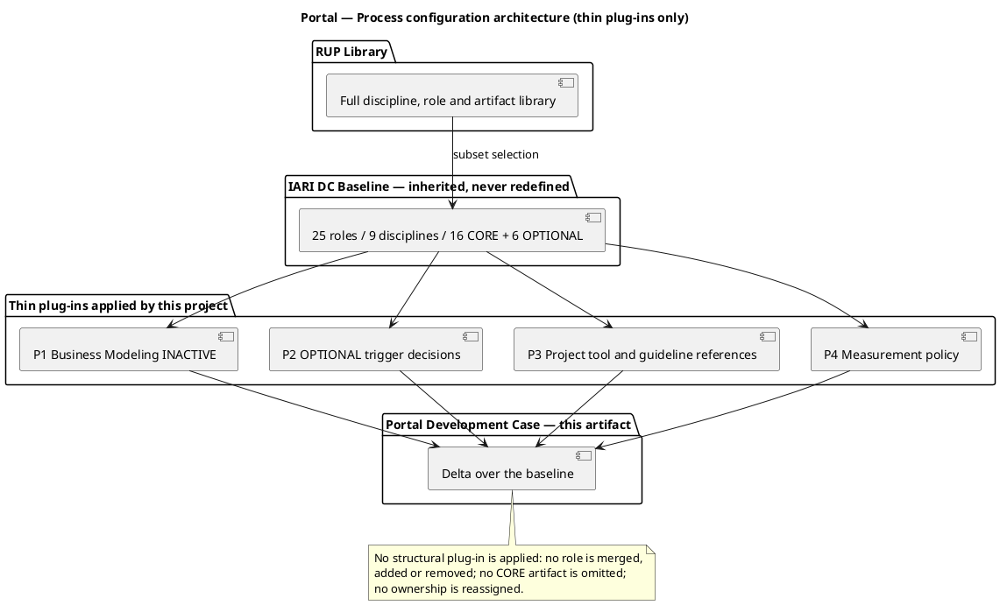
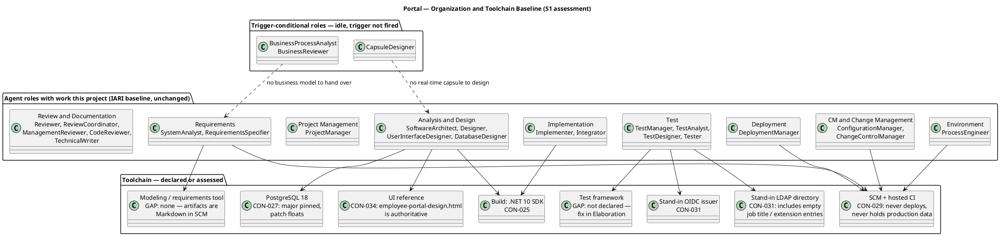
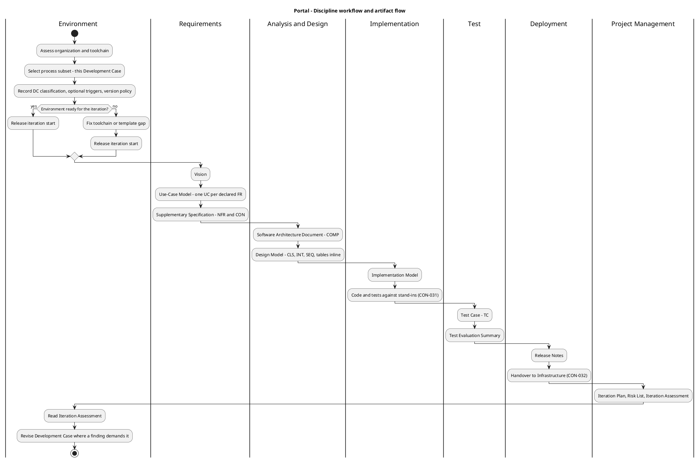
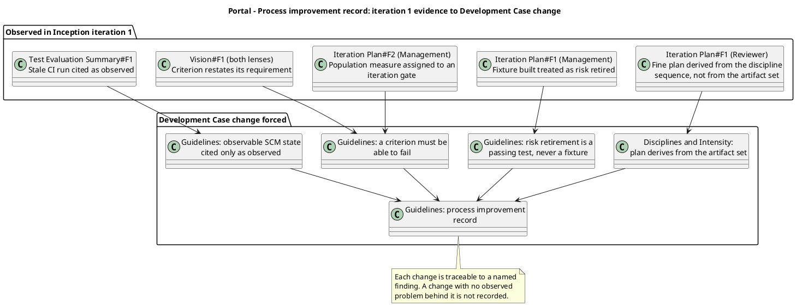

## Document Control
- **Phase:** Inception
- **Status:** Draft — iteration 3, submitted for review
- **Milestone Target:** End of Inception (not yet achieved)
## Tailoring Overview
This document is a **delta over the IARI Development Case baseline**. The baseline supplies the
25-role roster, the 9 disciplines, the 16 CORE and 6 OPTIONAL artifacts, the ownership allowlist and
the canonical intensity matrix. None of that is restated or redefined here. What follows is only what
this project changes, and why.

**No structural plug-in is applied.** No role is added, merged or removed; no CORE artifact is
omitted; no primary ownership is reassigned. Four thin plug-ins are applied — they substitute content
and add project guidance without altering the process shape.

### Organization and toolchain assessment (S1 findings)

The assessment below is the evidence behind every tailoring decision in this document. It was first
derived from the declared scope — 15 functional requirements, 5 non-functional requirements, 36
constraints, 2 declared risks, 4 stakeholders — and is now re-based on the ten artifacts Inception
iteration 2 produced and on the seventeen findings the three review lenses have recorded across both
iterations.

**Organization.** The project runs as an AI agent team against the fixed 25-role IARI roster. Three
facts shape the tailoring:

- **The declared scope is unusually constraint-dense.** 36 constraints against 15 requirements means
  the stakeholder has already made most design decisions. The process must therefore spend its effort
  on *conformance* — proving the system does exactly what CON-001 to CON-036 say — rather than on
  exploration. This is why Requirements intensity is Critical in Inception and why the Supplementary
  Specification carries the constraint load.
- **Three roles are idle by trigger, not by choice.** Business Modeling is inactive (see Disciplines
  and Intensity), so BusinessProcessAnalyst and BusinessReviewer have no work. CapsuleDesigner has no
  work because no real-time capsule exists. Idle roles are not removed from the roster — they simply
  receive no assignment this cycle.
- **Every defect in both iterations sits where the team made a decision, and none sits where it copied
  declared input.** Seventeen findings across two iterations, and not one touches the requirements
  baseline: 15 use cases, one per declared requirement, no phantom use case, no cross-cutting mechanism
  promoted to a use case, no exclusion crossed, no invented identifier. The findings concentrate in the
  artifacts that record a design or planning decision — Use-Case Model, Software Architecture Document,
  Iteration Plan, Test Evaluation Summary, Vision, Supplementary Specification. The process consequence
  is that review effort belongs on the decision-bearing artifacts, and that those artifacts need a
  checkable criterion applied *before* they are persisted, not after.

**The second generation is the finding that matters.** Iteration 1 raised ten findings and closed ten.
Iteration 2 closed those ten and raised seven more, five of them Major, three in one artifact. Two of
those three are the same defect class: a decision one artifact changed, not carried through to the
artifacts that had to follow it. The authoring checks this document added in iteration 2 were written
to catch that class and did not prevent its second generation. That is a process result, not an
artifact result, and it is the reason this revision exists — see Guidelines and Procedures, authoring
checks, for the check-by-check verdict.

**Toolchain.** Assessed against what the constraints declare:

| Capability | State | Basis |
|---|---|---|
| SCM and hosted CI | Available and observed working | CON-029 — hosted provider CI; never deploys, never holds production data or credentials. A build on `main` was observed successful at the iteration-2 review |
| Build | Available | CON-025 — .NET 10 SDK |
| Database | Available | CON-027 — PostgreSQL 18, major pinned, patch floats |
| Identity stand-in | Required, team-built | CON-031 — test OIDC issuer with placeholder issuer/client id/secret |
| Directory stand-in | Required, team-built | CON-031 — test directory carrying the declared attributes, including entries with empty job title or extension |
| UI reference | Available | CON-034 — `docs/inputs/employee-portal-design.html`, mandatory and authoritative |
| Test framework | **Gap** | Not declared by the stakeholder. TestManager selects it in Elaboration; no framework is assumed here |
| Modeling tool | **Gap, accepted** | No modeling tool is declared. All artifacts are Markdown with embedded PlantUML in SCM — this is sufficient and no tool is procured |
| Lint / format config | **Gap** | `CONTRIBUTING.md` and lint configuration do not yet exist. SoftwareArchitect and Implementer author them in Elaboration; this document references them, it does not author them |

The two stand-ins are the load-bearing toolchain item. CON-031 makes them the team's entire
integration surface: the team never touches the real Keycloak or the real Active Directory, and
"every use case works correctly against the stand-ins" is the team's definition of done. A stand-in
that omits the empty-attribute entries would leave R001 untested — and building the stand-in is not
the same act as retiring the risk (see Guidelines and Procedures, risk retirement).

### Rollout order

The process is rolled out incrementally, not in one step. Requirements and Analysis and Design are
established first because they carry the constraint-conformance load; Implementation and Test follow
once the stand-ins exist; Deployment is exercised only at handover. A team that follows this subset
well outperforms one that nominally follows the full library.

## Disciplines and Intensity
**All active disciplines: intensity per canonical matrix.** No deviation is proposed and none is
self-granted.

**Inactive discipline — Business Modeling.** Declared INACTIVE for this project. The portal automates
discrete administrative tasks that the stakeholder declared directly as system use cases FR-001 to
FR-015. There is no business process to model: no business actors, no business workers, no process
re-engineering, and no business use case anywhere in the declared scope. BusinessProcessAnalyst and
BusinessReviewer therefore receive no assignment this cycle. This is a thin plug-in — it removes no
role from the roster and changes no workflow structure.

**Environment.** One-time at project start, per the baseline. This document is its output. The
recurring part — the per-iteration readiness checkpoint — is described in Guidelines and Procedures.

**Real-time-system trigger: not fired.** NFR-004's one-second clocking response is a performance
target, not a hard deadline. FR-013's retry is a bounded client-side retry loop, not reactive
event-driven behaviour. CON-010's single-featured-item rule is a data invariant enforced in the
service layer. No capsule, no concurrent state machine, no timing invariant — CapsuleDesigner
receives no assignment.

**A discipline at Medium or Low intensity is active, not idle.** Inception runs Analysis and Design
at Medium and Test at Low. Neither is a rest state: the Software Architecture Document and the Test
Evaluation Summary are both CORE artifacts produced in Inception, and both were produced in iteration
1. Reading a Low or Medium intensity as "no work this phase" is what caused `Iteration Plan#F1`
(Reviewer), where two producing roles were marked idle and two produced artifacts had no work item.

**A plan is derived from the artifact set, not from the discipline sequence.** The workflow diagram
below orders the disciplines; it does not enumerate the work. An iteration plan is built by listing
the artifacts that iteration will produce, assigning each to its owning role, and placing each in the
critical chain — then checking the result against this diagram for ordering, never deriving the list
from it. The diagram answers "in what order"; only the artifact set answers "what".

Disciplines are pipelined within an iteration, not run as a waterfall: Requirements, Analysis and
Design, Implementation and Test overlap, while Project Management and CM run alongside all of them.
The diagram shows ordering, not workload — see the two rules above.
## Artifacts and Templates
**All 16 CORE artifacts are produced. None is omitted, deferred or downgraded.** The table records
only the project-specific format note for each; ownership is in Roles and Ownership.

| CORE artifact | Project format note |
|---|---|
| Vision | Derived from the declared scope; carries FR, NFR, CON, BG, STK, AC and R identifiers as assigned |
| Use-Case Model | One UC per declared FR-001 to FR-015. Multi-actor on the same declared process is one UC with several scenarios. Authentication (NFR-001) is a Supplementary Specification mechanism with `<<include>>`, never a UC |
| Supplementary Specification | Carries the 5 NFRs and the 36 constraints. This is the constraint-conformance record — the densest artifact of the project |
| Software Architecture Document | Carries COMP identifiers and the deployment section (see Optional Artifact Triggers). Must place Keycloak inside the corporate network per CON-028 |
| Design Model | Carries ACL, CLS, INT, SEQ and the data tables inline (see Optional Artifact Triggers). Co-owned: Designer, UserInterfaceDesigner, DatabaseDesigner each write their own sections |
| Implementation Model | Reverse-engineered from the repository; records the stand-in configuration surface (CON-031) |
| Test Case | TC identifiers. Must cover the empty-attribute directory entries whose passing test retires R001, and the FR-013 retry path |
| Test Evaluation Summary | Per iteration |
| User Documentation | Employee-facing and HR-facing. Must not describe a self-service correction screen (CON-017) or an audit view screen (NFR-005) |
| Release Notes | Per release; handover-oriented for Infrastructure (CON-032) |
| Iteration Plan | Defines per-iteration testing scope, since no Test Plan exists |
| Iteration Assessment | Carries the measured token spend and the two-clock elapsed time |
| Risk List | R001 and R002 carried with their declared identifiers and magnitudes, never renumbered or reclassified. Team-identified risks are numbered R003 onwards in the order raised (CON-023) |
| Review Record | Concrete findings only, one per defect, with severity and verdict |
| Development Case | This document |
| Change Request | Per-iteration audit narrative from Construction onwards; SCM issues carry the live state |

**Templates.** No template files are procured. Each artifact's canonical section skeleton, as
published by the artifact service, is the template. This is a deliberate tailoring decision: a
separate template repository would be a second source of truth that drifts from the skeleton the
service actually enforces.

**Project tool and guideline references.** This document references, and does not author, the
following. Each is owned by the discipline role named:

| Reference | Owner | State |
|---|---|---|
| `CONTRIBUTING.md` | SoftwareArchitect with Implementer | Not yet created — Elaboration |
| Lint and format configuration | Implementer | Not yet created — Elaboration |
| `.github/workflows` (build and test CI) | ConfigurationManager with Implementer | Not yet created — Elaboration |
| `docs/inputs/employee-portal-design.html` | Stakeholder-declared, authoritative (CON-034) | Committed with the project inputs |
## Optional Artifact Triggers

**No OPTIONAL artifact trigger fires for this project.** All six are recorded NOT TRIGGERED, each
against its baseline condition. This set is re-evaluated every iteration — a Change Request may
newly fire one.

| OPTIONAL artifact | Verdict | Why the trigger does not hold |
|---|---|---|
| Glossary | NOT TRIGGERED | The domain is internal HR administration, not regulated, legal, medical or financial. Every specialist term the project uses is already defined by a constraint: worker category by CON-009 (closed four-value list), clocking pair by CON-011, EmployeeId by CON-004. Terminology is defined inline in the Supplementary Specification; a separate stakeholder-validated glossary would duplicate it |
| Architectural Proof-of-Concept | NOT TRIGGERED | The phase condition (Elaboration) is not met. Substantively, neither declared risk needs empirical validation: R001 is retired by testing against a stand-in directory that carries empty job title and extension entries (CON-031), and R002 is an adoption risk with no architectural mechanism. Validation against the real Keycloak and AD is human work by Infrastructure and HR, not a team PoC. Re-evaluated in Elaboration |
| Data Model | NOT TRIGGERED | Not a data-centric system, fewer than 10 entities, and CON-033 declares no data migration. The entities are clocking, clocking correction, news item, worker-category link and audit entry. CON-021 fixes the worker-category table at two columns. Data design lives inline in the Design Model |
| Deployment Model | NOT TRIGGERED | Single internal Windows Server estate, no cloud, no containers, no clustering or load balancing declared, no migration. Deployment is a section of the Software Architecture Document — which is where CON-028's requirement that Keycloak sit inside the corporate network is enforced |
| User-Interface Prototype | NOT TRIGGERED | The stakeholder has already supplied the authoritative UI design at `docs/inputs/employee-portal-design.html`, mandatory for the visual layer per CON-034. A prototype exists to obtain validation the project already holds; building a second one would create a competing source of truth |
| Test Plan | NOT TRIGGERED | No formal delivery, regulatory audit or contractual test reporting. NFR-005 states no external compliance regime applies and no retention period is mandated. Per-iteration testing scope is defined in the Iteration Plan |

## Roles and Ownership

**The 25-role roster is inherited unchanged. Primary ownership is per the service-side allowlist and
is not reassigned.** This section records only which roles are active this cycle and what each
contributes.

**Active roles (22).** All roles in Requirements, Analysis and Design, Implementation, Test,
Deployment, Configuration and Change Management, Project Management, Environment, and Review and
Documentation receive assignment.

**Idle roles (3) — trigger not fired, not removed from the roster:**

| Role | Why idle |
|---|---|
| BusinessProcessAnalyst | Business Modeling is inactive — no business process, business actor or business use case in the declared scope |
| BusinessReviewer | Same — there is no business model to review |
| CapsuleDesigner | No real-time capsule: no hard deadline, no concurrent state machine, no timing invariant |

**Project contribution notes.** Three contribution patterns are specific to this project and are
worth stating because they are where the process most often goes wrong:

- **The Software Architect owns the constraint-conformance argument.** With 36 constraints, the SAD
  is where each architectural constraint (CON-001, CON-002, CON-021, CON-025, CON-026, CON-027,
  CON-028, CON-034, CON-036) is shown to be satisfied. A constraint that appears in no SAD section is
  an unproven constraint.
- **The Database Designer owns the audit trail's physical shape.** NFR-005 requires that corrections
  never overwrite in place (CON-013) and that news is never deleted (CON-014). Those are schema
  decisions, not prose decisions.
- **The TechnicalWriter must not document what the scope excludes.** No self-service correction
  screen (CON-017), no audit view screen (NFR-005), no news archive screen, no permission
  administration screen (CON-008). User Documentation that describes an excluded screen is a defect.

```plantuml
@startuml
title Portal - Roles and the CORE artifacts they contribute to

package "Requirements" {
  class "SystemAnalyst" as SA
  class "RequirementsSpecifier" as RS
  class "Vision" as VIS <<artifact>>
  class "Use-Case Model" as UCM <<artifact>>
  class "Supplementary Specification" as SS <<artifact>>
}
package "Analysis and Design" {
  class "SoftwareArchitect" as SWA
  class "Designer" as DES
  class "UserInterfaceDesigner" as UID
  class "DatabaseDesigner" as DBD
  class "Software Architecture Document" as SAD <<artifact>>
  class "Design Model" as DM <<artifact>>
}
package "Implementation" {
  class "Implementer" as IMP
  class "Integrator" as INT
  class "Implementation Model" as IM <<artifact>>
}
package "Test" {
  class "TestManager" as TM
  class "TestAnalyst" as TA
  class "TestDesigner" as TD
  class "Tester" as TE
  class "Test Case" as TC <<artifact>>
  class "Test Evaluation Summary" as TES <<artifact>>
}
package "Deployment" {
  class "DeploymentManager" as DEP
  class "Release Notes" as RN <<artifact>>
}
package "Project Management" {
  class "ProjectManager" as PM
  class "Iteration Plan" as IP <<artifact>>
  class "Iteration Assessment" as IA <<artifact>>
  class "Risk List" as RL <<artifact>>
}
package "CM and Change Management" {
  class "ConfigurationManager" as CMG
  class "ChangeControlManager" as CCM
  class "Change Request" as CR <<artifact>>
}
package "Review and Documentation" {
  class "Reviewer" as REV
  class "ReviewCoordinator" as RC
  class "ManagementReviewer" as MR
  class "CodeReviewer" as CRV
  class "TechnicalWriter" as TW
  class "Review Record" as RR <<artifact>>
  class "User Documentation" as UD <<artifact>>
}
package "Environment" {
  class "ProcessEngineer" as PE
  class "Development Case" as DC <<artifact>>
}
package "Idle - trigger not fired" {
  class "BusinessProcessAnalyst" as BPA
  class "BusinessReviewer" as BRV
  class "CapsuleDesigner" as CAP
}

SA --> VIS
SA --> UCM
RS --> SS
SWA --> SAD
DES --> DM
UID --> DM
DBD --> DM
IMP --> IM
INT --> IM
TM --> TES
TA --> TC
TD --> TC
TE --> TC
DEP --> RN
PM --> IP
PM --> IA
PM --> RL
CMG --> IM
CCM --> CR
REV --> RR
RC --> RR
MR --> RR
CRV --> RR
TW --> UD
PE --> DC
@enduml
```

## Guidelines and Procedures
### Measurement policy

The baseline measures two quantities and only two: tokens consumed, and elapsed time split into agent
time and human queue time. This section states what **this project** does with them — the decision
each one enables and who reads it. A quantity with no named decision is not collected.

| Quantity | Decision it enables | Read by |
|---|---|---|
| Tokens consumed per iteration | Whether the live-artifact surface is growing faster than the work it enables. Cost in this process scales with artifact surface × times read, not with lines emitted. If spend rises across iterations while the milestone has not passed, that is the schedule-slip signal, and the response is to **replace** an artifact or section rather than re-read it — never to cut declared scope | ProcessEngineer, for the process-weight review; ProjectManager, for the Iteration Assessment |
| Agent time per iteration | Iteration length. Agent time is the working clock; it is not converted into a date | ProjectManager |
| Human queue time per iteration | Whether the CON-031 validation gate is holding the iteration. Queue time is waiting, not working, and is reported apart from agent time — the two clocks are never added | ProjectManager, for escalation; ReviewCoordinator, at the milestone gate |

**No token budget or cap exists for this project, and none is set by the team (CON-030).** Each
iteration's measured spend is recorded and used to forecast the next. Declared scope is never cut or
deferred to fit an estimate.

**The human validation gate is a risk, not an estimate.** CON-031 places validation against the real
Keycloak and the real AD in the hands of Infrastructure and HR, with feedback required before
Elaboration closes. That gate is bounded at a ceiling of 14 days of queue time. If it is exceeded the
process **suspends** — nothing is auto-filled, no date is projected, and the ProjectManager escalates.
The remedy for a delayed gate is another iteration, not a scope reduction (CON-023). Its actual
duration is measured and reported apart from agent time.

### Version policy

The enterprise version policy is recorded and governs over any registry "latest". The Software
Architect anchors it in the Software Architecture Document; the Process Engineer does not resolve or
verify versions against a registry.

| Ecosystem | Package | Pinned | Basis |
|---|---|---|---|
| framework | .NET | 10 | CON-025 — backend is .NET 10 with a REST API |
| framework | PostgreSQL | 18 | CON-027 — latest stable major at project start; major pinned, patch floats |

No package-level pins (NuGet, npm, PyPI) are declared by the stakeholder. The frontend is Razor Pages
(CON-026), so no client-side framework pin applies. A package-level pin is added only when the
stakeholder declares one — the team does not invent one.

### Working against stand-ins (CON-031)

This is the single most consequential procedure in the project, because it defines the team's entire
integration surface.

- The OIDC client and the LDAP connection are configured with **placeholder values** — issuer, client
  id, client secret, LDAP host, bind account, base DN — held in configuration and **never in code**.
  Infrastructure substitutes the real values at deployment.
- The team builds and tests against stand-ins it controls: a test OIDC issuer, and a test directory
  carrying the declared attributes **including entries whose job title or extension is empty**.
- Validation against the real Keycloak and the real AD is human work by Infrastructure with HR. It is
  not team work to plan, and the team does not schedule it.
- The team's definition of done is: every use case works correctly against the stand-ins.

**The stand-in is R001's mechanism, not its retirement.** R001 is that the directory shows gaps when
attributes are unfilled. A fixture that carries the gaps makes the risk *testable*; only a passing
directory search and a passing export against that fixture retires it. The two are different events
and the plan records them as different events. A stand-in without the empty-attribute entries leaves
R001 untested while appearing to have addressed it — which is the failure mode this paragraph exists
to prevent.

### Iteration preparation checkpoint

Process preparation is not a one-time Inception activity. Every iteration opens with an explicit
readiness checkpoint before development starts, and the Environment discipline owns it:

1. Re-evaluate the DC classification and the six OPTIONAL triggers — a Change Request may newly fire
   one.
2. Re-record the version policy — the stakeholder may revise it.
3. Verify the toolchain the iteration depends on actually works: build, CI, test framework, and the
   stand-ins. A broken build discovered on day one is a process failure, not a development one.
4. Confirm the templates and guideline references the iteration needs exist. `CONTRIBUTING.md`, the
   lint configuration and `.github/workflows` are gaps this iteration; they must be closed before
   Implementation intensity rises in Construction.

### Process support during the iteration

Support is continuous, not an afterthought. During active construction the Process Engineer is the
process help desk: questions about how a guideline applies, ambiguous templates, and malfunctioning
tools are answered within the iteration. A blocking process question is escalated immediately rather
than carried to the next iteration.

### Guideline ownership — collaborative, not solo

Guideline content lives in `CONTRIBUTING.md` and the lint configuration, not in this document. Each
section is authored by the discipline expert who owns the practice; the Process Engineer integrates
and publishes, and does not invent technical guidance.

| Guideline area | Authoring role |
|---|---|
| Architecture and design conventions | SoftwareArchitect |
| Coding standards, formatting, lint rules | Implementer, with CodeReviewer |
| UI implementation against the authoritative design (CON-034) | UserInterfaceDesigner |
| Schema, audit-trail and immutability conventions (CON-013, CON-014) | DatabaseDesigner |
| Test conventions and stand-in fixtures | TestManager with TestDesigner |
| Branching, CI and release procedure | ConfigurationManager |

### Process improvement

After every iteration the Process Engineer reads the Iteration Assessment and the Review Record and
asks what went wrong and why — a process gap, a tool failure, an ambiguous template, or a missing
guideline. Each change to this document is traceable to a specific observed problem. Process
improvement without that evidence is guesswork and is not recorded here.

**Iteration 1 evidence and the changes it forced.** Ten findings were recorded across three lenses.
Five of them are defects of a *kind*, not of a single artifact — the same mistake made in different
documents — and a kind of defect is a process gap, which is this document's business.

| Observed problem | Root cause | Change to this document |
|---|---|---|
| `Iteration Plan#F1` (Reviewer) — the fine plan covered seven artifacts; the iteration produced nine, and the two it missed had their roles marked idle | The plan was derived from the discipline sequence this document describes, not from the artifact set the iteration was going to produce. Analysis and Design is Medium and Test is Low in Inception, and both were read as idle | Disciplines and Intensity now states that a plan is derived from the artifact set, and that a discipline at Medium or Low intensity is active, not idle |
| `Iteration Plan#F1` (Management Reviewer) — the plan claimed R001 retired in iteration 2 on the strength of the stand-in fixture being built | Building a risk's mechanism was treated as retiring the risk. The distinction is the one claim a risk-driven gate exists to test | Guidelines and Procedures, working against stand-ins: the stand-in is R001's mechanism, not its retirement; retirement is a passing test |
| `Iteration Plan#F2` (Management Reviewer) — AC-004, a population measure, was assigned to the iteration in which its own window opens | A measure that cannot close inside an iteration was gated on an iteration | Guidelines and Procedures, criteria: a criterion must be able to fail, and a measure whose window outlives the iteration is a post-acceptance measure with a named owner |
| `Vision#F1` (both lenses) — BG-001 presented as measurable with no declared baseline; FR-014 and FR-015 citing their own identifiers as success criteria | A criterion that restates its requirement cannot be distinguished from it, so it cannot be tested | Same guideline as above, applied at authoring time rather than at review time |
| `Test Evaluation Summary#F1` — a CI run identifier and two timestamps cited from an earlier read than the moment of writing | Observable SCM state was cited from memory | Guidelines and Procedures, observable state: a run identifier, a timestamp, a build status or a commit SHA is cited only as read at the moment of writing, or not cited at all |

**The pattern behind four of the five.** Each is a claim that *looks* verified and is not: a fixture
that looks like a retired risk, a criterion that looks like a measure, a run identifier that looks
like an observation, a plan that looks like it covers the work. The check that catches all four is the
same — name the event that would make the claim false, and confirm that event is recorded somewhere.
A claim with no falsifying event is not a claim the process can act on.

**No change is made to the roster, the CORE catalog, the ownership allowlist or the intensity
matrix.** The iteration-1 defects were authoring and planning defects, not process-shape defects. The
process configuration held; what it lacked was three authoring checks, and those are now guidelines.

### Scope note for test tailoring

No accessibility conformance target is declared for this cycle, and scale is not a binding concern at
200 employees across 3 offices. Neither is designed for as a separate objective, and neither is a gap
in this document — both return to the stakeholder when this cycle closes.

One factual consequence follows from CON-034 and is recorded here so the UI Designer and Test roles
do not have to rediscover it: the authoritative design reference at
`docs/inputs/employee-portal-design.html` — committed to the repository with the project inputs per
CON-034 — states in its own design-system header that it targets AA contrast, visible focus, targets
of at least 40px, and keyboard-only operation. Because CON-034 makes that file mandatory and
authoritative for the visual layer, those values are inherited as **design conformance** — the UI is
built to the reference and tested against it. They are not a separately declared accessibility
target, no WCAG level is claimed, and no accessibility test suite is scoped from them. The
distinction matters: a defect is "the UI departs from the reference", not "the portal fails WCAG".

### Criteria that can fail

Three of the ten iteration-1 findings are one defect in three artifacts: a criterion that restates
the requirement it is meant to verify. BG-001 was presented as measurable with no declared baseline;
FR-014 and FR-015 cited their own identifiers as their success criterion; AC-004 was gated on the
iteration in which its own window opens.

The check, applied at authoring time and not left to review:

1. **Can this criterion fail?** If no observation could make it false, it is not a criterion.
2. **Is it distinguishable from the requirement?** If the criterion and the requirement are the same
   sentence, the criterion measures nothing.
3. **Does its window fit its gate?** A measure that elapses after the iteration closes — an adoption
   rate, a three-month trend — is a post-acceptance measure with a named owner, never an iteration
   gate. A gate that can never close is worse than no gate, because it reports as permanently in
   progress.

### Observable state

A run identifier, a build status, a timestamp, a commit SHA, a test count, a defect count — each is a
fact with a moment. Citing one from an earlier read than the moment of writing turns a stale value
into what reads downstream as a verified observation. `Test Evaluation Summary#F1` is exactly this
defect.

The rule: cite observable SCM state only as read at the moment of writing, or state the fact without
the identifier. Never reconstruct an identifier from memory, and never carry one forward from a prior
iteration's artifact. Where a figure is not measured, it carries `[ASSUMPTION — requires validation]`
and is not presented as an observation.

