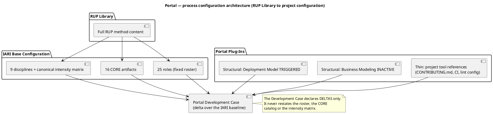
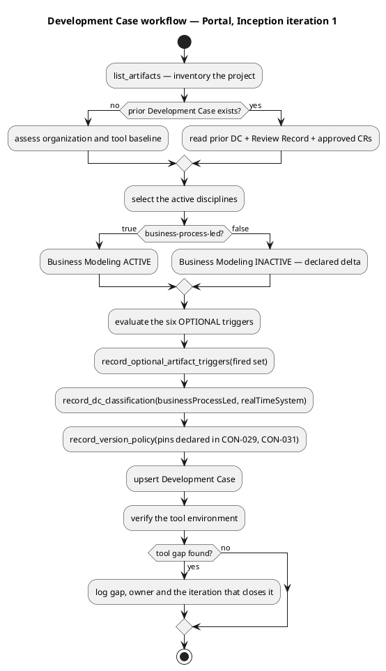
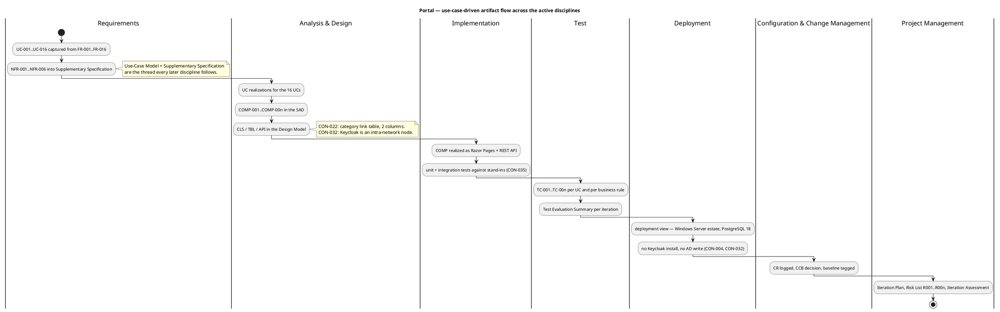
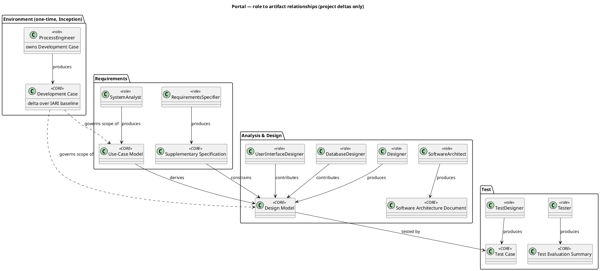

## Document Control

- Phase: Inception
- Status: Draft — iteration 1, submitted for review
- Milestone Target: End of Inception (Lifecycle Objectives) — NOT YET ACHIEVED

## Tailoring Overview

This document is a **delta over the IARI Development Case baseline**. It declares only what this project changes: which discipline is inactive, which OPTIONAL artifacts are triggered, which roles are not staffed, and which project tool files the team works against. The baseline's role roster, CORE artifact catalog, ownership map and intensity matrix are not restated here and are not modified.

### Process configuration

Two plug-ins are applied. **Structural** — Business Modeling is deactivated (see §Disciplines and Intensity); this removes a discipline, its artifacts and its two roles from the project's process shape. **Thin** — the project tool references in §Guidelines and Procedures substitute project files for the baseline's generic guidance without altering the process structure.

### Tailoring rationale — organization and tool assessment

| Assessment area | Finding at Inception iteration 1 | Tailoring consequence |
|---|---|---|
| Artifact baseline | No artifact exists for this project | Greenfield configuration; no prior Development Case to evolve |
| Agent role count | 25 roles available; the project's declared scope is 16 system use cases over 3 functional areas | Business Modeling's two roles are not staffed; every other role is available on demand per iteration |
| Process maturity | No prior iteration, no prior Review Record, no Change Request | Incremental rollout: Requirements and Analysis & Design are the first disciplines stabilized; the remaining disciplines are configured but exercised from Elaboration |
| SCM | Repository `portal` present; `docs/inputs/employee-portal-design.html` committed at sha `715d4f73d6ef4de18c46242258bc17a67f51ba6f` | The mandatory UI reference (CON-037) is available to the Designer, UserInterfaceDesigner and Implementer from day one — it is not a pending input |
| CI | `.github/workflows/` absent | Gap G-1 below; CON-033 requires hosted CI on the configured SCM provider |
| Guidelines | `CONTRIBUTING.md` absent; `.editorconfig` absent | Gaps G-2 and G-3 below |
| Change Requests | No issue open or closed | No CR-driven scope change to accommodate this iteration |
| External dependencies | Keycloak and Active Directory are external to the project but inside the corporate network (CON-032); the OIDC client is already registered (CON-002) | No process gate, no queue and no request to raise for login; the team works against stand-ins (CON-035) |

### Process workflow

## Disciplines and Intensity

**Intensity per discipline and phase: per the canonical matrix.** No deviation is requested and none is granted. The project's risk profile (R001 LDAP attribute completeness, R002 clocking adoption) is addressed by the artifact scope and the test approach below, not by raising any intensity level.

**Inactive discipline — Business Modeling.** Reason: the stakeholder declared 16 system requirements (FR-001 to FR-016) directly as system use cases. No business use case, business actor, business worker or business object was declared, and the scope statement describes replacing shared Excel sheets, mass emails and an outdated PDF with a single intranet web application. The clocking, news and directory processes already exist and are moved into the portal unchanged — there is no business process to model or re-engineer. Consequence: the BusinessProcessAnalyst and BusinessReviewer roles are not staffed, and no business use case model, business object model or business rule artifact is produced. Business rules that the stakeholder did declare (CON-011 to CON-025) are carried as constraints into the Supplementary Specification, which is where the Requirements discipline consumes them.

**Environment discipline** is one-time at project start and is executed in this iteration. It does not recur in Construction.

### Artifact flow across the active disciplines

## Artifacts and Templates

**CORE artifacts: all 16 are produced. None is omitted, and no primary ownership is changed.** The table below records the project-specific production schedule — which phase each artifact is first produced in — and the template the producing role works against. It is a schedule, not a redefinition of the catalog.

| Discipline | CORE artifacts produced | First produced in | Template / reference |
|---|---|---|---|
| Requirements | Vision, Use-Case Model, Supplementary Specification | Inception | Baseline templates; UI reference `docs/inputs/employee-portal-design.html` for the three main views |
| Analysis & Design | Software Architecture Document, Design Model | Elaboration | Baseline templates; UI reference is authoritative for the visual layer (CON-037) |
| Implementation | Implementation Model | Elaboration | Baseline template; `CONTRIBUTING.md` once gap G-2 closes |
| Test | Test Case, Test Evaluation Summary | Elaboration | Baseline templates; stand-in OIDC issuer and stand-in directory per CON-035 |
| Deployment | Release Notes | Construction | Baseline template |
| Configuration & Change Management | Change Request | Construction | Baseline template; SCM issues carry the live CR state |
| Project Management | Iteration Plan, Iteration Assessment, Risk List | Inception | Baseline templates; risk register convention per CON-027 |
| Environment | Development Case | Inception | This document |
| All disciplines | Review Record | Inception | Baseline template; findings recorded via the finding tool before the narrative |

**User Documentation** is produced in Transition by the TechnicalWriter. **No artifact outside the CORE + OPTIONAL universe is produced by this project.**

**Templates and project inputs the team works against:**

| Input | Location | Status |
|---|---|---|
| Mandatory UI design reference | `docs/inputs/employee-portal-design.html` | Present, committed, authoritative for the visual layer (CON-037) |
| Coding and contribution guidelines | `CONTRIBUTING.md` | Absent — gap G-2 |
| CI pipeline definition | `.github/workflows/` | Absent — gap G-1 |
| Editor and lint configuration | `.editorconfig` | Absent — gap G-3 |

## Optional Artifact Triggers

Six OPTIONAL artifacts were evaluated against their §5.2 trigger conditions. **One fires.**

| OPTIONAL artifact | Trigger condition | Verdict | Justification |
|---|---|---|---|
| Deployment Model | Distributed / multi-node topology, OR multi-environment non-trivial | **FIRED** | The deployment view is genuinely multi-node and multi-environment: a .NET application on the internal Windows Server estate (CON-005), a PostgreSQL 18 instance Infrastructure installs on that same estate (CON-031), an intra-network Keycloak as the OIDC identity provider (CON-032), and Active Directory read over LDAP (CON-003). Development, test and production are distinct environments, and the stand-in-versus-real configuration split (CON-035) is a deployment-time concern. The deployment view must also record two negative facts that a SAD section would bury: Keycloak is not installed by this project, and no write reaches Active Directory (CON-004). |
| Data Model | Data-centric system OR >10 entities OR data-migration in scope | NOT FIRED | The persistent surface is small and the system is not data-centric: clockings, news items, and a two-column category link table (CON-022). The entity count is well under ten. CON-036 declares explicitly that there is no data migration — the portal starts empty and the historical Excel sheets stay on the shared drive as a read-only archive. Data design therefore lives inline in the Design Model. |
| Glossary | Domain uses specialist vocabulary requiring stakeholder-validated definitions | NOT FIRED | The domain vocabulary is ordinary workplace HR language — clock in, clock out, news, directory, worker category. The four worker categories are a closed list fixed by CON-025 and are defined in the Supplementary Specification as a business rule, which is where the team reads them. No term requires a separate stakeholder-validated definition. |
| Architectural Proof-of-Concept | Elaboration phase + at least one technical risk requiring empirical validation | NOT FIRED | No technical risk requires empirical validation. R001 (LDAP attribute completeness) is validated by reading the stand-in directory carrying the declared attributes including entries with empty job title or extension (CON-035) — a test, not a proof of concept. R002 is an adoption risk with no technical mechanism. The clocking retry (FR-016) is a bounded localStorage queue with an idempotency key, and CON-013 and CON-014 make two presses non-conflicting, so no architectural uncertainty remains to be retired empirically. |
| User-Interface Prototype | UX-critical OR UI complexity requiring stakeholder validation before implementation | NOT FIRED | The stakeholder has already supplied the validated visual layer: `docs/inputs/employee-portal-design.html` is mandatory and authoritative for the UI visual layer, not only its structure (CON-037), and it is committed to the repository. It defines the palette, typography, components, states and the three main views. A prototype would duplicate an input the stakeholder has already fixed. |
| Test Plan | Formal delivery / regulatory audit / contractual test reporting | NOT FIRED | No formal delivery, regulatory audit or contractual test reporting applies. CON-010 states that no external compliance regime applies to the audit trail and no retention period is mandated. Per-iteration testing scope is defined by the Iteration Plan, and the Test Evaluation Summary reports the outcome. |

## Roles and Ownership

**The 25-role roster is fixed and is not modified. No CORE artifact changes primary owner. No two roles are merged.**

Project deltas:

| Delta | Detail |
|---|---|
| Roles not staffed | BusinessProcessAnalyst and BusinessReviewer — Business Modeling is inactive. Their responsibilities are not redistributed: the business rules the stakeholder declared (CON-011 to CON-025) are consumed by the RequirementsSpecifier as constraints in the Supplementary Specification. |
| Roles staffed on demand | The remaining 23 roles are available per iteration. Inception iteration 1 staffs: ProcessEngineer, SystemAnalyst, RequirementsSpecifier, SoftwareArchitect, ProjectManager, Reviewer, ReviewCoordinator, ManagementReviewer. |
| Contributors per project | DatabaseDesigner and UserInterfaceDesigner contribute to the Design Model alongside the Designer; the Designer remains its primary owner. The TechnicalWriter contributes to User Documentation in Transition. |
| External parties, not roles | Infrastructure (STK-003) operates Active Directory, Keycloak and the portal, and performs the human validation of the real Keycloak and AD (CON-035). HR (STK-001) validates the portal's HR-facing behaviour. Neither is a project role and neither is assigned an artifact. |

### Role to artifact relationships

## Guidelines and Procedures

### Measurement policy

The baseline measures two quantities and only two: tokens consumed, and elapsed time split into agent time and time waiting for a human. This project states what it does with them.

| Quantity | Decision it enables | Who reads it |
|---|---|---|
| Tokens consumed per iteration | Forecast the next iteration's spend from the measured actual, and detect a phase whose spend keeps rising without passing its milestone — the schedule-slip signal. CON-034 declares no budget and no cap, and none is set by the team: the figure is recorded and forecast, never used to cut or defer declared scope. | ProjectManager in the Iteration Assessment; ProcessEngineer when deciding whether the process is too heavy for the iteration |
| Elapsed time — agent time | Compare against the iteration's exit criteria to see whether the work or the process is the constraint. | ProjectManager; ProcessEngineer |
| Elapsed time — human queue time | Track the one human gate this project has: the validation of the real Keycloak and the real AD by Infrastructure with HR (CON-035), whose feedback must reach the team before Elaboration closes. It is a risk, not an estimate: bounded in the Risk List with a ceiling of 14 days, after which the process suspends and nothing is auto-filled. CON-028 grants the remedy in advance — if that validation delays a milestone, the remedy is another iteration, never a cut to declared scope. | ProjectManager in the Risk List and Iteration Assessment |

The two clocks are never added. No per-iteration velocity is quoted, and no phase is forecast before it closes.

### Tool environment and gap closure

| ID | Gap | Owner | Closes by | Effect while open |
|---|---|---|---|---|
| G-1 | No CI pipeline definition under `.github/workflows/`. CON-033 requires build and test to run on the configured SCM provider's hosted CI, which never holds production data or credentials and never deploys — Infrastructure deploys. | ConfigurationManager with Integrator | Elaboration iteration 1 | Build and test are run manually; no automated gate on a pull request |
| G-2 | No `CONTRIBUTING.md`. Coding standards, branch and review conventions and the stand-in configuration procedure (CON-035) have no written home. | SoftwareArchitect with Implementer | Elaboration iteration 1 | Coding and review conventions are agreed per pull request instead of being written down |
| G-3 | No `.editorconfig` or lint configuration. | Implementer | Elaboration iteration 1 | Formatting is not enforced mechanically |

The Development Case references these files; it does not author their content. Each is owned by the discipline role named above.

### Configuration and stand-in procedure

The OIDC client and the LDAP connection are configured with placeholder values — issuer, client id, client secret, LDAP host, bind account, base DN — held in configuration and never in code (CON-035). Infrastructure substitutes the real values at deployment. The team builds and tests against a stand-in OIDC issuer and a stand-in directory carrying the declared attributes, including entries whose job title or extension is empty. This is the project's answer to R001: the empty-attribute case is exercised in test, not discovered in production.

### Iteration preparation checklist

Every iteration opens with this checkpoint before development starts. It is not a one-time Inception activity.

1. Re-evaluate the six OPTIONAL triggers and re-record the fired set — a trigger may newly fire through a Change Request.
2. Re-record the version policy if the stakeholder revises a declared version.
3. Read the prior Iteration Assessment and the Review Record; for each finding, decide whether it changes the process, a template or a tool configuration.
4. Verify the tool environment is working — build, test runner, stand-in OIDC issuer, stand-in directory — before the iteration's first development task.
5. Confirm the gaps in the table above that were due to close in the previous iteration are closed, and re-own any that are not.

### Process support during the iteration

Process questions, ambiguous templates and tool failures are answered within the iteration in which they are raised. A blocking process issue — one that stops a role from producing its artifact — is escalated immediately rather than carried to the next iteration. Process artifacts are revised in place when the answer changes them.

### Version policy

The stakeholder declared two version constraints, recorded as the enterprise version policy: the .NET 10 runtime target (CON-029, with Razor Pages on the same runtime per CON-030) and PostgreSQL 18 with the major pinned and the patch level floating (CON-031). The SoftwareArchitect anchors both in the Software Architecture Document; they govern over any registry "latest". No other version is consequential for this project, and none was invented.
