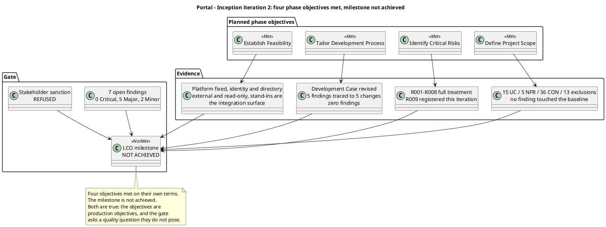
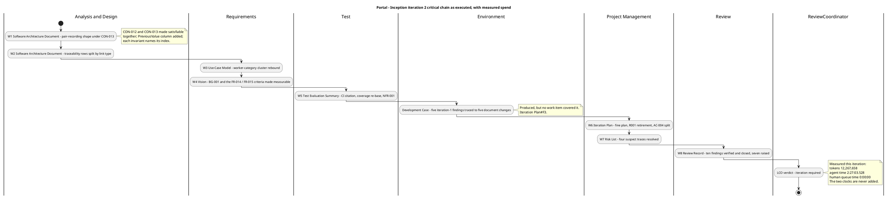
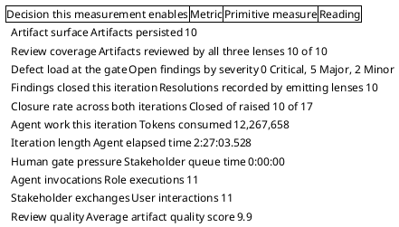
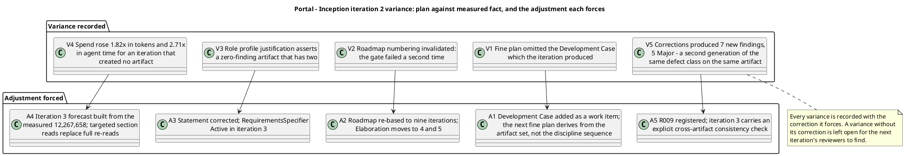
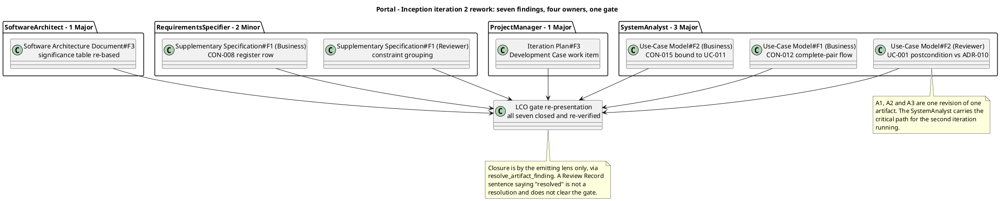

## Document Control
- **Phase:** Inception
- **Status:** Draft — iteration 2 record
- **Milestone Target:** End of Inception (not yet achieved)

## Iteration Objectives Reached

The ReviewCoordinator's verdict for this iteration is **LCO: iteration required — scope incomplete**. This assessment records the iteration's outcome given that verdict. It does not re-issue the verdict and does not declare the milestone.

Four objectives were planned for the phase. All four are met on their own terms. The milestone is not achieved. Both statements are true and the difference between them is the substance of this assessment: the four objectives are production objectives — produce the baseline, produce the risk position, produce the tailoring, establish feasibility — and the gate asks a quality question they do not pose.

| # | Planned objective | Outcome | Evidence |
|---|---|---|---|
| 1 | Define Project Scope | **Met** | Vision, Use-Case Model and Supplementary Specification persisted. 15 use cases, one per declared FR-001 to FR-015; 5 NFRs; 36 constraints; 13 exclusions published verbatim as a checkable boundary. No finding in either iteration, from any lens, touched the requirements baseline. The trace tree shows no leaf on any FR, NFR or UC |
| 2 | Identify Critical Risks | **Met** | Risk List carries R001 and R002 with their declared identifiers and magnitudes (P=3 I=3 exposure=9; P=3 I=2 exposure=6), unrenumbered and unreclassified, plus team risks R003 to R009 in the order raised, each with probability, impact, magnitude, strategy, mitigation, contingency, owner and warning sign. Every `Accept` cites the CON-023 grant; none is accepted on the Project Manager's own authority |
| 3 | Tailor Development Process | **Met, with its effectiveness now in question** | Development Case persisted as a delta over the IARI baseline and substantively revised this iteration: a process-improvement record tracing five iteration-1 findings to five document changes, a "Criteria that can fail" guideline, an "Observable state" guideline, a "Scope note for test tailoring" section, and the rule that a discipline at Medium or Low intensity is active rather than idle. It carried zero findings across all three lenses. But the authoring checks it added did not prevent the second generation of the defect class they were written to catch — see R009 |
| 4 | Establish Feasibility | **Met** | Platform fixed by CON-001, CON-025, CON-026 and CON-027; identity and directory external and read-only under CON-002, CON-003 and CON-022; the team's entire integration surface is stand-ins it controls under CON-031. The Management Reviewer recorded feasibility as met and stated explicitly that the No-Go verdict is not a finding that the project is not viable |

**Mapping to the Iteration Plan's own objectives.** The iteration 2 plan stated five objectives: O1 (fine plan accounts for every artifact the iteration produces), O2 (each risk's retirement stated against the event that retires it), O3 (every declared AC has a point at which it can close), O4 (the four suspect traces resolved), O5 (the LCO gate re-presented). O2, O3, O4 and O5 held. **O1 did not**: the Development Case was substantively revised and had no work item, which is `Iteration Plan#F3` and is corrected in this iteration.

## Adherence to Plan
### What the iteration actually did

Ten artifacts were persisted and all ten were reviewed by all three lenses. Eleven agent invocations and eleven stakeholder exchanges produced them. The iteration created no artifact: every stretch edited an artifact that already existed.

The critical chain below is the chain **as executed**, not as planned. Its depth is six sequential agent stretches to the gate. The Development Case stretch is the one the plan did not draw — it was produced and revised, and no work item covered it.

### Measured spend

Two phases have now closed, so two measured actuals exist. Every forecast from here is built from them, and none is built from a theoretical capacity.

| Quantity | Iteration 1 | Iteration 2 | What the figure is for |
|---|---|---|---|
| Tokens consumed | 6,756,727 | 12,267,658 | The measured basis of the iteration 3 forecast. Spend scales with the live-artifact surface and the number of times it is re-read, not with the volume a phase emits — and this iteration created no artifact while spending 1.82 times what the iteration that created nine did |
| Agent elapsed time | 0:54:19.692 | 2:27:03.528 | Iteration length on the working clock. It is not converted into a date and no date is projected from it |
| Human queue time | 0:00:00 | 0:00:00 | Waiting, not working. It excludes the end-of-iteration approval gate, which is not measured. It is reported beside agent time and never added to it |
| Agent invocations | 11 | 11 | The role-execution count behind the artifact set |
| Stakeholder exchanges | 11 | 11 | The human interactions the iteration required |
| Artifacts persisted | 9 | 10 | The live-artifact surface the next iteration re-reads. It is the driver of the token figure above, not a productivity count |
| Open findings by severity | 0 Critical, 6 Major, 4 Minor | 0 Critical, 5 Major, 2 Minor | Whether the gate can be re-presented. Five Major findings block it; the two Minor do not, but the stakeholder required all seven corrected |
| Findings closed | 0 | 10 | Whether the previous iteration's corrections were accepted. All ten were, by their emitting lenses |
| Review coverage | 8 of 8 | 10 of 10 | Whether any artifact reached the gate unreviewed. None did |
| Average artifact quality score | 10.0 | 9.9 | The reviewers' own scoring. It is recorded because it is measured, not because it changes a decision: the finding ledger, not the score, is what the gate acts on |

**No token budget exists and none is set.** CON-030 declares no budget or cap and forbids the team to set one. No figure above is a ceiling, and no declared scope was cut or deferred to fit any of them.

### Variance against the plan

Five variances. Each is recorded with the correction it forces, in the same breath — a variance recorded without its correction is left open for the next iteration's reviewers to find.

| # | Variance | Root cause | Adjustment | State |
|---|---|---|---|---|
| V1 | The fine plan's W1–W9 covered eight artifacts; the iteration produced and substantively revised a ninth, the Development Case. The plan's own exit criterion E1 requires every artifact the iteration produces to have a work item, an owner and an exit condition, and the plan failed it. The role profile marked ProcessEngineer Active in iteration 2, asserting work the fine plan did not contain | The fine plan was again derived from the finding ledger alone — the Development Case closes no named finding, so it did not appear — rather than from the artifact set the iteration would produce. This is the same root cause as iteration 1's V1, recurring in a new plan | The Development Case is a work item in the iteration 2 fine plan (W8) with owner ProcessEngineer and an exit condition naming what the revision must achieve, placed in the critical chain before the Review Record. The iteration 3 fine plan is derived from the artifact set, and its W8 carries the Development Case's own verification | **Corrected** — `Iteration Plan#F3`, awaiting verification by the Management Reviewer lens |
| V2 | The plan assumed iteration 2 would close the LCO milestone and that iteration 3 would be the first Elaboration iteration. The gate failed a second time, so iteration 3 is a third Inception iteration and every iteration from the old 3 onward shifts by one. Two artifacts corrected in this same iteration — the Software Architecture Document's significance table and the Test Evaluation Summary's coverage plan — were re-based onto the eight-iteration numbering and now name Elaboration iterations 3 and 4, which the roadmap moves to 4 and 5 | A roadmap is a forecast, and this one was built on the assumption that one correction iteration would suffice. The assumption was wrong, and the artifacts that consumed the roadmap were corrected before the roadmap moved | The roadmap is re-based to nine iterations: Elaboration 4 and 5, Construction 6 to 8, Transition 9. Nine is the ceiling of the 6 ± 3 band, and the plan states that a fourth Inception iteration would take the project out of it. Iteration 3's W4, W5 and W11 sweep every artifact that names an iteration number, and exit criterion E6 makes the sweep a condition of the gate | **Corrected** — Iteration Plan roadmap and Evaluation Criteria; the sweep is iteration 3 work |
| V3 | The role profile's iteration 2 justification read "RequirementsSpecifier is not [Active]: no finding touches the Supplementary Specification, which carried zero findings across all three lenses". The review then raised two Minor findings against that artifact | The justification was written from the iteration-1 ledger and stated as a fact about the current review, which had not yet run | The statement is corrected: RequirementsSpecifier was inactive in iteration 2 because no iteration-1 finding touched the Supplementary Specification, and is Active in iteration 3 on the two Minor findings the iteration 2 review raised against it | **Corrected** — Iteration Plan Resources |
| V4 | The iteration 2 forecast was "the iteration 1 figure plus the cost of re-reading nine artifacts". Measured: 12,267,658 tokens against 6,756,727 — 1.82 times — and 2:27:03.528 of agent time against 0:54:19.692 — 2.71 times. The iteration created no artifact and spent nearly twice the tokens of the iteration that created nine | The forecast treated re-reading as a linear cost of the artifact surface. It is not: the iteration re-read ten artifacts repeatedly, and each correction required reading the section it changed plus the sections that had to agree with it. Agent time rose faster than tokens because the corrections were reasoning-heavy and emission-light | The iteration 3 forecast is built from the measured 12,267,658 and 2:27:03.528, not from the iteration 1 figure and not from a capacity model. The lever recorded for iteration 3 is targeted section reads in place of full re-reads, which is what the Review Record's own remediation instructions already prescribe | **Recorded** — the forecast basis is corrected in the Iteration Plan's iteration 3 fine plan |
| V5 | The ten corrections produced seven new findings — 0 Critical, 5 Major, 2 Minor — and three of the five Major sit in one artifact, the Use-Case Model. Two of those three are the same defect class: a rule or a decision another artifact changed, not carried through to the use case that must enforce it. ADR-010 changed the clocking shape and the Use-Case Model did not follow; the roadmap changed and the Software Architecture Document did not follow | The corrections were made artifact by artifact against the finding that named them, without a pass that asked which other artifacts the correction invalidated. The Development Case's new authoring checks target this class but were written in the same iteration and had not been exercised | R009 is registered with a full treatment: the Development Case authoring checks are verified against all seven open findings and each classified as caught or not caught (W8), and the Review Record sweeps every artifact that names an iteration number (W11). Exit criterion E6 makes the sweep a gate condition. If a third generation appears, the Project Manager escalates the reading that the process needs correction rather than scheduling a fourth pass | **Recorded** — R009 in the Risk List; W8, W11 and E6 in the Iteration Plan |

**One variance is corrected in this iteration and four are recorded with their adjustment in place.** A correction is not a closure: the emitting lens verifies it and closes the finding, and until it does the variance stays recorded here.

### Lessons carried into iteration 3

1. **A plan derived from the finding ledger will understate the iteration, exactly as a plan derived from the discipline sequence did.** Iteration 1's plan missed the two artifacts whose disciplines are Low or Medium in Inception. Iteration 2's plan missed the one artifact that closes no named finding. The rule from here: the fine plan is derived from the artifact set the iteration will produce, and the finding ledger is an input to it, not its source.
2. **A roadmap is a forecast and it must be re-based the moment the gate moves it.** Two artifacts were corrected onto an eight-iteration numbering in the same iteration that invalidated it. The cost of the sweep is small; the cost of two artifacts disagreeing about when the architecture is designed is the LCO criterion on architecture credibility.
3. **Corrections generate findings, and the second generation is the one that matters.** Iteration 1 raised 10 findings and closed 10; iteration 2 closed those 10 and raised 7. That is the normal cost of a correction that changes a decision other artifacts had to follow. What is not normal is that the class repeated: the authoring checks were written to catch it and were not exercised before the next review. R009 makes that the thing to watch.
4. **Spend does not track output volume.** The iteration that created nine artifacts spent 6.76 million tokens; the iteration that created none spent 12.27 million. The driver is re-reading the accumulated surface and reasoning across artifacts that must agree. The lever is targeted section reads, not fewer corrections.
5. **The requirements baseline remains the strongest part of the set.** Fifteen use cases, one per declared requirement, no phantom use case, no cross-cutting mechanism promoted to a use case, no per-actor split, no exclusion crossed, no invented identifier — across two iterations and three lenses. Every defect in both iterations is in the artifacts where the team made design and planning decisions.
6. **A milestone that does not pass costs an iteration, and that is still the correct price.** Two Inception iterations have now failed the gate. The remedy is iteration 3 in Inception — not a scope cut, which CON-023 forbids, and not more agents in parallel, which adds context conflict and artifact contention without proportional benefit. The roadmap is nine iterations, the ceiling of the 6 ± 3 band, and that ceiling is now the constraint the process is measured against.

## Use Cases and Scenarios Implemented
No use case is implemented. Inception produces no working software, and no acceptance criterion is closed.

All fifteen declared use cases are baselined: each is identified, traced to its declared requirement, and bound to the constraints that govern it. Four are detailed because they are architecturally significant; eleven are outlined and are detailed in Elaboration iteration 5.

| UC | Name | Source | State at iteration close | Detailed in |
|---|---|---|---|---|
| UC-001 | Clock In and Clock Out | FR-001 | Baselined, detailed — postcondition and complete-pair flow under correction, `Use-Case Model#F2` (Reviewer), `Use-Case Model#F1` (Business) | Iteration 1 |
| UC-002 | View Own Clocking History | FR-002 | Baselined, outline | Iteration 5 |
| UC-003 | View All Employee Clockings | FR-003 | Baselined, outline | Iteration 5 |
| UC-004 | Export Monthly Clocking Report as CSV | FR-004 | Baselined, detailed | Iteration 1 |
| UC-005 | Correct or Insert Clocking | FR-005 | Baselined, outline | Iteration 5 |
| UC-006 | Publish News | FR-006 | Baselined, outline | Iteration 5 |
| UC-007 | Edit Published News | FR-007 | Baselined, outline | Iteration 5 |
| UC-008 | Unpublish News | FR-008 | Baselined, outline | Iteration 5 |
| UC-009 | Feature or Un-feature News | FR-009 | Baselined, detailed | Iteration 1 |
| UC-010 | Read and Filter News | FR-010 | Baselined, outline — bound to the news-category closed list | Iteration 5 |
| UC-011 | Search Employee Directory | FR-011 | Baselined, detailed — CON-015 binding under correction, `Use-Case Model#F2` (Business) | Iteration 1 |
| UC-012 | Assign or Clear Worker Category | FR-012 | Baselined, outline | Iteration 5 |
| UC-013 | Retry Clocking Through a Network Drop | FR-013 | Baselined, outline | Iteration 5 |
| UC-014 | Recognize Directory Unavailable | FR-014 | Baselined, outline | Iteration 5 |
| UC-015 | Recognize News Unavailable | FR-015 | Baselined, outline | Iteration 5 |

**Scenarios carried into Elaboration.** UC-001 A1–A5 (duplicate press, network recovered, network lost, second pair, complete pair), UC-004 A1–A5 (missing clock-out, no clocking, no category, corrected day, empty directory attribute), UC-009 A1–A3 (un-feature, unpublish the featured item, nothing featured), UC-011 A1–A3 (empty attribute, network unreachable, no match).

**Why these four were detailed now.** UC-001 carries the client-timestamp and idempotency contract (FR-013) that forces a design decision. UC-004 is the project's most volatile interface — a fixed external column contract. UC-009 carries a system invariant (CON-010) that must hold wherever the change comes from. UC-011 carries the LDAP read and the R001 empty-attribute case. These are the four places where a wrong decision in Elaboration would be expensive to reverse.

**Two scenarios are executed in iteration 4, not deferred to Construction.** UC-011 A1 (empty attribute) and UC-004 A5 (empty directory attribute) are the cases that retire R001. They need no production code beyond the directory read path and the export derivation, so they run in the iteration that builds the stand-ins. The full use-case tests for UC-004 and UC-011 remain in Construction with the rest of their capability areas.

## Results Relative to Evaluation Criteria
One line per criterion the Iteration Plan carried. Layer B is this iteration's own exit criteria; Layer A is the declared acceptance criteria the project is accountable to.

### Layer B — this iteration's exit criteria

These are the six criteria the iteration 2 plan carried, assessed as they stood at this iteration's close. The Iteration Plan now carries seven criteria for iteration 3 — E6 is new, requiring that no artifact names an iteration the roadmap has moved, and LCO readiness moves from E6 to E7. The two lists are not the same list and are not meant to be: this section records what iteration 2 committed to, and the plan records what iteration 3 commits to.

| # | Criterion | Result at close | Evidence |
|---|---|---|---|
| E1 | Every artifact the iteration produces has a work item, an owner and an exit condition | **Not met at close — corrected in this iteration** | The fine plan's W1–W9 covered eight artifacts; the Development Case was substantively revised and had no work item, while the role profile marked ProcessEngineer Active. `Iteration Plan#F3` (Management Reviewer). The Development Case is now W8 with an owner and an exit condition, placed in the critical chain before the Review Record |
| E2 | Every role that produces in an iteration is Active in that iteration's column | **Met** | ProcessEngineer, SystemAnalyst, SoftwareArchitect, TestManager and ProjectManager all produced in iteration 2 and all are Active in the iteration 2 column. The profile's justification for RequirementsSpecifier's inactivity was factually wrong and is corrected — see V3 |
| E3 | Every risk names the event that retires it, and that event is a passing test or an observed reading — never a fixture, never a design | **Met** | The risk retirement sequencing table names the retiring event for all nine risks. R001 is retired in iteration 4 by executing the empty-attribute case of UC-011 and UC-004, not by building the fixture. R009 is retired in iteration 3 by the review raising no finding of its class |
| E4 | Every declared AC-NNN has a point at which it can close | **Met** | Layer A carries all five, with AC-004 split into AC-004a (learnability, iteration 6) and AC-004b (population measure, post-Project-Acceptance with STK-001). The Test Evaluation Summary carries the same split, so the plan and the test position agree |
| E5 | No suspect trace remains open against the Risk List | **Met** | The four suspect traces against the Risk List were re-verified against the changed UC-010 and UC-011 and resolved. R001, R003 and R005 were re-queried at close and each carries its DependsOn edges to the use cases it threatens |
| E6 | LCO readiness is assessed | **Met** | The Iteration Plan's LCO readiness assessment answers all five LCO questions. The verdict on it is the ReviewCoordinator's and is recorded above, not here |

**E1 is recorded as not met at close, and that is the honest reading.** The correction is in place in this iteration, but a correction is not a pass: the emitting lens verifies it and closes the finding, and the criterion is re-assessed at the iteration 3 close. Recording it as met because it has since been corrected would erase the variance this assessment exists to record.

### Layer A — declared acceptance criteria

No acceptance criterion is closed. Each is verified by working software, which Inception does not produce.

| AC | Criterion | Carried by | Addressed this iteration by | Verified in |
|---|---|---|---|---|
| AC-001 | An employee can clock in and out without help from HR or the development team | FR-001 → UC-001 | UC-001 detailed; the one-press interaction and its confirmation are specified | Iteration 6 |
| AC-002 | An HR Administrator can publish a news item without technical assistance | FR-006 → UC-006 | UC-006 baselined and bound to CON-010, CON-018, MECH-02, MECH-03 | Iteration 7 |
| AC-003 | Any employee finds a colleague's phone/email in under 10 seconds | FR-011 → UC-011 | UC-011 detailed; the seven displayed fields and the LDAP read are specified | Iteration 8 |
| AC-004a | Learnability half — an employee completes at least one clocking with no prior training | FR-001 → UC-001 | UC-001 detailed; learnability is specified as a product requirement, not a communication task | Iteration 6 — a small untrained-user check in the iteration that implements UC-001 |
| AC-004b | Population half — 80% of employees complete at least one clocking within three months of launch | BG-003 | Not addressable inside an iteration: the window opens at go-live and closes after Project Acceptance | Post-Project-Acceptance, owner STK-001, measured against BG-003. Not a gate on any iteration |
| AC-005 | A clocking made while the corporate network is down for up to 5 minutes is not lost | FR-013 → UC-013 | UC-013 baselined as the exception path of UC-001; the retry and idempotency contract are specified | Iteration 6 |

**AC-004 is recorded in two parts because it fuses two different measures.** The learnability half is testable in the iteration that implements UC-001. The population half is governed by BG-003's three-month window and cannot close inside any iteration; assigning it to one would produce a criterion permanently in progress and a gate that can never close on it. It is a post-acceptance measure with a named owner, and the project's accountability to it is recorded rather than gated.

## Test Results
**No test was executed in this iteration and none could be.** The iteration produced no code, no stand-ins and no test cases. Reporting a pass rate would be reporting a result that does not exist.

| Measure | Value | Basis |
|---|---|---|
| Test cases designed | 0 | Test Case is an Elaboration artifact; the four detailed use cases are its input |
| Test cases executed | 0 | No code exists to execute against |
| Defects raised by test | 0 | No test ran, so no defect could be found. This is the correct reading, not a quality achievement |
| Use cases with a named test level and an execution iteration matching the roadmap | 15 of 15 | Test Evaluation Summary coverage plan |
| NFRs with a named measurement method and an iteration where the behaviour exists | 5 of 5 | Test Evaluation Summary quality-attribute plan |
| Acceptance criteria with a point at which they can close | 5 of 5, with AC-004 split into two parts | Test Evaluation Summary acceptance criteria verification |
| Stand-in fixture obligations recorded | 2 | The empty job-title and empty extension entries that retire R001 (R004), and the worker with no category that exercises CON-016 in UC-011 A4 |
| Test framework selected | No | Recorded gap; closes in iteration 4 |

**Test Evaluation Summary mission verdict: MET.** The test effort is decidable and it now follows the plan it is measured against: every use case has a test level and an execution iteration, every NFR is measured by the method the requirement itself names in an iteration where the behaviour exists, every acceptance criterion has a point at which it can close, and the fixture obligations that retire R001 and exercise CON-016 are recorded as test obligations with the iteration in which they are executed. That verdict is about the test position, not the product, and the document says so.

**Quality signals.** The build on `main` was observed successful at the moment of writing this assessment — run `39940933643`, started 2026-10-23 10:41:58Z, completed 10:42:50Z. The green build proves the CI path CON-029 requires is live; it carries no product evidence, because the repository holds project inputs and artifacts only. One issue is recorded in the tracker, `Issue #1`, a documentation-staleness defect raised by review rather than by a test.

**The defect record for this iteration is the Review Record, not the SCM issue tracker.** Seven findings were raised by review and none by test. The SCM issue tracker is the authoritative defect record from the first iteration that executes tests.

## External Changes

No change request was raised, approved or rejected this iteration. No declared scope was added, cut or deferred. The fifteen functional requirements, five non-functional requirements, thirty-six constraints, three business goals, five acceptance criteria and two declared risks are carried exactly as declared.

| Event | Effect on the plan |
|---|---|
| Stakeholder refused the LCO sanction a second time and instructed that every finding be corrected and closed | The iteration does not close the milestone. All seven findings are corrected before the gate is re-presented; none is deferred. No scope is cut — CON-023 forbids it and the remedy for a milestone that does not pass is another iteration. The roadmap moves from eight iterations to nine |
| The iteration 2 review closed all ten iteration-1 findings and raised seven new ones | The correction pass worked as a correction and not as a closure: the corrections themselves produced the next generation of findings. R009 registers the convergence question |
| Two open questions deferred out of this cycle — accessibility target, and whether throughput is binding | Neither is designed for and neither is a gap. Both return to the stakeholder when this cycle closes. The Development Case records the factual consequence that CON-034's authoritative design reference states AA contrast, visible focus, 40px targets and keyboard-only operation, inherited as design conformance and not as a declared WCAG target |
| No Change Request, no scope change, no new stakeholder requirement | The requirements baseline is unchanged from the declared scope |

## Rework Required
Seven findings are open: 0 Critical, 5 Major, 2 Minor. The stakeholder's instruction is that every one be corrected and closed. None is deferred, and no declared scope is cut or deferred to fit a schedule.

Closure is by the emitting lens only, through `resolve_artifact_finding`, after that lens verifies the correction is adequate. A Review Record sentence saying "resolved" is not a resolution and does not clear the gate. The table below records the correction each finding requires and, where this iteration made it, that the correction is in place and awaiting verification.

| Priority | Finding | Severity | Owner | Correction | Correction made in iteration 2 |
|---|---|---|---|---|---|
| 1 | `Use-Case Model#F2` (Reviewer) | Major | SystemAnalyst | Restate the UC-001 postcondition in ADR-010's terms — one ClockIn event row after the first press, one ClockOut event row after the second, the effective pair being the two rows no other row supersedes. Confirm UC-002, UC-003 and UC-005 read the same shape. Clear the four `COMP-002` suspect traces | No — iteration 3 |
| 2 | `Use-Case Model#F1` (Business) | Major | SystemAnalyst | Add an alternative flow to UC-001 for the complete-pair case, state the button logic in terms of the three states CON-012 creates — no pair, pair open, pair complete — and route the employee to HR under UC-005 per CON-017 | No — iteration 3 |
| 3 | `Use-Case Model#F2` (Business) | Major | SystemAnalyst | Bind CON-015 to UC-011, stating its permissive half (rendered column, filterable result set) and its prohibitive half (no access decision) separately, add the filter to UC-011's flows, remove the sentence denying the binding, and align the outline table and the binding diagram with the Software Architecture Document | No — iteration 3 |
| 4 | `Software Architecture Document#F3` | Major | SoftwareArchitect | Re-base the architectural-significance "Design in" column onto the nine-iteration roadmap — ranks 1 to 4 to Elaboration iteration 4, ranks 5 to 10 to Elaboration iteration 5 — and sweep the rest of the document for the same numbering | No — iteration 3 |
| 5 | `Iteration Plan#F3` (Management Reviewer) | Major | ProjectManager | Add the Development Case as a work item in the iteration 2 fine plan with owner ProcessEngineer and an exit condition naming what the revision must achieve, placed in the critical chain before the Review Record | **Yes** — W8 added with its exit condition, placed in the critical chain before the Review Record; the iteration 3 fine plan is derived from the artifact set and its W8 carries the Development Case's own verification |
| 6 | `Supplementary Specification#F1` (Reviewer) | Minor | RequirementsSpecifier | Make the constraint grouping agree with the declared categories in both the table and the diagram, or retitle both so they state they group by what each constraint decides | No — iteration 3 |
| 7 | `Supplementary Specification#F1` (Business) | Minor | RequirementsSpecifier | Add CON-008 to the business-rules register as the thirteenth row with its enforcement point and a MECH-02 cross-reference, and correct the preamble count | No — iteration 3 |

**Prioritization.** Priorities 1 to 3 are one pass, not three: all three are in the Use-Case Model and two touch UC-001's flows. Correcting the postcondition without correcting the button logic would leave the use case internally inconsistent, and correcting the button logic without binding CON-015 to UC-011 would leave the Use-Case Model contradicting the architecture. They rank first because the Use-Case Model carries three of the five open Major findings and because two of the LCO exit criteria fail on it. Priority 4 is the other failing criterion — architecture credibility — and is a single correction inside one artifact. Priority 5 is a planning-completeness defect that made the plan fail its own exit criterion, and it is corrected here. Priorities 6 and 7 are Minor: they do not block the gate, but the stakeholder required every finding corrected, so neither is deferred.

**Load by owner.** SystemAnalyst 3 Major — the critical path for the second iteration running; SoftwareArchitect 1 Major; RequirementsSpecifier 2 Minor; ProjectManager 1 Major, corrected in this iteration. The concentration in the Use-Case Model is the reason it is the critical path: two of its three findings are the same defect class, a rule or a decision another artifact changed and the use case did not follow.

**What the next iteration is.** Iteration 3 is an Inception iteration, not the first Elaboration iteration: the LCO gate is re-presented after the seven corrections are verified, and Elaboration opens only when the sanction is granted. The roadmap is now nine iterations, the ceiling of the 6 ± 3 band. If iteration 3's review raises a third generation of the same defect class, the correct reading is that the process needs correction rather than a fourth pass, and R009 records that reading with its escalation path. The remedy for a milestone that does not pass is another iteration — never more agent parallelism, which adds context conflict and artifact contention without proportional benefit, and never a cut to declared scope, which CON-023 forbids.

