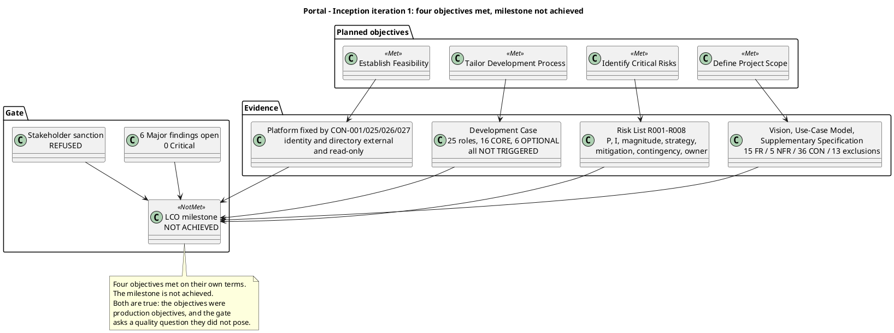
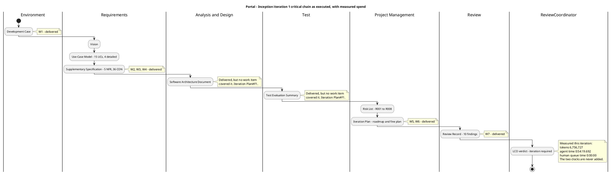
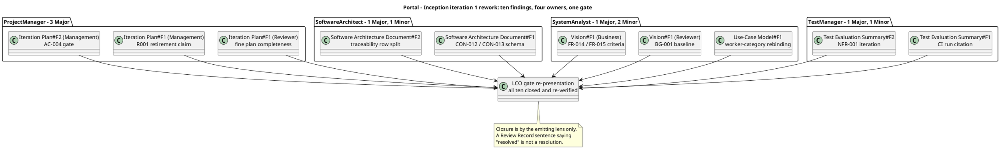

## Document Control

- **Phase:** Inception
- **Status:** Draft — iteration 1 assessment recorded
- **Milestone Target:** End of Inception (not yet achieved)

## Iteration Objectives Reached

The ReviewCoordinator's verdict for this iteration is **LCO: iteration required — scope incomplete**. This assessment records the iteration's outcome given that verdict. It does not re-issue the verdict and does not declare the milestone.

Four objectives were planned for the phase. All four are met on their own terms. The milestone is not achieved. Both statements are true and the difference between them is the substance of this assessment: the four objectives were production objectives — produce the baseline, produce the risk position, produce the tailoring, establish feasibility — and the gate asks a quality question they did not pose.

| # | Planned objective | Outcome | Evidence |
|---|---|---|---|
| 1 | Define Project Scope | **Met** | Vision, Use-Case Model and Supplementary Specification persisted. 15 use cases, one per declared FR-001 to FR-015; 5 NFRs; 36 constraints; 13 exclusions published verbatim as a checkable boundary. All three lenses confirmed 15 of 15, 5 of 5 and 36 of 36 coverage, and the trace tree shows no leaf on any FR, NFR or UC |
| 2 | Identify Critical Risks | **Met** | Risk List carries R001 and R002 with their declared identifiers and magnitudes (P=3 I=3 exposure=9; P=3 I=2 exposure=6), unrenumbered and unreclassified, plus team risks R003 to R008 in the order raised, each with probability, impact, magnitude, strategy, mitigation, contingency, owner and warning sign. The Risk List is one of three artifacts carrying zero findings across all three lenses |
| 3 | Tailor Development Process | **Met** | Development Case persisted as a delta over the IARI baseline: 25-role roster inherited unchanged, 16 CORE artifacts all produced, all six OPTIONAL triggers recorded NOT TRIGGERED against their §5.2 conditions, Business Modeling declared INACTIVE on the correct trigger, measurement policy refusing to set a token budget under CON-030. Zero findings across all three lenses |
| 4 | Establish Feasibility | **Met** | Platform fixed by CON-001, CON-025, CON-026 and CON-027; identity and directory external and read-only under CON-002, CON-003 and CON-022; the team's entire integration surface is stand-ins it controls under CON-031. The Management Reviewer recorded feasibility as met and stated explicitly that the No-Go verdict is not a finding that the project is not viable |

**Mapping to the Iteration Plan's own objectives.** The Iteration Plan states its objectives as O1 (baseline the declared scope), O2 (classify every risk), O3 (coarse roadmap and fine plan), O4 (assess LCO readiness). O1, O2 and O4 map one-to-one onto objectives 1, 2 and 4 above. O3 is the one that did not hold: the roadmap and the fine plan both exist, but the fine plan does not account for the iteration's actual work — see `Iteration Plan#F1` (Reviewer) in Rework Required. The phase's objective 3 (Tailor Development Process) is not an Iteration Plan objective at all; it was carried by the Development Case as a work item.

## Adherence to Plan
### What the iteration actually did

Nine artifacts were persisted. Eight were reviewed by all three lenses; the ninth is the Review Record itself, which is the review. Eleven agent invocations and eleven stakeholder exchanges produced them.

The critical chain below is the chain **as executed**, not as planned. Its depth is nine sequential agent stretches to the gate — two more than the plan drew, because the Software Architecture Document and the Test Evaluation Summary were produced without a work item covering them.

### Measured spend

This is the first phase of the project to close, so these are the first measured actuals that exist. Every forecast from here is built from them, and none is built from a theoretical capacity.

| Quantity | Measured | What the figure is for |
|---|---|---|
| Tokens consumed | 6,756,727 | The baseline for the iteration 2 forecast. Spend in this process scales with the live-artifact surface and the number of times it is re-read, not with the volume a phase emits — so the forecast for iteration 2 is this figure plus the cost of re-reading nine artifacts, and the lever if it rises is to replace a section rather than re-read it |
| Agent elapsed time | 0:54:19.692 | Iteration length on the working clock. It is not converted into a date and no date is projected from it |
| Human queue time | 0:00:00 | Waiting, not working. It excludes the end-of-iteration approval gate, which is not measured. It is reported beside agent time and never added to it |
| Agent invocations | 11 | The role-execution count behind the artifact set |
| Stakeholder exchanges | 11 | The human interactions this iteration required |

**No token budget exists and none is set.** CON-030 declares no budget or cap and forbids the team to set one. No figure above is a ceiling, and no declared scope was cut or deferred to fit any of them.

### Variance against the plan

Eight variances. Each is recorded with the correction it forces, in the same breath — a variance recorded without its correction is left open for the next iteration's reviewers to find.

```plantuml
@startuml
title Portal - Inception iteration 1 variance: plan against measured fact, and the adjustment each forces

package "Variance recorded" {
  class "V1 Fine plan omitted two artifacts\nit actually produced" as V1
  class "V2 Risk-retirement claim not\nsupported by the evidence chain" as V2
  class "V3 AC-004 assigned to the gate\nwhere its window opens" as V3
  class "V4 Role profile marked two\nproducing roles idle" as V4
  class "V5 Schema cannot satisfy\nCON-012 and CON-013 together" as V5
  class "V6 Worker-category rules bound\nto news filtering" as V6
  class "V7 Stale CI run cited as\nobserved SCM state" as V7
  class "V8 Three Minor defects in\nVision and Test Evaluation Summary" as V8
}

package "Adjustment forced" {
  class "A1 Fine plan and critical chain\ncarry every artifact the\niteration produces" as A1
  class "A2 R001 retirement restated against\nthe test that retires it, and the\ntest moved to iteration 3" as A2
  class "A3 AC-004 split: learnability check\nin iteration 5, population measure\npost-acceptance with HR" as A3
  class "A4 Role profile reflects the\nroles that actually produce" as A4
  class "A5 Schema shape chosen and the\nindex made to match it" as A5
  class "A6 Rule cluster rebound to the\nuse cases that enforce it" as A6
  class "A7 Observable SCM state cited\nonly as observed" as A7
  class "A8 Minor defects corrected in\nthe same pass" as A8
}

V1 --> A1
V2 --> A2
V3 --> A3
V4 --> A4
V5 --> A5
V6 --> A6
V7 --> A7
V8 --> A8

note bottom of V1
  Every variance here is recorded with
  the correction it forces. A variance
  without its correction is left open
  for the next iteration's reviewers.
end note
@enduml
```

| # | Variance | Root cause | Adjustment | State |
|---|---|---|---|---|
| V1 | The fine plan's work items W1–W7 covered seven artifacts; the iteration produced nine. The Software Architecture Document and the Test Evaluation Summary had no work item, no place in the critical chain, and their roles were marked idle in the Iteration 1 column | The fine plan was written from the discipline sequence the Development Case describes, not from the artifact set the iteration was actually going to produce. Analysis and Design is Medium and Test is Low in Inception — neither is idle, and both were treated as if they were | The fine plan and the critical chain carry every artifact the iteration produces, and the role profile marks SoftwareArchitect and TestManager active in Iteration 1 | **Corrected** — awaiting verification by the Reviewer lens |
| V2 | The plan answered "Yes" to whether the highest-magnitude risk is retired first, on the strength of the stand-in fixture being built in iteration 2. The test that retires R001 ran in iterations 4 and 6, and no test role was active in iteration 2 | The plan conflated building a risk's mechanism with retiring the risk. R001 is that the directory shows gaps when attributes are unfilled; a fixture that carries the gaps is the mechanism, and only a passing directory search and export against it is the retirement | The plan now carries a risk-retirement sequencing table naming the event that retires each risk. R001 is retired in **iteration 3** by executing the empty-attribute case of UC-011 and UC-004 against the stand-in — a passing directory search and export, not the fixture. Tester is active from iteration 3. The LCA consequence is stated: R001 retired before LCA, R002 and R008 open by their nature | **Corrected** — awaiting verification by the Management Reviewer lens |
| V3 | AC-004 was assigned verification in iteration 7, the iteration in which its own three-month window opens, so it could never close at the gate it was assigned to | AC-004 fuses two different things — a learnability check testable in the iteration that implements UC-001, and an 80% population measure governed by BG-003's three-month window — and the plan treated the fusion as one gate | AC-004 is split: AC-004a (learnability) verified in iteration 5 with a small untrained-user check; AC-004b (population) recorded as a post-Project-Acceptance measure with STK-001 as owner. Layer A states that AC-004 is verified in two parts at two different points | **Corrected** — awaiting verification by the Management Reviewer lens |
| V4 | The role profile marked SoftwareArchitect and TestManager inactive in Iteration 1 while both produced CORE artifacts | Same root cause as V1 — the profile was derived from the discipline sequence rather than from the work | Both roles active in Iteration 1; the profile is derived from the work items, not the other way round | **Corrected** — awaiting verification by the Reviewer lens |
| V5 | The Data View cannot satisfy CON-012 and CON-013 at the same time: recording a Clock Out is an in-place UPDATE of the row created at Clock In, which CON-013 forbids, while the unique index on (EmployeeId, WorkDate) rejects the correction row the Invariants table relies on. The correction record carries no previous-value column | The schema was designed for the happy path and the two invariants were asserted in a table beside it rather than enforced by the shape | The pair-recording shape is chosen explicitly, the unique index is made to match it, a PreviousValue column is added, and each Invariants row names the index that enforces it | Open — SoftwareArchitect, iteration 2 |
| V6 | The worker-category rule cluster (CON-009, CON-015, CON-016, CON-021) was bound to UC-010 Read and Filter News, and CON-015 was listed among UC-010's rules | Two closed four-value lists exist in this project — worker categories and news categories — and they were conflated. CON-015 exists precisely to prevent that confusion | The worker-category cluster is bound to UC-004 and UC-012 only; the news-category closed list is bound to UC-010, sourced from FR-010 and FR-006 | Open — SystemAnalyst, iteration 2 |
| V7 | The Test Evaluation Summary cited CI run `39932821851` as the observed build; the build observed on `main` at review time was run `39933356092` | A run identifier and two timestamps are observable SCM state, and the citation was written from an earlier read rather than the read at the moment of writing | The cited run is replaced with the observed one, or the build status is stated without a run identifier. The caveat that a green build on a repository holding only inputs and artifacts proves the pipeline runs and not that the product works is kept | Open — TestManager, iteration 2 |
| V8 | Three Minor defects: BG-001 presented as measurable with no declared baseline; FR-014 and FR-015 citing their own identifiers as success criteria; NFR-001 assigned to an Elaboration design iteration where its stated method cannot be executed | Each is a criterion that restates its requirement instead of measuring it, or a measurement assigned to a point where the behaviour does not yet exist | BG-001 marked not yet measurable with HR named as the baseline source; the two self-referential criteria replaced with observable checks; NFR-001 split into an Elaboration claim-mapping check and a Construction refusal assertion | Open — SystemAnalyst and TestManager, iteration 2 |

**Four of eight variances are corrected in this iteration; four remain open.** The four corrected are the ProjectManager's own findings, and they are corrected because the stakeholder's instruction was to correct all findings and the ProjectManager owns them. A correction is not a closure: the emitting lens verifies it and closes the finding, and until it does the variance stays recorded here.

### Lessons carried into iteration 2

1. **A plan derived from the discipline sequence will understate the iteration.** The two artifacts the fine plan missed are the two whose disciplines are Low or Medium in Inception. The plan is now derived from the artifact set the iteration will produce, and the role profile from the work items.
2. **Building a risk's mechanism is not retiring the risk.** The distinction is the whole point of risk-driven planning, and it is the one claim an LCO gate exists to test. The Iteration Plan now carries a risk-retirement sequencing table in which every risk names the event that retires it, and that event is a passing test or an observed reading — never a fixture, never a design. R001 is retired in iteration 3 by executing the empty-attribute case of UC-011 and UC-004 against the stand-in, and Tester is active from iteration 3 for exactly that reason.
3. **A criterion that restates its requirement is not a criterion.** Three of the ten findings are this defect in different artifacts. The test applied from here: can this criterion fail? If it cannot be distinguished from the requirement it verifies, it is not a measure.
4. **Observable SCM state must be cited as observed.** A run identifier, a timestamp, a build status — each is a fact with a moment. Citing one from memory makes a verified observation out of a stale one.
5. **The requirements baseline is the strongest part of the set and no finding touched it.** Fifteen use cases, one per declared requirement, no phantom use case, no cross-cutting mechanism promoted to a use case, no per-actor split, no exclusion crossed, no invented identifier. The defects are all in the artifacts where the team made design and planning decisions — which is where the next iteration's effort belongs.
6. **A milestone that does not pass costs an iteration, and that is the correct price.** The first iteration produced a complete baseline and still did not pass the gate. The remedy is iteration 2 in Inception, not a scope cut and not more agents in parallel. The roadmap is now eight iterations, and the declared scope is unchanged.

## Use Cases and Scenarios Implemented

No use case is implemented. Inception produces no working software, and no acceptance criterion is closed.

All fifteen declared use cases are baselined: each is identified, traced to its declared requirement, and bound to the constraints that govern it. Four are detailed because they are architecturally significant; eleven are outlined and are detailed in Elaboration.

| UC | Name | Source | State at iteration close | Detailed in |
|---|---|---|---|---|
| UC-001 | Clock In and Clock Out | FR-001 | Baselined, detailed | Iteration 1 |
| UC-002 | View Own Clocking History | FR-002 | Baselined, outline | Iteration 3 |
| UC-003 | View All Employee Clockings | FR-003 | Baselined, outline | Iteration 3 |
| UC-004 | Export Monthly Clocking Report as CSV | FR-004 | Baselined, detailed | Iteration 1 |
| UC-005 | Correct or Insert Clocking | FR-005 | Baselined, outline | Iteration 3 |
| UC-006 | Publish News | FR-006 | Baselined, outline | Iteration 3 |
| UC-007 | Edit Published News | FR-007 | Baselined, outline | Iteration 3 |
| UC-008 | Unpublish News | FR-008 | Baselined, outline | Iteration 3 |
| UC-009 | Feature or Un-feature News | FR-009 | Baselined, detailed | Iteration 1 |
| UC-010 | Read and Filter News | FR-010 | Baselined, outline — rule binding defective, `Use-Case Model#F1` | Iteration 3 |
| UC-011 | Search Employee Directory | FR-011 | Baselined, detailed | Iteration 1 |
| UC-012 | Assign or Clear Worker Category | FR-012 | Baselined, outline | Iteration 3 |
| UC-013 | Retry Clocking Through a Network Drop | FR-013 | Baselined, outline | Iteration 3 |
| UC-014 | Recognize Directory Unavailable | FR-014 | Baselined, outline | Iteration 3 |
| UC-015 | Recognize News Unavailable | FR-015 | Baselined, outline | Iteration 3 |

**Scenarios carried into Elaboration.** UC-001 A1–A4 (duplicate press, network recovered, network lost, second pair), UC-004 A1–A5 (missing clock-out, no clocking, no category, corrected day, empty directory attribute), UC-009 A1–A3 (un-feature, unpublish the featured item, nothing featured), UC-011 A1–A3 (empty attribute, network unreachable, no match).

**Why these four were detailed now.** UC-001 carries the client-timestamp and idempotency contract (FR-013) that forces a design decision. UC-004 is the project's most volatile interface — a fixed external column contract. UC-009 carries a system invariant (CON-010) that must hold wherever the change comes from. UC-011 carries the LDAP read and the R001 empty-attribute case. These are the four places where a wrong decision in Elaboration would be expensive to reverse.

## Results Relative to Evaluation Criteria
One line per criterion the Iteration Plan carried. Layer B is this iteration's own exit criteria; Layer A is the declared acceptance criteria the project is accountable to.

### Layer B — this iteration's exit criteria

| # | Criterion | Result at close | Evidence |
|---|---|---|---|
| E1 | The requirements baseline exists and every declared FR, NFR and CON is accounted for | **Met** | Vision, Use-Case Model and Supplementary Specification persisted; 15 UCs, 5 NFR, 36 CON. All three lenses confirmed the counts and the trace tree shows no leaf on any FR, NFR or UC |
| E2 | Every project risk is classified with probability, impact, magnitude, strategy, mitigation and contingency | **Met** | Risk List R001 to R008, each with all six attributes plus owner and warning sign. Zero findings across all three lenses |
| E3 | Every risk that is accepted cites the authority that granted the acceptance | **Met** | Every `Accept` cites the CON-023 grant and its condition. No risk is accepted on the Project Manager's own authority |
| E4 | The coarse roadmap and this iteration's fine plan both exist in this document | **Not met at close — corrected in this iteration** | Both sections existed and the roadmap was justified against the risk profile, but the fine plan did not account for the iteration's work: two CORE artifacts it produced had no work item, no place in the critical chain, and their roles were marked idle. `Iteration Plan#F1` (Reviewer). The fine plan now carries W5 and W6 with exit conditions, both in the critical chain, both roles Active in the Iteration 1 column |
| E5 | Every declared AC-NNN is accounted for, addressed or deferred to a named iteration | **Not met at close — corrected in this iteration** | Four of five were accounted for and deferred to a named iteration. AC-004 was assigned to iteration 7, the iteration in which its own three-month window opens, so it had no gate at which it could close. `Iteration Plan#F2` (Management Reviewer). Layer A now carries AC-004a (learnability, iteration 5) and AC-004b (population measure, post-Project-Acceptance with STK-001) as separate rows with separate gates |
| E6 | LCO readiness is assessed | **Met** | The Iteration Plan's LCO readiness assessment exists and answers all five LCO questions. The verdict on it is the ReviewCoordinator's and is recorded above, not here |

**E4 and E5 are recorded as not met at close, and that is the honest reading.** The corrections are in place in this iteration, but a correction is not a pass: the emitting lenses verify it and close the finding, and the criterion is re-assessed at the iteration 2 close. Recording them as met because they have since been corrected would erase the variance this assessment exists to record.

### Layer A — declared acceptance criteria

No acceptance criterion is closed. Each is verified by working software, which Inception does not produce.

| AC | Criterion | Carried by | Addressed this iteration by | Verified in |
|---|---|---|---|---|
| AC-001 | An employee can clock in and out without help from HR or the development team | FR-001 → UC-001 | UC-001 detailed; the one-press interaction and its confirmation are specified | Iteration 5 |
| AC-002 | An HR Administrator can publish a news item without technical assistance | FR-006 → UC-006 | UC-006 baselined and bound to CON-010, CON-018, MECH-02, MECH-03 | Iteration 6 |
| AC-003 | Any employee finds a colleague's phone/email in under 10 seconds | FR-011 → UC-011 | UC-011 detailed; the seven displayed fields and the LDAP read are specified | Iteration 7 |
| AC-004a | Learnability half — an employee completes at least one clocking with no prior training | FR-001 → UC-001 | UC-001 detailed; learnability is specified as a product requirement, not a communication task | Iteration 5 — a small untrained-user check in the iteration that implements UC-001 |
| AC-004b | Population half — 80% of employees complete at least one clocking within three months of launch | BG-003 | Not addressable inside an iteration: the window opens at go-live and closes after Project Acceptance | Post-Project-Acceptance, owner STK-001, measured against BG-003. Not a gate on any iteration |
| AC-005 | A clocking made while the corporate network is down for up to 5 minutes is not lost | FR-013 → UC-013 | UC-013 baselined as the exception path of UC-001; the retry and idempotency contract are specified | Iteration 5 |

**AC-004 is recorded in two parts because it fuses two different measures.** The learnability half is testable in the iteration that implements UC-001. The population half is governed by BG-003's three-month window and cannot close inside any iteration; assigning it to one would produce a criterion permanently in progress and a gate that can never close on it. It is a post-acceptance measure with a named owner, and the project's accountability to it is recorded rather than gated.

## Test Results

**No test was executed in this iteration and none could be.** The iteration produced no code, no stand-ins and no test cases. Reporting a pass rate would be reporting a result that does not exist.

| Measure | Value | Basis |
|---|---|---|
| Test cases designed | 0 | Test Case is an Elaboration artifact; the four detailed use cases are its input |
| Test cases executed | 0 | No code exists to execute against |
| Defects raised by test | 0 | No test ran, so no defect could be found. This is the correct reading, not a quality achievement |
| Use cases with a named test level and execution iteration | 15 of 15 | Test Evaluation Summary coverage plan |
| NFRs with a named measurement method | 5 of 5 | Test Evaluation Summary quality-attribute plan |
| Stand-in fixture obligations recorded | 1 | The empty job-title and empty extension entries that retire R001 (R004) |
| Test framework selected | No | Recorded gap; Test Manager closes it in Elaboration |

**Test Evaluation Summary mission verdict: MET.** The test effort is decidable — every use case has a test level and an iteration, every NFR has the measurement method the requirement itself names, the R001 fixture obligation is an entry criterion rather than a convention, and the defect record and quality signals are named. That verdict is about the test position, not the product, and the document says so.

**Quality signals.** The build on `main` was observed successful at review time — run `39933356092`, per the Review Record. The Test Evaluation Summary's own citation of run `39932821851` is stale and is `Test Evaluation Summary#F1`. The green build proves the CI path CON-029 requires is live; it carries no product evidence, because the repository holds project inputs and artifacts only. No open pull request, no branch labelled `ready-for-review`, and no issue in any state existed at review time.

**The defect record for this iteration is the Review Record, not the SCM issue tracker.** Ten findings were raised by review and none by test. The SCM issue tracker is the authoritative defect record from the first iteration that executes tests.

## External Changes

No change request was raised, approved or rejected this iteration. No declared scope was added, cut or deferred. The fifteen functional requirements, five non-functional requirements, thirty-six constraints, three business goals, five acceptance criteria and two declared risks are carried exactly as declared.

| Event | Effect on the plan |
|---|---|
| Stakeholder refused the LCO sanction and instructed that every finding be corrected | The iteration does not close the milestone. All ten findings are corrected before the gate is re-presented; none is deferred. No scope is cut — CON-023 forbids it and the remedy for a milestone that does not pass is another iteration |
| Two open questions deferred out of this cycle — accessibility target, and whether throughput is binding | Neither is designed for and neither is a gap. Both return to the stakeholder when this cycle closes. The Development Case records the factual consequence that CON-034's authoritative design reference states AA contrast, visible focus, 40px targets and keyboard-only operation, inherited as design conformance and not as a declared WCAG target |
| No Change Request, no scope change, no new stakeholder requirement | The requirements baseline is unchanged from the declared scope |

## Rework Required
Ten findings are open: 0 Critical, 6 Major, 4 Minor. The stakeholder's instruction is that every one be corrected. None is deferred, and no declared scope is cut or deferred to fit a schedule.

Closure is by the emitting lens only, through `resolve_artifact_finding`, after that lens verifies the correction is adequate. A Review Record sentence saying "resolved" is not a resolution and does not clear the gate. The table below records the correction each finding requires and, where this iteration made it, that the correction is in place and awaiting verification.

| Priority | Finding | Severity | Owner | Correction | Correction made in iteration 1 |
|---|---|---|---|---|---|
| 1 | `Software Architecture Document#F1` | Major | SoftwareArchitect | State how a pair is recorded across two presses under CON-013 — two append-only rows with CON-012 enforced on the pair, or one row whose Clock Out is an append-only correction referencing the original. Make the unique index match the chosen shape. Add a PreviousValue column to the correction record. Make each Invariants row name the index that enforces it | No — iteration 2 |
| 2 | `Iteration Plan#F1` (Management Reviewer) | Major | ProjectManager | Restate the R001 retirement claim to match the evidence chain — move the UC-011 and UC-004 test executions earlier, or state plainly that R001 stays open until Construction and record what that means for the LCA gate. Do not answer "Yes" to a risk-retirement question on the strength of a fixture | **Yes** — the plan now carries a risk-retirement sequencing table naming the event that retires each risk; R001 is retired in iteration 3 by executing the empty-attribute case of UC-011 and UC-004 against the stand-in; Tester is active from iteration 3; the LCA consequence is stated |
| 3 | `Iteration Plan#F2` (Management Reviewer) | Major | ProjectManager | Split AC-004 into its learnability check (iteration 5, with a small untrained-user check) and its post-launch population measure (BG-003 window, STK-001 as owner). State in Layer A that AC-004 is verified in two parts at two different points | **Yes** — Layer A now carries AC-004a and AC-004b as separate rows with separate gates, and states why a population measure cannot be an iteration gate |
| 4 | `Iteration Plan#F1` (Reviewer) | Major | ProjectManager | Add the Software Architecture Document and the Test Evaluation Summary as work items with exit conditions, place them in the critical chain, and mark SoftwareArchitect and TestManager active in Iteration 1 | **Yes** — W5 and W6 added with exit conditions, both placed in the critical chain with their own lanes, both roles marked Active in the Iteration 1 column |
| 5 | `Use-Case Model#F1` | Major | SystemAnalyst | Remove the `R_CAT --> UC010` edge and CON-015 from UC-010's rules. Bind the news-category closed list to UC-010, sourced from FR-010 and FR-006. Keep the worker-category cluster bound to UC-004 and UC-012 only | No — iteration 2 |
| 6 | `Test Evaluation Summary#F1` | Major | TestManager | Replace the cited run with the observed build, or state the build status without a run identifier. Keep the caveat that a green build proves the pipeline runs, not that the product works | No — iteration 2 |
| 7 | `Software Architecture Document#F2` | Minor | SoftwareArchitect | Split each affected component into two rows — one for the Realizes edges with Traces To empty, one for the DependsOn edges with Link Type DependsOn | No — iteration 2 |
| 8 | `Test Evaluation Summary#F2` | Minor | TestManager | Move NFR-001's execution to the first Construction iteration in which the use cases it exercises are implemented, or split the row into an Elaboration claim-mapping check and a Construction refusal assertion. Re-base the coverage plan to the eight-iteration roadmap | No — iteration 2 |
| 9 | `Vision#F1` (Reviewer) | Minor | SystemAnalyst | Mark the BG-001 row as not yet measurable and record that HR must supply the current manual baseline, or state the measure as a post-launch comparison HR performs | No — iteration 2 |
| 10 | `Vision#F1` (Business Reviewer) | Minor | SystemAnalyst | Replace the self-referential success criteria on the FR-014 and FR-015 feature rows with an independent observable measure | No — iteration 2 |

**Prioritization.** Priority 1 is the only finding that would cost a re-baseline if carried forward: Elaboration would baseline a schema that cannot satisfy two declared invariants, and the defect would surface as an unimplementable design rather than as a document error. Priorities 2 and 3 decide the milestone — they are the plan's own claims about risk retirement and acceptance-criterion gating, and a plan that answers "Yes" to a risk-retirement question on the strength of a fixture is the exact claim an LCO gate exists to refuse. Priority 4 is a completeness defect in the same artifact and was corrected in the same pass. Priorities 5 and 6 are Major but local. Priorities 7 to 10 are Minor and do not block the gate, but the stakeholder required every finding corrected, so none is deferred.

**Load by owner.** ProjectManager 3 Major — all three corrected in this iteration; SoftwareArchitect 1 Major and 1 Minor; SystemAnalyst 1 Major and 2 Minor; TestManager 1 Major and 1 Minor. The ProjectManager carried the heaviest load and it sat on one artifact; the three findings were distinct defects and were corrected in one pass over the Iteration Plan.

**What the next iteration is.** Iteration 2 is an Inception iteration, not the first Elaboration iteration: the LCO gate is re-presented after the ten corrections are verified, and Elaboration opens only when the sanction is granted. The remedy for a milestone that does not pass is another iteration — never more agent parallelism, which adds context conflict and artifact contention without proportional benefit, and never a cut to declared scope, which CON-023 forbids.
