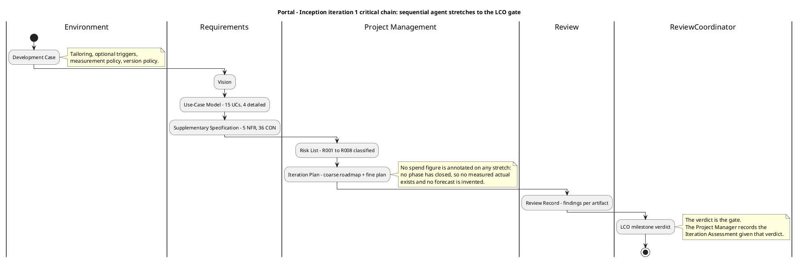

## Document Control

- **Phase:** Inception
- **Status:** Draft — iteration 1, submitted for review
- **Milestone Target:** End of Inception (not yet achieved)

## Iteration Objectives

Inception iteration 1 establishes the requirements baseline and the risk position the rest of the
project is planned against. It is a planning iteration, not a build iteration: no code is produced and
no acceptance criterion is closed here.

| # | Objective | Evidence that closes it |
|---|---|---|
| O1 | Baseline the declared scope as a requirements set the team can build against | Vision, Use-Case Model (15 UCs, one per declared FR), Supplementary Specification (5 NFR, 36 CON) |
| O2 | Classify every project risk with probability, impact, magnitude, strategy, mitigation and contingency | Risk List — R001 to R008, each with a strategy and a treatment |
| O3 | Establish the coarse cross-iteration roadmap and the fine plan for this iteration | This document — Plan and Milestones, Resources |
| O4 | Assess LCO readiness: is the project viable to proceed to Elaboration? | Evaluation Criteria below |

**What this iteration does not do.** It does not detail the eleven outline use cases (Elaboration), does
not produce the architecture (Elaboration), and does not build the stand-ins (Elaboration). It does not
close any acceptance criterion — every AC-NNN is verified by working software, which does not exist yet.

## Plan and Milestones

### Coarse roadmap — cross-iteration

Seven iterations across the four phases. The rubber profile (Inception 5%, Elaboration 20%,
Construction 65%, Transition 10%) is a starting point for **iteration count only**; the distribution
below is justified against this project's risk profile, not applied mechanically.

| Iteration | Phase | Milestone at close | Objective | Use cases in scope |
|---|---|---|---|---|
| 1 | Inception | **LCO** | Requirements baseline, risk position, roadmap | All 15 baselined; UC-001, UC-004, UC-009, UC-011 detailed |
| 2 | Elaboration | — | Architecture baseline; stand-ins built; the two High-volatility contracts designed | UC-001, UC-004, UC-009, UC-011 designed |
| 3 | Elaboration | **LCA** | Design complete for all 15; stand-ins validated; CON-031 human feedback received | All 15 designed |
| 4 | Construction | — | Clocking capability implemented and tested | UC-001, UC-002, UC-003, UC-004, UC-005, UC-013 |
| 5 | Construction | — | News capability implemented and tested | UC-006, UC-007, UC-008, UC-009, UC-010, UC-015 |
| 6 | Construction | **IOC** | Directory capability implemented; full regression; release candidate | UC-011, UC-012, UC-014 |
| 7 | Transition | **PR** | Handover to Infrastructure (CON-032); adoption measurement begins | All 15 in production |

**Why seven, and why this distribution.**

- **Inception is not stretched (1 iteration).** The declared scope is constraint-dense — 36 constraints
  against 15 requirements — so the stakeholder has already made most design decisions. There is no
  discovery to fund. A second Inception iteration would re-read the same baseline.
- **Elaboration is stretched (2 iterations).** This is where the project's real risk sits: R001 (LDAP
  attribute gaps), the FR-004 export contract and the CON-009 category list are the three High-volatility
  elements, and CON-031 makes the stand-ins the team's entire integration surface. Iteration 2 builds
  the architecture and the stand-ins; iteration 3 absorbs the CON-031 human feedback before LCA.
- **Construction is 3 iterations, not the profile's ~4.5.** The 15 use cases divide cleanly into three
  capability areas — clocking, news, directory — each a mini-project with its own analysis, design,
  implementation and test. Construction carries no discovery: every requirement is fully specified by a
  constraint. Adding a fourth iteration would add coordination overhead without retiring risk.
- **Transition is compressed (1 iteration).** Internal deployment on an estate Infrastructure already
  operates (CON-032), no data migration (CON-033), and AC-004 requires the portal be learnable with no
  training — so there is no training rollout to schedule.

Seven iterations sits inside the 6 ± 3 band. The lever for a slipped milestone is **another iteration**,
never a scope cut (CON-023) and never more agent parallelism.

```plantuml
@startgantt
title Portal - Iteration sequence and human gates (unanchored)

[T1 Inception iteration 1] lasts 1 day
[T1 Inception iteration 1] is colored in LightBlue

[LCO] happens at [T1 Inception iteration 1]'s end

[T2 Elaboration iteration 2] lasts 1 day
[T2 Elaboration iteration 2] starts at [T1 Inception iteration 1]'s end
[T2 Elaboration iteration 2] is colored in LightGreen

[T3 Elaboration iteration 3] lasts 1 day
[T3 Elaboration iteration 3] starts at [T2 Elaboration iteration 2]'s end
[T3 Elaboration iteration 3] is colored in LightGreen

[G1 CON-031 human validation gate] lasts 14 days
[G1 CON-031 human validation gate] starts at [T2 Elaboration iteration 2]'s end
[G1 CON-031 human validation gate] is colored in Salmon

[LCA] happens at [T3 Elaboration iteration 3]'s end

[T4 Construction iteration 4] lasts 1 day
[T4 Construction iteration 4] starts at [T3 Elaboration iteration 3]'s end
[T4 Construction iteration 4] is colored in Orange

[T5 Construction iteration 5] lasts 1 day
[T5 Construction iteration 5] starts at [T4 Construction iteration 4]'s end
[T5 Construction iteration 5] is colored in Orange

[T6 Construction iteration 6] lasts 1 day
[T6 Construction iteration 6] starts at [T5 Construction iteration 5]'s end
[T6 Construction iteration 6] is colored in Orange

[IOC] happens at [T6 Construction iteration 6]'s end

[T7 Transition iteration 7] lasts 1 day
[T7 Transition iteration 7] starts at [T6 Construction iteration 6]'s end
[T7 Transition iteration 7] is colored in Grey

[PR] happens at [T7 Transition iteration 7]'s end
@endgantt
```

**Reading this diagram.** It is unanchored: no project start date and no absolute date appears, because
no duration in this project has been measured. The `1 day` unit is the Gantt's rendering device for
**ordering** — it is not a size, not a duration and not a forecast, and no work item in this plan
carries a size. The one figure at true scale is the CON-031 human validation gate: **14 days of queue
time**, the ceiling the Development Case sets, drawn at that scale so the gate's weight against the
agent iterations is visible. That is a declared ceiling, not a measurement.

**Two clocks, never added.** Agent iterations are measured in tokens and elapsed agent time. The
CON-031 gate is measured in days of human queue time — waiting, not working. They are reported side by
side and never summed into one figure.

### Fine plan — Inception iteration 1

Bounded to this iteration. Owners are agent roles. No work item carries a size: no phase has closed, so
no measured actual exists and no forecast is invented (CON-030 sets no token budget, and none is set
here).

| # | Work item | Owner | Depends on | Exit condition |
|---|---|---|---|---|
| W1 | Development Case — tailoring, optional triggers, measurement and version policy | ProcessEngineer | — | Persisted; all six OPTIONAL triggers recorded |
| W2 | Vision — problem, features, exclusions, volatility map | SystemAnalyst | W1 | Persisted; 13 exclusions published verbatim |
| W3 | Use-Case Model — 15 UCs, 4 detailed, business-rule binding | SystemAnalyst | W2 | Persisted; every UC traces to its FR |
| W4 | Supplementary Specification — 5 NFR, 36 CON, MECH-01 to MECH-04 include graph | RequirementsSpecifier | W3 | Persisted; every constraint bound to a UC or a mechanism |
| W5 | Risk List — R001 to R008 classified, treated, traced | ProjectManager | W4 | Persisted; every risk has a strategy and a treatment |
| W6 | Iteration Plan — coarse roadmap and this fine plan | ProjectManager | W5 | Persisted; LCO readiness assessed |
| W7 | Review Record — findings per artifact | Reviewer, ReviewCoordinator | W6 | Findings recorded with severity |
| G0 | **LCO milestone verdict** | ReviewCoordinator | W7 | Verdict issued |

```plantuml
@startgantt
title Portal - Inception iteration 1 fine plan: work items and owners

[W1 Development Case - tailoring and triggers] lasts 1 day
[W1 Development Case - tailoring and triggers] is colored in LightBlue

[W2 Vision - problem, features, exclusions] lasts 1 day
[W2 Vision - problem, features, exclusions] starts at [W1 Development Case - tailoring and triggers]'s end
[W2 Vision - problem, features, exclusions] is colored in LightGreen

[W3 Use-Case Model - 15 UCs, 4 detailed] lasts 1 day
[W3 Use-Case Model - 15 UCs, 4 detailed] starts at [W2 Vision - problem, features, exclusions]'s end
[W3 Use-Case Model - 15 UCs, 4 detailed] is colored in LightGreen

[W4 Supplementary Specification - NFR and CON] lasts 1 day
[W4 Supplementary Specification - NFR and CON] starts at [W3 Use-Case Model - 15 UCs, 4 detailed]'s end
[W4 Supplementary Specification - NFR and CON] is colored in LightGreen

[W5 Risk List - R001 to R008] lasts 1 day
[W5 Risk List - R001 to R008] starts at [W4 Supplementary Specification - NFR and CON]'s end
[W5 Risk List - R001 to R008] is colored in Orange

[W6 Iteration Plan - roadmap and fine plan] lasts 1 day
[W6 Iteration Plan - roadmap and fine plan] starts at [W5 Risk List - R001 to R008]'s end
[W6 Iteration Plan - roadmap and fine plan] is colored in Orange

[W7 Review Record - findings] lasts 1 day
[W7 Review Record - findings] starts at [W6 Iteration Plan - roadmap and fine plan]'s end
[W7 Review Record - findings] is colored in Grey

[G0 LCO milestone verdict] happens at [W7 Review Record - findings]'s end
@endgantt
```

### Critical chain

The sequential agent stretches from iteration start to the LCO gate. Depth is seven stretches plus the
gate. No stretch carries a spend annotation: no phase has closed, so there is no measured actual to
forecast from.

## Resources

The 25-role roster is inherited unchanged from the Development Case. Three roles are idle by trigger,
not by choice: BusinessProcessAnalyst and BusinessReviewer (Business Modeling inactive) and
CapsuleDesigner (no real-time capsule). No role is added, merged or removed.

### Agent role profile — by iteration

| Role | It. 1 | It. 2 | It. 3 | It. 4 | It. 5 | It. 6 | It. 7 |
|---|---|---|---|---|---|---|---|
| ProcessEngineer | Active | Active | Active | Active | Active | Active | Active |
| SystemAnalyst | Active | Active | Active | — | — | — | — |
| RequirementsSpecifier | Active | Active | Active | — | — | — | — |
| SoftwareArchitect | — | Active | Active | Active | Active | Active | Active |
| Designer | — | Active | Active | Active | Active | Active | — |
| UserInterfaceDesigner | — | Active | Active | Active | Active | Active | — |
| DatabaseDesigner | — | Active | Active | Active | Active | Active | — |
| Implementer | — | — | — | Active | Active | Active | — |
| Integrator | — | — | — | Active | Active | Active | Active |
| TestManager | — | Active | Active | Active | Active | Active | Active |
| TestAnalyst | — | — | Active | Active | Active | Active | — |
| TestDesigner | — | — | Active | Active | Active | Active | — |
| Tester | — | — | — | Active | Active | Active | Active |
| DeploymentManager | — | — | — | — | — | Active | Active |
| ConfigurationManager | Active | Active | Active | Active | Active | Active | Active |
| ChangeControlManager | Active | Active | Active | Active | Active | Active | Active |
| ProjectManager | Active | Active | Active | Active | Active | Active | Active |
| Reviewer | Active | Active | Active | Active | Active | Active | Active |
| ReviewCoordinator | Active | Active | Active | Active | Active | Active | Active |
| ManagementReviewer | Active | — | Active | — | — | Active | Active |
| CodeReviewer | — | — | — | Active | Active | Active | — |
| TechnicalWriter | — | — | — | Active | Active | Active | Active |
| BusinessProcessAnalyst | Idle | Idle | Idle | Idle | Idle | Idle | Idle |
| BusinessReviewer | Idle | Idle | Idle | Idle | Idle | Idle | Idle |
| CapsuleDesigner | Idle | Idle | Idle | Idle | Idle | Idle | Idle |

**Parallelism discipline.** The profile widens in Construction because the work genuinely divides by
capability area, not because the project is behind. If an iteration slips, the remedy is another
iteration — never more roles in parallel, which adds context conflict and artifact contention without
proportional benefit, and never a cut to declared scope (CON-023).

### Human resources — the two clocks

| Resource | Role in the project | Clock | Bound |
|---|---|---|---|
| STK-001 Laura Gómez | Project sponsor; grants risk acceptance (CON-023); owns HR processes, news and worker categories | Human queue time | — |
| STK-002 Miguel Torres | Clarifies engineering doubts for the technical roles; does not build | Human queue time | — |
| STK-003 Infrastructure team | Operates AD and Keycloak; performs the CON-031 validation against the real systems; operates the portal post-launch (CON-032) | Human queue time | **14 days** ceiling on the CON-031 gate |
| STK-004 Cuba Corp Employees | End users; source of the BG-003 adoption measure | Human queue time | — |

The CON-031 validation gate is the only human gate inside the plan. It is bounded at 14 days of queue
time. If exceeded, the process suspends — nothing is auto-filled, no date is projected, and the Project
Manager escalates. The remedy is another iteration, not a scope reduction.

## Use Cases and Scenarios Addressed

All fifteen declared use cases are in the iteration's scope as a **baseline** activity: each is
identified, traced to its declared requirement, and bound to the constraints that govern it. Four are
detailed in this iteration because they are architecturally significant; eleven are outlined and are
detailed in Elaboration.

| UC | Name | Source | This iteration | Detailed in |
|---|---|---|---|---|
| UC-001 | Clock In and Clock Out | FR-001 | Baselined, **detailed** | Iteration 1 |
| UC-002 | View Own Clocking History | FR-002 | Baselined, outline | Iteration 3 |
| UC-003 | View All Employee Clockings | FR-003 | Baselined, outline | Iteration 3 |
| UC-004 | Export Monthly Clocking Report as CSV | FR-004 | Baselined, **detailed** | Iteration 1 |
| UC-005 | Correct or Insert Clocking | FR-005 | Baselined, outline | Iteration 3 |
| UC-006 | Publish News | FR-006 | Baselined, outline | Iteration 3 |
| UC-007 | Edit Published News | FR-007 | Baselined, outline | Iteration 3 |
| UC-008 | Unpublish News | FR-008 | Baselined, outline | Iteration 3 |
| UC-009 | Feature or Un-feature News | FR-009 | Baselined, **detailed** | Iteration 1 |
| UC-010 | Read and Filter News | FR-010 | Baselined, outline | Iteration 3 |
| UC-011 | Search Employee Directory | FR-011 | Baselined, **detailed** | Iteration 1 |
| UC-012 | Assign or Clear Worker Category | FR-012 | Baselined, outline | Iteration 3 |
| UC-013 | Retry Clocking Through a Network Drop | FR-013 | Baselined, outline | Iteration 3 |
| UC-014 | Recognize Directory Unavailable | FR-014 | Baselined, outline | Iteration 3 |
| UC-015 | Recognize News Unavailable | FR-015 | Baselined, outline | Iteration 3 |

**Why these four are detailed now.** UC-001 carries the client-timestamp and idempotency contract
(FR-013) that forces a design decision. UC-004 is the project's most volatile interface — a fixed
external column contract. UC-009 carries a system invariant (CON-010) that must hold wherever the
change comes from. UC-011 carries the LDAP read and the R001 empty-attribute case. These are the four
places where a wrong decision in Elaboration would be expensive to reverse.

**Scenarios carried into Elaboration.** UC-001 A1–A4 (duplicate press, network recovered, network lost,
second pair), UC-004 A1–A5 (missing clock-out, no clocking, no category, corrected day, empty directory
attribute), UC-009 A1–A3 (un-feature, unpublish the featured item, nothing featured), UC-011 A1–A3
(empty attribute, network unreachable, no match).

## Evaluation Criteria

Two layers, kept apart: the declared acceptance criteria the project is accountable to, and this
iteration's own exit criteria.

### Layer A — declared acceptance criteria

Every AC-NNN in the declared scope is accounted for. None is absent. No AC is closed in this iteration:
each is verified by working software, which Inception does not produce. Each is therefore addressed
here by the use case that carries it and deferred for verification to a named iteration.

| AC | Criterion | Carried by | Addressed this iteration by | Verified in |
|---|---|---|---|---|
| AC-001 | An employee can clock in and out without help from HR or the development team | FR-001 → UC-001 | UC-001 detailed; the one-press interaction and its confirmation are specified | Iteration 4 |
| AC-002 | An HR Administrator can publish a news item without technical assistance | FR-006 → UC-006 | UC-006 baselined and bound to CON-010, CON-018, MECH-02, MECH-03 | Iteration 5 |
| AC-003 | Any employee finds a colleague's phone/email in under 10 seconds | FR-011 → UC-011 | UC-011 detailed; the seven displayed fields and the LDAP read are specified | Iteration 6 |
| AC-004 | 80% of employees complete at least one clocking with no prior training | FR-001 → UC-001 | UC-001 detailed; learnability is specified as a product requirement, not a communication task | Iteration 7 |
| AC-005 | A clocking made while the corporate network is down for up to 5 minutes is not lost | FR-013 → UC-013 | UC-013 baselined as the exception path of UC-001; the retry and idempotency contract are specified | Iteration 4 |

### Layer B — this iteration's exit criteria

| # | Exit criterion | Met when |
|---|---|---|
| E1 | The requirements baseline exists and every declared FR, NFR and CON is accounted for | Vision, Use-Case Model and Supplementary Specification persisted; 15 UCs, 5 NFR, 36 CON |
| E2 | Every project risk is classified with probability, impact, magnitude, strategy, mitigation and contingency | Risk List persisted with R001 to R008 |
| E3 | Every risk that is accepted cites the authority that granted the acceptance | Risk List — each `Accept` cites CON-023 and its condition |
| E4 | The coarse roadmap and this iteration's fine plan both exist in this document | Plan and Milestones, Resources |
| E5 | Every declared AC-NNN is accounted for, addressed or deferred to a named iteration | Layer A above |
| E6 | LCO readiness is assessed | Below |

### LCO readiness assessment

| LCO question | Assessment | Basis |
|---|---|---|
| Do the stakeholders agree on the scope? | Yes, as declared | 15 FR, 5 NFR, 36 CON, 13 exclusions published verbatim in the Vision as a checkable boundary |
| Is the project viable to proceed to Elaboration? | Yes | The platform is fixed (CON-001, CON-025, CON-026, CON-027), identity and directory are external and read-only (CON-002, CON-003, CON-022), and the team's integration surface is the stand-ins it controls (CON-031) |
| Are the initial risks identified and classified? | Yes | R001 to R008, each with a strategy and a treatment; R001 and R002 carried with their declared identifiers and magnitudes |
| Is the architecture's risk position understood? | Yes, at the level Inception owes | The three High-volatility elements are named (FR-004, FR-009, FR-012) and the four architecturally significant use cases are detailed |
| Is there a plan to retire the highest-magnitude risk first? | Yes | R001 is retired in Elaboration iteration 2 by the stand-in directory carrying empty job-title and extension entries; R004 guards against retiring it untested |

**This assessment is an input to the LCO verdict, not the verdict.** The ReviewCoordinator issues the
milestone verdict; the Project Manager records the Iteration Assessment given that verdict.
