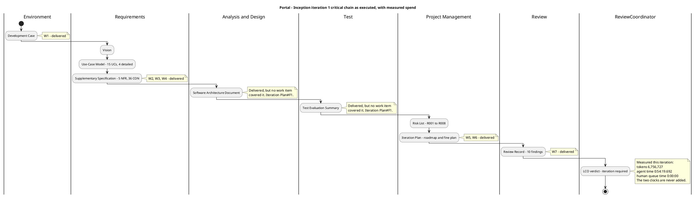
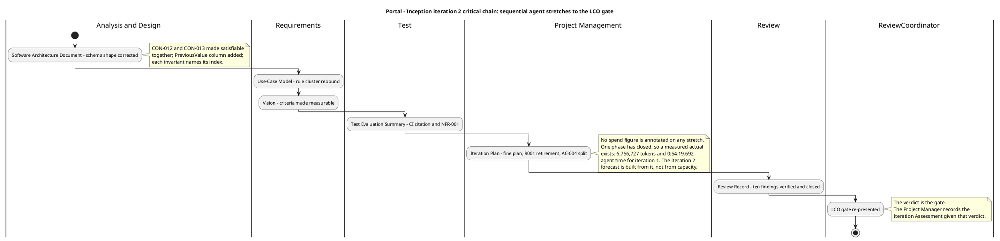

## Document Control
- **Phase:** Inception
- **Status:** Draft — iteration 1 closed with LCO not achieved; iteration 2 plan built
- **Milestone Target:** End of Inception (not yet achieved)
## Iteration Objectives
Inception iteration 1 establishes the requirements baseline and the risk position the rest of the project is planned against. It is a planning iteration, not a build iteration: no code is produced and no acceptance criterion is closed here.

| # | Objective | Evidence that closes it | Result |
|---|---|---|---|
| O1 | Baseline the declared scope as a requirements set the team can build against | Vision, Use-Case Model (15 UCs, one per declared FR), Supplementary Specification (5 NFR, 36 CON) | Met |
| O2 | Classify every project risk with probability, impact, magnitude, strategy, mitigation and contingency | Risk List — R001 to R008, each with a strategy and a treatment | Met |
| O3 | Establish the coarse cross-iteration roadmap and the fine plan for this iteration | This document — Plan and Milestones, Resources | Partially met — the roadmap holds; the fine plan omitted two artifacts the iteration produced. Corrected in this revision |
| O4 | Assess LCO readiness: is the project viable to proceed to Elaboration? | Evaluation Criteria below | Met — the assessment exists; the verdict on it is the ReviewCoordinator's and was **iteration required** |

**What this iteration does not do.** It does not detail the eleven outline use cases (Elaboration), does not produce the architecture (Elaboration), and does not build the stand-ins (Elaboration). It does not close any acceptance criterion — every AC-NNN is verified by working software, which does not exist yet.

**Iteration 2 objectives.** Correct the ten findings raised at the LCO review and re-present the gate. No scope is added, none is cut. The work items are in Plan and Milestones.

## Plan and Milestones
### Coarse roadmap — cross-iteration

Eight iterations across the four phases. The rubber profile (Inception 5%, Elaboration 20%, Construction 65%, Transition 10%) is a starting point for **iteration count only**; the distribution below is justified against this project's risk profile, not applied mechanically.

Iteration 1 did not close the LCO milestone: the ReviewCoordinator's verdict was iteration required, and the stakeholder refused the sanction with the instruction that every finding be corrected. Iteration 2 is therefore a second **Inception** iteration, not the first Elaboration iteration. Elaboration opens only when the LCO sanction is granted. The remedy for a milestone that does not pass is another iteration — never a scope cut (CON-023) and never more agent parallelism.

| Iteration | Phase | Milestone at close | Objective | Use cases in scope |
|---|---|---|---|---|
| 1 | Inception | LCO — **not achieved** | Requirements baseline, risk position, roadmap | All 15 baselined; UC-001, UC-004, UC-009, UC-011 detailed |
| 2 | Inception | **LCO** | Correct the ten findings; re-present the gate | Unchanged — no scope added, none cut |
| 3 | Elaboration | — | Architecture baseline; stand-ins built; the two High-volatility contracts designed; **R001 retired** | UC-001, UC-004, UC-009, UC-011 designed; the empty-attribute case of UC-011 and UC-004 executed |
| 4 | Elaboration | **LCA** | Design complete for all 15; stand-ins validated; CON-031 human feedback received | All 15 designed |
| 5 | Construction | — | Clocking capability implemented and tested | UC-001, UC-002, UC-003, UC-004, UC-005, UC-013 |
| 6 | Construction | — | News capability implemented and tested | UC-006, UC-007, UC-008, UC-009, UC-010, UC-015 |
| 7 | Construction | **IOC** | Directory capability implemented; full regression; release candidate | UC-011, UC-012, UC-014 |
| 8 | Transition | **PR** | Handover to Infrastructure (CON-032); adoption measurement begins | All 15 in production |

**Re-basing.** Every iteration from the old iteration 2 onward shifts by one. The Test Evaluation Summary's execution iterations follow the roadmap: the old iteration 3 becomes 4, the old 4 becomes 5, the old 5 becomes 6, the old 6 becomes 7. The TestManager re-bases the coverage plan in the same correction pass that closes `Test Evaluation Summary#F2`.

**Why eight, and why this distribution.**

- **Inception is two iterations, not one.** The first iteration produced a complete and correctly shaped requirements baseline — no phantom use case, no exclusion crossed, no invented identifier — and still did not pass the gate, because the plan that must carry the project through Elaboration did not survive its own evidence chain. The second iteration corrects ten findings and re-presents the gate. It adds no scope: the declared 15 requirements, 5 NFRs and 36 constraints are unchanged.
- **Elaboration is two iterations.** This is where the project's real risk sits: R001 (LDAP attribute gaps), the FR-004 export contract and the CON-009 category list are the three High-volatility elements, and CON-031 makes the stand-ins the team's entire integration surface. Iteration 3 builds the architecture and the stand-ins and retires R001; iteration 4 absorbs the CON-031 human feedback before LCA.
- **Construction is three iterations, not the profile's ~4.5.** The 15 use cases divide cleanly into three capability areas — clocking, news, directory — each a mini-project with its own analysis, design, implementation and test. Construction carries no discovery: every requirement is fully specified by a constraint. A fourth iteration would add coordination overhead without retiring risk.
- **Transition is one iteration.** Internal deployment on an estate Infrastructure already operates (CON-032), no data migration (CON-033), and AC-004 requires the portal be learnable with no training — so there is no training rollout to schedule.

Eight iterations sits inside the 6 ± 3 band.

```plantuml
@startgantt
title Portal - Iteration sequence and human gates (unanchored)

[T1 Inception iteration 1] lasts 1 day
[T1 Inception iteration 1] is colored in LightBlue

[LCO attempt 1 - not achieved] happens at [T1 Inception iteration 1]'s end

[T2 Inception iteration 2 - corrections] lasts 1 day
[T2 Inception iteration 2 - corrections] starts at [T1 Inception iteration 1]'s end
[T2 Inception iteration 2 - corrections] is colored in LightBlue

[LCO] happens at [T2 Inception iteration 2 - corrections]'s end

[T3 Elaboration iteration 3] lasts 1 day
[T3 Elaboration iteration 3] starts at [T2 Inception iteration 2 - corrections]'s end
[T3 Elaboration iteration 3] is colored in LightGreen

[T4 Elaboration iteration 4] lasts 1 day
[T4 Elaboration iteration 4] starts at [T3 Elaboration iteration 3]'s end
[T4 Elaboration iteration 4] is colored in LightGreen

[G1 CON-031 human validation gate] lasts 14 days
[G1 CON-031 human validation gate] starts at [T3 Elaboration iteration 3]'s end
[G1 CON-031 human validation gate] is colored in Salmon

[LCA] happens at [T4 Elaboration iteration 4]'s end

[T5 Construction iteration 5] lasts 1 day
[T5 Construction iteration 5] starts at [T4 Elaboration iteration 4]'s end
[T5 Construction iteration 5] is colored in Orange

[T6 Construction iteration 6] lasts 1 day
[T6 Construction iteration 6] starts at [T5 Construction iteration 5]'s end
[T6 Construction iteration 6] is colored in Orange

[T7 Construction iteration 7] lasts 1 day
[T7 Construction iteration 7] starts at [T6 Construction iteration 6]'s end
[T7 Construction iteration 7] is colored in Orange

[IOC] happens at [T7 Construction iteration 7]'s end

[T8 Transition iteration 8] lasts 1 day
[T8 Transition iteration 8] starts at [T7 Construction iteration 7]'s end
[T8 Transition iteration 8] is colored in Grey

[PR] happens at [T8 Transition iteration 8]'s end
@endgantt
```

**Reading this diagram.** It is unanchored: no project start date and no absolute date appears, because no duration in this project has been measured. The `1 day` unit is the Gantt's rendering device for **ordering** — it is not a size, not a duration and not a forecast, and no work item in this plan carries a size. The one figure at true scale is the CON-031 human validation gate: **14 days of queue time**, the ceiling the Development Case sets, drawn at that scale so the gate's weight against the agent iterations is visible. That is a declared ceiling, not a measurement.

**Two clocks, never added.** Agent iterations are measured in tokens and elapsed agent time. The CON-031 gate is measured in days of human queue time — waiting, not working. They are reported side by side and never summed into one figure.

### Fine plan — Inception iteration 1 (closed)

Bounded to iteration 1, corrected to account for the work the iteration actually did. Nine artifacts were produced, not seven: the Software Architecture Document and the Test Evaluation Summary were produced without a work item covering them, and their roles were marked idle in the role profile. Both are corrected here.

No work item carries a size. No phase had closed when this plan was written, so no measured actual existed and no forecast was invented.

| # | Work item | Owner | Depends on | Exit condition |
|---|---|---|---|---|
| W1 | Development Case — tailoring, optional triggers, measurement and version policy | ProcessEngineer | — | Persisted; all six OPTIONAL triggers recorded |
| W2 | Vision — problem, features, exclusions, volatility map | SystemAnalyst | W1 | Persisted; 13 exclusions published verbatim |
| W3 | Use-Case Model — 15 UCs, 4 detailed, business-rule binding | SystemAnalyst | W2 | Persisted; every UC traces to its FR |
| W4 | Supplementary Specification — 5 NFR, 36 CON, MECH-01 to MECH-04 include graph | RequirementsSpecifier | W3 | Persisted; every constraint bound to a UC or a mechanism |
| W5 | Software Architecture Document — components, views, constraint conformance, deployment | SoftwareArchitect | W4 | Persisted; the three High-volatility requirements each encapsulated |
| W6 | Test Evaluation Summary — evaluation mission, coverage plan, quality signals | TestManager | W5 | Persisted; 15 of 15 UCs and 5 of 5 NFRs assigned |
| W7 | Risk List — R001 to R008 classified, treated, traced | ProjectManager | W6 | Persisted; every risk has a strategy and a treatment |
| W8 | Iteration Plan — coarse roadmap and this fine plan | ProjectManager | W7 | Persisted; LCO readiness assessed |
| W9 | Review Record — findings per artifact | Reviewer, BusinessReviewer, ManagementReviewer, ReviewCoordinator | W8 | Findings recorded with severity |
| G0 | **LCO milestone verdict** | ReviewCoordinator | W9 | Verdict issued — iteration required |

```plantuml
@startgantt
title Portal - Inception iteration 1 fine plan: work items and owners

[W1 Development Case - tailoring and triggers] lasts 1 day
[W1 Development Case - tailoring and triggers] is colored in LightBlue

[W2 Vision - problem, features, exclusions] lasts 1 day
[W2 Vision - problem, features, exclusions] starts at [W1 Development Case - tailoring and triggers]'s end
[W2 Vision - problem, features, exclusions] is colored in LightGreen

[W3 Use-Case Model - 15 UCs, 4 detailed] lasts 1 day
[W3 Use-Case Model - 15 UCs, 4 detailed] starts at [W2 Vision - problem, features, exclusions]'s end
[W3 Use-Case Model - 15 UCs, 4 detailed] is colored in LightGreen

[W4 Supplementary Specification - NFR and CON] lasts 1 day
[W4 Supplementary Specification - NFR and CON] starts at [W3 Use-Case Model - 15 UCs, 4 detailed]'s end
[W4 Supplementary Specification - NFR and CON] is colored in LightGreen

[W5 Software Architecture Document] lasts 1 day
[W5 Software Architecture Document] starts at [W4 Supplementary Specification - NFR and CON]'s end
[W5 Software Architecture Document] is colored in LightBlue

[W6 Test Evaluation Summary] lasts 1 day
[W6 Test Evaluation Summary] starts at [W5 Software Architecture Document]'s end
[W6 Test Evaluation Summary] is colored in LightBlue

[W7 Risk List - R001 to R008] lasts 1 day
[W7 Risk List - R001 to R008] starts at [W6 Test Evaluation Summary]'s end
[W7 Risk List - R001 to R008] is colored in Orange

[W8 Iteration Plan - roadmap and fine plan] lasts 1 day
[W8 Iteration Plan - roadmap and fine plan] starts at [W7 Risk List - R001 to R008]'s end
[W8 Iteration Plan - roadmap and fine plan] is colored in Orange

[W9 Review Record - findings] lasts 1 day
[W9 Review Record - findings] starts at [W8 Iteration Plan - roadmap and fine plan]'s end
[W9 Review Record - findings] is colored in Grey

[G0 LCO milestone verdict] happens at [W9 Review Record - findings]'s end
@endgantt
```

### Critical chain — Inception iteration 1

The sequential agent stretches from iteration start to the LCO gate, as executed. Depth is nine stretches plus the gate. Analysis and Design and Test each carry a lane: both disciplines are active in Inception — Analysis and Design at Medium, Test at Low — and neither role is idle.

No stretch carries a spend annotation. No phase had closed when this chain was drawn, so there was no measured actual to forecast from. The measured spend of this iteration is recorded in the Iteration Assessment and is the basis of the iteration 2 forecast.

### Fine plan — Inception iteration 2 (next)

Bounded to iteration 2. Every work item closes a named finding; no work item adds scope. The declared 15 requirements, 5 NFRs and 36 constraints are unchanged, and no declared work is cut or deferred to fit an estimate.

No work item carries a size. One phase has now closed, so a measured actual exists — 6,756,727 tokens and 0:54:19.692 of agent time for iteration 1 — and it is the basis of the forecast below, not a theoretical capacity.

| # | Work item | Owner | Closes | Exit condition |
|---|---|---|---|---|
| W1 | Software Architecture Document — choose the pair-recording shape under CON-013, make the unique index match it, add the PreviousValue column, make each Invariants row name the index that enforces it | SoftwareArchitect | `Software Architecture Document#F1` | CON-012 and CON-013 satisfiable together by the drawn schema; the correction record carries the previous value |
| W2 | Software Architecture Document — split the conflated Traceability rows by link type | SoftwareArchitect | `Software Architecture Document#F2` | One row per link type; `Traces To` empty on Realizes rows |
| W3 | Use-Case Model — rebind the worker-category cluster to UC-004 and UC-012 only; bind the news-category closed list to UC-010 from FR-010 and FR-006 | SystemAnalyst | `Use-Case Model#F1` | No worker-category rule on UC-010; CON-015 appears only where it applies |
| W4 | Vision — mark BG-001 not yet measurable with HR as the baseline source; replace the self-referential FR-014 and FR-015 success criteria with observable checks | SystemAnalyst | `Vision#F1` (Reviewer), `Vision#F1` (Business Reviewer) | Every success criterion can fail |
| W5 | Test Evaluation Summary — cite the observed CI run or state the build status without a run identifier; re-base the coverage plan to the eight-iteration roadmap; move NFR-001's execution to where the behaviour exists; record the iteration 3 empty-attribute execution | TestManager | `Test Evaluation Summary#F1`, `Test Evaluation Summary#F2` | No stale observable SCM state; every execution iteration matches the roadmap |
| W6 | Iteration Plan — this document: fine plan completeness, R001 retirement restated, AC-004 split, roadmap re-based | ProjectManager | `Iteration Plan#F1` (Reviewer), `Iteration Plan#F1` (Management Reviewer), `Iteration Plan#F2` (Management Reviewer) | Every artifact the iteration produces has a work item; R001's retirement names the test that retires it; AC-004 has a gate at which each half can close |
| W7 | Review Record — re-review the corrected artifacts and close the ten findings | Reviewer, BusinessReviewer, ManagementReviewer, ReviewCoordinator | — | Ten findings verified and closed by their emitting lenses |
| G0 | **LCO gate re-presented** | ReviewCoordinator | — | Verdict issued |

```plantuml
@startgantt
title Portal - Inception iteration 2 fine plan: corrections and LCO re-presentation

[W1 Correct the schema shape - CON-012 and CON-013] lasts 1 day
[W1 Correct the schema shape - CON-012 and CON-013] is colored in LightGreen

[W2 Rebind the worker-category rule cluster] lasts 1 day
[W2 Rebind the worker-category rule cluster] starts at [W1 Correct the schema shape - CON-012 and CON-013]'s end
[W2 Rebind the worker-category rule cluster] is colored in LightGreen

[W3 Correct the Vision criteria] lasts 1 day
[W3 Correct the Vision criteria] starts at [W2 Rebind the worker-category rule cluster]'s end
[W3 Correct the Vision criteria] is colored in LightGreen

[W4 Correct the test position] lasts 1 day
[W4 Correct the test position] starts at [W3 Correct the Vision criteria]'s end
[W4 Correct the test position] is colored in LightBlue

[W5 Revise the Iteration Plan] lasts 1 day
[W5 Revise the Iteration Plan] starts at [W4 Correct the test position]'s end
[W5 Revise the Iteration Plan] is colored in Orange

[W6 Re-review and close the ten findings] lasts 1 day
[W6 Re-review and close the ten findings] starts at [W5 Revise the Iteration Plan]'s end
[W6 Re-review and close the ten findings] is colored in Grey

[G0 LCO gate re-presented] happens at [W6 Re-review and close the ten findings]'s end
@endgantt
```

### Critical chain — Inception iteration 2

Four sequential agent stretches to the gate. The chain is shorter than iteration 1's because the work is correction, not production: no artifact is created, and each stretch edits an artifact that already exists.

### Risk retirement sequencing

R001 is the project's highest-magnitude risk (P=3, I=3, exposure=9). Its mechanism is the stand-in directory carrying entries with empty job title and extension (CON-031); its **retirement** is a passing directory search and export against that fixture. Building the fixture is not retiring the risk, and this plan does not claim it is.

| Risk | Mechanism built in | Retired by | Retired in |
|---|---|---|---|
| R001 | Iteration 3 — the stand-in directory with empty-attribute entries | The empty-attribute case of UC-011 and UC-004 executed against the stand-in: the directory renders the field blank with the row intact, and the export produces the row with an empty FullName | **Iteration 3** |
| R002 | Iteration 5 — FR-001 as one press with a visible confirmation | BG-003 adoption reading after launch | Post-launch, STK-001 |
| R003 | Iteration 3 — queue time measured apart from agent time | CON-031 feedback received from Infrastructure and HR | Iteration 4 |
| R004 | Iteration 3 — the fixture inspection | CodeReviewer verifies the empty-attribute entries before the directory tests are accepted | Iteration 3 |
| R005 | Every iteration — the 13 exclusions published verbatim | Every review, every artifact | Continuous |
| R006 | Iteration 3 — the column derivation table in UC-004 | The export contract asserted column by column | Iteration 5 |
| R007 | Iteration 2 — the iteration preparation checkpoint | Test framework selected and the CI glob discovers the test projects | Iteration 3 |
| R008 | Iteration 5 — the confirmation shows the recorded time | Accepted under CON-023; mitigated, not retired | — |

**R001 is retired in Elaboration iteration 3, before LCA.** The empty-attribute case of UC-011 and UC-004 needs no production code beyond the directory read path and the export derivation, so it is the project's first executed test and it runs in the iteration that builds the stand-ins. The full use-case tests for UC-004 and UC-011 remain in Construction with the rest of their capability areas. This is the sequencing the Test Evaluation Summary's coverage plan follows.

**What this means for the LCA gate.** LCA is granted with R001 already retired and R003, R004, R006 and R007 retired or closed. R002 and R008 remain open by their nature — one is a post-launch adoption measure, the other is accepted under CON-023 — and the LCA gate records both as open with their treatments, not as retired.

## Resources
The 25-role roster is inherited unchanged from the Development Case. Three roles are idle by trigger, not by choice: BusinessProcessAnalyst and BusinessReviewer (Business Modeling inactive) and CapsuleDesigner (no real-time capsule). No role is added, merged or removed.

### Agent role profile — by iteration

The profile is derived from the work items, not the other way round. Iteration 1's column is corrected: Analysis and Design is Medium and Test is Low in Inception, so neither SoftwareArchitect nor TestManager is idle — both produced CORE artifacts in iteration 1.

| Role | It. 1 | It. 2 | It. 3 | It. 4 | It. 5 | It. 6 | It. 7 | It. 8 |
|---|---|---|---|---|---|---|---|---|
| ProcessEngineer | Active | Active | Active | Active | Active | Active | Active | Active |
| SystemAnalyst | Active | Active | Active | Active | — | — | — | — |
| RequirementsSpecifier | Active | — | Active | Active | — | — | — | — |
| SoftwareArchitect | Active | Active | Active | Active | Active | Active | Active | Active |
| Designer | — | — | Active | Active | Active | Active | Active | — |
| UserInterfaceDesigner | — | — | Active | Active | Active | Active | Active | — |
| DatabaseDesigner | — | — | Active | Active | Active | Active | Active | — |
| Implementer | — | — | — | — | Active | Active | Active | — |
| Integrator | — | — | — | — | Active | Active | Active | Active |
| TestManager | Active | Active | Active | Active | Active | Active | Active | Active |
| TestAnalyst | — | — | Active | Active | Active | Active | Active | — |
| TestDesigner | — | — | Active | Active | Active | Active | Active | — |
| Tester | — | — | Active | Active | Active | Active | Active | — |
| DeploymentManager | — | — | — | — | — | — | Active | Active |
| ConfigurationManager | Active | Active | Active | Active | Active | Active | Active | Active |
| ChangeControlManager | Active | Active | Active | Active | Active | Active | Active | Active |
| ProjectManager | Active | Active | Active | Active | Active | Active | Active | Active |
| Reviewer | Active | Active | Active | Active | Active | Active | Active | Active |
| ReviewCoordinator | Active | Active | Active | Active | Active | Active | Active | Active |
| ManagementReviewer | Active | Active | — | Active | — | — | Active | Active |
| CodeReviewer | — | — | Active | Active | Active | Active | Active | — |
| TechnicalWriter | — | — | — | — | Active | Active | Active | Active |
| BusinessProcessAnalyst | Idle | Idle | Idle | Idle | Idle | Idle | Idle | Idle |
| BusinessReviewer | Idle | Idle | Idle | Idle | Idle | Idle | Idle | Idle |
| CapsuleDesigner | Idle | Idle | Idle | Idle | Idle | Idle | Idle | Idle |

**Two corrections to iteration 1's column.** SoftwareArchitect and TestManager are Active, not idle: the Software Architecture Document and the Test Evaluation Summary were both produced in iteration 1 and both are CORE artifacts the Development Case requires. The profile now follows the work items.

**Tester is active from iteration 3, not iteration 5.** R001 is retired in iteration 3 by executing the empty-attribute case of UC-011 and UC-004 against the stand-in, and a risk cannot be retired by a role that is not working. This is the sequencing correction that closes `Iteration Plan#F1` (Management Reviewer).

**Parallelism discipline.** The profile widens in Construction because the work genuinely divides by capability area, not because the project is behind. If an iteration slips, the remedy is another iteration — never more roles in parallel, which adds context conflict and artifact contention without proportional benefit, and never a cut to declared scope (CON-023).

### Human resources — the two clocks

| Resource | Role in the project | Clock | Bound |
|---|---|---|---|
| STK-001 Laura Gómez | Project sponsor; grants risk acceptance (CON-023); owns HR processes, news and worker categories; owns the BG-001 baseline and the AC-004 population measure | Human queue time | — |
| STK-002 Miguel Torres | Clarifies engineering doubts for the technical roles; does not build | Human queue time | — |
| STK-003 Infrastructure team | Operates AD and Keycloak; performs the CON-031 validation against the real systems; operates the portal post-launch (CON-032) | Human queue time | **14 days** ceiling on the CON-031 gate |
| STK-004 Cuba Corp Employees | End users; source of the BG-003 adoption measure | Human queue time | — |

The CON-031 validation gate is the only human gate inside the plan. It is bounded at 14 days of queue time. If exceeded, the process suspends — nothing is auto-filled, no date is projected, and the Project Manager escalates. The remedy is another iteration, not a scope reduction.

**Measured human queue time, iteration 1: 0:00:00.** That figure excludes the end-of-iteration approval gate, which is not measured. It is reported beside the agent clock and never added to it.

## Use Cases and Scenarios Addressed
All fifteen declared use cases are in the iteration's scope as a **baseline** activity: each is identified, traced to its declared requirement, and bound to the constraints that govern it. Four are detailed in this iteration because they are architecturally significant; eleven are outlined and are detailed in Elaboration iteration 4.

| UC | Name | Source | This iteration | Detailed in |
|---|---|---|---|---|
| UC-001 | Clock In and Clock Out | FR-001 | Baselined, **detailed** | Iteration 1 |
| UC-002 | View Own Clocking History | FR-002 | Baselined, outline | Iteration 4 |
| UC-003 | View All Employee Clockings | FR-003 | Baselined, outline | Iteration 4 |
| UC-004 | Export Monthly Clocking Report as CSV | FR-004 | Baselined, **detailed** | Iteration 1 |
| UC-005 | Correct or Insert Clocking | FR-005 | Baselined, outline | Iteration 4 |
| UC-006 | Publish News | FR-006 | Baselined, outline | Iteration 4 |
| UC-007 | Edit Published News | FR-007 | Baselined, outline | Iteration 4 |
| UC-008 | Unpublish News | FR-008 | Baselined, outline | Iteration 4 |
| UC-009 | Feature or Un-feature News | FR-009 | Baselined, **detailed** | Iteration 1 |
| UC-010 | Read and Filter News | FR-010 | Baselined, outline | Iteration 4 |
| UC-011 | Search Employee Directory | FR-011 | Baselined, **detailed** | Iteration 1 |
| UC-012 | Assign or Clear Worker Category | FR-012 | Baselined, outline | Iteration 4 |
| UC-013 | Retry Clocking Through a Network Drop | FR-013 | Baselined, outline | Iteration 4 |
| UC-014 | Recognize Directory Unavailable | FR-014 | Baselined, outline | Iteration 4 |
| UC-015 | Recognize News Unavailable | FR-015 | Baselined, outline | Iteration 4 |

**Why these four are detailed now.** UC-001 carries the client-timestamp and idempotency contract (FR-013) that forces a design decision. UC-004 is the project's most volatile interface — a fixed external column contract. UC-009 carries a system invariant (CON-010) that must hold wherever the change comes from. UC-011 carries the LDAP read and the R001 empty-attribute case. These are the four places where a wrong decision in Elaboration would be expensive to reverse.

**Scenarios carried into Elaboration.** UC-001 A1–A4 (duplicate press, network recovered, network lost, second pair), UC-004 A1–A5 (missing clock-out, no clocking, no category, corrected day, empty directory attribute), UC-009 A1–A3 (un-feature, unpublish the featured item, nothing featured), UC-011 A1–A3 (empty attribute, network unreachable, no match).

**Two scenarios are executed in iteration 3, not deferred to Construction.** UC-011 A1 (empty attribute) and UC-004 A5 (empty directory attribute) are the cases that retire R001. They need no production code beyond the directory read path and the export derivation, so they run in the iteration that builds the stand-ins. The full use-case tests for UC-004 and UC-011 remain in Construction with the rest of their capability areas.

## Evaluation Criteria
Two layers, kept apart: the declared acceptance criteria the project is accountable to, and this iteration's own exit criteria.

### Layer A — declared acceptance criteria

Every AC-NNN in the declared scope is accounted for. None is absent. No AC is closed in this iteration: each is verified by working software, which Inception does not produce. Each is addressed here by the use case that carries it and deferred for verification to a named iteration.

**AC-004 is verified in two parts at two different points.** It fuses a learnability check — an employee completes a clocking with no prior training, testable in the iteration that implements UC-001 — with an 80%-of-population measure governed by BG-003's three-month window, which cannot close inside any iteration. The two halves are separated below and each is assigned to a point where it can actually close.

| AC | Criterion | Carried by | Addressed this iteration by | Verified in |
|---|---|---|---|---|
| AC-001 | An employee can clock in and out without help from HR or the development team | FR-001 → UC-001 | UC-001 detailed; the one-press interaction and its confirmation are specified | Iteration 5 |
| AC-002 | An HR Administrator can publish a news item without technical assistance | FR-006 → UC-006 | UC-006 baselined and bound to CON-010, CON-018, MECH-02, MECH-03 | Iteration 6 |
| AC-003 | Any employee finds a colleague's phone/email in under 10 seconds | FR-011 → UC-011 | UC-011 detailed; the seven displayed fields and the LDAP read are specified | Iteration 7 |
| AC-004a | **Learnability half** — an employee completes at least one clocking with no prior training | FR-001 → UC-001 | UC-001 detailed; learnability is specified as a product requirement, not a communication task | **Iteration 5** — a small untrained-user check in the iteration that implements UC-001 |
| AC-004b | **Population half** — 80% of employees complete at least one clocking within three months of launch | BG-003 | Not addressable inside an iteration. The three-month window opens at go-live and closes after Project Acceptance | **Post-Project-Acceptance**, owner STK-001, measured against BG-003. Not a gate on any iteration |
| AC-005 | A clocking made while the corporate network is down for up to 5 minutes is not lost | FR-013 → UC-013 | UC-013 baselined as the exception path of UC-001; the retry and idempotency contract are specified | Iteration 5 |

**Why AC-004b is not an iteration gate.** A population measure whose window opens at go-live cannot be verified by the iteration in which the window opens. Assigning it to one would produce a criterion that is permanently "in progress" and a gate that can never close on it. It is a post-acceptance measure with a named owner, and the project's accountability to it is recorded rather than gated.

### Layer B — this iteration's exit criteria

| # | Exit criterion | Met when | Result at iteration 1 close |
|---|---|---|---|
| E1 | The requirements baseline exists and every declared FR, NFR and CON is accounted for | Vision, Use-Case Model and Supplementary Specification persisted; 15 UCs, 5 NFR, 36 CON | **Met** |
| E2 | Every project risk is classified with probability, impact, magnitude, strategy, mitigation and contingency | Risk List persisted with R001 to R008 | **Met** |
| E3 | Every risk that is accepted cites the authority that granted the acceptance | Risk List — each `Accept` cites CON-023 and its condition | **Met** |
| E4 | The coarse roadmap and this iteration's fine plan both exist in this document | Plan and Milestones, Resources | **Partially met** — the fine plan omitted two artifacts the iteration produced; corrected in this revision |
| E5 | Every declared AC-NNN is accounted for, addressed or deferred to a named iteration | Layer A above | **Not met** — AC-004 had no gate at which it could close; corrected in this revision by the two-part split |
| E6 | LCO readiness is assessed | Below | **Met** |

### LCO readiness assessment

| LCO question | Assessment | Basis |
|---|---|---|
| Do the stakeholders agree on the scope? | Yes, as declared | 15 FR, 5 NFR, 36 CON, 13 exclusions published verbatim in the Vision as a checkable boundary. No finding in any lens touched the requirements baseline |
| Is the project viable to proceed to Elaboration? | Yes | The platform is fixed (CON-001, CON-025, CON-026, CON-027), identity and directory are external and read-only (CON-002, CON-003, CON-022), and the team's integration surface is the stand-ins it controls (CON-031) |
| Are the initial risks identified and classified? | Yes | R001 to R008, each with a strategy and a treatment; R001 and R002 carried with their declared identifiers and magnitudes |
| Is the architecture's risk position understood? | Yes, at the level Inception owes | The three High-volatility elements are named (FR-004, FR-009, FR-012) and the four architecturally significant use cases are detailed |
| Is there a plan to retire the highest-magnitude risk first? | Yes — and the claim now names the test that retires it | R001's mechanism is the stand-in directory with empty-attribute entries, built in iteration 3. R001 is **retired in iteration 3** by executing the empty-attribute case of UC-011 and UC-004 against that fixture — a passing directory search and export, not the fixture itself. Tester is active from iteration 3 for exactly this reason. R004 guards against retiring it untested |

**This assessment is an input to the LCO verdict, not the verdict.** The ReviewCoordinator issues the milestone verdict; the Project Manager records the Iteration Assessment given that verdict. At iteration 1 close the verdict was **iteration required** and the stakeholder refused the sanction; the gate is re-presented at the close of iteration 2.

