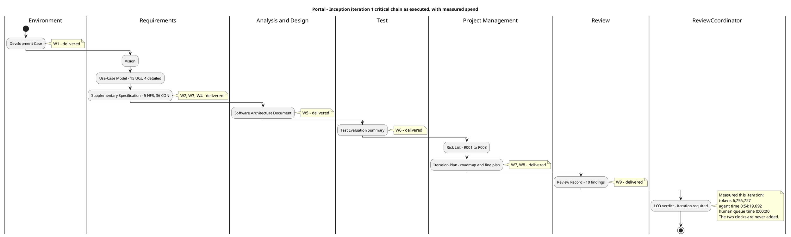
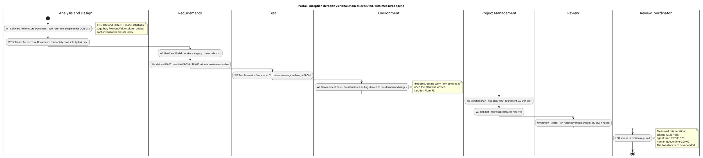
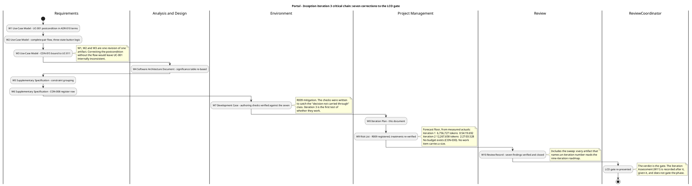

## Document Control
- **Phase:** Inception
- **Status:** Draft — iteration 2, submitted for review
- **Milestone Target:** End of Inception (not yet achieved)

## Iteration Objectives
Inception iteration 3 is a correction iteration. It creates no artifact and adds no scope: the declared 15 requirements, 5 NFRs, 36 constraints, 3 business goals, 5 acceptance criteria and 2 declared risks are carried exactly as declared. Its work is to close the seven findings the iteration 2 review raised and to re-present the LCO gate.

| # | Objective | Evidence that closes it | State |
|---|---|---|---|
| O1 | Close every finding the iteration 2 review raised, in every section each finding names | Plan and Milestones — fine plan W1–W6; the Review Record's consolidated ledger | Open — seven findings, four owners. Assessed at close |
| O2 | Re-base every artifact that names an iteration number onto the nine-iteration roadmap | Plan and Milestones — coarse roadmap; fine plan W4 and W10 | Open — the Software Architecture Document and the Test Evaluation Summary both name Elaboration iterations 3 and 4, which this roadmap moves to 4 and 5. Assessed at close |
| O3 | Make the fine plan account for every artifact the iteration produces, and the role profile follow the work items | Plan and Milestones — fine plan W1–W11; Resources — agent role profile | In place — eleven work items, each with an owner and an exit condition; every role that produces is Active in its iteration. Assessed at close |
| O4 | State each risk's retirement against the event that retires it, never against the mechanism that makes it retirable | Plan and Milestones — Risk retirement sequencing | In place — R001 is retired in iteration 4 by executing the empty-attribute case of UC-011 and UC-004, not by building the fixture. Assessed at close |
| O5 | Give every declared acceptance criterion a point at which it can close | Evaluation Criteria — Layer A | In place — AC-004 is split into a learnability check at iteration 6 and a post-Project-Acceptance population measure owned by STK-001. Assessed at close |
| O6 | Re-present the LCO gate | Evaluation Criteria — LCO readiness assessment | Open — the verdict is the ReviewCoordinator's and is not issued in this document |

**Iteration 2 outcome, which this iteration is built on.** Iteration 2 corrected all ten iteration-1 findings and the emitting lenses closed all ten. It did not pass the gate: the corrections themselves produced seven new findings — 0 Critical, 5 Major, 2 Minor — and the stakeholder refused the sanction a second time with the instruction that every finding be corrected and closed. Three of the five Major findings sit in one artifact, the Use-Case Model, and two of those three are the same defect class: a rule or a decision another artifact changed, not carried through to the use case that must enforce it.

**What this iteration does not do.** It does not detail the eleven outline use cases, does not produce the architecture baseline, and does not build the stand-ins — all Elaboration work. It closes no acceptance criterion: every AC-NNN is verified by working software, which does not exist yet.
## Plan and Milestones
### Coarse roadmap — cross-iteration

Nine iterations across the four phases. The rubber profile (Inception 5%, Elaboration 20%, Construction 65%, Transition 10%) is a starting point for **iteration count only**; the distribution below is justified against this project's risk profile, not applied mechanically.

Neither Inception iteration has closed the LCO milestone. Iteration 1's verdict was iteration required; iteration 2's verdict was iteration required again, and the stakeholder refused the sanction a second time with the instruction that every finding be corrected and closed. Iteration 3 is therefore a third **Inception** iteration. Elaboration opens only when the LCO sanction is granted. The remedy for a milestone that does not pass is another iteration — never a scope cut (CON-023) and never more agent parallelism.

| Iteration | Phase | Milestone at close | Objective | Use cases in scope |
|---|---|---|---|---|
| 1 | Inception | LCO attempt 1 — **not achieved** | Requirements baseline, risk position, roadmap | All 15 baselined; UC-001, UC-004, UC-009, UC-011 detailed |
| 2 | Inception | LCO attempt 2 — **not achieved** | Correct the ten iteration-1 findings; re-present the gate | Unchanged — no scope added, none cut |
| 3 | Inception | **LCO** | Correct the seven iteration-2 findings; re-present the gate | Unchanged — no scope added, none cut |
| 4 | Elaboration | — | Architecture baseline; stand-ins built; the two High-volatility contracts designed; **R001 retired** | UC-001, UC-004, UC-009, UC-011 designed; the empty-attribute case of UC-011 and UC-004 executed |
| 5 | Elaboration | **LCA** | Design complete for all 15; stand-ins validated; CON-031 human feedback received | All 15 designed |
| 6 | Construction | — | Clocking capability implemented and tested | UC-001, UC-002, UC-003, UC-004, UC-005, UC-013 |
| 7 | Construction | — | News capability implemented and tested | UC-006, UC-007, UC-008, UC-009, UC-010, UC-015 |
| 8 | Construction | **IOC** | Directory capability implemented; full regression; release candidate | UC-011, UC-012, UC-014 |
| 9 | Transition | **PR** | Handover to Infrastructure (CON-032); adoption measurement begins | All 15 in production |

**Re-base, and what it costs the other artifacts.** Every iteration from the old iteration 3 onward shifts by one: Elaboration is now iterations 4 and 5, Construction 6 to 8, Transition 9. Two artifacts were corrected in iteration 2 against the previous eight-iteration numbering and now name iterations this table has moved. The Software Architecture Document's architectural-significance "Design in" column and the Test Evaluation Summary's coverage plan both read Elaboration iterations 3 and 4; under this table they read **4 and 5**. Iteration 3's W4 and W10 sweep every artifact that names an iteration number against this table, and that sweep is an exit condition of the LCO re-presentation, not a convention.

**Why nine, and why this distribution.**

- **Inception is three iterations.** The first produced a complete and correctly shaped requirements baseline and did not pass the gate, because the plan that must carry the project through Elaboration did not survive its own evidence chain. The second corrected ten findings and did not pass the gate either: the corrections themselves produced seven new findings, five of them Major, and three of those sit in one artifact. The third corrects those seven. No iteration has added scope.
- **Elaboration is two iterations.** This is where the project's real risk sits: R001 (LDAP attribute gaps), the FR-004 export contract and the CON-009 category list are the three High-volatility elements, and CON-031 makes the stand-ins the team's entire integration surface. Iteration 4 builds the architecture and the stand-ins and retires R001; iteration 5 absorbs the CON-031 human feedback before LCA.
- **Construction is three iterations, not the profile's ~4.5.** The 15 use cases divide cleanly into three capability areas — clocking, news, directory — each a mini-project with its own analysis, design, implementation and test. Construction carries no discovery: every requirement is fully specified by a constraint. A fourth iteration would add coordination overhead without retiring risk.
- **Transition is one iteration.** Internal deployment on an estate Infrastructure already operates (CON-032), no data migration (CON-033), and AC-004 requires the portal be learnable with no training — so there is no training rollout to schedule.

**Nine is the ceiling of the 6 ± 3 band, and that is the load-bearing fact in this table.** A fourth Inception iteration would take the project to ten and out of the band. That reading would be correct: it would mean the correction process is not converging and the process needs correction, not another pass. R009 registers exactly that risk and names the check that decides it — whether iteration 3's review raises a third generation of the "a decision another artifact changed, not carried through" defect class.

```plantuml
@startgantt
title Portal - Iteration sequence and human gates (unanchored)

[T1 Inception iteration 1] lasts 1 day
[T1 Inception iteration 1] is colored in LightBlue

[LCO attempt 1 - not achieved] happens at [T1 Inception iteration 1]'s end

[T2 Inception iteration 2 - corrections] lasts 1 day
[T2 Inception iteration 2 - corrections] starts at [T1 Inception iteration 1]'s end
[T2 Inception iteration 2 - corrections] is colored in LightBlue

[LCO attempt 2 - not achieved] happens at [T2 Inception iteration 2 - corrections]'s end

[T3 Inception iteration 3 - corrections and roadmap re-base] lasts 1 day
[T3 Inception iteration 3 - corrections and roadmap re-base] starts at [T2 Inception iteration 2 - corrections]'s end
[T3 Inception iteration 3 - corrections and roadmap re-base] is colored in LightBlue

[LCO] happens at [T3 Inception iteration 3 - corrections and roadmap re-base]'s end

[T4 Elaboration iteration 4] lasts 1 day
[T4 Elaboration iteration 4] starts at [T3 Inception iteration 3 - corrections and roadmap re-base]'s end
[T4 Elaboration iteration 4] is colored in LightGreen

[G1 CON-031 human validation gate] lasts 14 days
[G1 CON-031 human validation gate] starts at [T4 Elaboration iteration 4]'s end
[G1 CON-031 human validation gate] is colored in Salmon

[T5 Elaboration iteration 5] lasts 1 day
[T5 Elaboration iteration 5] starts at [T4 Elaboration iteration 4]'s end
[T5 Elaboration iteration 5] is colored in LightGreen

[LCA] happens at [T5 Elaboration iteration 5]'s end

[T6 Construction iteration 6] lasts 1 day
[T6 Construction iteration 6] starts at [T5 Elaboration iteration 5]'s end
[T6 Construction iteration 6] is colored in Orange

[T7 Construction iteration 7] lasts 1 day
[T7 Construction iteration 7] starts at [T6 Construction iteration 6]'s end
[T7 Construction iteration 7] is colored in Orange

[T8 Construction iteration 8] lasts 1 day
[T8 Construction iteration 8] starts at [T7 Construction iteration 7]'s end
[T8 Construction iteration 8] is colored in Orange

[IOC] happens at [T8 Construction iteration 8]'s end

[T9 Transition iteration 9] lasts 1 day
[T9 Transition iteration 9] starts at [T8 Construction iteration 8]'s end
[T9 Transition iteration 9] is colored in Grey

[PR] happens at [T9 Transition iteration 9]'s end
@endgantt
```

**Reading this diagram.** It is unanchored: no project start date and no absolute date appears, because no duration in this project has been measured. The `1 day` unit is the Gantt's rendering device for **ordering** — it is not a size, not a duration and not a forecast, and no work item in this plan carries a size. The one figure at true scale is the CON-031 human validation gate: **14 days of queue time**, the ceiling the Development Case sets, drawn at that scale so the gate's weight against the agent iterations is visible. That is a declared ceiling, not a measurement.

**Two clocks, never added.** Agent iterations are measured in tokens and elapsed agent time. The CON-031 gate is measured in days of human queue time — waiting, not working. They are reported side by side and never summed into one figure.

### Fine plan — Inception iteration 1 (closed)

Bounded to iteration 1, and it accounts for the work the iteration actually did. Nine artifacts were produced and each has a work item. Analysis and Design is Medium and Test is Low in Inception, so the Software Architecture Document and the Test Evaluation Summary are on the plan and on the critical chain, and their roles are Active.

No work item carries a size. No phase had closed when this plan was written, so no measured actual existed and no forecast was invented.

| # | Work item | Owner | Depends on | Exit condition |
|---|---|---|---|---|
| W1 | Development Case — tailoring, optional triggers, measurement and version policy | ProcessEngineer | — | Persisted; all six OPTIONAL triggers recorded |
| W2 | Vision — problem, features, exclusions, volatility map | SystemAnalyst | W1 | Persisted; 13 exclusions published verbatim |
| W3 | Use-Case Model — 15 UCs, 4 detailed, business-rule binding | SystemAnalyst | W2 | Persisted; every UC traces to its FR |
| W4 | Supplementary Specification — 5 NFR, 36 CON, MECH-01 to MECH-04 include graph | RequirementsSpecifier | W3 | Persisted; every constraint bound to a UC or a mechanism |
| W5 | Software Architecture Document — components, views, constraint conformance, deployment | SoftwareArchitect | W4 | Persisted; the three High-volatility requirements each encapsulated |
| W6 | Test Evaluation Summary — evaluation mission, coverage plan, quality signals | TestManager | W5 | Persisted; 15 of 15 UCs and 5 of 5 NFRs assigned |
| W7 | Risk List — R001 to R008 classified, treated, traced | ProjectManager | W6 | Persisted; every risk has a strategy and a treatment |
| W8 | Iteration Plan — coarse roadmap and this fine plan | ProjectManager | W7 | Persisted; LCO readiness assessed |
| W9 | Review Record — findings per artifact | Reviewer, BusinessReviewer, ManagementReviewer, ReviewCoordinator | W8 | Findings recorded with severity |
| G0 | **LCO milestone verdict** | ReviewCoordinator | W9 | Verdict issued — iteration required |

```plantuml
@startgantt
title Portal - Inception iteration 1 fine plan: work items and owners

[W1 Development Case - tailoring and triggers] lasts 1 day
[W1 Development Case - tailoring and triggers] is colored in LightBlue

[W2 Vision - problem, features, exclusions] lasts 1 day
[W2 Vision - problem, features, exclusions] starts at [W1 Development Case - tailoring and triggers]'s end
[W2 Vision - problem, features, exclusions] is colored in LightGreen

[W3 Use-Case Model - 15 UCs, 4 detailed] lasts 1 day
[W3 Use-Case Model - 15 UCs, 4 detailed] starts at [W2 Vision - problem, features, exclusions]'s end
[W3 Use-Case Model - 15 UCs, 4 detailed] is colored in LightGreen

[W4 Supplementary Specification - NFR and CON] lasts 1 day
[W4 Supplementary Specification - NFR and CON] starts at [W3 Use-Case Model - 15 UCs, 4 detailed]'s end
[W4 Supplementary Specification - NFR and CON] is colored in LightGreen

[W5 Software Architecture Document] lasts 1 day
[W5 Software Architecture Document] starts at [W4 Supplementary Specification - NFR and CON]'s end
[W5 Software Architecture Document] is colored in LightBlue

[W6 Test Evaluation Summary] lasts 1 day
[W6 Test Evaluation Summary] starts at [W5 Software Architecture Document]'s end
[W6 Test Evaluation Summary] is colored in LightBlue

[W7 Risk List - R001 to R008] lasts 1 day
[W7 Risk List - R001 to R008] starts at [W6 Test Evaluation Summary]'s end
[W7 Risk List - R001 to R008] is colored in Orange

[W8 Iteration Plan - roadmap and fine plan] lasts 1 day
[W8 Iteration Plan - roadmap and fine plan] starts at [W7 Risk List - R001 to R008]'s end
[W8 Iteration Plan - roadmap and fine plan] is colored in Orange

[W9 Review Record - findings] lasts 1 day
[W9 Review Record - findings] starts at [W8 Iteration Plan - roadmap and fine plan]'s end
[W9 Review Record - findings] is colored in Grey

[G0 LCO milestone verdict] happens at [W9 Review Record - findings]'s end
@endgantt
```

### Critical chain — Inception iteration 1

The sequential agent stretches from iteration start to the LCO gate, as executed. Depth is nine stretches plus the gate. Analysis and Design and Test each carry a lane: both disciplines are active in Inception — Analysis and Design at Medium, Test at Low — and neither role is idle.

No stretch carries a spend annotation. No phase had closed when this chain was drawn, so there was no measured actual to forecast from. The measured spend of this iteration is recorded in the Iteration Assessment and is the basis of the iteration 2 forecast.

### Critical chain — Inception iteration 2

Six sequential agent stretches to the gate, as executed. The chain is shorter than iteration 1's because the work is correction, not production: no artifact is created, and each stretch edits an artifact that already exists. The Development Case stretch sits before the Review Record, because the Review Record verifies the corrected artifacts and the Development Case is one of them.

### Risk retirement sequencing

R001 is the project's highest-magnitude risk (P=3, I=3, exposure=9). Its mechanism is the stand-in directory carrying entries with empty job title and extension (CON-031); its **retirement** is a passing directory search and export against that fixture. Building the fixture is not retiring the risk, and this plan does not claim it is.

| Risk | Mechanism built in | Retired by | Retired in |
|---|---|---|---|
| R001 | Iteration 4 — the stand-in directory with empty-attribute entries | The empty-attribute case of UC-011 and UC-004 executed against the stand-in: the directory renders the field blank with the row intact, and the export produces the row with an empty FullName | **Iteration 4** |
| R002 | Iteration 6 — FR-001 as one press with a visible confirmation | BG-003 adoption reading after launch | Post-launch, STK-001 |
| R003 | Iteration 4 — queue time measured apart from agent time | CON-031 feedback received from Infrastructure and HR | Iteration 5 |
| R004 | Iteration 4 — the fixture inspection | CodeReviewer verifies the empty-attribute entries before the directory tests are accepted | Iteration 4 |
| R005 | Every iteration — the 13 exclusions published verbatim | Every review, every artifact | Continuous |
| R006 | Iteration 4 — the column derivation table in UC-004 | The export contract asserted column by column | Iteration 6 |
| R007 | Iteration 3 — the iteration preparation checkpoint | Test framework selected and the CI glob discovers the test projects | Iteration 4 |
| R008 | Iteration 6 — the confirmation shows the recorded time | Accepted under CON-023; mitigated, not retired | — |
| R009 | Iteration 3 — the Development Case authoring checks and the cross-artifact iteration-number sweep | The iteration 3 review raises no finding of the "a decision another artifact changed, not carried through" class | **Iteration 3** |

**R001 is retired in Elaboration iteration 4, before LCA.** The empty-attribute case of UC-011 and UC-004 needs no production code beyond the directory read path and the export derivation, so it is the project's first executed test and it runs in the iteration that builds the stand-ins. The full use-case tests for UC-004 and UC-011 remain in Construction with the rest of their capability areas. This is the sequencing the Test Evaluation Summary's coverage plan follows.

**What this means for the LCA gate.** LCA is granted with R001 already retired and R003, R004, R006 and R007 retired or closed. R002 and R008 remain open by their nature — one is a post-launch adoption measure, the other is accepted under CON-023 — and the LCA gate records both as open with their treatments, not as retired.

**R009 is the risk this iteration's own history creates.** Two Inception iterations have each produced a generation of the same defect class: a decision one artifact changed, not carried through to the artifacts that had to follow it. Iteration 1's corrections produced seven findings of that class; iteration 2's corrections produced five Major findings of it, three in one artifact. If iteration 3's corrections produce a third generation, the authoring checks are not working and the remedy is a process correction, not a fourth pass. R009's mechanism is inside the team's control, so its strategy is Avoid, not Accept — no CON-023 grant is needed and none is cited.

### Fine plan — Inception iteration 2 (current)

Bounded to iteration 2. Every work item closes a named finding or resolves a named suspect trace; no work item adds scope. The declared 15 requirements, 5 NFRs, 36 constraints, 3 business goals, 5 acceptance criteria and 2 declared risks are unchanged, and no declared work is cut or deferred to fit an estimate.

No work item carries a size. One phase has now closed, so a measured actual exists — 6,756,727 tokens and 0:54:19.692 of agent time for iteration 1 — and it is the basis of the forecast below, not a theoretical capacity.

| # | Work item | Owner | Closes | Exit condition |
|---|---|---|---|---|
| W1 | Software Architecture Document — choose the pair-recording shape under CON-013, make the unique index match it, add the PreviousValue column, make each Invariants row name the index that enforces it | SoftwareArchitect | `Software Architecture Document#F1` | CON-012 and CON-013 satisfiable together by the drawn schema; the correction record carries the previous value |
| W2 | Software Architecture Document — split the conflated Traceability rows by link type | SoftwareArchitect | `Software Architecture Document#F2` | One row per link type; `Traces To` empty on Realizes rows |
| W3 | Use-Case Model — rebind the worker-category cluster to UC-004 and UC-012 only; bind the news-category closed list to UC-010 from FR-010 and FR-006 | SystemAnalyst | `Use-Case Model#F1` | No worker-category rule on UC-010; CON-015 appears only where it applies |
| W4 | Vision — mark BG-001 not yet measurable with HR as the baseline source; replace the self-referential FR-014 and FR-015 success criteria with observable checks | SystemAnalyst | `Vision#F1` (Reviewer), `Vision#F1` (Business Reviewer) | Every success criterion can fail |
| W5 | Test Evaluation Summary — cite the observed CI run or state the build status without a run identifier; re-base the coverage plan to the eight-iteration roadmap; move NFR-001's execution to where the behaviour exists; record the iteration 3 empty-attribute execution | TestManager | `Test Evaluation Summary#F1`, `Test Evaluation Summary#F2` | No stale observable SCM state; every execution iteration matches the roadmap |
| W6 | Iteration Plan — this document: fine plan completeness, R001 retirement restated, AC-004 split, roadmap re-based | ProjectManager | `Iteration Plan#F1` (Reviewer), `Iteration Plan#F1` (Management Reviewer), `Iteration Plan#F2` (Management Reviewer) | Every artifact the iteration produces has a work item; R001's retirement names the test that retires it; AC-004 has a gate at which each half can close |
| W7 | Risk List — re-verify the four suspect traces against the changed UC-010 and UC-011 and clear or evolve each | ProjectManager | — | No suspect trace left open against the Risk List |
| W8 | Review Record — re-review the corrected artifacts and close the ten findings | Reviewer, BusinessReviewer, ManagementReviewer, ReviewCoordinator | — | Ten findings verified and closed by their emitting lenses |
| G0 | **LCO gate re-presented** | ReviewCoordinator | — | Verdict issued |
| W9 | Iteration Assessment — record the iteration 2 outcome given the verdict | ProjectManager | — | Assessment persisted; it does not gate the phase |

```plantuml
@startgantt
title Portal - Inception iteration 2 fine plan: corrections and LCO re-presentation

[W1 SAD - pair-recording shape under CON-013] lasts 1 day
[W1 SAD - pair-recording shape under CON-013] is colored in LightBlue

[W2 SAD - traceability rows split by link type] lasts 1 day
[W2 SAD - traceability rows split by link type] starts at [W1 SAD - pair-recording shape under CON-013]'s end
[W2 SAD - traceability rows split by link type] is colored in LightBlue

[W3 Use-Case Model - rule cluster rebound] lasts 1 day
[W3 Use-Case Model - rule cluster rebound] starts at [W2 SAD - traceability rows split by link type]'s end
[W3 Use-Case Model - rule cluster rebound] is colored in LightGreen

[W4 Vision - criteria made measurable] lasts 1 day
[W4 Vision - criteria made measurable] starts at [W3 Use-Case Model - rule cluster rebound]'s end
[W4 Vision - criteria made measurable] is colored in LightGreen

[W5 Test Evaluation Summary - CI citation and NFR-001] lasts 1 day
[W5 Test Evaluation Summary - CI citation and NFR-001] starts at [W4 Vision - criteria made measurable]'s end
[W5 Test Evaluation Summary - CI citation and NFR-001] is colored in LightBlue

[W6 Iteration Plan - fine plan, R001, AC-004] lasts 1 day
[W6 Iteration Plan - fine plan, R001, AC-004] starts at [W5 Test Evaluation Summary - CI citation and NFR-001]'s end
[W6 Iteration Plan - fine plan, R001, AC-004] is colored in Orange

[W7 Risk List - suspect traces resolved] lasts 1 day
[W7 Risk List - suspect traces resolved] starts at [W6 Iteration Plan - fine plan, R001, AC-004]'s end
[W7 Risk List - suspect traces resolved] is colored in Orange

[W8 Review Record - ten findings verified] lasts 1 day
[W8 Review Record - ten findings verified] starts at [W7 Risk List - suspect traces resolved]'s end
[W8 Review Record - ten findings verified] is colored in Grey

[G0 LCO gate re-presented] happens at [W8 Review Record - ten findings verified]'s end

[W9 Iteration Assessment - iteration 2 outcome] lasts 1 day
[W9 Iteration Assessment - iteration 2 outcome] starts at [W8 Review Record - ten findings verified]'s end
[W9 Iteration Assessment - iteration 2 outcome] is colored in Orange
@endgantt
```

### Fine plan — Inception iteration 2 (closed)

Bounded to iteration 2, and it accounts for every artifact the iteration produced. Ten work items, each with an owner and an exit condition. The Development Case is on the plan as W8: it was substantively revised this iteration — a process-improvement record tracing five iteration-1 findings to five document changes, a "Criteria that can fail" guideline, an "Observable state" guideline, a "Scope note for test tailoring" section, and the rule that a discipline at Medium or Low intensity is active rather than idle — and the ProcessEngineer is Active in the iteration 2 column, so the profile and the plan now assert the same work.

Every work item closes a named finding or resolves a named suspect trace; no work item adds scope. The declared 15 requirements, 5 NFRs, 36 constraints, 3 business goals, 5 acceptance criteria and 2 declared risks are unchanged, and no declared work is cut or deferred to fit an estimate.

No work item carries a size. One phase had closed when this plan was written, so a measured actual existed — 6,756,727 tokens and 0:54:19.692 of agent time for iteration 1 — and it was the basis of the forecast, not a theoretical capacity.

| # | Work item | Owner | Closes | Exit condition |
|---|---|---|---|---|
| W1 | Software Architecture Document — choose the pair-recording shape under CON-013, make the unique index match it, add the PreviousValue column, make each Invariants row name the index that enforces it | SoftwareArchitect | `Software Architecture Document#F1` | CON-012 and CON-013 satisfiable together by the drawn schema; the correction record carries the previous value |
| W2 | Software Architecture Document — split the conflated Traceability rows by link type | SoftwareArchitect | `Software Architecture Document#F2` | One row per link type; `Traces To` empty on Realizes rows |
| W3 | Use-Case Model — rebind the worker-category cluster to UC-004 and UC-012 only; bind the news-category closed list to UC-010 from FR-010 and FR-006 | SystemAnalyst | `Use-Case Model#F1` | No worker-category rule on UC-010; CON-015 appears only where it applies |
| W4 | Vision — mark BG-001 not yet measurable with HR as the baseline source; replace the self-referential FR-014 and FR-015 success criteria with observable checks | SystemAnalyst | `Vision#F1` (Reviewer), `Vision#F1` (Business Reviewer) | Every success criterion can fail |
| W5 | Test Evaluation Summary — cite the observed CI run or state the build status without a run identifier; re-base the coverage plan to the roadmap; move NFR-001's execution to where the behaviour exists; record the empty-attribute execution | TestManager | `Test Evaluation Summary#F1`, `Test Evaluation Summary#F2` | No stale observable SCM state; every execution iteration matches the roadmap |
| W6 | Iteration Plan — this document: fine plan completeness, R001 retirement restated, AC-004 split, roadmap re-based | ProjectManager | `Iteration Plan#F1` (Reviewer), `Iteration Plan#F1` (Management Reviewer), `Iteration Plan#F2` (Management Reviewer) | Every artifact the iteration produces has a work item; R001's retirement names the test that retires it; AC-004 has a gate at which each half can close |
| W7 | Risk List — re-verify the four suspect traces against the changed UC-010 and UC-011 and clear or evolve each | ProjectManager | — | No suspect trace left open against the Risk List |
| W8 | Development Case — trace each iteration-1 finding that is a defect of a kind to a named change in the document, and state the authoring checks that would have caught it | ProcessEngineer | `Iteration Plan#F3` | The five iteration-1 findings that are defects of a kind are each traced to a named change, and the authoring checks that would have caught them are stated |
| W9 | Review Record — re-review the corrected artifacts and close the ten findings | Reviewer, BusinessReviewer, ManagementReviewer, ReviewCoordinator | — | Ten findings verified and closed by their emitting lenses |
| G0 | **LCO gate re-presented** | ReviewCoordinator | — | Verdict issued — iteration required |
| W10 | Iteration Assessment — record the iteration 2 outcome given the verdict | ProjectManager | — | Assessment persisted; it does not gate the phase |

```plantuml
@startgantt
title Portal - Inception iteration 2 fine plan: corrections and LCO re-presentation

[W1 SAD - pair-recording shape under CON-013] lasts 1 day
[W1 SAD - pair-recording shape under CON-013] is colored in LightBlue

[W2 SAD - traceability rows split by link type] lasts 1 day
[W2 SAD - traceability rows split by link type] starts at [W1 SAD - pair-recording shape under CON-013]'s end
[W2 SAD - traceability rows split by link type] is colored in LightBlue

[W3 Use-Case Model - rule cluster rebound] lasts 1 day
[W3 Use-Case Model - rule cluster rebound] starts at [W2 SAD - traceability rows split by link type]'s end
[W3 Use-Case Model - rule cluster rebound] is colored in LightGreen

[W4 Vision - criteria made measurable] lasts 1 day
[W4 Vision - criteria made measurable] starts at [W3 Use-Case Model - rule cluster rebound]'s end
[W4 Vision - criteria made measurable] is colored in LightGreen

[W5 Test Evaluation Summary - CI citation and NFR-001] lasts 1 day
[W5 Test Evaluation Summary - CI citation and NFR-001] starts at [W4 Vision - criteria made measurable]'s end
[W5 Test Evaluation Summary - CI citation and NFR-001] is colored in LightBlue

[W6 Iteration Plan - fine plan, R001, AC-004] lasts 1 day
[W6 Iteration Plan - fine plan, R001, AC-004] starts at [W5 Test Evaluation Summary - CI citation and NFR-001]'s end
[W6 Iteration Plan - fine plan, R001, AC-004] is colored in Orange

[W7 Risk List - suspect traces resolved] lasts 1 day
[W7 Risk List - suspect traces resolved] starts at [W6 Iteration Plan - fine plan, R001, AC-004]'s end
[W7 Risk List - suspect traces resolved] is colored in Orange

[W8 Development Case - authoring checks] lasts 1 day
[W8 Development Case - authoring checks] starts at [W7 Risk List - suspect traces resolved]'s end
[W8 Development Case - authoring checks] is colored in LightBlue

[W9 Review Record - ten findings verified] lasts 1 day
[W9 Review Record - ten findings verified] starts at [W8 Development Case - authoring checks]'s end
[W9 Review Record - ten findings verified] is colored in Grey

[G0 LCO gate re-presented] happens at [W9 Review Record - ten findings verified]'s end

[W10 Iteration Assessment - iteration 2 outcome] lasts 1 day
[W10 Iteration Assessment - iteration 2 outcome] starts at [W9 Review Record - ten findings verified]'s end
[W10 Iteration Assessment - iteration 2 outcome] is colored in Orange
@endgantt
```

### Fine plan — Inception iteration 3 (current)

Bounded to iteration 3. Every work item closes a named finding or resolves a named suspect trace; no work item adds scope. The declared 15 requirements, 5 NFRs, 36 constraints, 3 business goals, 5 acceptance criteria and 2 declared risks are unchanged, and no declared work is cut or deferred to fit an estimate.

No work item carries a size. Two phases have now closed, so two measured actuals exist — 6,756,727 tokens and 0:54:19.692 of agent time for iteration 1, and 12,267,658 tokens and 2:27:03.528 for iteration 2. They are the basis of the forecast, not a theoretical capacity.

| # | Work item | Owner | Closes | Exit condition |
|---|---|---|---|---|
| W1 | Use-Case Model — restate the UC-001 postcondition in ADR-010's terms: one ClockIn event row after the first press, one ClockOut event row after the second, the effective pair being the two rows no other row supersedes; confirm UC-002, UC-003 and UC-005 read the same shape | SystemAnalyst | `Use-Case Model#F2` (Reviewer) | The postcondition describes two event rows and a supersession query, not one record; no `SUSPECT → System Analyst` edge remains on COMP-002 |
| W2 | Use-Case Model — add an alternative flow to UC-001 for the complete-pair case, state the button logic in terms of the three states CON-012 creates (no pair, pair open, pair complete), and route the employee to HR under UC-005 per CON-017 | SystemAnalyst | `Use-Case Model#F1` (Business) | UC-001 no longer permits the state CON-012 declares impossible; the complete-pair case has a flow |
| W3 | Use-Case Model — bind CON-015 to UC-011, stating its permissive half (rendered column, filterable result set) and its prohibitive half (no access decision) separately, add the filter to UC-011's flows, remove the sentence denying the binding, and align the outline table and the binding diagram with the Software Architecture Document | SystemAnalyst | `Use-Case Model#F2` (Business) | The Use-Case Model and the Software Architecture Document read the same way about CON-015 and the directory search |
| W4 | Software Architecture Document — re-base the architectural-significance "Design in" column onto this plan's roadmap: ranks 1 to 4 to **Elaboration iteration 4**, ranks 5 to 10 to **Elaboration iteration 5**; sweep the rest of the document for the same numbering | SoftwareArchitect | `Software Architecture Document#F3` | No iteration number in the document contradicts the roadmap table above |
| W5 | Supplementary Specification — make the constraint grouping agree with the declared categories in both the table and the diagram, or retitle both so they state they group by what each constraint decides | RequirementsSpecifier | `Supplementary Specification#F1` (Reviewer) | The table and the diagram group the same 36 constraints the same way, and the grouping's basis is stated |
| W6 | Supplementary Specification — add CON-008 to the business-rules register as the thirteenth row with its enforcement point and a MECH-02 cross-reference, and correct the preamble count | RequirementsSpecifier | `Supplementary Specification#F1` (Business) | The register carries all thirteen declared `[BusinessRule]` constraints, or states which one is carried as a mechanism and why |
| W7 | Development Case — verify the authoring checks against the seven open findings and state whether each would have caught its defect; add a check for the class the checks missed | ProcessEngineer | R009 | Each of the seven findings is classified as caught or not caught by an existing check, and the gap is closed |
| W8 | Iteration Plan — this document: roadmap re-based to nine iterations, iteration 3 fine plan, role profile corrected | ProjectManager | `Iteration Plan#F3` | Every artifact the iteration produces has a work item, an owner and an exit condition; no iteration number in this document contradicts the roadmap |
| W9 | Risk List — register R009 and re-verify every treatment against the re-based roadmap | ProjectManager | — | R009 carries a full treatment; no risk names a retirement iteration the roadmap has moved |
| W10 | Review Record — re-review the corrected artifacts, close the seven findings, and sweep every artifact that names an iteration number against the roadmap | Reviewer, BusinessReviewer, ManagementReviewer, ReviewCoordinator | — | Seven findings verified and closed by their emitting lenses; no artifact names an iteration the roadmap has moved |
| G0 | **LCO gate re-presented** | ReviewCoordinator | — | Verdict issued |
| W11 | Iteration Assessment — record the iteration 3 outcome given the verdict | ProjectManager | — | Assessment persisted; it does not gate the phase |

```plantuml
@startgantt
title Portal - Inception iteration 3 fine plan: seven corrections and the LCO re-presentation

[W1 UC-001 postcondition in ADR-010 terms] lasts 1 day
[W1 UC-001 postcondition in ADR-010 terms] is colored in LightGreen

[W2 UC-001 complete-pair flow] lasts 1 day
[W2 UC-001 complete-pair flow] starts at [W1 UC-001 postcondition in ADR-010 terms]'s end
[W2 UC-001 complete-pair flow] is colored in LightGreen

[W3 CON-015 bound to UC-011] lasts 1 day
[W3 CON-015 bound to UC-011] starts at [W2 UC-001 complete-pair flow]'s end
[W3 CON-015 bound to UC-011] is colored in LightGreen

[W4 SAD significance table re-based] lasts 1 day
[W4 SAD significance table re-based] starts at [W3 CON-015 bound to UC-011]'s end
[W4 SAD significance table re-based] is colored in LightBlue

[W5 Supplementary Specification constraint grouping] lasts 1 day
[W5 Supplementary Specification constraint grouping] starts at [W4 SAD significance table re-based]'s end
[W5 Supplementary Specification constraint grouping] is colored in LightGreen

[W6 Supplementary Specification CON-008 row] lasts 1 day
[W6 Supplementary Specification CON-008 row] starts at [W5 Supplementary Specification constraint grouping]'s end
[W6 Supplementary Specification CON-008 row] is colored in LightGreen

[W7 Development Case authoring checks verified] lasts 1 day
[W7 Development Case authoring checks verified] starts at [W6 Supplementary Specification CON-008 row]'s end
[W7 Development Case authoring checks verified] is colored in LightBlue

[W8 Iteration Plan] lasts 1 day
[W8 Iteration Plan] starts at [W7 Development Case authoring checks verified]'s end
[W8 Iteration Plan] is colored in Orange

[W9 Risk List] lasts 1 day
[W9 Risk List] starts at [W8 Iteration Plan]'s end
[W9 Risk List] is colored in Orange

[W10 Review Record] lasts 1 day
[W10 Review Record] starts at [W9 Risk List]'s end
[W10 Review Record] is colored in Grey

[G0 LCO gate re-presented] happens at [W10 Review Record]'s end

[W11 Iteration Assessment] lasts 1 day
[W11 Iteration Assessment] starts at [W10 Review Record]'s end
[W11 Iteration Assessment] is colored in Orange
@endgantt
```

### Critical chain — Inception iteration 3

Seven sequential agent stretches to the gate. W1, W2 and W3 are one revision of one artifact: correcting the postcondition without the flow would leave UC-001 internally inconsistent, and correcting the flow without binding CON-015 to UC-011 would leave the Use-Case Model contradicting the architecture.

## Resources
The 25-role roster is inherited unchanged from the Development Case. Three roles are idle by trigger, not by choice: BusinessProcessAnalyst and BusinessReviewer (Business Modeling inactive) and CapsuleDesigner (no real-time capsule). No role is added, merged or removed.

### Agent role profile — by iteration

The profile is derived from the work items, not the other way round. Analysis and Design is Medium and Test is Low in Inception, so neither SoftwareArchitect nor TestManager is idle in Inception — both produce CORE artifacts there and both are Active.

| Role | It. 1 | It. 2 | It. 3 | It. 4 | It. 5 | It. 6 | It. 7 | It. 8 | It. 9 |
|---|---|---|---|---|---|---|---|---|---|
| ProcessEngineer | Active | Active | Active | Active | Active | Active | Active | Active | Active |
| SystemAnalyst | Active | Active | Active | Active | Active | — | — | — | — |
| RequirementsSpecifier | Active | — | Active | Active | Active | — | — | — | — |
| SoftwareArchitect | Active | Active | Active | Active | Active | Active | Active | Active | Active |
| Designer | — | — | — | Active | Active | Active | Active | Active | — |
| UserInterfaceDesigner | — | — | — | Active | Active | Active | Active | Active | — |
| DatabaseDesigner | — | — | — | Active | Active | Active | Active | Active | — |
| Implementer | — | — | — | — | — | Active | Active | Active | — |
| Integrator | — | — | — | — | — | Active | Active | Active | Active |
| TestManager | Active | Active | Active | Active | Active | Active | Active | Active | Active |
| TestAnalyst | — | — | — | Active | Active | Active | Active | Active | — |
| TestDesigner | — | — | — | Active | Active | Active | Active | Active | — |
| Tester | — | — | — | Active | Active | Active | Active | Active | — |
| DeploymentManager | — | — | — | — | — | — | — | Active | Active |
| ConfigurationManager | Active | Active | Active | Active | Active | Active | Active | Active | Active |
| ChangeControlManager | Active | Active | Active | Active | Active | Active | Active | Active | Active |
| ProjectManager | Active | Active | Active | Active | Active | Active | Active | Active | Active |
| Reviewer | Active | Active | Active | Active | Active | Active | Active | Active | Active |
| ReviewCoordinator | Active | Active | Active | Active | Active | Active | Active | Active | Active |
| ManagementReviewer | Active | Active | — | Active | — | — | — | Active | Active |
| CodeReviewer | — | — | — | Active | Active | Active | Active | Active | — |
| TechnicalWriter | — | — | — | — | — | Active | Active | Active | Active |
| BusinessProcessAnalyst | Idle | Idle | Idle | Idle | Idle | Idle | Idle | Idle | Idle |
| BusinessReviewer | Idle | Idle | Idle | Idle | Idle | Idle | Idle | Idle | Idle |
| CapsuleDesigner | Idle | Idle | Idle | Idle | Idle | Idle | Idle | Idle | Idle |

**Iteration 1 column.** SoftwareArchitect and TestManager are Active: the Software Architecture Document and the Test Evaluation Summary were both produced in iteration 1 and both are CORE artifacts the Development Case requires. The profile follows the work items.

**Iteration 2 column.** SoftwareArchitect, SystemAnalyst, TestManager and ProjectManager are Active because each owns at least one work item in that iteration's fine plan. RequirementsSpecifier is not: no iteration-1 finding touched the Supplementary Specification, so it had no correction to make. The iteration 2 review then raised two Minor findings against it, which is why it is Active in iteration 3.

**Iteration 3 column.** RequirementsSpecifier is Active on W5 and W6 — the two Minor findings against the Supplementary Specification. TestManager is Active on W7: the coverage plan and quality-attribute plan were re-based onto the eight-iteration roadmap in iteration 2 and the roadmap has since moved to nine, so the Test Evaluation Summary names execution iterations that no longer exist. That is the same defect class R009 registers, and it is corrected in the iteration that moves the roadmap rather than a later one.

**Tester is active from iteration 4, not iteration 6.** R001 is retired in iteration 4 by executing the empty-attribute case of UC-011 and UC-004 against the stand-in, and a risk cannot be retired by a role that is not working.

**Parallelism discipline.** The profile widens in Construction because the work genuinely divides by capability area, not because the project is behind. If an iteration slips, the remedy is another iteration — never more roles in parallel, which adds context conflict and artifact contention without proportional benefit, and never a cut to declared scope (CON-023).

### Human resources — the two clocks

| Resource | Role in the project | Clock | Bound |
|---|---|---|---|
| STK-001 Laura Gómez | Project sponsor; grants risk acceptance (CON-023); owns HR processes, news and worker categories; owns the BG-001 baseline and the AC-004b population measure | Human queue time | — |
| STK-002 Miguel Torres | Clarifies engineering doubts for the technical roles; does not build | Human queue time | — |
| STK-003 Infrastructure team | Operates AD and Keycloak; performs the CON-031 validation against the real systems; operates the portal post-launch (CON-032) | Human queue time | **14 days** ceiling on the CON-031 gate |
| STK-004 Cuba Corp Employees | End users; source of the BG-003 adoption measure | Human queue time | — |

The CON-031 validation gate is the only human gate inside the plan. It is bounded at 14 days of queue time. If exceeded, the process suspends — nothing is auto-filled, no date is projected, and the Project Manager escalates. The remedy is another iteration, not a scope reduction.

**Measured human queue time: 0:00:00 in iteration 1 and 0:00:00 in iteration 2.** Those figures exclude the end-of-iteration approval gate, which is not measured. They are reported beside the agent clock and never added to it.

## Use Cases and Scenarios Addressed
All fifteen declared use cases are in the project's scope as a **baseline** activity: each is identified, traced to its declared requirement, and bound to the constraints that govern it. Four are detailed because they are architecturally significant; eleven are outlined and are detailed in Elaboration iteration 5.

Iteration 3 adds no use case and details none. Its only use-case work is the correction of three findings against UC-001 and UC-011: the postcondition restated in ADR-010's append-only terms, the complete-pair alternative flow CON-012 requires, and CON-015 bound to the directory search.

| UC | Name | Source | State | Detailed in |
|---|---|---|---|---|
| UC-001 | Clock In and Clock Out | FR-001 | Baselined, **detailed** — postcondition and complete-pair flow under correction, `Use-Case Model#F2` (Reviewer), `Use-Case Model#F1` (Business) | Iteration 1 |
| UC-002 | View Own Clocking History | FR-002 | Baselined, outline | Iteration 5 |
| UC-003 | View All Employee Clockings | FR-003 | Baselined, outline | Iteration 5 |
| UC-004 | Export Monthly Clocking Report as CSV | FR-004 | Baselined, **detailed** | Iteration 1 |
| UC-005 | Correct or Insert Clocking | FR-005 | Baselined, outline | Iteration 5 |
| UC-006 | Publish News | FR-006 | Baselined, outline | Iteration 5 |
| UC-007 | Edit Published News | FR-007 | Baselined, outline | Iteration 5 |
| UC-008 | Unpublish News | FR-008 | Baselined, outline | Iteration 5 |
| UC-009 | Feature or Un-feature News | FR-009 | Baselined, **detailed** | Iteration 1 |
| UC-010 | Read and Filter News | FR-010 | Baselined, outline — bound to the news-category closed list | Iteration 5 |
| UC-011 | Search Employee Directory | FR-011 | Baselined, **detailed** — CON-015 binding under correction, `Use-Case Model#F2` (Business) | Iteration 1 |
| UC-012 | Assign or Clear Worker Category | FR-012 | Baselined, outline | Iteration 5 |
| UC-013 | Retry Clocking Through a Network Drop | FR-013 | Baselined, outline | Iteration 5 |
| UC-014 | Recognize Directory Unavailable | FR-014 | Baselined, outline | Iteration 5 |
| UC-015 | Recognize News Unavailable | FR-015 | Baselined, outline | Iteration 5 |

**Why these four were detailed.** UC-001 carries the client-timestamp and idempotency contract (FR-013) that forces a design decision. UC-004 is the project's most volatile interface — a fixed external column contract. UC-009 carries a system invariant (CON-010) that must hold wherever the change comes from. UC-011 carries the LDAP read and the R001 empty-attribute case. These are the four places where a wrong decision in Elaboration would be expensive to reverse.

**Two closed four-value lists, kept apart.** Worker categories (Full-time, Part-time, Contractor, Intern — CON-009) and news categories (General, HR, IT, Events — FR-006, FR-010) are different lists governing different use cases. CON-015 confines the worker category to two places: the directory column that also filters, and the CSV export column. It drives no access decision and no news filter. UC-010 filters news by the news-category list; UC-004, UC-011 and UC-012 are the use cases that carry the worker-category cluster.

**Scenarios carried into Elaboration.** UC-001 A1–A5 (duplicate press, network recovered, network lost, second pair, complete pair), UC-004 A1–A5 (missing clock-out, no clocking, no category, corrected day, empty directory attribute), UC-009 A1–A3 (un-feature, unpublish the featured item, nothing featured), UC-011 A1–A3 (empty attribute, network unreachable, no match).

**Two scenarios are executed in iteration 4, not deferred to Construction.** UC-011 A1 (empty attribute) and UC-004 A5 (empty directory attribute) are the cases that retire R001. They need no production code beyond the directory read path and the export derivation, so they run in the iteration that builds the stand-ins. The full use-case tests for UC-004 and UC-011 remain in Construction with the rest of their capability areas.
## Evaluation Criteria
Two layers, kept apart: the declared acceptance criteria the project is accountable to, and this iteration's own exit criteria.

### Layer A — declared acceptance criteria

Every AC-NNN in the declared scope is accounted for. None is absent. No AC is closed in this iteration: each is verified by working software, which Inception does not produce. Each is addressed here by the use case that carries it and deferred for verification to a named iteration.

**AC-004 is verified in two parts at two different points.** It fuses a learnability check — an employee completes a clocking with no prior training, testable in the iteration that implements UC-001 — with an 80%-of-population measure governed by BG-003's three-month window, which cannot close inside any iteration. The two halves are separated below and each is assigned to a point where it can actually close.

| AC | Criterion | Carried by | Addressed this iteration by | Verified in |
|---|---|---|---|---|
| AC-001 | An employee can clock in and out without help from HR or the development team | FR-001 → UC-001 | UC-001 detailed; the one-press interaction and its confirmation are specified | Iteration 6 |
| AC-002 | An HR Administrator can publish a news item without technical assistance | FR-006 → UC-006 | UC-006 baselined and bound to CON-010, CON-018, MECH-02, MECH-03 | Iteration 7 |
| AC-003 | Any employee finds a colleague's phone/email in under 10 seconds | FR-011 → UC-011 | UC-011 detailed; the seven displayed fields and the LDAP read are specified | Iteration 8 |
| AC-004a | **Learnability half** — an employee completes at least one clocking with no prior training | FR-001 → UC-001 | UC-001 detailed; learnability is specified as a product requirement, not a communication task | **Iteration 6** — a small untrained-user check in the iteration that implements UC-001 |
| AC-004b | **Population half** — 80% of employees complete at least one clocking within three months of launch | BG-003 | Not addressable inside an iteration. The three-month window opens at go-live and closes after Project Acceptance | **Post-Project-Acceptance**, owner STK-001, measured against BG-003. Not a gate on any iteration |
| AC-005 | A clocking made while the corporate network is down for up to 5 minutes is not lost | FR-013 → UC-013 | UC-013 baselined as the exception path of UC-001; the retry and idempotency contract are specified | Iteration 6 |

**Why AC-004b is not an iteration gate.** A population measure whose window opens at go-live cannot be verified by the iteration in which the window opens. Assigning it to one would produce a criterion that is permanently in progress and a gate that can never close on it. It is a post-acceptance measure with a named owner, and the project's accountability to it is recorded rather than gated.

### Layer B — this iteration's exit criteria

| # | Exit criterion | Met when | Result at iteration 3 close |
|---|---|---|---|
| E1 | Every artifact the iteration produces has a work item, an owner and an exit condition | Fine plan W1–W11 above | Open — assessed at close |
| E2 | Every role that produces in an iteration is Active in that iteration's column | Agent role profile | Open — assessed at close |
| E3 | Every risk names the event that retires it, and that event is a passing test or an observed reading — never a fixture, never a design | Risk retirement sequencing above | Open — assessed at close |
| E4 | Every declared AC-NNN has a point at which it can close | Layer A above | Open — assessed at close |
| E5 | No suspect trace remains open against the Risk List | Risk List — Traceability | Open — assessed at close |
| E6 | No artifact names an iteration the roadmap has moved | Every artifact that names an iteration number, swept in W10 | Open — assessed at close |
| E7 | LCO readiness is assessed | Below | Open — assessed at close |

**E6 is new this iteration and it is the criterion the last two iterations lacked.** Both iterations produced findings of one class: a decision one artifact changed, not carried through to the artifacts that had to follow it. Iteration 2's roadmap re-base moved Elaboration from iterations 3 and 4 to 4 and 5, and two artifacts corrected in that same iteration still name the old numbers. A criterion that requires the sweep is cheaper than a third generation of the same finding.

### LCO readiness assessment

| LCO question | Assessment | Basis |
|---|---|---|
| Do the stakeholders agree on the scope? | Yes, as declared | 15 FR, 5 NFR, 36 CON, 13 exclusions published verbatim in the Vision as a checkable boundary. No finding in any lens, in either iteration, touched the requirements baseline |
| Is the project viable to proceed to Elaboration? | Yes | The platform is fixed (CON-001, CON-025, CON-026, CON-027), identity and directory are external and read-only (CON-002, CON-003, CON-022), and the team's integration surface is the stand-ins it controls (CON-031) |
| Are the initial risks identified and classified? | Yes | R001 to R009, each with a strategy and a treatment; R001 and R002 carried with their declared identifiers and magnitudes |
| Is the architecture's risk position understood? | Yes, at the level Inception owes | The three High-volatility elements are named (FR-004, FR-009, FR-012) and the four architecturally significant use cases are detailed. The one open Major finding against the architecture is a numbering defect in its significance table, not a defect in the architecture |
| Is there a plan to retire the highest-magnitude risk first? | Yes — and the claim names the test that retires it | R001's mechanism is the stand-in directory with empty-attribute entries, built in iteration 4. R001 is **retired in iteration 4** by executing the empty-attribute case of UC-011 and UC-004 against that fixture — a passing directory search and export, not the fixture itself. Tester is active from iteration 4 for exactly this reason. R004 guards against retiring it untested |

**This assessment is an input to the LCO verdict, not the verdict.** The ReviewCoordinator issues the milestone verdict; the Project Manager records the Iteration Assessment given that verdict. The gate is re-presented at the close of iteration 3.

