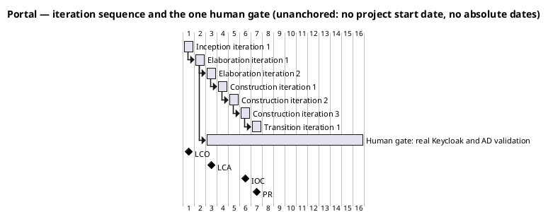
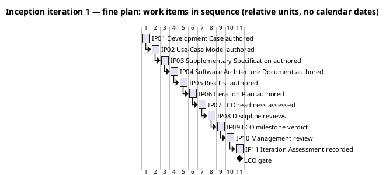
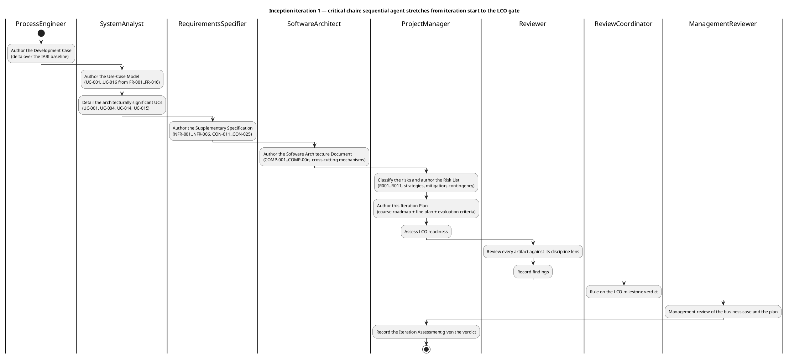

## Document Control

- Phase: Inception
- Status: Draft — iteration 1, submitted for review
- Milestone Target: End of Inception (Lifecycle Objectives) — NOT YET ACHIEVED

## Iteration Objectives

This is Inception iteration 1, the project's first iteration. Its objective is to establish the project: agree the scope, identify and classify the risks, and produce the requirements and architecture baseline that Elaboration will build against. No executable is produced — the increment this iteration delivers is the reviewed baseline itself.

| # | Objective | Exit evidence | Risk it confronts |
|---|---|---|---|
| O-1 | Agree the scope with the stakeholders | The 16 declared use cases (UC-001 to UC-016) are captured, all `Must`, each tracing to its declared `FR-NNN`; the 13 declared exclusions are published so no later iteration re-proposes them | — |
| O-2 | Identify and classify the project's risks | The Risk List carries R001 to R011, each with probability, impact, magnitude, strategy, owner, mitigation and contingency | R001, R002 |
| O-3 | Establish the architecture baseline | The Software Architecture Document names the components and the cross-cutting mechanisms; the four Medium-volatility use cases are encapsulated | R001, R005, R007 |
| O-4 | Establish the process that governs production | The Development Case declares the inactive discipline, the fired optional trigger, the unstaffed roles and the tool gaps | — |
| O-5 | Assess whether the project is viable to proceed to Elaboration | The LCO readiness assessment below, and the ReviewCoordinator's milestone verdict | — |

**What this iteration does not do.** It does not implement, integrate or test any use case. Every acceptance criterion in the declared scope is a runtime criterion and is therefore deferred to a named later iteration — see "Evaluation Criteria". No spend figure is quoted anywhere in this plan: no phase has closed, so no measured actual exists (CON-034).

## Plan and Milestones

This section carries two levels. The **coarse roadmap** is cross-iteration: the milestone sequence, the iteration boundaries and the agent role profile per phase. The **fine plan** is bounded to Inception iteration 1: its work items and their owners. The two are never conflated.

### Coarse roadmap — milestone sequence and iteration boundaries

**The Gantt is unanchored.** It carries no project start date and no absolute date, because no duration in this project has been measured. The uniform bar length is a rendering unit that expresses sequence and nothing else — it is not a size, and no iteration is quoted in days, weeks or person-anything. The one bar that carries a real figure is the human gate, and it is quoted in **days of queue time**, which is a different currency from agent work and is never added to it.

| Milestone | Achieved at | What it certifies |
|---|---|---|
| LCO — Lifecycle Objectives | End of Inception iteration 1 | Stakeholders agree on scope; the project is viable; the initial risks are identified and classified |
| LCA — Lifecycle Architecture | End of Elaboration iteration 2 | The architecture is stable; the highest-magnitude risks are retired or bounded; the human validation of the real Keycloak and AD has reported |
| IOC — Initial Operational Capability | End of Construction iteration 3 | All 16 use cases are implemented, integrated and tested against the stand-ins |
| PR — Product Release | End of Transition iteration 1 | The portal is ready for Infrastructure to deploy; adoption measurement against BG-003 begins |

### Iteration count and the rubber profile

| Phase | Iterations | Rubber-profile starting point | Justification for the deviation |
|---|---|---|---|
| Inception | 1 | ~5% | Not stretched. The scope is declared, not discovered: 16 requirements arrive already mapped 1:1 to 16 use cases, and the stakeholder has already fixed the UI visual layer (CON-037). There is no business process to model — Business Modeling is inactive. |
| Elaboration | 2 | ~20% | **Stretched.** Four risks are Significant (R001, R003, R005, R007) and three of them are architectural: the LDAP read with no local copy, the client-supplied timestamp with an idempotency key, and the authorization claim shape. Elaboration iteration 1 builds the architecture and the first vertical slice; iteration 2 completes the remaining use cases and absorbs the human validation feedback, which must reach the team before Elaboration closes (CON-035). |
| Construction | 3 | ~65% | Not stretched. The functional surface is small and fully declared: three areas, 16 use cases, no data migration (CON-036), no integration beyond two read paths. |
| Transition | 1 | ~10% | Not compressed. The portal is internal and needs no user training (AC-001, AC-004), but the adoption measurement against BG-003 runs for three months after go-live and is the phase's real content. |
| **Total** | **7** | — | Within the 6 ± 3 rule. Seven iterations is the middle of the range, which matches a project with a small, fully declared functional surface and a concentrated architectural risk profile. |

### Fine plan — Inception iteration 1 work items and owners

| # | Work item | Owner | Depends on | Exit evidence |
|---|---|---|---|---|
| IP-01 | Author the Development Case | ProcessEngineer | — | The delta over the IARI baseline is committed: inactive discipline, fired optional trigger, unstaffed roles, tool gaps G-1 to G-3 |
| IP-02 | Author the Use-Case Model | SystemAnalyst | IP-01 | UC-001 to UC-016 captured, each tracing to its declared `FR-NNN`; UC-001, UC-004, UC-014, UC-015, UC-016 detailed |
| IP-03 | Author the Supplementary Specification | RequirementsSpecifier | IP-02 | NFR-001 to NFR-006 specified; CON-011 to CON-025 carried as business rules; the three cross-cutting mechanisms specified as `<<include>>` entries |
| IP-04 | Author the Software Architecture Document | SoftwareArchitect | IP-03 | Components named; the four Medium-volatility use cases encapsulated; Keycloak placed as an intra-network node (CON-032) |
| IP-05 | Classify the risks and author the Risk List | ProjectManager | IP-04 | R001 to R011 classified with strategy, owner, mitigation and contingency; the not-applicable candidates retired with reasons |
| IP-06 | Author this Iteration Plan | ProjectManager | IP-05 | Coarse roadmap and fine plan committed; evaluation criteria filled |
| IP-07 | Assess LCO readiness | ProjectManager | IP-06 | The readiness assessment below, with each LCO exit criterion marked met or not met |
| IP-08 | Review every artifact against its discipline lens | Reviewer | IP-07 | Findings recorded per artifact |
| IP-09 | Rule on the LCO milestone verdict | ReviewCoordinator | IP-08 | The milestone verdict |
| IP-10 | Management review of the business case and the plan | ManagementReviewer | IP-09 | The management review outcome |
| IP-11 | Record the Iteration Assessment given the verdict | ProjectManager | IP-10 | The Iteration Assessment committed |

**No work item carries a size.** The Gantt's uniform bar length is a rendering unit expressing sequence; it is not an estimate. No work item is quoted in hours, days, weeks, person-days or person-weeks — this system measures tokens and elapsed time, and neither has been measured yet because no phase has closed. The first measured actual will replace every assumed figure in the next plan.

### Critical chain — sequential agent stretches to the gate

The chain is **8 sequential agent stretches** deep. Each stretch is a role's turn, not a calendar span, and none carries a spend figure — no phase has closed, so no measured actual exists to forecast from. The chain is sequential rather than parallel because each stretch consumes the artifact the previous one produced: the Use-Case Model is written against the Development Case, the Supplementary Specification against the Use-Case Model, the architecture against both, and the Risk List against the architecture. Adding agent roles to this chain would not shorten it — it would add coordination overhead across artifacts that are already in a strict dependency order.

**The human gate is not on this chain.** The validation of the real Keycloak and the real AD by Infrastructure with HR (CON-035) is queue time, not agent work. It is quoted separately, in days, and is never added to any agent figure.

### Human gates

| Gate | Who | Currency | Ceiling | Effect if it does not report |
|---|---|---|---|---|
| Validation of the real Keycloak and the real AD | Infrastructure, with HR (STK-003, STK-001) | Days of queue time | 14 days | The process suspends; nothing is auto-filled. The remedy is another iteration, never a cut to declared scope (CON-028) |

This is the project's only human gate. CON-002 states the OIDC client is already registered and login can be tested from day one, so there is no request to raise and no queue to wait on for login itself. The gate is the validation of the real systems, and its feedback must reach the team before Elaboration closes.

### Spend

| Currency | Measured so far | Forecast |
|---|---|---|
| Agent work — tokens | None. No phase has closed. | None. A forecast is built from a measured actual; there is none, so none is invented. |
| Agent work — elapsed time | None. No phase has closed. | None, for the same reason. |
| Human gate — queue time | None. The gate has not been opened. | Bounded at 14 days of queue time, per the Development Case measurement policy. |

CON-034 declares there is no budget and no cap on token spend for this project, and none is to be set by the team. No token box is proposed here and none is asked of the stakeholder. Declared scope is never cut or deferred to fit an estimate.

## Resources

### Agent role profile — this iteration

| Role | Stretch | Artifact produced |
|---|---|---|
| ProcessEngineer | IP-01 | Development Case |
| SystemAnalyst | IP-02 | Use-Case Model |
| RequirementsSpecifier | IP-03 | Supplementary Specification |
| SoftwareArchitect | IP-04 | Software Architecture Document |
| ProjectManager | IP-05, IP-06, IP-07, IP-11 | Risk List, Iteration Plan, Iteration Assessment |
| Reviewer | IP-08 | Review Record findings |
| ReviewCoordinator | IP-09 | LCO milestone verdict |
| ManagementReviewer | IP-10 | Management review outcome |

Eight roles are staffed. BusinessProcessAnalyst and BusinessReviewer are not staffed — Business Modeling is inactive (Development Case). No role is staffed twice in parallel: the chain is sequential by artifact dependency.

### Agent role profile — next iteration (Elaboration iteration 1)

| Role | Why it is staffed |
|---|---|
| SoftwareArchitect | Evolves the architecture into the design baseline; owns the cross-cutting mechanisms |
| Designer | Use-case realizations for the first vertical slice |
| DatabaseDesigner | The clocking, news and category-link tables |
| UserInterfaceDesigner | The three main views against the mandatory reference (CON-037) |
| Implementer | The first vertical slice: UC-001 and UC-016 against the stand-ins (CON-035) |
| TestDesigner | Test cases for the slice, including the empty-attribute directory entries (R001) |
| Tester | Executes them |
| Integrator | Assembles the slice |
| ConfigurationManager | Closes gap G-1 — the CI pipeline definition (CON-033) |
| ProjectManager | Iteration Plan and Risk List for the iteration; Iteration Assessment for this one |
| Reviewer, ReviewCoordinator | Discipline review and the milestone verdict |

This profile is a **starting point built from the risk profile, not from a measured capacity** — no capacity has been measured. It is revised when Elaboration iteration 1 opens, against this iteration's measured spend.

### Parallelism discipline

The next iteration's profile is wider than this one's because Elaboration iteration 1 has genuinely independent work streams — the design baseline, the database schema, the UI views and the CI pipeline can proceed against the same frozen requirements. It is not widened as a remedy for a schedule slip: no slip has occurred, and if one does, the lever is another iteration, never more agents and never a cut to declared scope.

## Use Cases and Scenarios Addressed

This iteration addresses all 16 use cases **at the requirements and architecture level**. None is implemented, integrated or tested — Inception produces no executable.

| UC | Name | Source | This iteration | Deferred implementation to |
|---|---|---|---|---|
| UC-001 | Clock In and Clock Out | FR-001 | Detailed specification; architecture decision on the client-supplied timestamp and the idempotency key | Elaboration iteration 1 |
| UC-002 | View Own Clocking History | FR-002 | Outlined | Elaboration iteration 1 |
| UC-003 | View All Employee Clockings | FR-003 | Outlined | Elaboration iteration 2 |
| UC-004 | Export Monthly Clocking Report as CSV | FR-004 | Detailed specification; architecture decision on the empty-versus-zero semantics and the unrounded computation | Elaboration iteration 2 |
| UC-005 | Correct or Insert a Clocking | FR-005 | Outlined; the audit obligation specified | Elaboration iteration 2 |
| UC-006 | Publish News Item | FR-006 | Outlined; the audit obligation specified | Elaboration iteration 2 |
| UC-007 | Read News List | FR-007 | Outlined | Elaboration iteration 2 |
| UC-008 | Filter News by Category | FR-008 | Outlined | Elaboration iteration 2 |
| UC-009 | Display Featured News Banner | FR-009 | Outlined | Elaboration iteration 2 |
| UC-010 | Feature or Un-feature a News Item | FR-010 | Outlined; the single-featured invariant specified | Elaboration iteration 2 |
| UC-011 | Edit Published News Item | FR-011 | Outlined; the audit obligation specified | Elaboration iteration 2 |
| UC-012 | Unpublish News Item | FR-012 | Outlined; the un-feature-on-unpublish rule specified | Elaboration iteration 2 |
| UC-013 | Search Employee Directory | FR-013 | Outlined; the LDAP read with no local copy specified | Elaboration iteration 2 |
| UC-014 | View Directory Entry | FR-014 | Detailed specification; architecture decision on the LDAP read and the empty-attribute case (R001) | Elaboration iteration 2 |
| UC-015 | Assign or Clear Worker Category | FR-015 | Detailed specification; architecture decision on the two-column link table — the portal's only write about a person | Elaboration iteration 2 |
| UC-016 | Clock In/Out Survives a Network Drop | FR-016 | Detailed specification; realized as the alternative flow of UC-001 | Elaboration iteration 1 |

**Scenarios.** The alternative flows specified this iteration are the ones that carry a declared rule or a declared risk: the network drop and the idempotent retry (UC-001 A1, A2), the missing clock-out and the no-clocking day (UC-004 A1, A2), the empty AD attribute (UC-014 A1), and the cleared category (UC-015 A1). The remaining alternative flows are detailed in Elaboration with their use cases.

**Cross-cutting mechanisms.** Authentication, authorization and the audit trail are specified in the Supplementary Specification and `<<include>>`d by the use cases that depend on them. None is a use case, and none is scheduled as one.

## Evaluation Criteria

Two layers, kept apart: the declared acceptance criteria the project is accountable to, and this iteration's own exit criteria.

### Layer (a) — declared acceptance criteria

Every `AC-NNN` in the declared scope is listed. Each is either addressed this iteration with the evidence that closes it, or deferred to a named iteration. None is absent.

| AC | Criterion | This iteration | Closes in |
|---|---|---|---|
| AC-001 | An employee can clock in and out without help from HR or the development team. | Deferred — a runtime criterion; Inception produces no executable. The design that makes it reachable (one button whose label follows the status, no training) is specified in UC-001. | Elaboration iteration 1 |
| AC-002 | An HR Administrator can publish a news item without technical assistance. | Deferred — a runtime criterion. The design is specified in UC-006. | Elaboration iteration 2 |
| AC-003 | Any employee finds a colleague's phone/email in under 10 seconds. | Deferred — a runtime criterion, and it depends on the directory rendering the empty-attribute case without inventing a value (R001). The design is specified in UC-013 and UC-014. | Elaboration iteration 2 |
| AC-004 | 80% of employees complete at least one clocking with no prior training. | Deferred — an adoption criterion measured after go-live. | Transition iteration 1 |
| AC-005 | A clocking made while the corporate network is down for up to 5 minutes is not lost. Beyond 5 minutes the employee reports the clocking to HR. | Deferred — a runtime criterion. The design is specified in UC-016 and its retry boundary is asserted against a stand-in that fails on demand (R003). | Elaboration iteration 1 |

### Layer (b) — this iteration's exit criteria

| # | Exit criterion | Met? |
|---|---|---|
| E-1 | The Development Case is committed and declares the inactive discipline, the fired optional trigger, the unstaffed roles and the tool gaps | Yes |
| E-2 | UC-001 to UC-016 are captured, each tracing to its declared `FR-NNN`, all `Must`, with the architecturally significant ones detailed | Yes |
| E-3 | NFR-001 to NFR-006 are specified, and CON-011 to CON-025 are carried as business rules | Yes |
| E-4 | The Software Architecture Document names the components and the cross-cutting mechanisms, and encapsulates the four Medium-volatility use cases | Yes |
| E-5 | The Risk List carries R001 to R011, each classified with strategy, owner, mitigation and contingency; the not-applicable candidates are retired with reasons | Yes |
| E-6 | The stakeholders agree on the scope: 16 use cases, all `Must`, and the 13 declared exclusions published | Pending stakeholder review |
| E-7 | The project is assessed viable to proceed to Elaboration | See the LCO readiness assessment below |
| E-8 | Every artifact has been reviewed and the LCO milestone verdict has been ruled | Pending — IP-08 and IP-09 |

### LCO readiness assessment

| LCO exit criterion | Assessment |
|---|---|
| Stakeholders agree on the scope | The scope is declared, not negotiated: 16 requirements arrive mapped 1:1 to 16 use cases, all `Must`, and the 13 exclusions are published verbatim. Nothing in this iteration added scope, and nothing was cut. The agreement itself is the stakeholder's to give at review. |
| The project is viable | Viable. The functional surface is small and fully declared; the technology is pinned and already operated by Infrastructure (.NET 10, PostgreSQL 18, CON-029 to CON-031); the identity dependency is already registered and testable from day one (CON-002); there is no data migration (CON-036) and no backup design (CON-038). |
| The initial risks are identified and classified | Eleven risks are classified, four of them Significant. None is High. Every `accept` is granted in advance by STK-001 under CON-028, on the condition that the treatment never cuts or defers declared scope. No risk is accepted on the team's own authority. |
| The architecture is plausible | The four Medium-volatility use cases are encapsulated, and the three architectural risks (R001, R003, R005) each have a named component that absorbs a change in one place rather than across sixteen use cases. |
| The plan is credible | Seven iterations, within the 6 ± 3 rule, with Elaboration stretched for the architectural risk profile. No work item is sized, because nothing has been measured. |

**This assessment does not close the milestone.** The LCO verdict is the ReviewCoordinator's to rule (IP-09), and the Iteration Assessment is recorded after that verdict. Nothing in this plan marks the milestone, the iteration or the phase as achieved.
