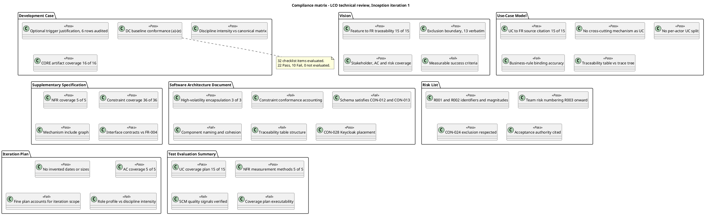
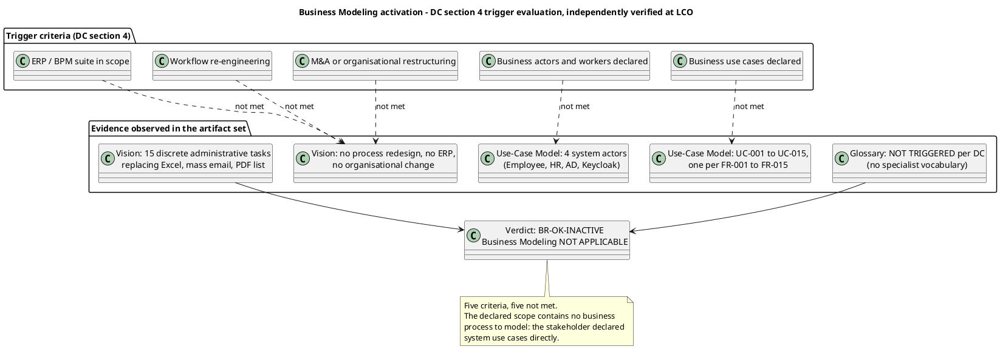
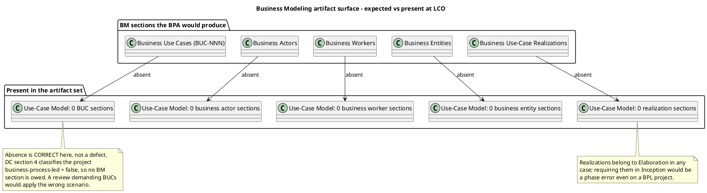
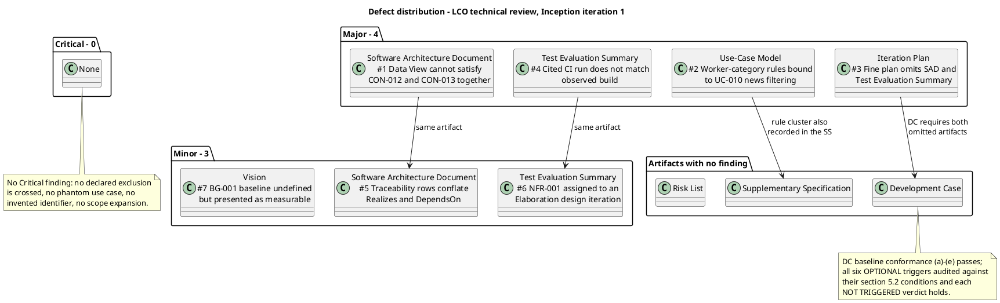
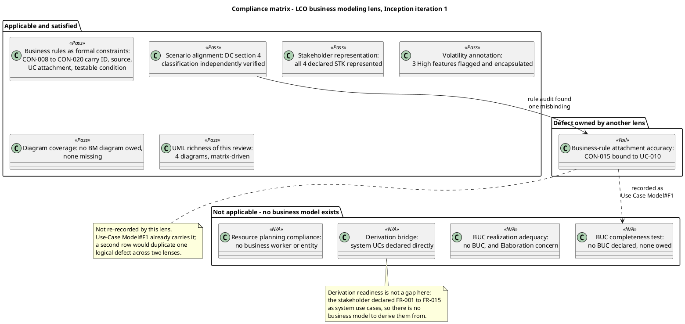
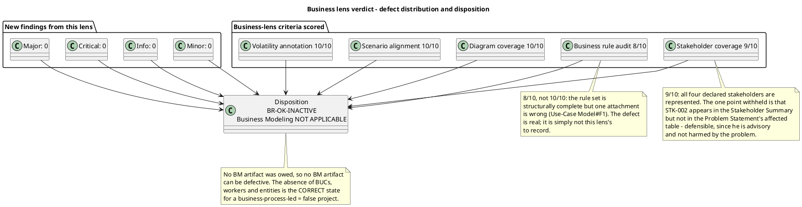

## Document Control
### Reviewer lens
<!-- review: Inception I1 -->

- **Phase:** Inception
- **Status:** Draft — iteration 1, technical lens review complete
- **Milestone Target:** End of Inception (not yet achieved)

### Business Reviewer lens
<!-- review: Inception I1 -->

<!-- review: Inception I1 -->

- **Phase:** Inception
- **Status:** Draft — iteration 1, business modeling lens review complete
- **Milestone Target:** End of Inception (not yet achieved)

## Review Scope and Criteria
### Reviewer lens
<!-- review: Inception I1 -->

**Review point:** LCO, technical lens. The question applied is exit criteria — do the artifacts collectively satisfy the conditions for phase transition — not completion of an iteration.

**Artifacts reviewed (8 of 8 persisted):** Development Case, Vision, Use-Case Model, Supplementary Specification, Software Architecture Document, Risk List, Iteration Plan, Test Evaluation Summary.

**Checklists applied, by artifact type:**

| Artifact | Checklist |
|---|---|
| Development Case | DC baseline conformance (a)–(e) against the IARI baseline; optional trigger justification against each §5.2 condition; discipline intensity against the canonical matrix; CORE artifact coverage |
| Vision | Feature-to-FR traceability; exclusion boundary completeness; stakeholder, AC and risk coverage; measurability of success criteria; data-source verification of quantitative claims |
| Use-Case Model | UC-to-FR source citation; no cross-cutting mechanism modelled as a UC; no per-actor split of one declared process; business-rule binding accuracy; Traceability table against the trace tree |
| Supplementary Specification | NFR coverage; constraint coverage; mechanism include graph; interface contracts against FR-004; scope-exclusion consistency |
| Software Architecture Document | High-volatility encapsulation; constraint conformance accounting; schema satisfiability of the declared invariants; component naming and cohesion; Traceability table structure; CON-028 placement |
| Risk List | R001/R002 identifier and magnitude preservation; team-risk numbering from R003; CON-024 exclusion respected; acceptance authority cited |
| Iteration Plan | No invented dates, sizes or velocity; AC coverage; fine plan completeness against the iteration's actual scope; role profile against discipline intensity |
| Test Evaluation Summary | UC coverage plan; NFR measurement methods; SCM quality signals verified against the repository; executability of the coverage plan |

**Trace tree consulted:** 42 Business roots, 180 nodes. Every FR-001 to FR-015 refines to exactly one UC-001 to UC-015; every UC realizes at least one component. No «LEAF» on any FR, NFR or UC. No «SUSPECT» edge. No «UNKNOWN LABEL».

**SCM evidence observed:**

| Signal | Observed |
|---|---|
| Open pull requests | None |
| Branches labelled `ready-for-review` | None |
| Build on `main` | Success — run `39933356092`, 2026-10-23 09:38:42Z to 09:39:34Z |
| Issues, all states | None |

**Pull request disposition.** No open pull request exists, so there is nothing to approve, request changes on, or defer. No branch carries `ready-for-review`. Inception produces no implementation code per RUP Ch.4, and the repository holds project inputs and artifacts only — consistent with the phase.

**Compliance matrix — 32 checklist items, 22 Pass, 10 Fail, 0 not evaluated:**

### Business Reviewer lens
<!-- review: Inception I1 -->

<!-- review: Inception I1 -->

**Review point:** LCO, business modeling lens. The question applied is exit criteria — is the Business Modeling discipline correctly dispositioned for this project, and does the artifact set carry the business-level content the downstream disciplines need.

**Scenario assessment — the governing decision of this review.** The six business modeling scenarios are Organization Chart, Domain Modeling, One Business Many Systems, Generic Business Model, New Business and Revamp. None applies: the project is not a business-process-led engagement at all. The Development Case records `business-process-led = false`, and I verified that classification independently against the Vision prose and the Use-Case Model rather than inheriting it. The declared scope contains no business process to model — the stakeholder declared fifteen discrete administrative tasks directly as system use cases FR-001 to FR-015, replacing three manual artifacts (shared Excel sheets, mass email, a PDF phone list). There is no process re-engineering, no ERP or BPM suite, no workflow redesign, no organizational restructuring, and no business actor or business worker anywhere in the declared scope.

**Consequence for the review standard applied.** Because no business model is owed, the business-lens criteria that presuppose one — BUC completeness, BUC realization adequacy, the business-to-system derivation bridge, resource planning compliance — are recorded N/A, not Fail. Applying them would be the wrong-scenario error: penalizing the absence of artifacts the Development Case correctly does not require. What I do review is the business-level content that exists regardless of scenario: the business rules, the stakeholder representation, the volatility annotations, and the correctness of the INACTIVE disposition itself.

**Artifacts reviewed (8 of 8 persisted):** Development Case, Vision, Use-Case Model, Supplementary Specification, Software Architecture Document, Risk List, Iteration Plan, Test Evaluation Summary. The Glossary is NOT TRIGGERED and is correctly absent.

**Business-lens checklists applied:**

| Criterion | Applied to | Result |
|---|---|---|
| Scenario alignment — is the BM disposition correct and independently evidenced | Development Case, Vision, Use-Case Model | Pass |
| Business rules as formal constraints — ID, source, worker/entity attachment, testable condition | Supplementary Specification, Use-Case Model | Fail — one attachment defect, carried by another lens |
| Stakeholder representation coverage — all significant organizational parts represented | Vision | Pass |
| Volatility annotation — volatile business processes explicitly flagged for encapsulation | Vision, Software Architecture Document | Pass |
| Diagram coverage — which business-level diagrams are present, absent, defective | Use-Case Model, Supplementary Specification | Pass — none owed, none missing |
| BUC completeness test | Use-Case Model | N/A — no BUC declared or owed |
| BUC realization adequacy | Use-Case Model | N/A — no BUC; Elaboration concern in any case |
| Business-to-system derivation bridge | Use-Case Model | N/A — system UCs declared directly |
| Resource planning compliance | Use-Case Model | N/A — no business worker or entity |

## Findings
### Reviewer lens
<!-- review: Inception I1 -->

Seven distinct defects: 4 Major, 3 Minor, 0 Critical. Each is recorded in the finding ledger against its artifact; the entries below state the defect, its location and its remediation.

#### Development Case

No finding. Baseline conformance (a)–(e) passes: the 25-role roster is inherited unchanged, no CORE artifact is omitted, no primary ownership is reassigned, no artifact outside the CORE + OPTIONAL universe appears, and no two roles are merged. All six OPTIONAL triggers are recorded NOT TRIGGERED and each verdict holds against its §5.2 condition — Data Model fails the >10-entity and data-migration tests, Deployment Model fails the distributed-topology test, Test Plan fails the formal-delivery test, User-Interface Prototype is redundant against the CON-034 reference, Architectural Proof-of-Concept fails the phase condition, and Glossary fails the specialist-vocabulary test. Discipline intensity is per the canonical matrix with no self-granted deviation. Business Modeling is declared INACTIVE on the correct trigger.

#### Vision

| Severity | Location | Defect | Remediation |
|---|---|---|---|
| Minor | Success criteria table, BG-001 row | BG-001 is presented as measurable — "50% reduction against the current manual baseline" — but no baseline is declared in the scope and none has been measured. The denominator is an inference the Vision adds; BG-001 itself names no baseline. The criterion cannot be verified as written. | Mark the row as not yet measurable and record that HR must supply the current manual baseline, or state the measure as a post-launch comparison HR performs. Do not present it as measurable while its denominator is undefined. |

All other Vision checks pass: 15 features trace to 15 declared FRs with no undeclared feature; the 13 declared exclusions are published verbatim as a checkable boundary; all 4 stakeholders, 5 ACs and 2 declared risks are carried; no unsourced quantitative business claim appears.

#### Use-Case Model

| Severity | Location | Defect | Remediation |
|---|---|---|---|
| Major | Business-rule binding diagram (`R_CAT --> UC010`); outline table, UC-010 "Rules bound" cell | The worker-category rule cluster (CON-009, CON-015, CON-016, CON-021) is bound to UC-010 Read and Filter News, and CON-015 is listed among UC-010's rules. CON-015 states the worker category is used in exactly two places — a directory column that also filters, and a CSV export column. UC-010 filters news by the four news categories (General, HR, IT, Events), a different closed list governed by FR-010 and FR-006. The binding contradicts the constraint and creates the confusion CON-015 exists to prevent. | Remove the `R_CAT --> UC010` edge and CON-015 from UC-010's rules. Bind the news-category closed list to UC-010 instead, sourced from FR-010 and FR-006. Keep the worker-category cluster bound to UC-004 and UC-012 only. |

All other Use-Case Model checks pass: 15 UCs each cite a declared FR-NNN in the `Source` field with no phantom UC and no quotation in the source slot; authentication is MECH-01 in the Supplementary Specification and never a UC; no cross-cutting mechanism is modelled as a UC; HR Administrator generalizes Employee rather than splitting one declared process into per-actor UCs; the Traceability table's 15 rows match the trace tree exactly.

#### Supplementary Specification

No finding. All 5 NFRs and all 36 constraints are accounted for; the four mechanisms MECH-01 to MECH-04 are recorded as mechanisms with an include graph and never as use cases; INT-03 reproduces the FR-004 column contract exactly, including the empty clock-out row, decimal hours to two decimals and the Corrected flag; the 13 exclusions are restated consistently with the Vision.

#### Software Architecture Document

| Severity | Location | Defect | Remediation |
|---|---|---|---|
| Major | Data View `Clocking` class; Invariants table rows for CON-012 and CON-013 | The schema cannot satisfy CON-012 and CON-013 simultaneously. `Clocking` holds ClockInUtc and ClockOutUtc in one row, so recording a Clock Out is an in-place UPDATE of the row created at Clock In — which CON-013 forbids. The Invariants table resolves CON-013 by declaring "a correction is a new row", but enforces CON-012 with a unique index on (EmployeeId, WorkDate), which rejects that new row for the same employee-day. The correction record also carries no previous-value column, while CON-013 and NFR-005 require the previous value. Either the index blocks corrections or corrections overwrite the original. | State explicitly how a pair is recorded across two presses under CON-013 — two append-only rows with CON-012 enforced on the pair, or one row whose Clock Out is an append-only correction referencing the original. Make the unique index match the chosen shape. Add a PreviousValue column to the correction record. Update the Invariants table so each row names the index that actually enforces it. |
| Minor | Traceability table, COMP-001 to COMP-007 rows | Rows conflate two link types under one Link Type value: "COMP-001 | UC-001, UC-013, UC-014, UC-015 | Realizes | COMP-002, COMP-003, ..." declares Realizes while Traces To holds DependsOn targets. A reader cannot tell which link type the Traces To entries carry. | Split each affected component into two rows — one for the Realizes edges with Traces To empty, one for the DependsOn edges with Link Type DependsOn. COMP-001 already establishes the pattern with its separate Derives row. |

All other SAD checks pass: the three High-volatility requirements (FR-004, FR-009, FR-012) each own a dedicated component and no component is named after a layer or a feature; CON-028 is satisfied — Keycloak sits in the identity-estate node inside the corporate network boundary, with the hosted CI the only node outside it and explicitly a development toolchain; the Process View correctly declares no scheduler, justified by CON-018 and CON-011; no cache is designed, consistent with FR-014 and FR-015.

#### Risk List

No finding. R001 and R002 are carried with their declared identifiers and magnitudes (P=3 I=3 exposure=9; P=3 I=2 exposure=6) and are not renumbered or reclassified. Team-identified risks run R003 to R008 in the order raised, each with probability, impact, magnitude, strategy, mitigation, contingency, owner and warning sign. CON-024 is respected — Keycloak and AD availability are not registered, and R003 is correctly distinguished as the timing of the CON-031 human feedback loop rather than a Keycloak or AD risk. Every `Accept` cites the CON-023 grant and its condition. The Traceability table's 8 rows match the trace tree, including R007's deliberate absence of a trace edge.

#### Iteration Plan

| Severity | Location | Defect | Remediation |
|---|---|---|---|
| Major | Fine plan table W1–W7; critical chain diagram; agent role profile, Iteration 1 column | The fine plan omits two artifacts this iteration produced. W1–W7 cover the Development Case, Vision, Use-Case Model, Supplementary Specification, Risk List, Iteration Plan and Review Record, but not the Software Architecture Document or the Test Evaluation Summary — both persisted this iteration and both CORE artifacts the Development Case requires. The critical chain has no Analysis and Design or Test lane, and the role profile marks SoftwareArchitect and TestManager inactive in Iteration 1, contradicting the existence of both artifacts. The plan understates the iteration's work and its critical path. | Add the Software Architecture Document (SoftwareArchitect) and the Test Evaluation Summary (TestManager) as work items with exit conditions, place them in the critical chain between the Supplementary Specification and the Risk List, and mark both roles active in Iteration 1. Analysis and Design is Medium and Test is Low in Inception, so neither role is idle. |

All other Iteration Plan checks pass: no absolute date, no projected calendar date, no person-week or story-point size, and no velocity figure appears; the Gantt's `1 day` unit is explicitly declared a rendering device for ordering, not a size; the 14-day CON-031 gate is drawn at true scale as a declared ceiling and the two clocks are kept apart; all 5 ACs are accounted for and deferred to named iterations; the seven-iteration roadmap is justified against the risk profile rather than applied mechanically.

#### Test Evaluation Summary

| Severity | Location | Defect | Remediation |
|---|---|---|---|
| Major | Quality signals table, "Hosted CI build on `main`" row | The cited run is not the current build. The table records run `39932821851`, 09:34:14Z to 09:35:04Z; the build observed on `main` is run `39933356092`, 09:38:42Z to 09:39:34Z. A run identifier and two timestamps are observable SCM state, so a stale citation reads downstream as a verified observation. The conclusion drawn from it — that the pipeline is live — still holds; the citation does not. | Replace the cited run with the observed one, or state the build status without a run identifier if the identifier is not read at the moment of writing. Keep the existing caveat that a green build on a repository holding only inputs and artifacts proves the pipeline runs, not that the product works. |
| Minor | Quality-attribute plan, NFR-001 row | NFR-001 is assigned to Iteration 3, which the Iteration Plan scopes as Elaboration design only with no implementation. The stated method — "every use case is exercised unauthenticated and must be refused" — cannot be executed against use cases that are designed but not built. Every other NFR is assigned to a Construction iteration where the behaviour exists. | Move NFR-001's execution to the first Construction iteration in which the use cases it exercises are implemented, or split the row: the stand-in OIDC claim mapping verified in Iteration 3 as an Elaboration check, and the unauthenticated-refusal assertion executed in the iteration that implements each use case. |

All other Test Evaluation Summary checks pass: all 15 UCs have a named test level and execution iteration; all 5 NFRs have the measurement method the requirement itself names, with NFR-002 correctly refusing server response time as a substitute; the R001 fixture obligation is recorded as an entry criterion rather than a convention; the defect record is the SCM issue tracker and the zero-defect reading is correctly attributed to no test having been executed; the mission verdict claims the test position only and explicitly disclaims product evidence.

**Defect distribution:**

### Business Reviewer lens
<!-- review: Inception I1 -->

<!-- review: Inception I1 -->

One new defect from this lens: 0 Critical, 0 Major, 1 Minor. The business-rule attachment defect in the Use-Case Model is real and I confirm it, but it is already carried by the Reviewer lens as `Use-Case Model#F1`; re-recording it here would put one logical defect in the ledger twice, so I reference it instead of duplicating it.

#### Development Case

No finding. The INACTIVE declaration is correct and correctly evidenced. It is a thin plug-in: it removes no role from the 25-role roster, changes no workflow structure, and reassigns no ownership. BusinessProcessAnalyst and BusinessReviewer are recorded idle by trigger rather than deleted, which is the right treatment — an idle role is not a removed role. The real-time-system trigger is also correctly not fired: NFR-004's one-second target is a performance requirement, not a hard deadline, and FR-013's retry is a bounded client-side retry loop rather than reactive event-driven behaviour.

#### Vision

| Severity | Location | Defect | Remediation |
|---|---|---|---|
| Minor | Features tables, FR-014 and FR-015 rows, success-criterion column | The success-criterion column is self-referential for two features: the FR-014 row cites "FR-014" and the FR-015 row cites "FR-015" as their own success criterion. Every other row cites an independent measure — an AC-NNN or a CON-NNN. A criterion that restates the requirement identifier is not a verification measure: it cannot be tested and cannot be distinguished from the requirement it is meant to verify. The two affected features are the network-unavailable behaviours, whose observable outcome is stated in the requirement text but is not expressed as a checkable criterion anywhere in the Vision. | Replace the self-referential cells with an independent measure — cite an existing acceptance criterion, or state the observable check directly, for example "the directory area shows a no-connection message and no result rows when the corporate network is unreachable". If no AC is declared for FR-014 and FR-015, record the criterion as derived from the requirement text rather than presenting the requirement identifier as its own measure. |

All other business-lens Vision checks pass. The 13 declared exclusions are published verbatim as a checkable boundary, which is the correct control for the exclusion-crossing risk. All four declared stakeholders are represented, and the negative-stakeholder analysis is honest: STK-003's constraint (CON-022, no AD modification) is declared and honoured rather than traded away. The volatility map flags exactly the three High features — FR-004, FR-009, FR-012 — and the Software Architecture Document encapsulates each in a dedicated component, so the volatility annotation reached the architecture rather than stopping at the Vision. No unsourced quantitative business claim appears.

#### Use-Case Model

No new finding from this lens. The business-rule binding defect is confirmed and is carried as `Use-Case Model#F1` by the Reviewer lens; I do not duplicate it.

The business-lens checks that pass: every one of the fifteen use cases cites a declared FR-NNN in its `Source` field, so no use case exists that the stakeholder did not declare and no declared requirement is unrepresented. The business rules are bound to use cases rather than left as prose — the binding diagram attaches each rule cluster to the use cases that enforce it, which is the property that makes a rule auditable. The three extension use cases (UC-013, UC-014, UC-015) are correctly modelled as exception paths rather than as independent actor goals, and the model says so explicitly. Authentication is a mechanism (MECH-01) and never a use case, which is the correct treatment of a cross-cutting technical concern.

#### Supplementary Specification

No finding. The business rules are the strongest part of this artifact set and they meet the four-property standard: each carries a unique identifier (CON-008 to CON-020), each is traceable to a declared source, each is attached to the use cases or entities it constrains, and each states a testable condition. CON-009's closed four-value list, CON-010's single-featured invariant, CON-012's one-pair-per-day rule and CON-013's never-overwrite rule are all stated as invariants rather than as guidelines, which is what makes them enforceable downstream. CON-015 is the load-bearing rule of the set — the worker category is descriptive and drives no access decision — and it is stated with the precision the exclusion requires.

#### Software Architecture Document

No finding from this lens. The three High-volatility features are each encapsulated behind a dedicated component, which is the architectural consequence the volatility annotation was there to produce. CON-028 is satisfied: Keycloak sits inside the corporate network boundary, and the hosted CI is the only node outside it and is explicitly a development toolchain rather than a runtime dependency. No cache is designed anywhere, which is the correct architectural reading of FR-014 and FR-015 — nothing is copied locally, so there is nothing to serve stale.

#### Risk List

No finding from this lens. R001 and R002 are carried with their declared identifiers and magnitudes and are not renumbered or reclassified, which CON-023 requires. R001 is the one risk with a business-model consequence: the directory must render an entry whose job title or extension is empty without breaking the row or hiding the employee, and the stand-in directory must carry such entries or the risk is retired untested. That obligation is recorded in the Development Case and in the Test Evaluation Summary as an entry criterion, so it is carried into execution rather than left as a note.

#### Iteration Plan, Test Evaluation Summary

No finding from this lens. Neither artifact carries business-level content that this lens governs; the technical lens has reviewed both.

**Defect distribution:**

## Resolutions and Actions
### Reviewer lens
<!-- review: Inception I1 -->

**Prior findings of this lens reconciled:** none. This is the first review of this lens on this project; `read_artifact_findings` returned an empty list for all eight artifacts, so no closure was due and no finding was re-recorded under an existing key.

**Actions arising from this review:**

| Action | Artifact | Owner | Blocks LCO |
|---|---|---|---|
| Resolve the CON-012 / CON-013 schema contradiction and add the previous-value column | Software Architecture Document | SoftwareArchitect | Yes |
| Rebind the worker-category rule cluster away from UC-010 and bind the news-category list to it | Use-Case Model | SystemAnalyst | Yes |
| Add the SAD and the Test Evaluation Summary to the fine plan and the critical chain; activate both roles in Iteration 1 | Iteration Plan | ProjectManager | Yes |
| Correct the cited CI run to the observed build | Test Evaluation Summary | TestManager | Yes |
| Split the conflated Traceability rows by link type | Software Architecture Document | SoftwareArchitect | No |
| Make NFR-001's execution iteration match where the behaviour exists | Test Evaluation Summary | TestManager | No |
| Mark BG-001 as not yet measurable, or name the baseline source | Vision | SystemAnalyst | No |

**No Critical finding was raised, so no escalation to the stakeholder is required from this lens.** No `[SCOPE_QUESTION]` is open against any artifact reviewed: the two deferred questions — accessibility target and throughput binding — are recorded as out of scope for this cycle in the Work Order and are correctly carried as deferred rather than as gaps in the Vision, the Supplementary Specification and the Development Case.

### Business Reviewer lens
<!-- review: Inception I1 -->

<!-- review: Inception I1 -->

**Prior findings of this lens reconciled:** none. This is the first review of this lens on this project. `read_artifact_findings` returned one finding each on the Vision and the Use-Case Model, both emitted by the Reviewer lens, and an empty list on the Supplementary Specification. No finding of the Business Reviewer lens existed to close, so no `resolve_artifact_finding` call was due and no finding was re-recorded under an existing key. The two Reviewer-lens findings are outside my ownership and were left untouched.

**Actions arising from this lens:**

| Action | Artifact | Owner | Blocks LCO |
|---|---|---|---|
| Replace the self-referential success criteria on the FR-014 and FR-015 feature rows with an independent measure | Vision | SystemAnalyst | No |

**No Critical finding was raised, so no escalation to the stakeholder is required from this lens.** No `[SCOPE_QUESTION]` is open against any artifact reviewed. The two deferred questions — accessibility target and throughput binding — are recorded as out of scope for this cycle in the Work Order and are correctly carried as deferred rather than as gaps.

## Disposition
### Reviewer lens
<!-- review: Inception I1 -->

**Disposition: Approved with Changes.**

The Inception artifact set is technically sound in its structure and its scope discipline. The requirements baseline is complete and correctly shaped: 15 use cases, one per declared requirement, with no phantom use case, no cross-cutting mechanism promoted to a use case, and no per-actor split of a single declared process. The 36 constraints are carried and bound. The architecture is a genuine candidate — decomposed by area of change, with each of the three High-volatility requirements encapsulated in its own component, CON-028 satisfied, and no over-engineering against a non-binding scale. The risk register preserves the declared identifiers and magnitudes and respects the CON-024 exclusion. The Development Case is a correct delta over the baseline with every optional trigger honestly audited.

The four Major findings are all correctable within this iteration and none of them invalidates the phase's central conclusions. The most consequential is the SAD's schema contradiction: CON-012 and CON-013 are both declared and the Data View as drawn cannot satisfy both, which would surface as an unimplementable design the moment Elaboration tries to baseline it. The Use-Case Model's misbinding of the worker-category rules to news filtering is the kind of defect that propagates — a designer reading UC-010's rule list would implement a category filter on news. The Iteration Plan's omission of two artifacts it actually produced understates the critical path. The Test Evaluation Summary's stale CI citation is a data-integrity defect rather than a quality defect: the conclusion holds, the evidence does not.

No Critical finding: no declared exclusion is crossed anywhere in the set, no identifier is invented, no scope is expanded beyond the declared 15 requirements, and no artifact claims a milestone or an acceptance criterion is closed. The set is fit to proceed to Elaboration once the four Major findings are addressed.

### Business Reviewer lens
<!-- review: Inception I1 -->

<!-- review: Inception I1 -->

**Disposition: BR-OK-INACTIVE — Business Modeling NOT APPLICABLE per DC §4.**

The Business Modeling discipline is correctly inactive for this project, and I verified that independently rather than accepting the Development Case's assertion. Five activation criteria were tested against the artifact set and none is met: no ERP or BPM suite is in scope, no workflow is being re-engineered, no organizational restructuring is involved, no business actor or business worker is declared, and no business use case is declared. The stakeholder declared fifteen discrete administrative tasks directly as system use cases, and the Use-Case Model reflects exactly that — four system actors, fifteen use cases, one per declared requirement.

The consequence is that the business-lens criteria which presuppose a business model are N/A rather than Fail. There is no BUC to test for completeness, no realization to assess, no business worker to carry an automation disposition, and no business entity to map to an analysis class. The derivation bridge is not broken — it does not exist, because the requirements discipline did not need it: the system use cases were declared, not derived. Recording these as defects would be the wrong-scenario error, and it would send the System Analyst to build artifacts the Development Case correctly does not require.

What the business lens does govern, and what I found: the business rules are the strongest content in this set. CON-008 to CON-020 each carry an identifier, a source, an attachment to the use cases that enforce them, and a testable condition — the four properties that make a rule auditable rather than a guideline. The one attachment defect, CON-015 bound to UC-010's news filtering, is real and consequential, and it is already carried as `Use-Case Model#F1` by the Reviewer lens; I confirm it and do not duplicate it. Stakeholder representation is complete across all four declared stakeholders, with the negative-stakeholder analysis honestly handled. The volatility annotation did its job: the three High features are flagged in the Vision and each is encapsulated behind a dedicated component in the Software Architecture Document, so the volatile business policy reached the architecture instead of stopping at a table.

One Minor finding is raised from this lens: two Vision feature rows cite their own requirement identifier as their success criterion, which is not a verification measure. It does not block the milestone.

The artifact set is fit to proceed to Elaboration from the business modeling perspective. No business artifact is owed, none is missing, and none is defective in a way this lens owns.
