## Document Control
### Reviewer lens
<!-- review: Inception I2 -->

- **Phase:** Inception
- **Status:** Draft — iteration 2, technical lens review complete
- **Milestone Target:** End of Inception (not yet achieved)

### Business Reviewer lens
<!-- review: Inception I1 -->

<!-- review: Inception I1 -->

- **Phase:** Inception
- **Status:** Draft — iteration 1, business modeling lens review complete
- **Milestone Target:** End of Inception (not yet achieved)

### Management Reviewer lens
<!-- review: Inception I1 -->

- **Phase:** Inception
- **Status:** Draft — iteration 1, management lens review complete; LCO sanction refused
- **Milestone Target:** End of Inception (not yet achieved)

### Review Coordinator lens
<!-- review: Inception I1 -->

<!-- review: Inception I1 -->

- **Phase:** Inception
- **Status:** Draft — iteration 1, consolidation complete; LCO milestone not achieved
- **Milestone Target:** End of Inception (not yet achieved)

## Review Scope and Criteria
### Reviewer lens
<!-- review: Inception I2 -->

**Review type:** Technical review, LCO lifecycle milestone, Inception iteration 2. Checklist-driven against the artifact type of each item reviewed.

**Scope.** All ten persisted artifacts, plus the trace graph and the SCM state. Nine were evaluated against their checklists; the Iteration Assessment is not judged — it is authored after this review and its absence or lag is never a finding.

| Artifact | Checklist applied | Result |
|---|---|---|
| Vision | Requirements: traceable, testable, unambiguous, no unsourced quantitative claim | Pass |
| Use-Case Model | Requirements: UC well-formed, one per declared process, no cross-cutting mechanism as a UC, rule binding correct, traceability | **Fail** — 1 Major |
| Supplementary Specification | Requirements: every constraint carried and bound, mechanisms not UCs, two closed lists kept apart | **Fail** — 1 Minor |
| Software Architecture Document | Architecture: every subsystem maps to a volatile requirement, constraint conformance, invariants enforceable, traceability one edge per row | **Fail** — 1 Major |
| Risk List | Project Management: declared identifiers and magnitudes preserved, CON-024 respected, every risk treated and traced | Pass |
| Iteration Plan | Project Management: plan derived from the artifact set, risk retirement named against its event, every AC has a gate | Pass |
| Test Evaluation Summary | Test: coverage against use cases, measurement method per NFR, observable SCM state cited as observed | Pass |
| Development Case | DC baseline conformance (§1.2) and optional trigger justification | Pass |
| Iteration Assessment | Not judged — authored after this review | N/A |
| Review Record | This artifact | N/A |

**SCM state.** No open pull request exists, so no PR required a disposition. The build on `main` is green; it carries no product evidence, because the repository holds inputs and artifacts only.

**Trace graph.** 42 business roots, 180 nodes. No `FR-NNN`, `NFR-NNN` or `UC-NNN` is a leaf — every declared requirement is realized and every use case is carried by a component. Four `SUSPECT → System Analyst` edges are reported: `COMP-002 → UC-001`, `UC-002`, `UC-003`, `UC-005`. They are the trace-graph evidence for the Use-Case Model finding below and are recorded there rather than as a separate defect.

**Closure of prior findings.** Seven findings of this lens from iteration 1 were reconciled before any new defect was recorded. All seven are Resolved; none is Deferred or Rejected. The two `Iteration Plan` findings owned by the Management Reviewer lens are not this lens's to close and remain with that lens.

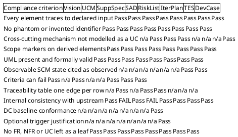

**What the two Fail cells have in common.** Both are artifacts that were not re-based onto a decision another artifact changed. The Software Architecture Document chose a new clocking shape in ADR-010 and the Use-Case Model still describes the old one; the Iteration Plan re-based the roadmap onto eight iterations and the Software Architecture Document still names the old iteration numbers. Neither is a defect of the artifact's own reasoning — each is a defect of the artifact's currency, which is the class of defect a milestone review exists to catch before the next phase builds on it.

### Business Reviewer lens
<!-- review: Inception I1 -->

<!-- review: Inception I1 -->

**Review point:** LCO, business modeling lens. The question applied is exit criteria — is the Business Modeling discipline correctly dispositioned for this project, and does the artifact set carry the business-level content the downstream disciplines need.

**Scenario assessment — the governing decision of this review.** The six business modeling scenarios are Organization Chart, Domain Modeling, One Business Many Systems, Generic Business Model, New Business and Revamp. None applies: the project is not a business-process-led engagement at all. The Development Case records `business-process-led = false`, and I verified that classification independently against the Vision prose and the Use-Case Model rather than inheriting it. The declared scope contains no business process to model — the stakeholder declared fifteen discrete administrative tasks directly as system use cases FR-001 to FR-015, replacing three manual artifacts (shared Excel sheets, mass email, a PDF phone list). There is no process re-engineering, no ERP or BPM suite, no workflow redesign, no organizational restructuring, and no business actor or business worker anywhere in the declared scope.

**Consequence for the review standard applied.** Because no business model is owed, the business-lens criteria that presuppose one — BUC completeness, BUC realization adequacy, the business-to-system derivation bridge, resource planning compliance — are recorded N/A, not Fail. Applying them would be the wrong-scenario error: penalizing the absence of artifacts the Development Case correctly does not require. What I do review is the business-level content that exists regardless of scenario: the business rules, the stakeholder representation, the volatility annotations, and the correctness of the INACTIVE disposition itself.

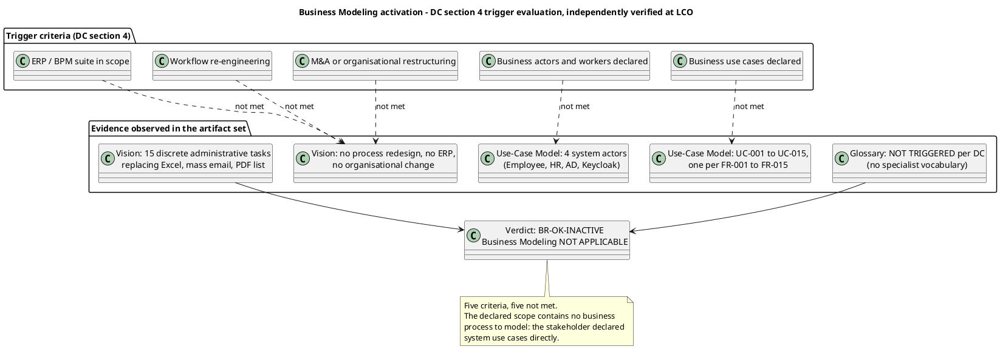

**Artifacts reviewed (8 of 8 persisted):** Development Case, Vision, Use-Case Model, Supplementary Specification, Software Architecture Document, Risk List, Iteration Plan, Test Evaluation Summary. The Glossary is NOT TRIGGERED and is correctly absent.

**Business-lens checklists applied:**

| Criterion | Applied to | Result |
|---|---|---|
| Scenario alignment — is the BM disposition correct and independently evidenced | Development Case, Vision, Use-Case Model | Pass |
| Business rules as formal constraints — ID, source, worker/entity attachment, testable condition | Supplementary Specification, Use-Case Model | Fail — one attachment defect, carried by another lens |
| Stakeholder representation coverage — all significant organizational parts represented | Vision | Pass |
| Volatility annotation — volatile business processes explicitly flagged for encapsulation | Vision, Software Architecture Document | Pass |
| Diagram coverage — which business-level diagrams are present, absent, defective | Use-Case Model, Supplementary Specification | Pass — none owed, none missing |
| BUC completeness test | Use-Case Model | N/A — no BUC declared or owed |
| BUC realization adequacy | Use-Case Model | N/A — no BUC; Elaboration concern in any case |
| Business-to-system derivation bridge | Use-Case Model | N/A — system UCs declared directly |
| Resource planning compliance | Use-Case Model | N/A — no business worker or entity |

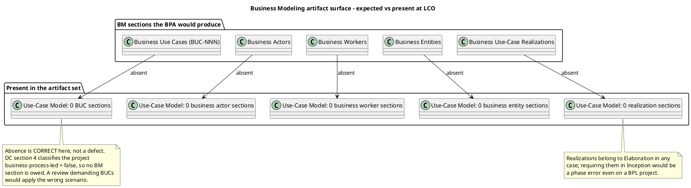

### Management Reviewer lens
<!-- review: Inception I1 -->

**Review point:** LCO, management lens. The question applied is exit criteria — do the artifacts collectively satisfy the conditions for phase transition — and the sanction question that follows from it. This is the Project Approval Review and the Project Planning Review held inside the LCO milestone review, not separately from it.

**Artifacts reviewed (8 of 8 persisted):** Development Case, Vision, Use-Case Model, Supplementary Specification, Software Architecture Document, Risk List, Iteration Plan, Test Evaluation Summary.

**Management-lens checklists applied:**

| Criterion | What it tests | Applied to |
|---|---|---|
| Evidence grounding | Every planning conclusion cites an artifact, metric or test result rather than an assertion | Iteration Plan, Risk List, Test Evaluation Summary |
| Milestone criteria coverage | All LCO exit criteria addressed with pass/fail per criterion | The artifact set as a whole |
| Risk retirement verification | Each risk has a mechanism and a named retiring event, and no retirement is claimed before its evidence exists | Risk List, Iteration Plan, Software Architecture Document |
| Iteration objective traceability | Delivery maps against the iteration's original stated objectives, not against what was delivered instead | Iteration Plan objectives O1–O4 |
| Four-axis health | Scope, schedule, cost and quality each assessed separately | The artifact set as a whole |
| Feasibility and acceptability | Feasibility from the artifacts; acceptability obtained by asking the stakeholder | The artifact set, then S_CONSULT_STAKEHOLDER |
| Data verification | Quantitative claims sourced or tagged; no invented unit, date or figure | Vision, Iteration Plan, Test Evaluation Summary |
| Conditional verdict enforcement | Prior conditions verified before the next verdict | No prior milestone verdict exists — first review |

**Trace tree consulted:** 42 Business roots, 180 nodes. Every FR-001 to FR-015 refines to exactly one UC-001 to UC-015; every UC realizes at least one component. No «LEAF» on any FR, NFR or UC. No «SUSPECT» edge. No «UNKNOWN LABEL». The requirements baseline is complete and correctly shaped — this is the strongest part of the set and no management finding touches it.

**SCM evidence observed:** no open pull request, no branch labelled `ready-for-review`, build on `main` successful, no issues in any state. Inception produces no implementation code, so there is no pull request to disposition and no defect record to read. The green build proves the pipeline runs, not that the product works.

**Compliance matrix — 8 LCO exit criteria, 5 Met, 2 Partial, 1 Not met, 1 not assessable:**

```plantuml
@startuml
title LCO compliance table - exit criteria, status and evidence (Inception iteration 1)

package "Met - 5" {
  class "Scope declared and published as a checkable boundary\n15 FR / 5 NFR / 36 CON / 13 exclusions verbatim" as M1 <<Met>>
  class "Requirements baselined\n15 UC one per FR, 5 NFR, 36 CON; no leaf on any FR, NFR or UC" as M2 <<Met>>
  class "Risks identified and classified\nR001-R008 with strategy, mitigation, contingency, owner, warning sign" as M3 <<Met>>
  class "Vision for the product\nproblem, position, features, volatility map, exclusions" as M4 <<Met>>
  class "Feasibility\nplatform fixed by CON-001/025/026/027; identity and directory external and read-only" as M5 <<Met>>
}

package "Partially met - 2" {
  class "Risk retirement plan\nR001 mechanism built in iteration 2, but the test that retires it runs in iterations 4 and 6" as P1 <<Partial>>
  class "Acceptance criteria accounted for\n4 of 5 have a gate; AC-004 is a population measure assigned to the gate where its window opens" as P2 <<Partial>>
}

package "Not met - 1" {
  class "Plan accounts for the iteration's work\nfine plan omits the SAD and the Test Evaluation Summary; two roles marked idle that produced artifacts" as N1 <<NotMet>>
}

package "Not assessable - 1" {
  class "Cost position\nCON-030 declares no budget and forbids the team to set one; no phase has closed, so no measured spend exists" as X1 <<NotAssessable>>
}

note bottom of P1
  The plan answers "Yes" to retiring the
  highest-magnitude risk first. The evidence
  chain places the retiring test two to four
  iterations later. Iteration Plan#F1.
end note

note bottom of P2
  AC-004 fuses a learnability check (testable
  in iteration 4) with an 80% population
  measure (BG-003, three months post-launch).
  Iteration Plan#F2.
end note

note bottom of X1
  Not a defect. A cost position cannot be
  reported where no budget is declared and
  no phase has closed.
end note
@enduml
```

**Four-axis health position:**

| Axis | Position | Basis |
|---|---|---|
| Scope | Healthy | 15 FR, 5 NFR, 36 CON, 13 exclusions all carried; no undeclared feature, no invented identifier, no exclusion crossed anywhere in the set |
| Schedule | At-Risk | The plan's risk-retirement claim is not supported by its own evidence chain (`Iteration Plan#F1`), and one acceptance criterion has no gate at which it can close (`Iteration Plan#F2`) |
| Cost | Not assessable | CON-030 declares no budget and forbids the team to set one; no phase has closed, so no measured spend exists. No figure is invented to fill the gap |
| Quality | Healthy at the level Inception owes | Requirements baseline complete and traceable; architecture is a genuine candidate with the three High-volatility requirements encapsulated; no test executed and none claimed |

### Review Coordinator lens
<!-- review: Inception I1 -->

<!-- review: Inception I1 -->

**Review point:** LCO, consolidation. This block holds the coordination of the milestone review — the review process framework, the review calendar, the consolidated finding ledger, the effectiveness metrics and the verdict. It does not re-evaluate the artifacts: the three lenses evaluated them and their findings are the evidence.

**Lens participation in this review:**

| Lens | Participant | Status |
|---|---|---|
| Technical | Reviewer | EXECUTED — 8 of 8 artifacts, 7 findings |
| Business | BusinessReviewer | EXECUTED — 8 of 8 artifacts, 1 finding |
| Management | ManagementReviewer | EXECUTED — 8 of 8 artifacts, 2 findings |

All three lenses executed. No lens is recorded as inactive, and the milestone decision rests on all three.

**Review process framework — seven review types, each bound to the workflow activity that triggers it:**

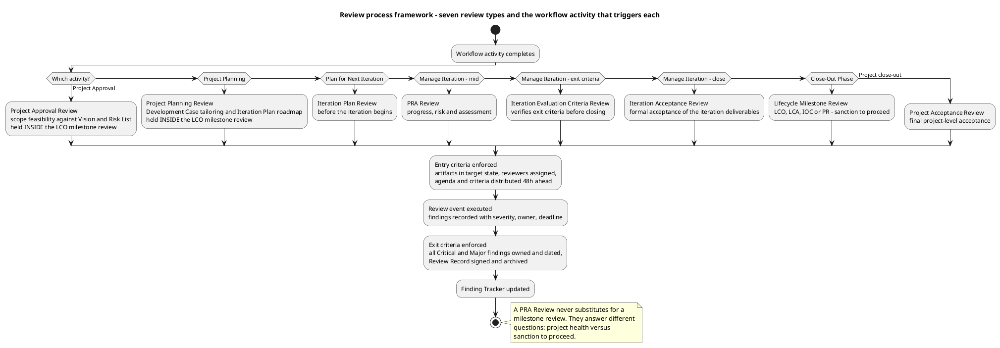

**Review calendar — Inception iteration 1, review events against the iteration timeline:**

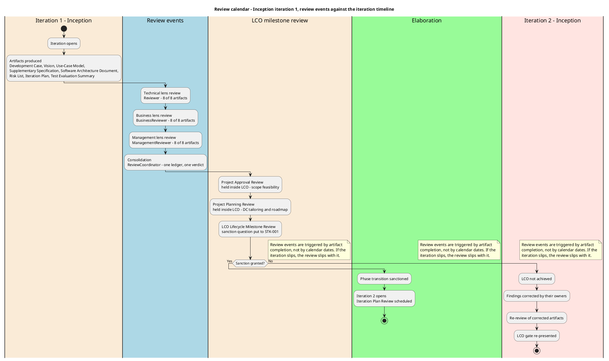

The Project Approval Review and the Project Planning Review were held inside the LCO milestone review, not as separate events — the Management Reviewer's block records both. The LCO Lifecycle Milestone Review is the Inception exit gate and it was held: the sanction question was put to STK-001 and refused.

**Finding lifecycle — the state machine every finding in this ledger is subject to:**

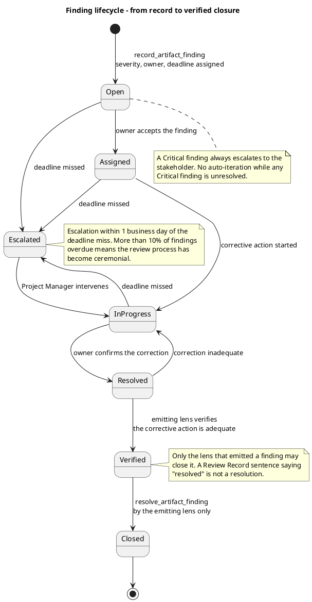

**Reviewer pool and expertise mapping — who reviews what, by artifact domain:**

| Artifact | Primary lens | Contributing lens | Expertise required |
|---|---|---|---|
| Development Case | Reviewer | ManagementReviewer | Process tailoring, baseline conformance |
| Vision | Reviewer | BusinessReviewer, ManagementReviewer | Requirements traceability, business representation |
| Use-Case Model | Reviewer | BusinessReviewer | Use-case modelling, business-rule binding |
| Supplementary Specification | Reviewer | BusinessReviewer | NFR and constraint coverage, interface contracts |
| Software Architecture Document | Reviewer | BusinessReviewer, ManagementReviewer | Architecture, schema satisfiability, constraint conformance |
| Risk List | Reviewer | ManagementReviewer | Risk governance, identifier preservation |
| Iteration Plan | Reviewer | ManagementReviewer | Planning, risk retirement, acceptance-criterion gating |
| Test Evaluation Summary | Reviewer | ManagementReviewer | Test strategy, coverage executability, SCM evidence |

**Entry and exit criteria applied to this review event:**

| Criterion | Applied |
|---|---|
| Entry — artifacts in target state, not draft | 8 of 8 persisted before any lens reviewed |
| Entry — reviewers assigned with matched expertise | Per the pool table above |
| Entry — evaluation criteria distributed in advance | Each lens states the checklists it applied |
| Exit — every Critical and Major finding has an owner and a deadline | 6 Major, all owned; see Resolutions and Actions |
| Exit — Review Record signed and archived | This block, committed |

**Consolidated finding ledger — three lenses, one ledger:**

```plantuml
@startuml
title Consolidated finding ledger - three lenses, one ledger, Inception iteration 1

package "Lenses that executed" {
  class "Reviewer\nTechnical lens\n7 findings: 4 Major, 3 Minor" as L1
  class "BusinessReviewer\nBusiness lens\n1 finding: 1 Minor" as L2
  class "ManagementReviewer\nManagement lens\n2 findings: 2 Major" as L3
}

package "Consolidated ledger - 10 findings" {
  class "Use-Case Model#F1\nMajor - SystemAnalyst" as F1
  class "Software Architecture Document#F1\nMajor - SoftwareArchitect" as F2
  class "Software Architecture Document#F2\nMinor - SoftwareArchitect" as F3
  class "Iteration Plan#F1 (Reviewer)\nMajor - ProjectManager" as F4
  class "Iteration Plan#F1 (Management)\nMajor - ProjectManager" as F5
  class "Iteration Plan#F2 (Management)\nMajor - ProjectManager" as F6
  class "Test Evaluation Summary#F1\nMajor - TestManager" as F7
  class "Test Evaluation Summary#F2\nMinor - TestManager" as F8
  class "Vision#F1 (Reviewer)\nMinor - SystemAnalyst" as F9
  class "Vision#F1 (Business)\nMinor - SystemAnalyst" as F10
}

package "Artifacts with no finding" {
  class "Development Case" as OK1
  class "Supplementary Specification" as OK2
  class "Risk List" as OK3
}

L1 --> F1
L1 --> F2
L1 --> F3
L1 --> F4
L1 --> F7
L1 --> F8
L1 --> F9
L2 --> F10
L3 --> F5
L3 --> F6

note bottom of F1
  CONFLICT RESOLVED: the Business Reviewer
  confirmed this defect but did not re-record
  it. One logical defect, one ledger entry.
  No duplicate to triage.
end note

note bottom of F4
  CONFLICT RESOLVED: three findings sit on
  the Iteration Plan from two lenses. They are
  distinct defects - fine-plan completeness,
  risk-retirement claim, AC-004 gate - and are
  consolidated into one owner's action list,
  not merged into one finding.
end note

note bottom of F9
  CONFLICT RESOLVED: the Management Reviewer's
  distribution diagram states 3 Minor but
  enumerates 4. The finding ledger holds 4.
  The ledger is authoritative; the diagram
  undercounted.
end note

note bottom of OK1
  Development Case, Supplementary Specification
  and Risk List carry zero findings across all
  three lenses.
end note
@enduml
```

**Cross-lens conflicts and their resolution:**

| Conflict | Resolution |
|---|---|
| The Business Reviewer confirmed `Use-Case Model#F1` but did not re-record it | Correct handling. One logical defect, one ledger entry. The Business Reviewer's confirmation is recorded in its block; the finding stays owned by the Reviewer lens, which is the only lens that may close it. |
| Three findings sit on the Iteration Plan from two lenses (`#F1` Reviewer, `#F1` and `#F2` Management) | Not merged. They are three distinct defects — fine-plan completeness, the R001 retirement claim, and the AC-004 gate. They are consolidated into one owner's action list so the ProjectManager triages one list, not three. |
| The Management Reviewer's defect-distribution diagram states "6 Major, 3 Minor" but enumerates four Minor entries | The finding ledger holds 4 Minor. The ledger is authoritative; the diagram undercounted by one. The consolidated total is 6 Major, 4 Minor, 0 Critical. |
| The Reviewer lens reports 4 Major / 3 Minor; the Business lens 0 Major / 1 Minor; the Management lens 2 Major / 0 Minor | Sums to 6 Major / 4 Minor / 0 Critical, matching the ledger exactly. No lens overstates or understates its own count. |

**Review effectiveness — current metrics only.** This is the first review event of the project. No prior iteration or cycle exists, so no trend is computed and none is implied; trend analysis begins at the second review event.

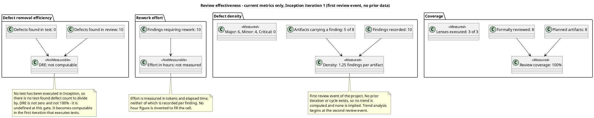

**Interpretation of the metrics.** Coverage is complete — every planned artifact was reviewed by all three lenses, so no artifact reached the milestone gate unreviewed. Defect density of 1.25 findings per artifact is concentrated: five artifacts carry all ten findings, and three carry none. The concentration is informative rather than alarming — the three clean artifacts (Development Case, Supplementary Specification, Risk List) are the ones whose content is largely inherited from declared inputs, while the five carrying findings are the ones where the team made design and planning decisions. The two artifacts with the highest-value defects are the Software Architecture Document and the Iteration Plan, which is where an LCO gate should be looking. Defect removal efficiency and rework effort are not measurable at this gate and no figure is invented for either.

## Findings
### Reviewer lens
<!-- review: Inception I2 -->

Three findings this milestone: 0 Critical, 2 Major, 1 Minor. Each is recorded in the finding ledger against its artifact; this entry states the defect, its location and its remediation.

#### Use-Case Model

**`Use-Case Model#F2` — Major.** The UC-001 postcondition still describes the single-row clocking model that ADR-010 replaced. It states that exactly one clocking record exists for the employee for today. Under ADR-010 a complete pair is two append-only rows — one ClockIn and one ClockOut — and an HR correction adds a third; the effective pair is a query over supersession, not a record. The postcondition is false after the second press.

The trace graph reports the same defect independently: the `COMP-002` Realizes edges to UC-001, UC-002, UC-003 and UC-005 are marked `SUSPECT → System Analyst`. The changed end is COMP-002, whose responsibility ADR-010 redefined, and it has not been reviewed against the use cases it realizes.

*Remediation.* Restate the postcondition in ADR-010's terms: after a Clock In press one ClockIn event row exists for the employee-day; after a Clock Out press a ClockOut event row exists for the same `WorkDate`; the effective pair is the two rows no other row supersedes. Confirm UC-002, UC-003 and UC-005 read the same shape — UC-005's outline already says a new audited record with the original never overwritten, which is consistent, so state it explicitly. Then clear the four suspect traces by declaring the Use-Case Model reviewed against ADR-010.

#### Software Architecture Document

**`Software Architecture Document#F3` — Major.** The architectural-significance table has not been re-based onto the eight-iteration roadmap. It assigns the four architecturally significant use cases to "Elaboration iteration 2" and the remaining six ranks to "Elaboration iteration 3". Under the current roadmap iteration 2 is this Inception correction iteration and Elaboration is iterations 3 and 4, so "Elaboration iteration 2" names an iteration that designs nothing. The Iteration Plan places the design of UC-001, UC-004, UC-009 and UC-011 in iteration 3, so the two artifacts disagree about when the architecture is designed. The Test Evaluation Summary performed this re-base for its coverage plan; the Software Architecture Document is the one artifact that did not receive it.

*Remediation.* Re-base the "Design in" column: ranks 1 to 4 to Elaboration iteration 3, ranks 5 to 10 to Elaboration iteration 4, matching the Iteration Plan's roadmap and its use-case table. Check the rest of the document for the same stale numbering in the same pass.

#### Supplementary Specification

**`Supplementary Specification#F1` — Minor.** The constraint grouping is internally inconsistent and does not match the declared categories. The "Environmental constraints" table lists CON-005 and CON-031, both declared Technical in the scope. The constraint map diagram disagrees with the table on CON-005 — the diagram places it in "Platform and technology" while the table places it in "Environmental" — and places CON-031 in its "Environment" package. A reader cannot tell whether the grouping is the declared category or the team's own, and the two representations of the same 36 constraints do not agree.

*Remediation.* Either group by the declared category, moving CON-005 and CON-031 to the platform/technical group in both the table and the diagram, or retitle the tables so they state they group by what each constraint decides rather than by its declared category, and make the diagram use the same grouping. Either resolution is acceptable; the defect is that the table and the diagram disagree and neither matches the declared category.

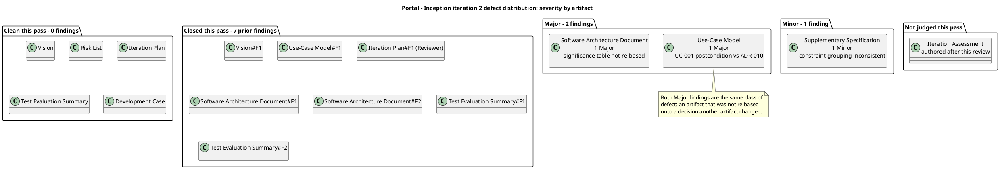

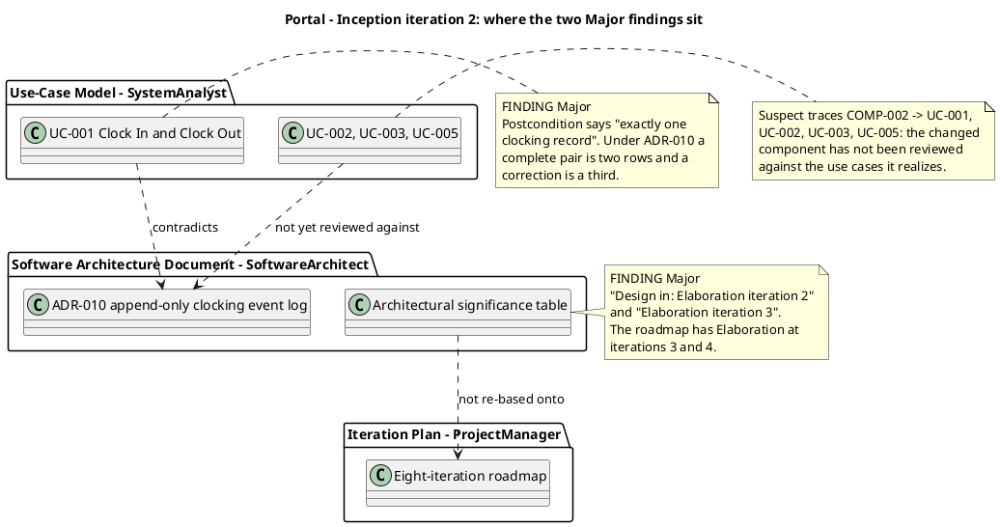

### Business Reviewer lens
<!-- review: Inception I1 -->

<!-- review: Inception I1 -->

One new defect from this lens: 0 Critical, 0 Major, 1 Minor. The business-rule attachment defect in the Use-Case Model is real and I confirm it, but it is already carried by the Reviewer lens as `Use-Case Model#F1`; re-recording it here would put one logical defect in the ledger twice, so I reference it instead of duplicating it.

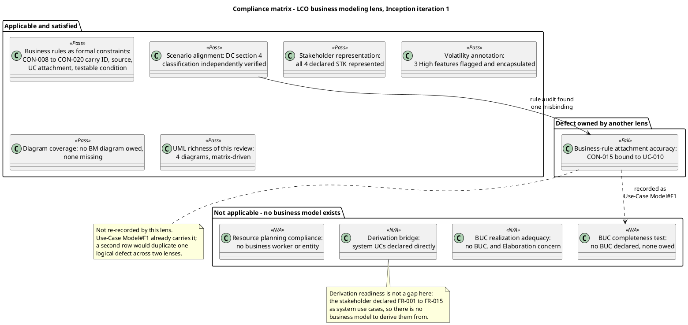

#### Development Case

No finding. The INACTIVE declaration is correct and correctly evidenced. It is a thin plug-in: it removes no role from the 25-role roster, changes no workflow structure, and reassigns no ownership. BusinessProcessAnalyst and BusinessReviewer are recorded idle by trigger rather than deleted, which is the right treatment — an idle role is not a removed role. The real-time-system trigger is also correctly not fired: NFR-004's one-second target is a performance requirement, not a hard deadline, and FR-013's retry is a bounded client-side retry loop rather than reactive event-driven behaviour.

#### Vision

| Severity | Location | Defect | Remediation |
|---|---|---|---|
| Minor | Features tables, FR-014 and FR-015 rows, success-criterion column | The success-criterion column is self-referential for two features: the FR-014 row cites "FR-014" and the FR-015 row cites "FR-015" as their own success criterion. Every other row cites an independent measure — an AC-NNN or a CON-NNN. A criterion that restates the requirement identifier is not a verification measure: it cannot be tested and cannot be distinguished from the requirement it is meant to verify. The two affected features are the network-unavailable behaviours, whose observable outcome is stated in the requirement text but is not expressed as a checkable criterion anywhere in the Vision. | Replace the self-referential cells with an independent measure — cite an existing acceptance criterion, or state the observable check directly, for example "the directory area shows a no-connection message and no result rows when the corporate network is unreachable". If no AC is declared for FR-014 and FR-015, record the criterion as derived from the requirement text rather than presenting the requirement identifier as its own measure. |

All other business-lens Vision checks pass. The 13 declared exclusions are published verbatim as a checkable boundary, which is the correct control for the exclusion-crossing risk. All four declared stakeholders are represented, and the negative-stakeholder analysis is honest: STK-003's constraint (CON-022, no AD modification) is declared and honoured rather than traded away. The volatility map flags exactly the three High features — FR-004, FR-009, FR-012 — and the Software Architecture Document encapsulates each in a dedicated component, so the volatility annotation reached the architecture rather than stopping at the Vision. No unsourced quantitative business claim appears.

#### Use-Case Model

No new finding from this lens. The business-rule binding defect is confirmed and is carried as `Use-Case Model#F1` by the Reviewer lens; I do not duplicate it.

The business-lens checks that pass: every one of the fifteen use cases cites a declared FR-NNN in its `Source` field, so no use case exists that the stakeholder did not declare and no declared requirement is unrepresented. The business rules are bound to use cases rather than left as prose — the binding diagram attaches each rule cluster to the use cases that enforce it, which is the property that makes a rule auditable. The three extension use cases (UC-013, UC-014, UC-015) are correctly modelled as exception paths rather than as independent actor goals, and the model says so explicitly. Authentication is a mechanism (MECH-01) and never a use case, which is the correct treatment of a cross-cutting technical concern.

#### Supplementary Specification

No finding. The business rules are the strongest part of this artifact set and they meet the four-property standard: each carries a unique identifier (CON-008 to CON-020), each is traceable to a declared source, each is attached to the use cases or entities it constrains, and each states a testable condition. CON-009's closed four-value list, CON-010's single-featured invariant, CON-012's one-pair-per-day rule and CON-013's never-overwrite rule are all stated as invariants rather than as guidelines, which is what makes them enforceable downstream. CON-015 is the load-bearing rule of the set — the worker category is descriptive and drives no access decision — and it is stated with the precision the exclusion requires.

#### Software Architecture Document

No finding from this lens. The three High-volatility features are each encapsulated behind a dedicated component, which is the architectural consequence the volatility annotation was there to produce. CON-028 is satisfied: Keycloak sits inside the corporate network boundary, and the hosted CI is the only node outside it and is explicitly a development toolchain rather than a runtime dependency. No cache is designed anywhere, which is the correct architectural reading of FR-014 and FR-015 — nothing is copied locally, so there is nothing to serve stale.

#### Risk List

No finding from this lens. R001 and R002 are carried with their declared identifiers and magnitudes and are not renumbered or reclassified, which CON-023 requires. R001 is the one risk with a business-model consequence: the directory must render an entry whose job title or extension is empty without breaking the row or hiding the employee, and the stand-in directory must carry such entries or the risk is retired untested. That obligation is recorded in the Development Case and in the Test Evaluation Summary as an entry criterion, so it is carried into execution rather than left as a note.

#### Iteration Plan, Test Evaluation Summary

No finding from this lens. Neither artifact carries business-level content that this lens governs; the technical lens has reviewed both.

**Defect distribution:**

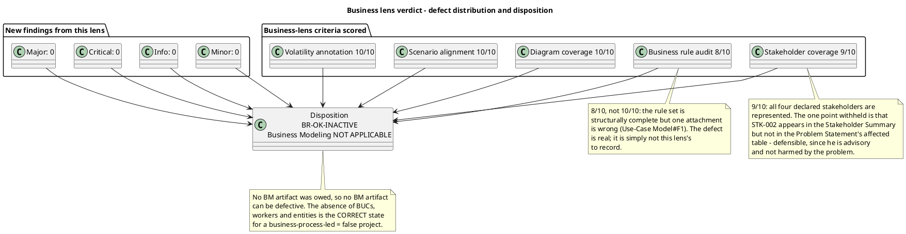

### Management Reviewer lens
<!-- review: Inception I1 -->

Two defects from this lens, both Major, both against the Iteration Plan. The other five findings in the ledger belong to the Reviewer and Business Reviewer lenses; I confirm them as part of the milestone position and cite them by key rather than re-recording them, because one logical defect recorded twice is one defect the author has to triage twice.

#### Iteration Plan

| Severity | Location | Defect | Remediation |
|---|---|---|---|
| Major | LCO readiness assessment, "Is there a plan to retire the highest-magnitude risk first?" row | The plan answers "Yes — R001 is retired in Elaboration iteration 2 by the stand-in directory carrying empty job-title and extension entries". Building the fixture is not retiring the risk. R001 is that the directory shows gaps when attributes are unfilled, and the Software Architecture Document's own retirement criterion is "a directory search and an export both pass against a fixture whose entries have empty job title and extension" — a passing test, not a fixture. The Test Evaluation Summary executes UC-011 in iteration 6 and UC-004 in iteration 4, and the role profile marks TestAnalyst, TestDesigner and Tester inactive in iteration 2. The highest-magnitude risk (R001, exposure 9) is therefore not retired until Construction, and the plan's central risk claim rests on an event its own evidence chain places two to four iterations later. | Restate the answer to match the evidence chain: R001's mechanism is built in iteration 2 and the risk is retired when the UC-011 and UC-004 tests pass against that fixture. Either move those two test executions earlier — a directory and export test against the stand-in needs no production code beyond the two components, so iteration 3 is a defensible home — or state plainly that R001 stays open until Construction and record what that means for the LCA gate. Do not answer "Yes" to a risk-retirement question on the strength of a fixture. |
| Major | Evaluation Criteria, Layer A table, AC-004 row | AC-004 is assigned verification in iteration 7, which is the iteration in which its own measure begins to elapse, so the criterion can never be verified at the gate it is assigned to. AC-004 is "80% of employees complete at least one clocking with no prior training" — a population measure over 200 employees. The coarse roadmap describes iteration 7 as "Handover to Infrastructure (CON-032); adoption measurement begins". A three-month adoption window (BG-003) that begins in the iteration assigned to verify it cannot have produced its result by the end of that iteration. The row also treats the criterion as addressed by UC-001 being detailed, which is a design statement, not a measurement. One of the five declared acceptance criteria has no gate at which it can be closed, and the plan presents it as accounted for. | Separate the two things AC-004 fuses. The learnability half — an employee completes a clocking with no prior training — is testable in the iteration that implements UC-001 (iteration 4) with a small untrained-user check, and belongs there. The 80%-of-population half is a post-launch adoption measure governed by BG-003's three-month window and cannot be closed inside any iteration; record it as a post-Project-Acceptance measure with HR (STK-001) as owner, and state in Layer A that AC-004 is verified in two parts at two different points. Do not assign a population measure to an iteration gate. |

#### Vision

No finding from this lens. The 13 declared exclusions are published verbatim as a checkable boundary, which is the correct control for the exclusion-crossing risk R005. All four declared stakeholders, all five acceptance criteria and both declared risks are carried. No unsourced quantitative business claim appears: the 200 employees, 3 offices, 50% reduction, 80% adoption and 3-month window are all declared inputs, not figures the Vision invented. The two findings in the ledger against this artifact are `Vision#F1` (Reviewer lens) and `Vision#F1` (Business Reviewer lens).

#### Risk List

No finding from this lens. R001 and R002 are carried with their declared identifiers and magnitudes (P=3 I=3 exposure=9; P=3 I=2 exposure=6) and are not renumbered or reclassified, which CON-023 requires. Team-identified risks run R003 to R008 in the order raised, each with probability, impact, magnitude, strategy, mitigation, contingency, owner and warning sign. CON-024 is respected — Keycloak and AD availability are not registered, and R003 is correctly distinguished as the timing of the CON-031 human feedback loop rather than a Keycloak or AD risk. Every `Accept` cites the CON-023 grant and its condition; no risk is accepted on the Project Manager's own authority. The register is the strongest management artifact in the set.

#### Development Case

No finding from this lens. Baseline conformance (a)–(e) passes: the 25-role roster is inherited unchanged, no CORE artifact is omitted, no primary ownership is reassigned, no artifact outside the CORE + OPTIONAL universe appears, and no two roles are merged. All six OPTIONAL triggers are recorded NOT TRIGGERED and each verdict holds against its §5.2 condition. Discipline intensity is per the canonical matrix with no self-granted deviation. Business Modeling is declared INACTIVE on the correct trigger. The measurement policy correctly refuses to set a token budget (CON-030) and keeps the two clocks apart.

#### Software Architecture Document

No finding from this lens. The three High-volatility requirements each own a dedicated component; CON-028 is satisfied with Keycloak inside the corporate network boundary; no cache is designed, consistent with FR-014 and FR-015; no scheduler exists, justified by CON-018 and CON-011. The ledger carries `Software Architecture Document#F1` (Reviewer lens, Major) and `Software Architecture Document#F2` (Reviewer lens, Minor).

#### Use-Case Model

No finding from this lens. Fifteen use cases, one per declared requirement, with no phantom use case, no cross-cutting mechanism promoted to a use case, and no per-actor split of a single declared process. The ledger carries `Use-Case Model#F1` (Reviewer lens, Major).

#### Supplementary Specification

No finding from this lens. All 5 NFRs and all 36 constraints are accounted for; the four mechanisms are recorded as mechanisms with an include graph and never as use cases; INT-03 reproduces the FR-004 column contract exactly. The constraint-conformance record is complete, which is what a 36-constraint project needs.

#### Test Evaluation Summary

No finding from this lens. The Evaluation Mission is correctly scoped to the test position rather than to a pass rate, and the document explicitly disclaims product evidence. All 15 use cases have a named test level and execution iteration; all 5 NFRs have the measurement method the requirement itself names, with NFR-002 correctly refusing server response time as a substitute. The ledger carries `Test Evaluation Summary#F1` (Reviewer lens, Major) and `Test Evaluation Summary#F2` (Reviewer lens, Minor).

**Defect distribution — 6 Major, 3 Minor, 0 Critical across the set:**

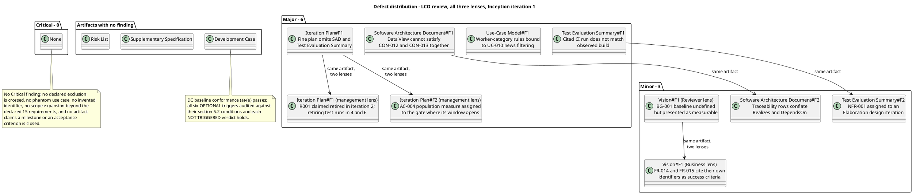

**Risk retirement trend — magnitude against retirement evidence at this gate:**

```plantuml
@startuml
title Risk retirement trend - magnitude against retirement evidence at LCO

package "High - exposure 9" {
  class "R001 AD attribute gaps\nP=3 I=3\nTrend: FLAT - no evidence yet\nRetired by: passing UC-011 and UC-004\ntests against the empty-attribute fixture" as R001
}

package "Significant - exposure 6" {
  class "R002 Clocking adoption\nP=3 I=2\nTrend: FLAT - post-launch measure\nRetired by: BG-003 adoption reading" as R002
  class "R003 Human gate exceeds 14 days\nP=2 I=3\nTrend: NEW - not yet elapsed\nRetired by: CON-031 feedback received" as R003
  class "R004 Stand-in omits empty entries\nP=2 I=3\nTrend: NEW - fixture not built\nRetired by: fixture inspection" as R004
  class "R005 Artifact crosses an exclusion\nP=2 I=3\nTrend: NEW - 0 crossings found\nRetired by: every review, every artifact" as R005
}

package "Moderate - exposure 4" {
  class "R006 Export contract misread\nP=2 I=2\nTrend: NEW - contract not built\nRetired by: column-by-column test" as R006
  class "R007 Toolchain gaps\nP=2 I=2\nTrend: NEW - 4 gaps open\nRetired by: gaps closed before Construction" as R007
  class "R008 Wrong client clock\nP=2 I=2\nTrend: NEW - accepted under CON-023\nRetired by: nothing - accepted, mitigated" as R008
}

package "Retirement evidence at this gate" {
  class "Risks with evidence of retirement: 0 of 8" as E0
  class "Risks with a mechanism designed: 6 of 8" as E1
  class "Risks accepted under CON-023: 4 of 8" as E2
}

R001 --> E0
R002 --> E0
R003 --> E0
R004 --> E0
R005 --> E0
R006 --> E0
R007 --> E0
R008 --> E0

note bottom of E0
  Zero is the correct reading at LCO, not a
  failure: Inception builds nothing, so no risk
  can be retired by evidence. What the gate
  checks is that each risk has a mechanism and
  a named retiring event - and that the plan
  does not claim retirement it has not earned.
end note

note bottom of R001
  The highest-magnitude risk. Its mechanism is
  built in iteration 2; its retiring test runs in
  iterations 4 and 6. The plan's claim that it is
  retired in iteration 2 is Iteration Plan#F1.
end note
@enduml
```

### Review Coordinator lens
<!-- review: Inception I1 -->

<!-- review: Inception I1 -->

**Consolidated ledger: 10 findings — 0 Critical, 6 Major, 4 Minor.** Every entry below is copied from `read_artifact_findings` for the artifact named. The coordinator does not re-evaluate the artifacts; the defect statements are the lenses' and are cited by key.

| # | Key | Artifact | Severity | Emitting lens | Owner | Defect |
|---|---|---|---|---|---|---|
| 1 | `Use-Case Model#F1` | Use-Case Model | Major | Reviewer | SystemAnalyst | The worker-category rule cluster (CON-009, CON-015, CON-016, CON-021) is bound to UC-010 Read and Filter News, and CON-015 is listed among UC-010's rules. CON-015 states the worker category is used in exactly two places — a directory column that also filters, and a CSV export column. UC-010 filters news by the four news categories, a different closed list governed by FR-010 and FR-006. |
| 2 | `Software Architecture Document#F1` | Software Architecture Document | Major | Reviewer | SoftwareArchitect | The Data View schema cannot satisfy CON-012 and CON-013 at the same time. `Clocking` holds ClockInUtc and ClockOutUtc in one row, so recording a Clock Out is an in-place UPDATE that CON-013 forbids; the Invariants table resolves CON-013 with "a correction is a new row" but enforces CON-012 with a unique index on (EmployeeId, WorkDate), which rejects that row. The correction record carries no previous-value column, which CON-013 and NFR-005 require. |
| 3 | `Iteration Plan#F1` (Reviewer) | Iteration Plan | Major | Reviewer | ProjectManager | The fine plan omits two artifacts this iteration produced. W1–W7 cover seven artifacts but not the Software Architecture Document or the Test Evaluation Summary, both persisted and both CORE. The critical chain has no Analysis and Design or Test lane, and the role profile marks SoftwareArchitect and TestManager inactive in iteration 1, contradicting the existence of both artifacts. |
| 4 | `Iteration Plan#F1` (Management Reviewer) | Iteration Plan | Major | ManagementReviewer | ProjectManager | The plan asserts R001 is retired in Elaboration iteration 2 by the stand-in directory carrying empty job-title and extension entries. Building the fixture is not retiring the risk: the SAD's own retirement criterion is a passing directory search and export against that fixture, and the Test Evaluation Summary executes UC-011 in iteration 6 and UC-004 in iteration 4 with no test role active in iteration 2. The highest-magnitude risk (exposure 9) is not retired until Construction. |
| 5 | `Iteration Plan#F2` (Management Reviewer) | Iteration Plan | Major | ManagementReviewer | ProjectManager | AC-004 is assigned verification in iteration 7, the iteration in which its own measure begins to elapse, so the criterion can never be verified at the gate it is assigned to. AC-004 is a population measure over 200 employees; the three-month adoption window (BG-003) that begins in iteration 7 cannot have produced its result by the end of iteration 7. One of five declared acceptance criteria has no gate at which it can close. |
| 6 | `Test Evaluation Summary#F1` | Test Evaluation Summary | Major | Reviewer | TestManager | The quality-signal table cites CI run `39932821851` (09:34:14Z to 09:35:04Z); the build observed on `main` is run `39933356092` (09:38:42Z to 09:39:34Z). A run identifier and two timestamps are observable SCM state, so a stale citation reads downstream as a verified observation. The conclusion holds; the citation does not. |
| 7 | `Software Architecture Document#F2` | Software Architecture Document | Minor | Reviewer | SoftwareArchitect | The Traceability table conflates two link types in one row: rows for COMP-001 to COMP-007 declare Realizes in the Link Type column while the Traces To column holds DependsOn targets. A reader cannot tell which link type the Traces To entries carry. |
| 8 | `Test Evaluation Summary#F2` | Test Evaluation Summary | Minor | Reviewer | TestManager | NFR-001 is assigned to Iteration 3, which the Iteration Plan scopes as Elaboration design only with no implementation. The stated method — every use case exercised unauthenticated and refused — cannot be executed against use cases that are designed but not built. |
| 9 | `Vision#F1` (Reviewer) | Vision | Minor | Reviewer | SystemAnalyst | The success-criteria table presents BG-001 as measurable — "50% reduction against the current manual baseline" — but no baseline is declared in the scope and none has been measured. The denominator is an inference the Vision adds; BG-001 names no baseline. The criterion cannot be verified as written. |
| 10 | `Vision#F1` (Business Reviewer) | Vision | Minor | BusinessReviewer | SystemAnalyst | In the Features tables the success-criterion column is self-referential for two features: the FR-014 row cites "FR-014" and the FR-015 row cites "FR-015" as their own success criterion. Every other row cites an independent measure. A criterion that restates the requirement identifier cannot be tested. |

**Artifacts carrying no finding across all three lenses:** Development Case, Supplementary Specification, Risk List.

**Defect distribution by artifact and owner:**

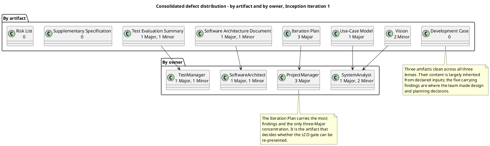

**Severity distribution and the gate consequence:**

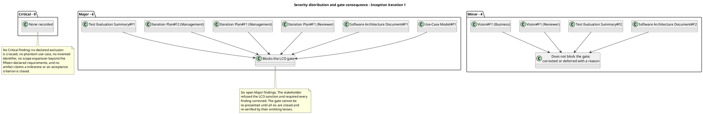

**Findings the coordinator raises on the review process itself.** These are process observations, not artifact defects, and they are not in the ledger above because the ledger holds artifact findings only.

| Observation | Consequence |
|---|---|
| The Management Reviewer's defect-distribution diagram states "6 Major, 3 Minor" while enumerating four Minor entries | A counting error in a review artifact. The ledger holds 4 Minor and the consolidated total uses the ledger. No artifact finding is raised — the diagram is inside the Review Record, which is this record, and the correction is made here. |
| The Business Reviewer confirmed `Use-Case Model#F1` without re-recording it | Correct process. One logical defect, one ledger entry, one owner. Duplicating it would have made the SystemAnalyst triage the same defect twice. |
| All three lenses reviewed all 8 artifacts | Coverage is complete. No artifact reached the gate unreviewed, and no lens reviewed a subset. |
| No lens closed a finding belonging to another lens | The ownership invariant held. No cross-lens closure was attempted. |

## Resolutions and Actions
### Reviewer lens
<!-- review: Inception I2 -->

**Prior findings of this lens, reconciled this iteration.** Seven were open at the start of iteration 2. Each was verified against the corrected artifact content and closed through `resolve_artifact_finding`. None is Deferred, none is Rejected, none is left open.

| Finding | Severity | Verified against | Resolution |
|---|---|---|---|
| `Vision#F1` | Minor | Success-criteria table — BG-001 row now reads "Not yet measurable", names STK-001 as the baseline source, and records the 50% reduction as a post-launch comparison | Resolved |
| `Use-Case Model#F1` | Major | Business-rule binding diagram — `R_CAT` binds UC-004 and UC-012 only; `R_NCAT` carries the news-category list to UC-006 and UC-010; UC-010's rules cell no longer cites CON-015 | Resolved |
| `Iteration Plan#F1` | Major | Fine plan W1–W9 includes W5 Software Architecture Document and W6 Test Evaluation Summary with exit conditions; critical chain carries Analysis and Design and Test lanes; both roles Active in the iteration 1 column | Resolved |
| `Software Architecture Document#F1` | Major | ADR-010 — append-only `ClockingEvent`, partial unique index on `(EmployeeId, WorkDate, EventKind)` where `SupersedesId IS NULL`, `PreviousValueUtc` column, Invariants table names the enforcing index per row | Resolved |
| `Software Architecture Document#F2` | Minor | Traceability table — one row per link type, `Traces To` empty on every Realizes and Derives row, separate DependsOn rows | Resolved |
| `Test Evaluation Summary#F1` | Minor | Quality-signals table — cites run `39940062277`, started 2026-10-23 10:34:26Z, completed 10:35:16Z, with the caveat retained | Resolved |
| `Test Evaluation Summary#F2` | Minor | Quality-attribute plan — NFR-001 split into NFR-001a (claim mapping, iteration 3) and NFR-001b (refusal assertion, iterations 5, 6, 7) | Resolved |

**Not this lens's to close.** `Iteration Plan#F1` and `Iteration Plan#F2` as recorded by the Management Reviewer remain with that lens. The actor handler rejects cross-lens closure, correctly: a lens that did not emit a finding cannot certify its correction.

**Open actions this milestone.** Three, all assigned, none deferred.

| Action | Owner | Closes | Exit condition |
|---|---|---|---|
| Restate the UC-001 postcondition in ADR-010's append-only terms; confirm UC-002, UC-003 and UC-005 read the same shape; clear the four `COMP-002` suspect traces | SystemAnalyst | `Use-Case Model#F2` | The postcondition describes two event rows and a supersession query, not one record; no `SUSPECT → System Analyst` edge remains on COMP-002 |
| Re-base the architectural-significance "Design in" column onto the eight-iteration roadmap | SoftwareArchitect | `Software Architecture Document#F3` | Ranks 1–4 read Elaboration iteration 3 and ranks 5–10 read Elaboration iteration 4, matching the Iteration Plan |
| Make the constraint grouping consistent between the table and the diagram, and state whether it follows the declared category | RequirementsSpecifier | `Supplementary Specification#F1` | The table and the diagram group the same 36 constraints the same way, and the grouping's basis is stated |

**What the corrections established.** The seven closures are not cosmetic. ADR-010 is the substantive one: it resolves a contradiction that would have surfaced as an unimplementable schema the moment Elaboration tried to baseline it, and it does so by making CON-013 hold by construction rather than by convention. The Iteration Plan's risk-retirement table now names the event that retires R001 rather than the fixture that makes it retirable, which is the claim an LCO gate exists to test. The Vision's BG-001 row now records an unmeasured criterion as unmeasured instead of presenting it as measurable.

**What the corrections did not establish.** A correction is not a closure, and a closure is not a pass. The two Major findings recorded this milestone are both consequences of the corrections themselves — ADR-010 changed the clocking shape and the Use-Case Model did not follow; the roadmap changed and the Software Architecture Document did not follow. That is the normal cost of a correction iteration and it is why the gate is re-presented rather than assumed.

### Business Reviewer lens
<!-- review: Inception I1 -->

<!-- review: Inception I1 -->

**Prior findings of this lens reconciled:** none. This is the first review of this lens on this project. `read_artifact_findings` returned one finding each on the Vision and the Use-Case Model, both emitted by the Reviewer lens, and an empty list on the Supplementary Specification. No finding of the Business Reviewer lens existed to close, so no `resolve_artifact_finding` call was due and no finding was re-recorded under an existing key. The two Reviewer-lens findings are outside my ownership and were left untouched.

**Actions arising from this lens:**

| Action | Artifact | Owner | Blocks LCO |
|---|---|---|---|
| Replace the self-referential success criteria on the FR-014 and FR-015 feature rows with an independent measure | Vision | SystemAnalyst | No |

**No Critical finding was raised, so no escalation to the stakeholder is required from this lens.** No `[SCOPE_QUESTION]` is open against any artifact reviewed. The two deferred questions — accessibility target and throughput binding — are recorded as out of scope for this cycle in the Work Order and are correctly carried as deferred rather than as gaps.

### Management Reviewer lens
<!-- review: Inception I1 -->

**Prior findings of this lens reconciled:** none. This is the first review of this lens on this project; `read_artifact_findings` returned no finding with `reviewerRole == ManagementReviewer` on any of the four management artifacts, so no closure was due and no finding was re-recorded under an existing key. The findings present on the Vision and the Iteration Plan belong to the Reviewer and Business Reviewer lenses and were left untouched — only the lens that emitted a finding may close it.

**Stakeholder sanction: REFUSED.**

**Stakeholder acceptance:** the sanction question was put with the verdict leaning and all six open Major defects inside it. The answer was "No", with the instruction "You need to correct all the findings." That answer is the record; no signature from a named person is required and none was sought.

**Actions arising from this review — all six Major findings must be corrected before the LCO gate is re-presented:**

| Action | Artifact | Owner | Blocks LCO |
|---|---|---|---|
| Resolve the CON-012 / CON-013 schema contradiction and add the previous-value column | Software Architecture Document | SoftwareArchitect | Yes |
| Rebind the worker-category rule cluster away from UC-010 and bind the news-category list to it | Use-Case Model | SystemAnalyst | Yes |
| Add the SAD and the Test Evaluation Summary to the fine plan and the critical chain; activate both roles in iteration 1 | Iteration Plan | ProjectManager | Yes |
| Correct the cited CI run to the observed build | Test Evaluation Summary | TestManager | Yes |
| Restate the R001 retirement claim to match the evidence chain, or move the retiring tests earlier | Iteration Plan | ProjectManager | Yes |
| Split AC-004 into its learnability check and its post-launch population measure, and assign each to a point where it can close | Iteration Plan | ProjectManager | Yes |
| Split the conflated Traceability rows by link type | Software Architecture Document | SoftwareArchitect | No |
| Make NFR-001's execution iteration match where the behaviour exists | Test Evaluation Summary | TestManager | No |
| Mark BG-001 as not yet measurable, or name the baseline source | Vision | SystemAnalyst | No |
| Replace the self-referential success criteria on the FR-014 and FR-015 feature rows | Vision | SystemAnalyst | No |

**No Critical finding was raised, so no Critical escalation is required.** The stakeholder was nevertheless consulted, because the LCO sanction is theirs to give and it was refused. No `[SCOPE_QUESTION]` is open against any artifact reviewed: the two deferred questions — accessibility target and throughput binding — are recorded as out of scope for this cycle in the Work Order and are correctly carried as deferred rather than as gaps in the Vision, the Supplementary Specification and the Development Case.

**Review and sanction sequence:**

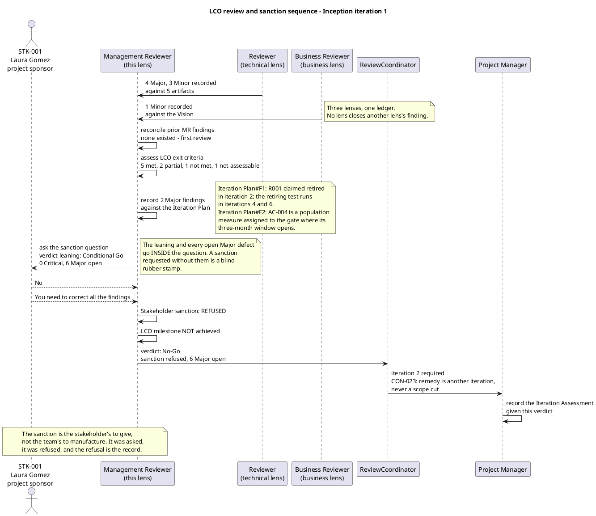

### Review Coordinator lens
<!-- review: Inception I1 -->

<!-- review: Inception I1 -->

**Prior findings reconciled:** none. This is the first review event of the project. `read_artifact_findings` returned an empty list for the Development Case, the Supplementary Specification and the Risk List, and returned only open findings — no resolution object — for the other five artifacts. No finding existed to close, so no closure was due from this lens.

**Stakeholder input already obtained — not re-asked.** The Management Reviewer put the LCO sanction question to STK-001 with the verdict leaning and all six open Major defects inside it. The answer was "No", with the instruction that every finding must be corrected. That answer is the stakeholder's input for the next pass and it is folded in below as the stakeholder finding. It is not put back to the stakeholder as a fresh question: the question has been asked and answered, and re-asking it would re-open a decision already made.

**Stakeholder finding:** every finding in this ledger is to be corrected. No finding is deferred, and no declared scope is cut or deferred to fit a schedule — CON-023 forbids it and the remedy for a milestone that does not pass is another iteration.

**Consolidated action list — prioritized by gate impact, one list per owner:**

| Priority | Action | Finding | Artifact | Owner | Closes at |
|---|---|---|---|---|---|
| 1 | Resolve the CON-012 / CON-013 schema contradiction: state how a pair is recorded across two presses under CON-013, make the unique index match the chosen shape, add a PreviousValue column to the correction record, and make each Invariants row name the index that enforces it | `Software Architecture Document#F1` | Software Architecture Document | SoftwareArchitect | LCO gate re-presentation |
| 2 | Restate the R001 retirement claim to match the evidence chain — either move the UC-011 and UC-004 test executions earlier or state plainly that R001 stays open until Construction and record what that means for the LCA gate | `Iteration Plan#F1` (Management Reviewer) | Iteration Plan | ProjectManager | LCO gate re-presentation |
| 3 | Split AC-004 into its learnability check (testable in the iteration that implements UC-001) and its post-launch population measure (BG-003 window, HR as owner), and assign each to a point where it can close | `Iteration Plan#F2` (Management Reviewer) | Iteration Plan | ProjectManager | LCO gate re-presentation |
| 4 | Add the Software Architecture Document and the Test Evaluation Summary to the fine plan with exit conditions, place them in the critical chain, and mark SoftwareArchitect and TestManager active in iteration 1 | `Iteration Plan#F1` (Reviewer) | Iteration Plan | ProjectManager | LCO gate re-presentation |
| 5 | Rebind the worker-category rule cluster away from UC-010 and bind the news-category closed list to UC-010 instead, sourced from FR-010 and FR-006 | `Use-Case Model#F1` | Use-Case Model | SystemAnalyst | LCO gate re-presentation |
| 6 | Replace the cited CI run with the observed build, or state the build status without a run identifier | `Test Evaluation Summary#F1` | Test Evaluation Summary | TestManager | LCO gate re-presentation |
| 7 | Split the conflated Traceability rows by link type — one row for Realizes with Traces To empty, one for DependsOn | `Software Architecture Document#F2` | Software Architecture Document | SoftwareArchitect | LCO gate re-presentation |
| 8 | Make NFR-001's execution iteration match where the behaviour exists, or split the row into an Elaboration claim-mapping check and a Construction refusal assertion | `Test Evaluation Summary#F2` | Test Evaluation Summary | TestManager | LCO gate re-presentation |
| 9 | Mark the BG-001 row as not yet measurable and record that HR must supply the current manual baseline, or state the measure as a post-launch comparison HR performs | `Vision#F1` (Reviewer) | Vision | SystemAnalyst | LCO gate re-presentation |
| 10 | Replace the self-referential success criteria on the FR-014 and FR-015 feature rows with an independent measure | `Vision#F1` (Business Reviewer) | Vision | SystemAnalyst | LCO gate re-presentation |

**Prioritization rationale.** Priority 1 is the only finding that would cost a re-baseline if carried forward: Elaboration would baseline a schema that cannot satisfy two declared invariants, and the defect surfaces as an unimplementable design rather than as a document error. Priorities 2 and 3 are the two findings that decide the milestone: they are the plan's own claims about risk retirement and acceptance-criterion gating, and a plan that answers "Yes" to a risk-retirement question on the strength of a fixture is the exact claim an LCO gate exists to refuse. Priority 4 is a completeness defect in the same artifact and is corrected in the same pass. Priorities 5 and 6 are Major but local — each is a single correction inside one artifact with no propagation beyond it. Priorities 7 to 10 are Minor: they do not block the gate, but the stakeholder required every finding corrected, so none is deferred.

**Action ownership and load:**

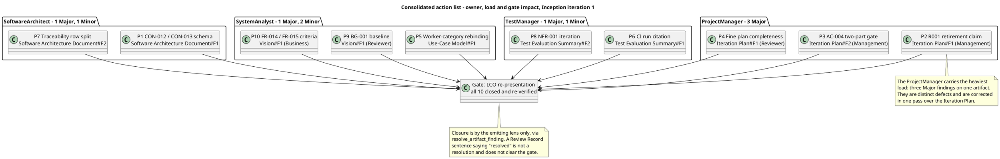

**Closure protocol for this action list.** Each action closes only when the emitting lens calls `resolve_artifact_finding` after verifying the corrective action is adequate. The coordinator does not close findings and does not accept a narrative claim of resolution in place of the tool call. The six Major findings must all be closed before the LCO gate is re-presented; the four Minor findings must be closed or explicitly deferred with a reason, and the stakeholder's instruction is that they be corrected.

**Escalation status.** No finding has missed a deadline, because no deadline has yet elapsed — the action list was issued at this review event. No escalation notice is due. No Critical finding exists, so no Critical escalation to the stakeholder is required. The stakeholder was nevertheless consulted, because the LCO sanction is theirs to give and it was refused.

**Review debt position at this gate:** 10 open findings, 0 overdue, 0 escalated. The 0% overdue rate is not a sign of health — it is the reading of a ledger issued moments ago. It becomes meaningful at the next review event, when the first deadlines have had a chance to elapse.

## Disposition
### Reviewer lens
<!-- review: Inception I1 -->

**Disposition: Approved with Changes.**

The Inception artifact set is technically sound in its structure and its scope discipline. The requirements baseline is complete and correctly shaped: 15 use cases, one per declared requirement, with no phantom use case, no cross-cutting mechanism promoted to a use case, and no per-actor split of a single declared process. The 36 constraints are carried and bound. The architecture is a genuine candidate — decomposed by area of change, with each of the three High-volatility requirements encapsulated in its own component, CON-028 satisfied, and no over-engineering against a non-binding scale. The risk register preserves the declared identifiers and magnitudes and respects the CON-024 exclusion. The Development Case is a correct delta over the baseline with every optional trigger honestly audited.

The four Major findings are all correctable within this iteration and none of them invalidates the phase's central conclusions. The most consequential is the SAD's schema contradiction: CON-012 and CON-013 are both declared and the Data View as drawn cannot satisfy both, which would surface as an unimplementable design the moment Elaboration tries to baseline it. The Use-Case Model's misbinding of the worker-category rules to news filtering is the kind of defect that propagates — a designer reading UC-010's rule list would implement a category filter on news. The Iteration Plan's omission of two artifacts it actually produced understates the critical path. The Test Evaluation Summary's stale CI citation is a data-integrity defect rather than a quality defect: the conclusion holds, the evidence does not.

No Critical finding: no declared exclusion is crossed anywhere in the set, no identifier is invented, no scope is expanded beyond the declared 15 requirements, and no artifact claims a milestone or an acceptance criterion is closed. The set is fit to proceed to Elaboration once the four Major findings are addressed.

### Business Reviewer lens
<!-- review: Inception I1 -->

<!-- review: Inception I1 -->

**Disposition: BR-OK-INACTIVE — Business Modeling NOT APPLICABLE per DC §4.**

The Business Modeling discipline is correctly inactive for this project, and I verified that independently rather than accepting the Development Case's assertion. Five activation criteria were tested against the artifact set and none is met: no ERP or BPM suite is in scope, no workflow is being re-engineered, no organizational restructuring is involved, no business actor or business worker is declared, and no business use case is declared. The stakeholder declared fifteen discrete administrative tasks directly as system use cases, and the Use-Case Model reflects exactly that — four system actors, fifteen use cases, one per declared requirement.

The consequence is that the business-lens criteria which presuppose a business model are N/A rather than Fail. There is no BUC to test for completeness, no realization to assess, no business worker to carry an automation disposition, and no business entity to map to an analysis class. The derivation bridge is not broken — it does not exist, because the requirements discipline did not need it: the system use cases were declared, not derived. Recording these as defects would be the wrong-scenario error, and it would send the System Analyst to build artifacts the Development Case correctly does not require.

What the business lens does govern, and what I found: the business rules are the strongest content in this set. CON-008 to CON-020 each carry an identifier, a source, an attachment to the use cases that enforce them, and a testable condition — the four properties that make a rule auditable rather than a guideline. The one attachment defect, CON-015 bound to UC-010's news filtering, is real and consequential, and it is already carried as `Use-Case Model#F1` by the Reviewer lens; I confirm it and do not duplicate it. Stakeholder representation is complete across all four declared stakeholders, with the negative-stakeholder analysis honestly handled. The volatility annotation did its job: the three High features are flagged in the Vision and each is encapsulated behind a dedicated component in the Software Architecture Document, so the volatile business policy reached the architecture instead of stopping at a table.

One Minor finding is raised from this lens: two Vision feature rows cite their own requirement identifier as their success criterion, which is not a verification measure. It does not block the milestone.

The artifact set is fit to proceed to Elaboration from the business modeling perspective. No business artifact is owed, none is missing, and none is defective in a way this lens owns.

### Management Reviewer lens
<!-- review: Inception I1 -->

**Disposition: No-Go. The LCO milestone is not achieved and the project does not advance to Elaboration.**

The stakeholder refused the sanction and required every finding corrected. That refusal is the verdict, and it is consistent with what the artifacts show: the requirements baseline is complete and correctly shaped, the risk register is honest, and the Development Case is a correct delta over the baseline — but the plan that is supposed to carry the project through Elaboration does not survive its own evidence chain.

The two management findings are the ones that decide this. `Iteration Plan#F1` is the more serious: the plan answers "Yes" to the question an LCO readiness assessment exists to answer — is the highest-magnitude risk retired first — on the strength of a fixture being built, when the test that retires R001 runs two to four iterations later and no test role is active in the iteration the plan names. A plan that claims a risk retired before its evidence exists is the failure mode risk-driven development is designed to prevent, and it is exactly the claim a milestone gate must not accept. `Iteration Plan#F2` is quieter but structural: AC-004 fuses a learnability check that is testable in iteration 4 with an 80% population measure whose three-month window opens in the iteration assigned to verify it, so one of five declared acceptance criteria has no gate at which it can close.

The four Major findings from the other lenses compound the position rather than changing it. `Software Architecture Document#F1` is the one that would cost most if carried forward: CON-012 and CON-013 are both declared and the Data View as drawn cannot satisfy both, so Elaboration would baseline an unimplementable schema. `Use-Case Model#F1` would propagate a category filter onto news. `Iteration Plan#F1` from the technical lens understates the critical path by omitting two artifacts the iteration actually produced. `Test Evaluation Summary#F1` is a data-integrity defect: the conclusion holds, the citation does not.

**What this verdict is not.** It is not a finding that the project is not viable. Feasibility is met: the platform is fixed by four constraints, identity and directory are external and read-only, the team's integration surface is stand-ins it controls, and the declared scope is constraint-dense enough that the stakeholder has already made most design decisions. Nothing in the set crosses a declared exclusion, invents an identifier, or expands scope beyond the fifteen declared requirements. The project is worth doing and the requirements baseline is worth building on.

**What must happen before the gate is re-presented.** All six Major findings corrected and re-verified, and the four Minor findings corrected or explicitly deferred with a reason. The remedy is another iteration — CON-023 forbids cutting or deferring declared scope to fit a schedule, and no scope is cut here. The cost axis is not assessable and no figure is invented to fill it: CON-030 declares no budget and forbids the team to set one, and no phase has closed, so no measured spend exists to forecast from.

**Project health state at this gate:**

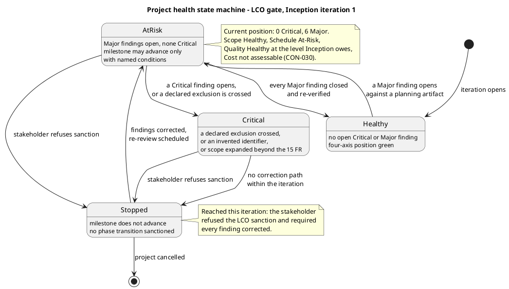

### Review Coordinator lens
<!-- review: Inception I1 -->

<!-- review: Inception I1 -->

**Disposition: No-Go. The LCO milestone is not achieved and the project does not advance to Elaboration.**

**Verdict basis — anchored to the finding data, not to judgment:**

| Condition for advancing | Reading | Met |
|---|---|---|
| Artifacts read | 8 of 8, unread: none | Yes |
| Open Critical findings | 0 | Yes |
| Open Major findings | 6 | **No** |
| Planned iteration objectives achieved | No — six Major findings open against five artifacts | **No** |
| Stakeholder sanction | REFUSED | **No** |

Three of the five conditions fail. The verdict is No-Go and the phase does not advance.

**Stakeholder sanction: REFUSED.** The Management Reviewer put the sanction question to STK-001 with the verdict leaning and all six open Major defects inside it. The answer was "No", with the instruction that every finding be corrected. That refusal is the verdict and it is consistent with the finding data: the requirements baseline is complete and correctly shaped, but the plan that must carry the project through Elaboration does not survive its own evidence chain.

**Stakeholder finding:** every finding in this ledger is to be corrected. Folded into the action list in Resolutions and Actions — all ten actions are assigned, none is deferred, and no declared scope is cut or deferred to fit a schedule.

**What this verdict is not.** It is not a finding that the project is not viable. Feasibility is met: the platform is fixed by CON-001, CON-025, CON-026 and CON-027; identity and directory are external and read-only under CON-002 and CON-003; the team's integration surface is stand-ins it controls under CON-031; and the declared scope is constraint-dense enough that the stakeholder has already made most design decisions. Nothing in the set crosses a declared exclusion, invents an identifier, or expands scope beyond the fifteen declared requirements. The requirements baseline is worth building on.

**What must happen before the gate is re-presented.** All six Major findings corrected and re-verified by their emitting lenses, and the four Minor findings corrected. The remedy is another iteration — CON-023 forbids cutting or deferring declared scope to fit a schedule, and no scope is cut here.

**Milestone and phase state:**

```plantuml
@startuml
title LCO milestone state - Inception iteration 1, verdict and next event

[*] --> Iteration1Open : Inception iteration 1 opens
Iteration1Open --> ArtifactsProduced : 8 of 8 artifacts persisted
ArtifactsProduced --> ThreeLensReview : Reviewer, BusinessReviewer,\nManagementReviewer each review 8 of 8
ThreeLensReview --> Consolidated : 10 findings, one ledger\n0 Critical, 6 Major, 4 Minor
Consolidated --> SanctionAsked : LCO sanction question put to STK-001\nleaning and all 6 Major inside it
SanctionAsked --> SanctionRefused : STK-001 answers No\n"correct all the findings"
SanctionRefused --> NoGo : LCO milestone NOT achieved
NoGo --> Iteration2 : record_milestone_auto_iterate\nrequiresIteration: true
Iteration2 --> Corrections : 10 actions, 4 owners
Corrections --> ReReview : emitting lenses verify\nand close via resolve_artifact_finding
ReReview --> SanctionAsked : LCO gate re-presented
SanctionAsked --> Elaboration : sanction granted
Elaboration --> [*]

state NoGo {
  NoGo : phase does not advance
  NoGo : no phase transition sanctioned
  NoGo : no scope cut, no scope deferred
}

state Corrections {
  Corrections : SoftwareArchitect 2
  Corrections : ProjectManager 3
  Corrections : SystemAnalyst 3
  Corrections : TestManager 2
}

note right of SanctionRefused
  The sanction is the stakeholder's to give,
  not the team's to manufacture. It was asked,
  it was refused, and the refusal is the record.
end note

note right of NoGo
  Four-axis position: Scope Healthy,
  Schedule At-Risk, Quality Healthy at the
  level Inception owes, Cost not assessable
  (CON-030 declares no budget and forbids
  the team to set one; no phase has closed,
  so no measured spend exists).
end note
@enduml
```

**Review process effectiveness at this gate.** Coverage was complete — 8 of 8 artifacts reviewed by all three lenses, no artifact reaching the gate unreviewed. The review found six Major defects that would otherwise have entered Elaboration, including a schema that cannot satisfy two declared invariants and a plan whose central risk claim is contradicted by its own evidence chain. That is the review process doing its job: the defects were found at the gate that exists to find them, not in Construction where the schema would already be baselined. Defect removal efficiency and rework effort are not measurable at this gate and no figure is invented for either.

**Next review event.** The LCO gate is re-presented after the ten actions close. The Iteration Plan Review for iteration 2 is scheduled at the point iteration 2 opens, and the LCO Lifecycle Milestone Review is re-held at the point the corrections are verified. Both are triggered by artifact completion, not by calendar dates.
