## Document Control
### Reviewer lens
<!-- review: Inception I2 -->

- **Phase:** Inception
- **Status:** Draft — iteration 2, technical lens review complete
- **Milestone Target:** End of Inception (not yet achieved)

### Business Reviewer lens
<!-- review: Inception I2 -->

<!-- review: Inception I2 -->

- **Phase:** Inception
- **Status:** Draft — iteration 2, business modeling lens review complete
- **Milestone Target:** End of Inception (not yet achieved)

### Management Reviewer lens
<!-- review: Inception I2 -->

- **Phase:** Inception
- **Status:** Draft — iteration 2, LCO review held, sanction refused
- **Milestone Target:** End of Inception (not yet achieved)

### Review Coordinator lens
<!-- review: Inception I2 -->

- **Phase:** Inception
- **Status:** Draft — iteration 2, LCO milestone review consolidated; milestone not achieved
- **Milestone Target:** End of Inception (not yet achieved)

## Review Scope and Criteria
### Reviewer lens
<!-- review: Inception I2 -->

**Review type:** Technical review, LCO lifecycle milestone, Inception iteration 2. Checklist-driven against the artifact type of each item reviewed.

**Scope.** All ten persisted artifacts, plus the trace graph and the SCM state. Nine were evaluated against their checklists; the Iteration Assessment is not judged — it is authored after this review and its absence or lag is never a finding.

| Artifact | Checklist applied | Result |
|---|---|---|
| Vision | Requirements: traceable, testable, unambiguous, no unsourced quantitative claim | Pass |
| Use-Case Model | Requirements: UC well-formed, one per declared process, no cross-cutting mechanism as a UC, rule binding correct, traceability | **Fail** — 1 Major |
| Supplementary Specification | Requirements: every constraint carried and bound, mechanisms not UCs, two closed lists kept apart | **Fail** — 1 Minor |
| Software Architecture Document | Architecture: every subsystem maps to a volatile requirement, constraint conformance, invariants enforceable, traceability one edge per row | **Fail** — 1 Major |
| Risk List | Project Management: declared identifiers and magnitudes preserved, CON-024 respected, every risk treated and traced | Pass |
| Iteration Plan | Project Management: plan derived from the artifact set, risk retirement named against its event, every AC has a gate | Pass |
| Test Evaluation Summary | Test: coverage against use cases, measurement method per NFR, observable SCM state cited as observed | Pass |
| Development Case | DC baseline conformance (§1.2) and optional trigger justification | Pass |
| Iteration Assessment | Not judged — authored after this review | N/A |
| Review Record | This artifact | N/A |

**SCM state.** No open pull request exists, so no PR required a disposition. The build on `main` is green; it carries no product evidence, because the repository holds inputs and artifacts only.

**Trace graph.** 42 business roots, 180 nodes. No `FR-NNN`, `NFR-NNN` or `UC-NNN` is a leaf — every declared requirement is realized and every use case is carried by a component. Four `SUSPECT → System Analyst` edges are reported: `COMP-002 → UC-001`, `UC-002`, `UC-003`, `UC-005`. They are the trace-graph evidence for the Use-Case Model finding below and are recorded there rather than as a separate defect.

**Closure of prior findings.** Seven findings of this lens from iteration 1 were reconciled before any new defect was recorded. All seven are Resolved; none is Deferred or Rejected. The two `Iteration Plan` findings owned by the Management Reviewer lens are not this lens's to close and remain with that lens.

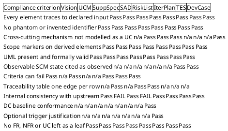

**What the two Fail cells have in common.** Both are artifacts that were not re-based onto a decision another artifact changed. The Software Architecture Document chose a new clocking shape in ADR-010 and the Use-Case Model still describes the old one; the Iteration Plan re-based the roadmap onto eight iterations and the Software Architecture Document still names the old iteration numbers. Neither is a defect of the artifact's own reasoning — each is a defect of the artifact's currency, which is the class of defect a milestone review exists to catch before the next phase builds on it.

### Business Reviewer lens
<!-- review: Inception I2 -->

<!-- review: Inception I2 -->

**Review point:** LCO, business modeling lens. The question applied is exit criteria — is the Business Modeling discipline correctly dispositioned, and does the artifact set carry the business-level content the downstream disciplines need.

**Scenario assessment — the governing decision.** The Development Case records `business-process-led = false` and I verified that classification independently rather than inheriting it. None of the six business modeling scenarios applies: no ERP or BPM suite is in scope, no workflow is re-engineered, no organizational restructuring is involved, no business actor or business worker is declared, and no business use case is declared. The stakeholder declared fifteen discrete administrative tasks directly as system use cases FR-001 to FR-015, replacing three manual artifacts. The disposition is correct and unchanged from iteration 1.

**Consequence for the standard applied.** Because no business model is owed, the criteria that presuppose one — BUC completeness, BUC realization adequacy, the business-to-system derivation bridge, resource planning compliance — are recorded N/A, not Fail. Applying them would be the wrong-scenario error. What I review is the business-level content that exists regardless of scenario: the business rules, stakeholder representation, volatility annotation, business-goal measurability, and scope adherence.

**Artifacts reviewed (9 of 9 persisted):** Development Case, Vision, Use-Case Model, Supplementary Specification, Software Architecture Document, Risk List, Iteration Plan, Test Evaluation Summary, Iteration Assessment. The Glossary is NOT TRIGGERED and is correctly absent. The Iteration Assessment is not judged — it is authored after this review.

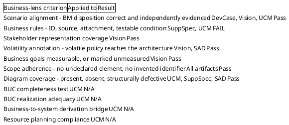

**Closure of prior findings.** One finding of this lens from iteration 1 was reconciled before any new defect was recorded: `Vision#F1` (Minor), the two self-referential success-criterion cells. It is Resolved — the FR-014 and FR-015 rows now carry observable checks derived from the requirement text, and the section preamble states the rule that a cell never restates its own requirement identifier. No finding of this lens is Deferred or Rejected.

**What the business lens found this iteration.** The business-rule register is the strongest content in the set and it is where both new defects sit. Twelve of the thirteen declared `[BusinessRule]` constraints carry an identifier, a source, an attachment to the use cases that enforce them, and a testable condition — the four properties that make a rule auditable rather than a guideline. The two defects are attachment defects, not content defects: CON-012 is bound to UC-001 but the use case specifies no behaviour for the state the rule forbids, and CON-015's attachment is incomplete and contradicts the Software Architecture Document about whether the rule governs the directory search. A third, Minor, is that the register presents itself as complete and carries twelve of thirteen.

**Stakeholder representation is complete.** All four declared stakeholders appear with their needs and influence, and the negative-stakeholder analysis is honest: the one group whose workload changes without their consent is Infrastructure, and their constraint (CON-022) is declared and honoured rather than traded away. No organizational area relevant to the declared scope is unrepresented — the scope is three capability areas over one identity, and each is owned by a declared stakeholder.

**Volatility annotation did its job.** The three High-volatility features are flagged in the Vision and each owns a dedicated component in the Software Architecture Document — COMP-003 for the FR-004 export contract, COMP-004 for the FR-009 single-featured invariant, COMP-006 for the FR-012 category value set. The volatile business policy reached the architecture instead of stopping at a table, which is the test this criterion exists to apply.

**Business-goal measurability.** BG-001 is recorded as not yet measurable with STK-001 named as the supplier of the baseline; BG-002 and BG-003 are measurable against declared facts. A criterion whose denominator does not exist is recorded as unmeasured, never as met — that is the correct handling and it is the correction of the iteration-1 finding.

**Scope adherence.** No element in the set addresses a functional area the stakeholder did not declare. The fifteen use cases map one to one onto FR-001 to FR-015. No identifier is invented — every `FR-`, `NFR-`, `CON-`, `AC-`, `BG-`, `STK-` and `R` identifier cited is one the work order assigned. No declared exclusion is crossed. No cross-cutting mechanism is promoted to a use case: authentication, authorization, audit and directory read are mechanisms in the Supplementary Specification, included by the use cases that depend on them.

**Diagram coverage.** No business-level diagram is owed, so none is missing. The diagrams that exist at the business level — the use-case diagram with the organizational boundary, the business-rule binding diagram, the two-closed-lists diagram, the volatility map — are present and formally valid. The defect this lens records is not a missing diagram but a diagram whose edges disagree with a use case's own prose: the binding diagram denies the R_CAT cluster reaches UC-011, and CON-015 declares the directory column as one of its two permitted uses.

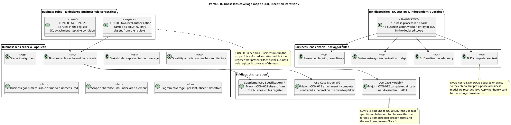

**Disposition: Approved with Changes.** No Critical finding. Two Major and one Minor, all correctable within this iteration, all in the business-rule attachment layer rather than in the requirements baseline. The Business Modeling discipline remains correctly inactive and no business artifact is owed, missing, or defective in a way this lens owns beyond the three findings above.

### Management Reviewer lens
<!-- review: Inception I2 -->

<!-- review: Inception I2 -->

**Review type:** Lifecycle Milestone Review — Lifecycle Objectives (LCO), end of Inception. Held at the close of Inception iteration 2, the correction iteration the stakeholder's refusal of the iteration-1 sanction required.

**Artifacts reviewed:** Development Case, Vision, Use-Case Model, Supplementary Specification, Software Architecture Document, Test Evaluation Summary, Risk List, Iteration Plan. The Iteration Assessment is not judged: the ProjectManager authors it after this review, given the verdict, and its absence at review time is not a defect.

**Criteria applied.** The seven LCO exit criteria, each answered against artifact evidence rather than against the plan's assertion of it. The management lens adds four checks the technical lenses do not run: whether the plan's claims survive their own evidence chain, whether every declared acceptance criterion has a point at which it can close, whether risk retirement is claimed only where evidence exists, and whether the Development Case conforms to the IARI baseline.

| # | LCO exit criterion | Result | Evidence |
|---|---|---|---|
| 1 | Stakeholders agree on the scope | Met | 15 FR, 5 NFR, 36 CON, 3 BG, 5 AC and 13 exclusions carried exactly as declared; the exclusions are published verbatim in the Vision as a checkable boundary. No lens recorded a scope finding in either iteration |
| 2 | Key risks identified and classified | Met | R001 to R008, each with probability, impact, exposure, magnitude, strategy, owner, mitigation, contingency and warning sign. R001 and R002 keep their declared identifiers and magnitudes, which CON-023 requires |
| 3 | The proposed approach is feasible | Met | Platform fixed by CON-001, CON-025, CON-026, CON-027; identity and directory external and read-only by CON-002, CON-003, CON-022; the team's integration surface is the stand-ins it controls by CON-031 |
| 4 | There is a plan to retire the highest-magnitude risk first | Met | R001 (exposure 9) is retired in Elaboration iteration 3 by executing the empty-attribute case of UC-011 and UC-004 against the stand-in. Verified against the Test Evaluation Summary's coverage plan and execution sequence, not accepted from the plan's assertion |
| 5 | Every declared acceptance criterion has a point at which it can close | Met | AC-001 to AC-005 each assigned a closing point; AC-004 split into AC-004a (iteration 5) and AC-004b (post-Project-Acceptance, owner STK-001) |
| 6 | The primary use cases are understood well enough to build from | **Not met** | UC-001 carries two open Major findings — its postcondition contradicts ADR-010, and CON-012 is bound to it but not enforced. UC-011 carries one open Major finding: CON-015's attachment contradicts the Software Architecture Document |
| 7 | The architecture is credible | **Not met** | The Use-Case Model and the Software Architecture Document disagree on whether CON-015 governs the directory search, and the SAD's architectural-significance table is not re-based onto the roadmap the Iteration Plan carries |

**Baseline conformance audit of the Development Case.** Checks (a) to (e) all pass: the 25-role roster is inherited unchanged with three roles idle by trigger and none removed; no CORE artifact is omitted; no primary ownership is reassigned; no artifact outside the CORE + OPTIONAL universe appears; no two roles are merged. All six OPTIONAL triggers are recorded NOT TRIGGERED and each verdict holds against its §5.2 condition — no distributed topology for a Deployment Model, fewer than ten entities and no migration for a Data Model, no formal or regulatory delivery for a Test Plan, and an authoritative stakeholder-supplied UI design that makes a prototype a competing source of truth. Discipline intensity is per the canonical matrix with no self-granted deviation, and Business Modeling is declared INACTIVE on the correct trigger. The measurement policy refuses to set a token budget, which CON-030 requires.

**Data verification.** No unsourced quantitative business claim appears in any artifact. The 200 employees, 3 offices, 50% reduction, 80% adoption and 3-month window are declared inputs. BG-001's missing denominator is now recorded as unmeasured with STK-001 named as its supplier rather than presented as a measurable criterion, which closes the iteration-1 finding. The one observable SCM fact cited — CI run `39940062277` — is cited as read at the moment of writing, and the Test Evaluation Summary states plainly that a green build on a repository holding only inputs and artifacts proves the pipeline runs, not that the product works.

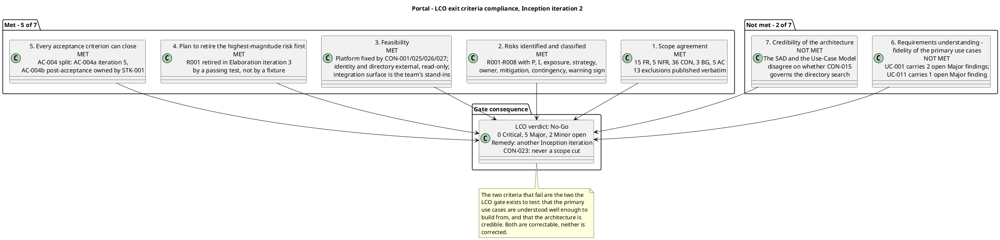

### Review Coordinator lens
<!-- review: Inception I2 -->

**Milestone review event:** LCO — Lifecycle Objectives Review, Inception iteration 2. This is the second presentation of the same gate; the first was refused at iteration 1.

**Lens participation.** Recorded as executed or not executed, never inferred from the artifact.

| Lens | Participant | Status this review |
|---|---|---|
| Technical | Reviewer | EXECUTED — 3 findings recorded, 7 prior findings closed |
| Business | BusinessReviewer | EXECUTED — 3 findings recorded, 1 prior finding closed |
| Management | ManagementReviewer | EXECUTED — 1 finding recorded, 2 prior findings closed, verdict No-Go, sanction REFUSED |

All three lenses executed. No lens is INACTIVE for this review, so the milestone decision rests on the full three-lens position.

**Review types held inside this milestone event.** The Project Approval Review and the Project Planning Review are not separate events and are not work items for another role — they are held inside the LCO, as the RUP milestone review requires.

| Review type | Where it is held | What it examined |
|---|---|---|
| Project Approval Review | Inside the LCO — the Management Reviewer's sanction question to STK-001 | Scope feasibility against the Vision and the Risk List; the stakeholder answered No |
| Project Planning Review | Inside the LCO — the LCO readiness assessment in the Iteration Plan | Development Case tailoring and the eight-iteration roadmap, reviewed for feasibility and acceptability |
| Iteration Evaluation Criteria Review | Inside the LCO — exit criteria E1 to E7 | Whether the iteration's own exit criteria were met; 5 of 7 met |
| Iteration Acceptance Review | Inside the LCO — the three lens dispositions | Formal acceptance of the iteration's deliverables; not granted |
| PRA Review | Not held as a separate event | Project health is carried by the Management Reviewer's four-axis scorecard inside this record |
| Lifecycle Objectives Review | This event | The Inception exit gate |

**Entry criteria — verified before the review began.**

| Criterion | Position |
|---|---|
| Artifacts in target state, not draft | Met — all 10 artifacts persisted and readable |
| Reviewers assigned with matched expertise | Met — three lenses, each matched to its artifact domain |
| Agenda and evaluation criteria distributed in advance | Met — the LCO exit criteria are published in the Iteration Plan |
| Prior findings reconciled before new ones recorded | Met — 10 prior findings closed by their emitting lenses before this milestone's findings were recorded |

**Exit criteria — position at close.**

| Criterion | Position |
|---|---|
| Every finding has an owner, a severity and a deadline | Met — 7 open findings, all assigned in Resolutions and Actions |
| Review Record signed and archived | Met — this record, committed |
| 0 open Critical and 0 open Major findings | **Not met** — 0 Critical, 5 Major open |
| Stakeholder sanction granted | **Not met** — REFUSED |

**Scope of the review.** All 10 artifacts in the repository were read and reviewed by all three lenses. No artifact reached the gate unreviewed. The Iteration Assessment was authored after this review and is not judged by it.

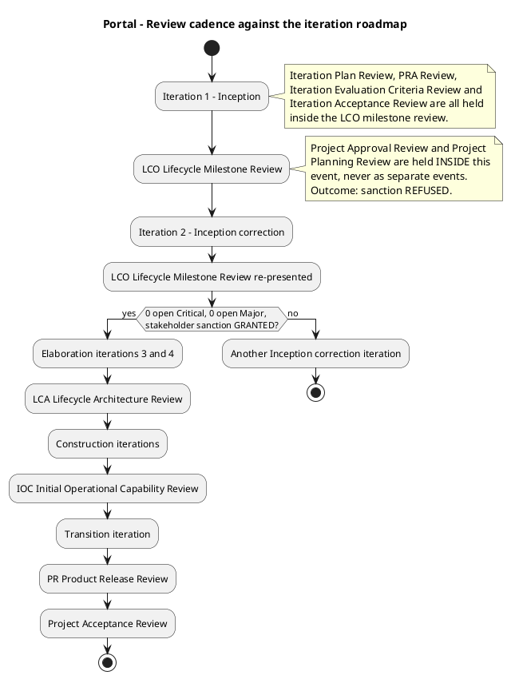

## Findings
### Reviewer lens
<!-- review: Inception I2 -->

Three findings this milestone: 0 Critical, 2 Major, 1 Minor. Each is recorded in the finding ledger against its artifact; this entry states the defect, its location and its remediation.

#### Use-Case Model

**`Use-Case Model#F2` — Major.** The UC-001 postcondition still describes the single-row clocking model that ADR-010 replaced. It states that exactly one clocking record exists for the employee for today. Under ADR-010 a complete pair is two append-only rows — one ClockIn and one ClockOut — and an HR correction adds a third; the effective pair is a query over supersession, not a record. The postcondition is false after the second press.

The trace graph reports the same defect independently: the `COMP-002` Realizes edges to UC-001, UC-002, UC-003 and UC-005 are marked `SUSPECT → System Analyst`. The changed end is COMP-002, whose responsibility ADR-010 redefined, and it has not been reviewed against the use cases it realizes.

*Remediation.* Restate the postcondition in ADR-010's terms: after a Clock In press one ClockIn event row exists for the employee-day; after a Clock Out press a ClockOut event row exists for the same `WorkDate`; the effective pair is the two rows no other row supersedes. Confirm UC-002, UC-003 and UC-005 read the same shape — UC-005's outline already says a new audited record with the original never overwritten, which is consistent, so state it explicitly. Then clear the four suspect traces by declaring the Use-Case Model reviewed against ADR-010.

#### Software Architecture Document

**`Software Architecture Document#F3` — Major.** The architectural-significance table has not been re-based onto the eight-iteration roadmap. It assigns the four architecturally significant use cases to "Elaboration iteration 2" and the remaining six ranks to "Elaboration iteration 3". Under the current roadmap iteration 2 is this Inception correction iteration and Elaboration is iterations 3 and 4, so "Elaboration iteration 2" names an iteration that designs nothing. The Iteration Plan places the design of UC-001, UC-004, UC-009 and UC-011 in iteration 3, so the two artifacts disagree about when the architecture is designed. The Test Evaluation Summary performed this re-base for its coverage plan; the Software Architecture Document is the one artifact that did not receive it.

*Remediation.* Re-base the "Design in" column: ranks 1 to 4 to Elaboration iteration 3, ranks 5 to 10 to Elaboration iteration 4, matching the Iteration Plan's roadmap and its use-case table. Check the rest of the document for the same stale numbering in the same pass.

#### Supplementary Specification

**`Supplementary Specification#F1` — Minor.** The constraint grouping is internally inconsistent and does not match the declared categories. The "Environmental constraints" table lists CON-005 and CON-031, both declared Technical in the scope. The constraint map diagram disagrees with the table on CON-005 — the diagram places it in "Platform and technology" while the table places it in "Environmental" — and places CON-031 in its "Environment" package. A reader cannot tell whether the grouping is the declared category or the team's own, and the two representations of the same 36 constraints do not agree.

*Remediation.* Either group by the declared category, moving CON-005 and CON-031 to the platform/technical group in both the table and the diagram, or retitle the tables so they state they group by what each constraint decides rather than by its declared category, and make the diagram use the same grouping. Either resolution is acceptable; the defect is that the table and the diagram disagree and neither matches the declared category.

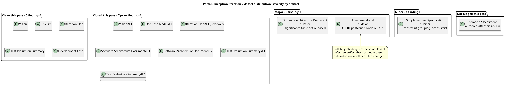

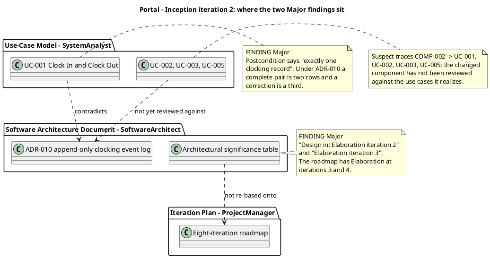

### Business Reviewer lens
<!-- review: Inception I2 -->

<!-- review: Inception I2 -->

Three findings this iteration: two Major, one Minor, no Critical. All three are business-rule attachment defects — the rule content is correct and the attachment to the use cases that enforce it is not.

**Reading the keys.** Findings are scoped per artifact and per lens, so `Use-Case Model#F1` and `#F2` in this block are this lens's findings and are distinct from the Reviewer lens's `Use-Case Model#F1` and `#F2` on the same artifact. The Reviewer lens's `#F2` is the UC-001 postcondition against ADR-010; this lens's `#F1` is CON-012's enforcement in the same use case. They are adjacent but not the same defect, and both must be corrected.

#### Use-Case Model

**`Use-Case Model#F1` (business lens) — Major — CON-012 is bound to UC-001 but not enforced by it.** The button logic in main-flow step 3 distinguishes only "a pair is open" from "a pair is not open", so once an employee has completed a pair for the day the portal renders Clock In again and step 6 records the press. Alternative flow A4 covers only the open-pair case. The complete-pair case is the one that produces a second pair, and it is unaddressed — as specified, UC-001 permits the exact state CON-012 declares impossible. Remediation: add an alternative flow for the complete-pair case, state step 3 in terms of the three states the rule creates (no pair, pair open, pair complete), and route the employee to HR under UC-005 per CON-017.

**`Use-Case Model#F2` (business lens) — Major — CON-015's attachment is incomplete and contradicts the Software Architecture Document.** CON-015 declares two permitted uses of the worker category: "a directory column that also filters" and "a CSV export column". The Use-Case Model binds the rule to UC-004 and UC-012 and explicitly denies it is bound to UC-011, which is the directory — in a paragraph that first states the rule "confines the worker category to the directory column and the export column". UC-011's main flow specifies no filter by worker category at all. The Software Architecture Document takes the opposite position, citing CON-015 as the basis for COMP-005 rendering the column and filtering the result set by it. Remediation: bind CON-015 to UC-011, state its permissive half (column plus filter) and its prohibitive half (no access decision) separately, add the filter to UC-011's flows, and align the outline table and the binding diagram.

#### Supplementary Specification

**`Supplementary Specification#F1` (business lens) — Minor — the business-rules register carries twelve of thirteen declared `[BusinessRule]` constraints.** The scope declares CON-008 through CON-020 as `[BusinessRule]`. The register presents itself as the business-rule register ("The twelve business rules below are invariants") and omits CON-008, the authorization rule. CON-008 is enforced and attached elsewhere as MECH-02, so the rule is not lost — but the register under-reports by one and asserts its own completeness. Remediation: add CON-008 as the thirteenth row with its enforcement point and a cross-reference to MECH-02, and correct the count; or state in the preamble that authorization is deliberately carried as a mechanism and name CON-008 as the one declared `[BusinessRule]` constraint treated that way.

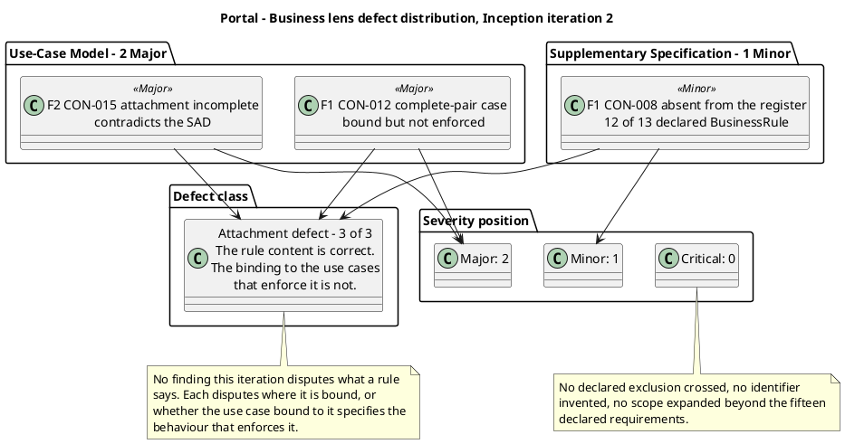

**What this lens did not find.** No business artifact is owed and missing. No BUC, business actor, business worker or business entity is absent that the Development Case requires — the discipline is correctly inactive and the absence is the correct state. No stakeholder is unrepresented. No business goal is presented as met when its denominator does not exist. No volatile business policy failed to reach the architecture. No element addresses an undeclared functional area.

### Management Reviewer lens
<!-- review: Inception I2 -->

<!-- review: Inception I2 -->

One new defect from this lens this milestone, Major, against the Iteration Plan. The other six open findings in the ledger belong to the Reviewer and Business Reviewer lenses; I confirm them as part of the milestone position and cite them by key rather than re-recording them, because one logical defect recorded twice is one defect the author has to triage twice.

#### Iteration Plan

**`Iteration Plan#F3` — Major.** The iteration 2 fine plan does not account for the Development Case, which this iteration produced. The plan's own exit criterion E1 states "Every artifact the iteration produces has a work item, an owner and an exit condition", and the fine plan carries W1 to W9 covering the Software Architecture Document, Use-Case Model, Vision, Test Evaluation Summary, Iteration Plan, Risk List, Review Record and Iteration Assessment — but not the Development Case. The Development Case was substantively revised this iteration: it now carries a process-improvement record tracing five iteration-1 findings to five document changes, a "Criteria that can fail" guideline, an "Observable state" guideline, a "Scope note for test tailoring" section, and the rule that a discipline at Medium or Low intensity is active rather than idle. The agent role profile marks ProcessEngineer Active in iteration 2, so the profile asserts work the fine plan does not contain.

This is the same defect class as `Iteration Plan#F1` (Reviewer) from iteration 1 — a fine plan that understates the iteration's work — recurring in the new plan. The consequence is that the plan cannot be checked against its own E1 criterion: the criterion is written to catch exactly this and the plan fails it.

*Remediation.* Add the Development Case as a work item in the iteration 2 fine plan with owner ProcessEngineer and an exit condition naming what the revision must achieve — for example "the five iteration-1 findings that are defects of a kind are each traced to a named change in this document, and the authoring checks that would have caught them are stated". Place it in the critical chain before the Review Record, since the Review Record verifies the corrected artifacts and the Development Case is one of them. Alternatively, if the Development Case revision is deliberately outside the plan's scope because it closes no named finding, state that explicitly in the fine plan's preamble and amend E1 so the criterion and the plan agree — a criterion the plan fails on its own content is worse than no criterion.

#### Open findings from the other lenses, confirmed

These are not mine to close and I do not re-record them. They are stated here because the milestone verdict depends on them and the stakeholder's sanction question carried them.

| Key | Artifact | Severity | Defect in one line |
|---|---|---|---|
| `Use-Case Model#F2` (Reviewer) | Use-Case Model | Major | The UC-001 postcondition still describes the single-row clocking model ADR-010 replaced; it is false after the second press |
| `Use-Case Model#F1` (Business) | Use-Case Model | Major | CON-012 is bound to UC-001 but not enforced — the complete-pair case is unaddressed, so the use case permits the state the rule forbids |
| `Use-Case Model#F2` (Business) | Use-Case Model | Major | CON-015's attachment contradicts the Software Architecture Document on whether the rule governs the directory search |
| `Software Architecture Document#F3` (Reviewer) | Software Architecture Document | Major | The architectural-significance table is not re-based onto the eight-iteration roadmap; it assigns design to an iteration that designs nothing |
| `Supplementary Specification#F1` (Reviewer) | Supplementary Specification | Minor | The constraint grouping disagrees with the declared categories and the table and diagram disagree with each other |
| `Supplementary Specification#F1` (Business) | Supplementary Specification | Minor | CON-008 is absent from the business-rules register, which presents itself as complete |

**Three of the five open Major findings sit in one artifact.** The Use-Case Model carries the concentration, and two of its three are the same defect class: a rule or a decision another artifact changed, not carried through to the use case that must enforce it. That is the pattern the Development Case's new authoring checks are written to catch, which is why the Development Case revision is not a cosmetic change and why its absence from the fine plan is a Major finding rather than a Minor one.

```plantuml
@startuml
title Portal - Finding ledger at the LCO gate, Inception iteration 2

package "Major - 5 open" {
  class "Use-Case Model#F2 (Reviewer)\nUC-001 postcondition describes the\nsingle-row model ADR-010 replaced" as M1
  class "Use-Case Model#F1 (Business)\nCON-012 bound to UC-001 but not\nenforced; complete-pair case unaddressed" as M2
  class "Use-Case Model#F2 (Business)\nCON-015 attachment contradicts\nthe Software Architecture Document" as M3
  class "Software Architecture Document#F3\nsignificance table not re-based onto\nthe eight-iteration roadmap" as M4
  class "Iteration Plan#F3 (Management)\nDevelopment Case has no work item\nin the iteration 2 fine plan" as M5
}

package "Minor - 2 open" {
  class "Supplementary Specification#F1 (Reviewer)\nconstraint grouping disagrees with\nthe declared categories" as N1
  class "Supplementary Specification#F1 (Business)\nCON-008 absent from the\nbusiness-rules register" as N2
}

package "Critical - 0 open" {
  class "None" as C0
}

package "Closed this iteration - 10" {
  class "Iteration Plan#F1 (Reviewer)" as R1
  class "Iteration Plan#F1 (Management)" as R2
  class "Iteration Plan#F2 (Management)" as R3
  class "Use-Case Model#F1 (Reviewer)" as R4
  class "Software Architecture Document#F1" as R5
  class "Software Architecture Document#F2" as R6
  class "Test Evaluation Summary#F1" as R7
  class "Test Evaluation Summary#F2" as R8
  class "Vision#F1 (Reviewer)" as R9
  class "Vision#F1 (Business)" as R10
}

note bottom of C0
  No Critical finding: no declared exclusion
  is crossed, no phantom use case, no invented
  identifier, no scope expansion beyond the
  fifteen declared requirements, and no
  artifact claims a milestone or an acceptance
  criterion is closed.
end note

note bottom of M3
  The only open finding that is a disagreement
  between two artifacts rather than a defect
  inside one. It is the one that most directly
  fails the LCO criterion on architecture
  credibility.
end note
@enduml
```

#### Artifacts with no finding from this lens

| Artifact | Position |
|---|---|
| Development Case | Baseline conformance (a)–(e) passes; all six OPTIONAL triggers audited against their §5.2 conditions and each NOT TRIGGERED verdict holds; intensity per the canonical matrix; Business Modeling inactive on the correct trigger; no token budget set, as CON-030 requires. The revision this iteration is a genuine process improvement — each of its five changes traces to a named iteration-1 finding |
| Vision | The 13 declared exclusions are published verbatim as the control for R005. All four stakeholders, five acceptance criteria and both declared risks are carried. BG-001 is now recorded as not yet measurable with STK-001 named as the baseline supplier, and the two self-referential success criteria are replaced with observable checks |
| Risk List | R001 and R002 carried with their declared identifiers and magnitudes, not renumbered or reclassified. R003 to R008 numbered in the order raised, each with a full treatment. CON-024 respected — Keycloak and AD availability are not registered, and R003 is correctly distinguished as the timing of the CON-031 human feedback loop. Every `Accept` cites the CON-023 grant and its condition; none is accepted on the Project Manager's own authority |
| Test Evaluation Summary | The Evaluation Mission is scoped to the test position and explicitly disclaims product evidence. 15 of 15 use cases and 5 of 5 NFRs assigned an execution iteration in which the behaviour exists. The stale CI citation is replaced with the run read at the moment of writing, and NFR-001 is split so neither half is assigned to an iteration that cannot execute it |
| Software Architecture Document | No finding from this lens beyond the Reviewer's `#F3`. The three High-volatility requirements each own a dedicated component; CON-028 is satisfied with Keycloak inside the corporate network boundary; no cache is designed, consistent with FR-014 and FR-015; no scheduler exists, justified by CON-018 and CON-011 |
| Supplementary Specification | No finding from this lens. All 5 NFRs and all 36 constraints are accounted for; the four mechanisms are recorded as mechanisms with an include graph and never as use cases; INT-03 reproduces the FR-004 column contract exactly |
| Use-Case Model | No finding from this lens. Fifteen use cases, one per declared requirement, no phantom use case, no cross-cutting mechanism promoted to a use case, no per-actor split of a single declared process. The open findings are the Reviewer's and the Business Reviewer's |

### Review Coordinator lens
<!-- review: Inception I2 -->

**Consolidated ledger: 7 open findings — 0 Critical, 5 Major, 2 Minor.** Every row is copied from `read_artifact_findings` for the artifact named. The coordinator does not re-evaluate the artifacts; the defect statements are the lenses' and are cited by key.

| # | Key | Artifact | Severity | Emitting lens | Owner | Defect |
|---|---|---|---|---|---|---|
| 1 | `Use-Case Model#F2` | Use-Case Model | Major | Reviewer | SystemAnalyst | The UC-001 postcondition still describes the single-row clocking model ADR-010 replaced. Under ADR-010 a complete pair is two append-only rows and a correction is a third; the effective pair is a query over supersession, not a record. The postcondition is false after the second press. The trace graph reports the same defect independently through four `SUSPECT → System Analyst` edges on COMP-002 |
| 2 | `Use-Case Model#F1` | Use-Case Model | Major | BusinessReviewer | SystemAnalyst | CON-012 is bound to UC-001 but not enforced by it. The button logic distinguishes only "a pair is open" from "a pair is not open", so once a pair is complete the portal renders Clock In again and records the press. Alternative flow A4 covers only the open-pair case. As specified, UC-001 permits the state CON-012 declares impossible |
| 3 | `Use-Case Model#F2` | Use-Case Model | Major | BusinessReviewer | SystemAnalyst | CON-015's attachment is incomplete and contradicts the Software Architecture Document. The Use-Case Model binds the rule to UC-004 and UC-012 and explicitly denies it is bound to UC-011, the directory, in a paragraph that first states the rule confines the category to the directory column and the export column. UC-011 specifies no filter by worker category. The SAD cites CON-015 as the basis for COMP-005 rendering the column and filtering by it |
| 4 | `Software Architecture Document#F3` | Software Architecture Document | Major | Reviewer | SoftwareArchitect | The architectural-significance table is not re-based onto the eight-iteration roadmap. It assigns the four significant use cases to "Elaboration iteration 2" and the remaining six ranks to "Elaboration iteration 3". Under the current roadmap iteration 2 is this Inception correction iteration and Elaboration is iterations 3 and 4, so the table names an iteration that designs nothing. The Iteration Plan places the design of UC-001, UC-004, UC-009 and UC-011 in iteration 3 |
| 5 | `Iteration Plan#F3` | Iteration Plan | Major | ManagementReviewer | ProjectManager | The iteration 2 fine plan does not account for the Development Case, which this iteration produced. Exit criterion E1 states every artifact the iteration produces has a work item, an owner and an exit condition; W1 to W9 cover eight artifacts but not the Development Case, which was substantively revised. The role profile marks ProcessEngineer Active in iteration 2, asserting work the fine plan does not contain. The plan fails its own E1 criterion |
| 6 | `Supplementary Specification#F1` | Supplementary Specification | Minor | Reviewer | RequirementsSpecifier | The constraint grouping is internally inconsistent and does not match the declared categories. The "Environmental constraints" table lists CON-005 and CON-031, both declared Technical. The constraint map diagram disagrees with the table on CON-005 and places CON-031 in its Environment package. The two representations of the same 36 constraints do not agree |
| 7 | `Supplementary Specification#F1` | Supplementary Specification | Minor | BusinessReviewer | RequirementsSpecifier | The business-rules register carries twelve of the thirteen declared `[BusinessRule]` constraints, omitting CON-008, the authorization rule. CON-008 is enforced elsewhere as MECH-02, so the rule is not lost, but the register presents itself as complete and under-reports by one |

**Findings closed this iteration — 10, by their emitting lenses.** These are not open and do not bear on the verdict; they are listed so the ledger's arithmetic is checkable.

| Key | Artifact | Severity | Emitting lens |
|---|---|---|---|
| `Vision#F1` | Vision | Minor | Reviewer |
| `Vision#F1` | Vision | Minor | BusinessReviewer |
| `Use-Case Model#F1` | Use-Case Model | Major | Reviewer |
| `Software Architecture Document#F1` | Software Architecture Document | Major | Reviewer |
| `Software Architecture Document#F2` | Software Architecture Document | Minor | Reviewer |
| `Iteration Plan#F1` | Iteration Plan | Major | Reviewer |
| `Iteration Plan#F1` | Iteration Plan | Major | ManagementReviewer |
| `Iteration Plan#F2` | Iteration Plan | Major | ManagementReviewer |
| `Test Evaluation Summary#F1` | Test Evaluation Summary | Major | Reviewer |
| `Test Evaluation Summary#F2` | Test Evaluation Summary | Minor | Reviewer |

**Artifacts carrying no finding across all three lenses:** Development Case, Risk List, Test Evaluation Summary, Vision, Iteration Assessment.

**Two findings share a key and are not duplicates.** `Use-Case Model#F2` appears twice because findings are scoped per artifact and per lens: the Reviewer's `#F2` is the UC-001 postcondition against ADR-010, the Business Reviewer's `#F2` is CON-015's attachment to UC-011. They are distinct defects with distinct remediations and both must be corrected. The same holds for `Supplementary Specification#F1`.

**Conflicts between lenses — resolved by the coordinator.**

| Conflict | Resolution |
|---|---|
| The Reviewer's `Use-Case Model#F2` and the Business Reviewer's `Use-Case Model#F1` both touch UC-001 and could be read as one defect | They are two: one restates the postcondition, the other adds a flow. Both are corrected in one pass over UC-001, but neither closes the other. Recorded as separate actions |
| The Business Reviewer's `Use-Case Model#F2` asserts CON-015 governs the directory search; the Use-Case Model denies it; the SAD implements it | Not a conflict to arbitrate — the declared constraint settles it. CON-015 names "a directory column that also filters" as one of exactly two permitted uses, so the Use-Case Model is the artifact that is wrong. The action is to bind the rule to UC-011, not to remove the filter from COMP-005 |
| The Reviewer's `Supplementary Specification#F1` and the Business Reviewer's `Supplementary Specification#F1` both concern the same section | Adjacent, not identical: one is the constraint grouping, the other the business-rules register count. Both are corrected in one pass over the Supplementary Specification |
| The Management Reviewer's `Iteration Plan#F3` offers two alternative resolutions | The coordinator selects the first: add the Development Case as a work item. Amending E1 to exclude the Development Case would weaken a criterion that is correct as written |

**No conflict required escalation to the stakeholder.** Every disagreement is settled by a declared constraint or by the artifact that owns the element.

```plantuml
@startuml
title Portal - Consolidated finding ledger at the LCO gate, Inception iteration 2

package "Open Major - 5" {
  class "Use-Case Model#F2 (Reviewer)\nUC-001 postcondition describes the\nsingle-row model ADR-010 replaced" as M1
  class "Use-Case Model#F1 (Business)\nCON-012 bound to UC-001 but not\nenforced; complete-pair case unaddressed" as M2
  class "Use-Case Model#F2 (Business)\nCON-015 attachment contradicts\nthe Software Architecture Document" as M3
  class "Software Architecture Document#F3\nsignificance table not re-based onto\nthe eight-iteration roadmap" as M4
  class "Iteration Plan#F3 (Management)\nDevelopment Case has no work item\nin the iteration 2 fine plan" as M5
}

package "Open Minor - 2" {
  class "Supplementary Specification#F1 (Reviewer)\nconstraint grouping disagrees with\nthe declared categories" as N1
  class "Supplementary Specification#F1 (Business)\nCON-008 absent from the\nbusiness-rules register" as N2
}

package "Open Critical - 0" {
  class "None" as C0
}

package "Closed this iteration - 10" {
  class "Vision#F1 (Reviewer)" as R1
  class "Vision#F1 (Business)" as R2
  class "Use-Case Model#F1 (Reviewer)" as R3
  class "Software Architecture Document#F1" as R4
  class "Software Architecture Document#F2" as R5
  class "Iteration Plan#F1 (Reviewer)" as R6
  class "Iteration Plan#F1 (Management)" as R7
  class "Iteration Plan#F2 (Management)" as R8
  class "Test Evaluation Summary#F1" as R9
  class "Test Evaluation Summary#F2" as R10
}

note bottom of M3
  The only open finding that is a disagreement
  between two artifacts rather than a defect
  inside one.
end note

note bottom of C0
  No declared exclusion crossed, no phantom
  use case, no invented identifier, no scope
  expansion beyond the fifteen declared
  requirements.
end note
@enduml
```

**Defect concentration.** Three of the five open Major findings sit in one artifact, the Use-Case Model, and two of those three are the same defect class: a rule or a decision another artifact changed, not carried through to the use case that must enforce it. That concentration is why the Use-Case Model is the critical path of the next iteration and why the Development Case's new authoring checks are load-bearing rather than cosmetic.

**Review effectiveness metrics — this milestone.**

| Metric | Value | Basis |
|---|---|---|
| Review coverage | 10 of 10 artifacts | Every artifact in the repository was read by all three lenses |
| Findings open at gate | 7 — 0 Critical, 5 Major, 2 Minor | `read_artifact_findings`, all 10 artifacts |
| Findings closed this iteration | 10 | Resolution objects present in the ledger |
| Closure rate | 10 of 17 findings raised across both iterations | 10 closed, 7 open |
| Defect density by artifact | Use-Case Model 3, Software Architecture Document 1, Iteration Plan 1, Supplementary Specification 2, five artifacts 0 | Open findings per artifact |
| Defect removal efficiency | Not computable at this gate | No test execution has occurred; Inception builds nothing, so there is no test-found defect count to compare against |
| Rework effort | Not measured in hours | This system measures tokens and elapsed time, not person-hours. Iteration 1 measured 6,756,727 tokens and 0:54:19.692 agent time with 0:00:00 human queue time, reported apart and never added |
| Overdue findings | 0 of 7 | The action list was issued at this review event; no deadline has elapsed |
| Escalations | 0 | No deadline missed, no Critical finding open |

**Interpretation.** Coverage is complete and closure is running at 59% across the two iterations, which is the expected shape of a correction iteration: the first pass raised 10 findings, 10 were closed, and the corrections themselves produced 7 new ones. The pattern is not declining rigor — it is the normal cost of a correction that changes a decision (ADR-010, the roadmap) which other artifacts had to follow. The signal to watch is whether the next iteration's corrections produce a third generation of the same defect class; if they do, the authoring checks are not working and the process needs correction, not another pass.

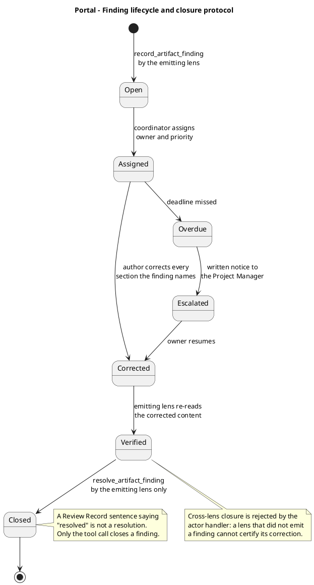

## Resolutions and Actions
### Reviewer lens
<!-- review: Inception I2 -->

**Prior findings of this lens, reconciled this iteration.** Seven were open at the start of iteration 2. Each was verified against the corrected artifact content and closed through `resolve_artifact_finding`. None is Deferred, none is Rejected, none is left open.

| Finding | Severity | Verified against | Resolution |
|---|---|---|---|
| `Vision#F1` | Minor | Success-criteria table — BG-001 row now reads "Not yet measurable", names STK-001 as the baseline source, and records the 50% reduction as a post-launch comparison | Resolved |
| `Use-Case Model#F1` | Major | Business-rule binding diagram — `R_CAT` binds UC-004 and UC-012 only; `R_NCAT` carries the news-category list to UC-006 and UC-010; UC-010's rules cell no longer cites CON-015 | Resolved |
| `Iteration Plan#F1` | Major | Fine plan W1–W9 includes W5 Software Architecture Document and W6 Test Evaluation Summary with exit conditions; critical chain carries Analysis and Design and Test lanes; both roles Active in the iteration 1 column | Resolved |
| `Software Architecture Document#F1` | Major | ADR-010 — append-only `ClockingEvent`, partial unique index on `(EmployeeId, WorkDate, EventKind)` where `SupersedesId IS NULL`, `PreviousValueUtc` column, Invariants table names the enforcing index per row | Resolved |
| `Software Architecture Document#F2` | Minor | Traceability table — one row per link type, `Traces To` empty on every Realizes and Derives row, separate DependsOn rows | Resolved |
| `Test Evaluation Summary#F1` | Minor | Quality-signals table — cites run `39940062277`, started 2026-10-23 10:34:26Z, completed 10:35:16Z, with the caveat retained | Resolved |
| `Test Evaluation Summary#F2` | Minor | Quality-attribute plan — NFR-001 split into NFR-001a (claim mapping, iteration 3) and NFR-001b (refusal assertion, iterations 5, 6, 7) | Resolved |

**Not this lens's to close.** `Iteration Plan#F1` and `Iteration Plan#F2` as recorded by the Management Reviewer remain with that lens. The actor handler rejects cross-lens closure, correctly: a lens that did not emit a finding cannot certify its correction.

**Open actions this milestone.** Three, all assigned, none deferred.

| Action | Owner | Closes | Exit condition |
|---|---|---|---|
| Restate the UC-001 postcondition in ADR-010's append-only terms; confirm UC-002, UC-003 and UC-005 read the same shape; clear the four `COMP-002` suspect traces | SystemAnalyst | `Use-Case Model#F2` | The postcondition describes two event rows and a supersession query, not one record; no `SUSPECT → System Analyst` edge remains on COMP-002 |
| Re-base the architectural-significance "Design in" column onto the eight-iteration roadmap | SoftwareArchitect | `Software Architecture Document#F3` | Ranks 1–4 read Elaboration iteration 3 and ranks 5–10 read Elaboration iteration 4, matching the Iteration Plan |
| Make the constraint grouping consistent between the table and the diagram, and state whether it follows the declared category | RequirementsSpecifier | `Supplementary Specification#F1` | The table and the diagram group the same 36 constraints the same way, and the grouping's basis is stated |

**What the corrections established.** The seven closures are not cosmetic. ADR-010 is the substantive one: it resolves a contradiction that would have surfaced as an unimplementable schema the moment Elaboration tried to baseline it, and it does so by making CON-013 hold by construction rather than by convention. The Iteration Plan's risk-retirement table now names the event that retires R001 rather than the fixture that makes it retirable, which is the claim an LCO gate exists to test. The Vision's BG-001 row now records an unmeasured criterion as unmeasured instead of presenting it as measurable.

**What the corrections did not establish.** A correction is not a closure, and a closure is not a pass. The two Major findings recorded this milestone are both consequences of the corrections themselves — ADR-010 changed the clocking shape and the Use-Case Model did not follow; the roadmap changed and the Software Architecture Document did not follow. That is the normal cost of a correction iteration and it is why the gate is re-presented rather than assumed.

### Business Reviewer lens
<!-- review: Inception I2 -->

<!-- review: Inception I2 -->

| Finding | Severity | Owner | Action | Status |
|---|---|---|---|---|
| `Vision#F1` (business lens, iteration 1) | Minor | SystemAnalyst | Replace the two self-referential success-criterion cells with independent observable checks | **Resolved** — verified in the Features section; FR-014 and FR-015 now carry derived observable checks and the preamble states the rule |
| `Use-Case Model#F1` (business lens) | Major | SystemAnalyst | Add the complete-pair alternative flow to UC-001; state step 3 in terms of no pair / pair open / pair complete; route to HR under UC-005 per CON-017 | Open — this iteration |
| `Use-Case Model#F2` (business lens) | Major | SystemAnalyst | Bind CON-015 to UC-011; state the permissive half (column plus filter) and the prohibitive half (no access decision) separately; add the filter to UC-011's flows; align the outline table and the binding diagram with the SAD | Open — this iteration |
| `Supplementary Specification#F1` (business lens) | Minor | SystemAnalyst | Add CON-008 as the thirteenth register row with its enforcement point and a MECH-02 cross-reference, and correct the count; or state in the preamble that authorization is carried as a mechanism | Open — this iteration |

**No finding is deferred and no finding is rejected.** The stakeholder's instruction that every finding be corrected is honoured: all three new findings are assigned to the SystemAnalyst, who owns both affected artifacts, and none is deferred to a later phase. No declared scope is cut or deferred to fit a schedule (CON-023).

**Closure discipline.** `Vision#F1` was closed by `resolve_artifact_finding` before any new defect was recorded, in a state separate from the one that records new findings. The three new findings are recorded under keys the system minted this iteration; none re-records a persisting defect, because no defect of this lens from iteration 1 persists.

**Two of these findings sit on the same artifact as two findings of the Reviewer lens, and they are not duplicates.** The Reviewer lens's `Use-Case Model#F2` is the UC-001 postcondition describing a single clocking record where ADR-010 establishes an append-only event log. This lens's `Use-Case Model#F1` is CON-012's enforcement in the same use case — the complete-pair case the flow does not handle. Both are corrected in the same pass over UC-001, but they are distinct defects with distinct remediations: one restates the postcondition, the other adds a flow. The Reviewer lens's `Use-Case Model#F1` (the worker-category cluster bound to UC-010) is already Resolved; this lens's `Use-Case Model#F2` is the adjacent but different question of whether CON-015 reaches UC-011 at all.

**What the SystemAnalyst needs to know to act without asking a follow-up question.** The two Major findings are one class of defect seen twice: a rule is cited in a "Business rules enforced" list without the use case specifying the behaviour that enforces it. `Use-Case Model#F1` (business lens) is the sharper case — the rule is bound, the flow contradicts it. `Use-Case Model#F2` (business lens) is the wider case — the rule is bound to two of its three declared uses and the artifact denies the third, while the architecture implements it. Correcting both means making the binding diagram, the outline table, the use-case flows and the Software Architecture Document say the same thing about the same rule.

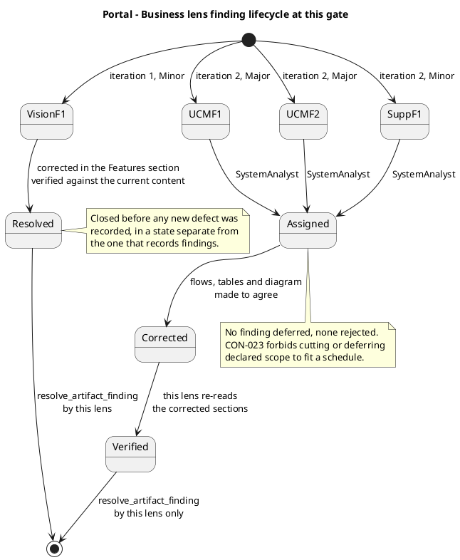

### Management Reviewer lens
<!-- review: Inception I2 -->

<!-- review: Inception I2 -->

**Stakeholder sanction: REFUSED.** The stakeholder answered No to the LCO sanction question, knowing the verdict was No-Go and that 0 Critical, 5 Major and 2 Minor findings were open. Stakeholder acceptance, verbatim: "No". The instruction accompanying it, verbatim: "Ok let's fix & close all findings".

The refusal is the correct reading of the evidence and it is recorded as the gate outcome, not as a defect against any artifact. The remedy is another Inception iteration — never a scope cut (CON-023) and never more agent parallelism.

#### Findings of this lens closed this iteration

Both prior findings of this lens were against the Iteration Plan. Each was closed by `resolve_artifact_finding` after the correction was verified against the evidence chain rather than accepted from the plan's assertion of it.

| Key | Severity | What was wrong | What was verified before closing |
|---|---|---|---|
| `Iteration Plan#F1` (Management) | Major | The plan claimed R001 was retired in Elaboration iteration 2 by the stand-in directory carrying empty job-title and extension entries. Building a fixture is not retiring a risk | A "Risk retirement sequencing" section now separates mechanism from retiring event for all eight risks, and R001 is retired in iteration 3 by executing the empty-attribute case of UC-011 and UC-004. Verified against the Test Evaluation Summary: its coverage plan reads "UC-011 … Iteration 7 — with the empty-attribute case executed in iteration 3" and "UC-004 … Iteration 5 — with the empty-attribute case executed in iteration 3", its execution sequence places both cases in iteration 3, and the role profile activates Tester from iteration 3. The plan also states what the sequencing means for the LCA gate |
| `Iteration Plan#F2` (Management) | Major | AC-004, a population measure over 200 employees, was assigned verification in the iteration in which its own three-month window begins to elapse, so it could never close at the gate it was assigned to | Layer A now splits AC-004 into AC-004a, the learnability half, verified in iteration 5 by an untrained-user check in the iteration that implements UC-001, and AC-004b, the population half, recorded as a post-Project-Acceptance measure owned by STK-001 against BG-003 and explicitly not a gate on any iteration. The Test Evaluation Summary carries the same split, so the plan and the test position agree |

#### Findings of this lens opened this iteration

| Key | Severity | Owner | Action required |
|---|---|---|---|
| `Iteration Plan#F3` | Major | ProjectManager | Add the Development Case as a work item in the iteration 2 fine plan with owner ProcessEngineer and an exit condition naming what the revision must achieve, and place it in the critical chain before the Review Record — or state in the fine plan's preamble that the revision is deliberately outside the plan's scope and amend exit criterion E1 so the criterion and the plan agree |

#### Actions this review places on the next iteration

Every open finding is an action. The stakeholder's instruction is that all of them are fixed and closed, so none is deferred and none is rejected.

| # | Action | Owner | Closes |
|---|---|---|---|
| 1 | Restate the UC-001 postcondition in ADR-010's terms — one ClockIn event row after the first press, one ClockOut event row after the second, the effective pair being the two rows no other row supersedes — and confirm UC-002, UC-003 and UC-005 read the same shape | SystemAnalyst | `Use-Case Model#F2` (Reviewer) |
| 2 | Add an alternative flow to UC-001 for the complete-pair case and state the button logic in terms of the three states CON-012 creates — no pair, pair open, pair complete — routing the employee to HR under UC-005 per CON-017 | SystemAnalyst | `Use-Case Model#F1` (Business) |
| 3 | Bind CON-015 to UC-011, stating its permissive half (rendered column, filterable result set) and its prohibitive half (no access decision) separately, add the filter to UC-011's flows, and remove the sentence denying the binding — so the Use-Case Model and the Software Architecture Document read the same way | SystemAnalyst | `Use-Case Model#F2` (Business) |
| 4 | Re-base the architectural-significance table's "Design in" column onto the eight-iteration roadmap — ranks 1 to 4 to Elaboration iteration 3, ranks 5 to 10 to Elaboration iteration 4 — and check the rest of the document for the same stale numbering | SoftwareArchitect | `Software Architecture Document#F3` (Reviewer) |
| 5 | Add the Development Case work item to the iteration 2 fine plan, or amend exit criterion E1 to match the plan | ProjectManager | `Iteration Plan#F3` (Management) |
| 6 | Make the constraint grouping agree with the declared categories in both the table and the diagram, or retitle both so they state they group by what each constraint decides | RequirementsSpecifier | `Supplementary Specification#F1` (Reviewer) |
| 7 | Add CON-008 to the business-rules register as the thirteenth row with its enforcement point and a cross-reference to MECH-02, and correct the preamble count — or state in the preamble that authorization is deliberately carried as a mechanism | RequirementsSpecifier | `Supplementary Specification#F1` (Business) |

**Actions 1 to 3 are one pass, not three.** All three are in the Use-Case Model and two of them touch UC-001's flows. Correcting the postcondition without correcting the button logic would leave the use case internally inconsistent, and correcting the button logic without binding CON-015 to UC-011 would leave the Use-Case Model contradicting the architecture. The SystemAnalyst should make all three corrections in one revision and re-read the whole use case against ADR-010 before persisting.

**Action 3 is the one that decides the architecture criterion.** The LCO criterion on architecture credibility fails because two artifacts disagree about whether CON-015 governs the directory search. Either resolution is defensible on its own; what is not defensible is the disagreement surviving into Elaboration, where UC-011 is detailed and the filter is either built or silently dropped.

#### What this review does not ask for

- It does not ask for a Project Approval Review or a Project Planning Review held apart from this milestone review. Both are held inside it: the sanction question to the stakeholder is the approval, and the LCO readiness assessment in the Iteration Plan is the planning review.
- It does not ask for signatures from named persons. The stakeholder's answer to the sanction question is the documented acceptance, and it is recorded above.
- It does not ask for the Iteration Assessment to be updated before the milestone can close. The ProjectManager authors it after this review, given the verdict.
- It does not ask for the merge to `main`. The iteration baseline is the delivered capability; the merge is the Integrator's post-sanction step.
- It does not ask for a token budget. CON-030 forbids one, and the measured spend of iteration 1 is recorded in the Iteration Assessment and used to forecast.

### Review Coordinator lens
<!-- review: Inception I1 -->

<!-- review: Inception I1 -->

**Prior findings reconciled:** none. This is the first review event of the project. `read_artifact_findings` returned an empty list for the Development Case, the Supplementary Specification and the Risk List, and returned only open findings — no resolution object — for the other five artifacts. No finding existed to close, so no closure was due from this lens.

**Stakeholder input already obtained — not re-asked.** The Management Reviewer put the LCO sanction question to STK-001 with the verdict leaning and all six open Major defects inside it. The answer was "No", with the instruction that every finding must be corrected. That answer is the stakeholder's input for the next pass and it is folded in below as the stakeholder finding. It is not put back to the stakeholder as a fresh question: the question has been asked and answered, and re-asking it would re-open a decision already made.

**Stakeholder finding:** every finding in this ledger is to be corrected. No finding is deferred, and no declared scope is cut or deferred to fit a schedule — CON-023 forbids it and the remedy for a milestone that does not pass is another iteration.

**Consolidated action list — prioritized by gate impact, one list per owner:**

| Priority | Action | Finding | Artifact | Owner | Closes at |
|---|---|---|---|---|---|
| 1 | Resolve the CON-012 / CON-013 schema contradiction: state how a pair is recorded across two presses under CON-013, make the unique index match the chosen shape, add a PreviousValue column to the correction record, and make each Invariants row name the index that enforces it | `Software Architecture Document#F1` | Software Architecture Document | SoftwareArchitect | LCO gate re-presentation |
| 2 | Restate the R001 retirement claim to match the evidence chain — either move the UC-011 and UC-004 test executions earlier or state plainly that R001 stays open until Construction and record what that means for the LCA gate | `Iteration Plan#F1` (Management Reviewer) | Iteration Plan | ProjectManager | LCO gate re-presentation |
| 3 | Split AC-004 into its learnability check (testable in the iteration that implements UC-001) and its post-launch population measure (BG-003 window, HR as owner), and assign each to a point where it can close | `Iteration Plan#F2` (Management Reviewer) | Iteration Plan | ProjectManager | LCO gate re-presentation |
| 4 | Add the Software Architecture Document and the Test Evaluation Summary to the fine plan with exit conditions, place them in the critical chain, and mark SoftwareArchitect and TestManager active in iteration 1 | `Iteration Plan#F1` (Reviewer) | Iteration Plan | ProjectManager | LCO gate re-presentation |
| 5 | Rebind the worker-category rule cluster away from UC-010 and bind the news-category closed list to UC-010 instead, sourced from FR-010 and FR-006 | `Use-Case Model#F1` | Use-Case Model | SystemAnalyst | LCO gate re-presentation |
| 6 | Replace the cited CI run with the observed build, or state the build status without a run identifier | `Test Evaluation Summary#F1` | Test Evaluation Summary | TestManager | LCO gate re-presentation |
| 7 | Split the conflated Traceability rows by link type — one row for Realizes with Traces To empty, one for DependsOn | `Software Architecture Document#F2` | Software Architecture Document | SoftwareArchitect | LCO gate re-presentation |
| 8 | Make NFR-001's execution iteration match where the behaviour exists, or split the row into an Elaboration claim-mapping check and a Construction refusal assertion | `Test Evaluation Summary#F2` | Test Evaluation Summary | TestManager | LCO gate re-presentation |
| 9 | Mark the BG-001 row as not yet measurable and record that HR must supply the current manual baseline, or state the measure as a post-launch comparison HR performs | `Vision#F1` (Reviewer) | Vision | SystemAnalyst | LCO gate re-presentation |
| 10 | Replace the self-referential success criteria on the FR-014 and FR-015 feature rows with an independent measure | `Vision#F1` (Business Reviewer) | Vision | SystemAnalyst | LCO gate re-presentation |

**Prioritization rationale.** Priority 1 is the only finding that would cost a re-baseline if carried forward: Elaboration would baseline a schema that cannot satisfy two declared invariants, and the defect surfaces as an unimplementable design rather than as a document error. Priorities 2 and 3 are the two findings that decide the milestone: they are the plan's own claims about risk retirement and acceptance-criterion gating, and a plan that answers "Yes" to a risk-retirement question on the strength of a fixture is the exact claim an LCO gate exists to refuse. Priority 4 is a completeness defect in the same artifact and is corrected in the same pass. Priorities 5 and 6 are Major but local — each is a single correction inside one artifact with no propagation beyond it. Priorities 7 to 10 are Minor: they do not block the gate, but the stakeholder required every finding corrected, so none is deferred.

**Action ownership and load:**

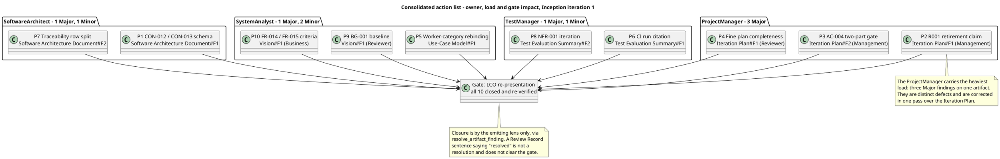

**Closure protocol for this action list.** Each action closes only when the emitting lens calls `resolve_artifact_finding` after verifying the corrective action is adequate. The coordinator does not close findings and does not accept a narrative claim of resolution in place of the tool call. The six Major findings must all be closed before the LCO gate is re-presented; the four Minor findings must be closed or explicitly deferred with a reason, and the stakeholder's instruction is that they be corrected.

**Escalation status.** No finding has missed a deadline, because no deadline has yet elapsed — the action list was issued at this review event. No escalation notice is due. No Critical finding exists, so no Critical escalation to the stakeholder is required. The stakeholder was nevertheless consulted, because the LCO sanction is theirs to give and it was refused.

**Review debt position at this gate:** 10 open findings, 0 overdue, 0 escalated. The 0% overdue rate is not a sign of health — it is the reading of a ledger issued moments ago. It becomes meaningful at the next review event, when the first deadlines have had a chance to elapse.

## Disposition
### Reviewer lens
<!-- review: Inception I2 -->

**Disposition: Approved with Changes.**

The technical position of the artifact set is materially stronger than at iteration 1. Seven findings of this lens were corrected and verified, and the corrections are substantive rather than cosmetic. ADR-010 resolves the schema contradiction that would have made CON-012 and CON-013 unsatisfiable together, and it does so by making CON-013 hold by construction — an append-only event log with a partial unique index that constrains the originals and admits every superseding row. The Iteration Plan now names the event that retires R001 rather than the fixture that makes it retirable, which is the claim an LCO gate exists to test. The Vision records BG-001 as unmeasured instead of presenting it as measurable. The Test Evaluation Summary's coverage plan is re-based onto the roadmap it is measured against, and NFR-001 is split so neither half is assigned to an iteration that cannot execute it.

Two Major findings remain, and both are defects of currency rather than of reasoning. The Use-Case Model's UC-001 postcondition still describes the single-row clocking model ADR-010 replaced, and the trace graph reports the same defect independently through four `SUSPECT → System Analyst` edges on COMP-002. The Software Architecture Document's architectural-significance table still names "Elaboration iteration 2", an iteration that under the current roadmap designs nothing. Neither invalidates the phase's conclusions; both would mislead the role that reads them next, which is why they are Major and not Minor.

One Minor finding: the Supplementary Specification's constraint grouping disagrees between its table and its diagram and matches neither the declared category.

**No Critical finding.** No declared exclusion is crossed anywhere in the set. No identifier is invented — every `FR-`, `NFR-`, `CON-`, `AC-`, `BG-`, `STK-` and `R` identifier cited is one the work order assigned. No scope is expanded beyond the fifteen declared requirements: the fifteen use cases map one to one onto them, and the three extension use cases are declared requirements modelled as exception paths rather than invented goals. No cross-cutting mechanism is promoted to a use case — authentication, authorization, audit and directory read are mechanisms in the Supplementary Specification, included by the use cases that depend on them. No artifact claims a milestone is achieved or an acceptance criterion is closed.

**What this disposition is not.** It is not a sanction to advance. The milestone verdict belongs to the ReviewCoordinator and the sanction to the stakeholder; this lens reports the technical state of the artifacts and nothing more. It is also not a claim that the two Major findings are tolerable — they are correctable within this iteration and they should be corrected before the gate is re-presented, because the role that reads each of them next is the role that would act on the stale version.

**Traceability position.** The trace graph carries 42 business roots and 180 nodes. No `FR-NNN`, `NFR-NNN` or `UC-NNN` is a leaf: every declared requirement is realized by a use case and every use case is carried by at least one component. The four `SUSPECT → System Analyst` edges are the only trace defect and are recorded as evidence inside `Use-Case Model#F2` rather than as a separate finding, because they and the postcondition are one defect seen from two directions.

**SCM position.** No open pull request, so no PR required a disposition. The build on `main` is green and carries no product evidence — the repository holds inputs and artifacts only, and a green build on such a repository proves the pipeline runs, not that anything works.

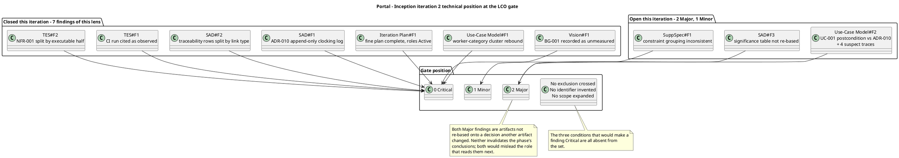

### Business Reviewer lens
<!-- review: Inception I2 -->

<!-- review: Inception I2 -->

**Disposition: Approved with Changes — from the business modeling lens only.**

The Business Modeling discipline is correctly inactive and the artifact set carries the business-level content the downstream disciplines need. No Critical finding. Two Major and one Minor, all in the business-rule attachment layer, all correctable within this iteration by the SystemAnalyst, who owns both affected artifacts.

**What this disposition is not.** It is not a sanction to advance. The milestone verdict belongs to the ReviewCoordinator and the sanction to the stakeholder; this lens reports the business modeling state of the artifacts and nothing more. It is also not a claim that the two Major findings are tolerable — they are correctable now and they should be corrected before the gate is re-presented, because each would mislead the role that reads it next. `Use-Case Model#F1` (business lens) would let a second clocking pair be recorded for one employee-day, which CON-012 declares impossible. `Use-Case Model#F2` (business lens) would let the declared directory filter be dropped when UC-011 is detailed in Elaboration, because the use case denies the rule that declares it.

**Business modeling position at this gate:**

| Criterion | Position | Basis |
|---|---|---|
| BM disposition | Correct and independently verified | `business-process-led = false`; five activation criteria tested, none met |
| Business artifacts owed | None | No BUC, business actor, business worker or business entity is required by the Development Case |
| Business artifacts missing | None | The Glossary is NOT TRIGGERED and correctly absent |
| Business rules | 12 of 13 carried with ID, attachment and testable condition; 2 attachment defects | `Use-Case Model#F1` (business lens), `Use-Case Model#F2` (business lens), `Supplementary Specification#F1` (business lens) |
| Stakeholder representation | Complete | All four declared stakeholders represented; negative-stakeholder analysis honest |
| Volatility annotation | Reached the architecture | Three High features each own a dedicated component |
| Business goals | Measurable or explicitly unmeasured | BG-001 unmeasured with STK-001 named as baseline supplier; BG-002 and BG-003 measurable |
| Scope adherence | Clean | 15 UCs to 15 declared FRs; no invented identifier; no exclusion crossed |

**Derivation readiness — the business lens's functional test.** The business-to-system derivation bridge is N/A because the system use cases were declared, not derived: the stakeholder declared FR-001 to FR-015 directly and the Use-Case Model maps one to one onto them. The bridge is not broken — it does not exist, and the Development Case correctly does not require it. What the Requirements discipline needs from the business level is the rule binding, and that is what the three findings correct.

**What must happen before the gate is re-presented.** The three findings corrected and re-verified by this lens. The remedy is another iteration — CON-023 forbids cutting or deferring declared scope to fit a schedule, and no scope is cut here. The cost axis is not assessable from this lens and no figure is invented to fill it: CON-030 declares no budget and forbids the team to set one.

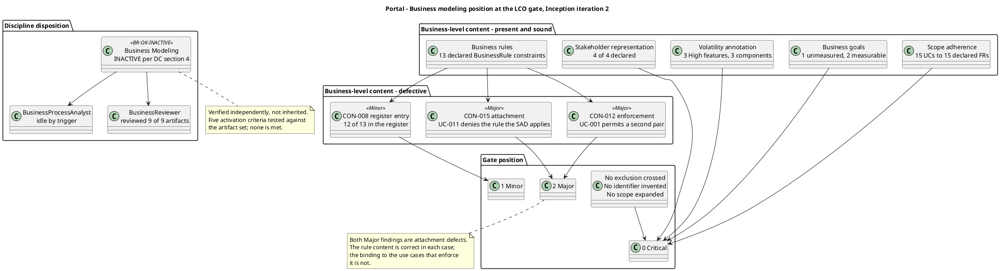

### Management Reviewer lens
<!-- review: Inception I2 -->

<!-- review: Inception I2 -->

**Verdict: No-Go.**

The Lifecycle Objectives milestone is **not achieved**. Five of the seven LCO exit criteria are met; two are not, and they are the two the gate exists to test — that the primary use cases are understood well enough to build from, and that the architecture is credible. Five Major findings and two Minor findings are open. No Critical finding is open.

**Stakeholder sanction: REFUSED.** The stakeholder answered No to the sanction question, knowing the verdict and the open defect count. Stakeholder acceptance, verbatim: "No". The instruction accompanying it, verbatim: "Ok let's fix & close all findings".

The refusal is the correct reading of the evidence. The project is not stopped: the remedy is another Inception iteration, which is the designed response to a gate that did not pass (CON-023). No declared scope is cut or deferred, and no role is added to compensate.

#### Four-axis health scorecard

| Axis | Rating | Basis |
|---|---|---|
| Scope | Green | 15 FR, 5 NFR, 36 CON, 3 BG and 5 AC carried exactly as declared; 13 exclusions published verbatim as a checkable boundary; zero scope findings in either iteration and zero exclusions crossed |
| Schedule | Amber | Inception is two iterations rather than one and the gate has not passed. The eight-iteration roadmap is re-based and internally consistent, and the CON-031 human gate is bounded at 14 days of queue time and has not yet elapsed. A second iteration is the designed remedy, not a schedule failure |
| Cost | Green | No token budget exists and none is set by the team, as CON-030 requires. Iteration 1 measured 6,756,727 tokens and 0:54:19.692 of agent time with 0:00:00 human queue time; the two clocks are reported apart and never added |
| Quality | **Red** | Five Major findings open, three of them in one artifact. Two LCO exit criteria fail. The defects are correctable and none disputes what a requirement says |

**One red axis is not a green project.** The quality axis is red for a specific and correctable reason: rules and decisions that another artifact changed were not carried through to the use cases that must enforce them. That is the defect class the Development Case's new authoring checks are written to catch, and it is why the Development Case revision is load-bearing rather than cosmetic.

```plantuml
@startuml
title Portal - Four-axis project health scorecard at the LCO gate

package "Scope - GREEN" {
  class "15 FR, 5 NFR, 36 CON, 3 BG, 5 AC\ncarried exactly as declared" as S1
  class "13 exclusions published verbatim\nas a checkable boundary" as S2
  class "0 scope findings in either iteration\n0 exclusions crossed" as S3
}

package "Schedule - AMBER" {
  class "Inception is 2 iterations, not 1\nThe LCO gate has not passed" as T1
  class "8-iteration roadmap, re-based\nand internally consistent" as T2
  class "CON-031 human gate bounded at\n14 days queue time, not yet elapsed" as T3
}

package "Cost - GREEN" {
  class "No token budget exists (CON-030)\nand none is set by the team" as C1
  class "Iteration 1 measured: 6,756,727 tokens,\n0:54:19.692 agent time, 0:00:00 human queue" as C2
  class "Two clocks reported apart,\nnever added" as C3
}

package "Quality - RED" {
  class "5 Major findings open\n0 Critical" as Q1
  class "3 of the 5 sit in one artifact:\nthe Use-Case Model" as Q2
  class "2 LCO exit criteria fail:\nuse-case fidelity, architecture credibility" as Q3
}

package "Verdict" {
  class "No-Go\nOne red axis is not a green project" as V1
}

S1 --> V1
S2 --> V1
S3 --> V1
T1 --> V1
T2 --> V1
T3 --> V1
C1 --> V1
C2 --> V1
C3 --> V1
Q1 --> V1
Q2 --> V1
Q3 --> V1

note bottom of Q3
  The red axis is quality, and it is red for a
  specific and correctable reason: rules and
  decisions that another artifact changed were
  not carried through to the use cases that
  must enforce them. No finding disputes what
  a requirement says.
end note

note bottom of T1
  Amber, not red. A second Inception iteration
  is the designed remedy for a gate that did
  not pass (CON-023), not a schedule failure.
end note
@enduml
```

#### Project health state

The project sits in the **No-Go** state: an LCO criterion fails, the sanction is not granted, and the remedy is another iteration. It is not in the Stopped state — the stakeholder refused the sanction, not the project, and instructed that the findings be fixed and closed.

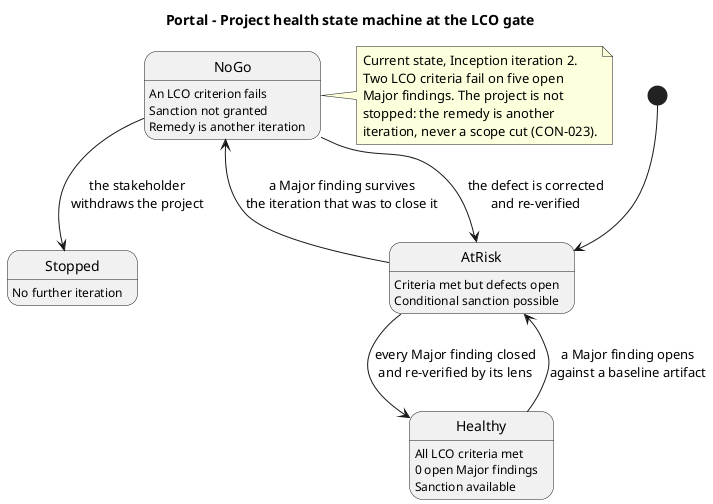

#### Risk retirement trend

Zero of eight risks is retired by evidence at this gate, and that is the correct reading rather than a failure: Inception builds nothing, so no risk can be retired by a passing test. What the gate checks is that every risk names the event that retires it and that the plan does not claim retirement it has not earned. Both now hold — the second was `Iteration Plan#F1` (Management) and it is closed.

R001, the highest-magnitude risk at exposure 9, has a flat trend with no evidence yet. Its retiring event is named and sequenced: the empty-attribute case of UC-011 and UC-004 passing against the stand-in in Elaboration iteration 3. R002 and R008 are open by their nature — one a post-launch adoption measure, the other accepted under CON-023 and mitigated rather than retired.

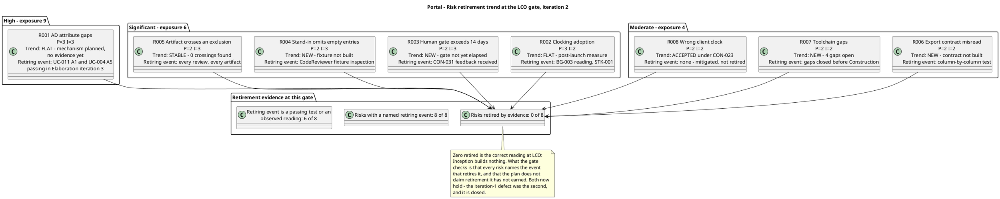

#### Conditions for the next LCO presentation

The gate re-opens when all seven actions in Resolutions and Actions are closed and re-verified by their emitting lenses. The conditions are stated as outcomes, not as activities, so the next review can check them:

1. UC-001's postcondition and its button logic describe the same clocking shape, and that shape is ADR-010's append-only event log. `Use-Case Model#F2` (Reviewer) and `Use-Case Model#F1` (Business) both close on this one revision.
2. CON-015 reads the same way in the Use-Case Model and the Software Architecture Document, and UC-011's flows contain the filter the rule declares. `Use-Case Model#F2` (Business) closes on this.
3. The Software Architecture Document's design iterations match the Iteration Plan's roadmap. `Software Architecture Document#F3` closes on this.
4. The Iteration Plan's fine plan and its exit criterion E1 agree about the Development Case. `Iteration Plan#F3` closes on this.
5. The Supplementary Specification's constraint grouping is internally consistent and its business-rules register is complete or states its own scope. Both Minor findings close on this.

**No condition requires new scope, a new artifact, or a new role.** Every one is a correction to an artifact that already exists, which is why the next iteration is a correction iteration and not a re-plan.

#### Review and sanction sequence

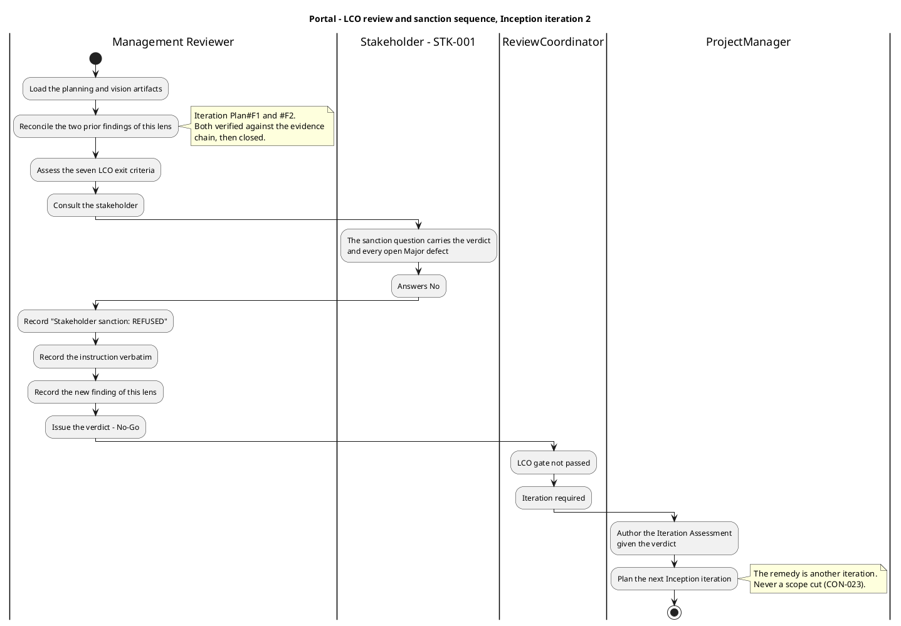
