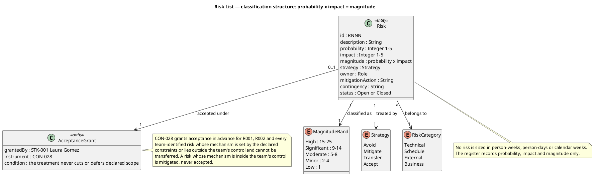
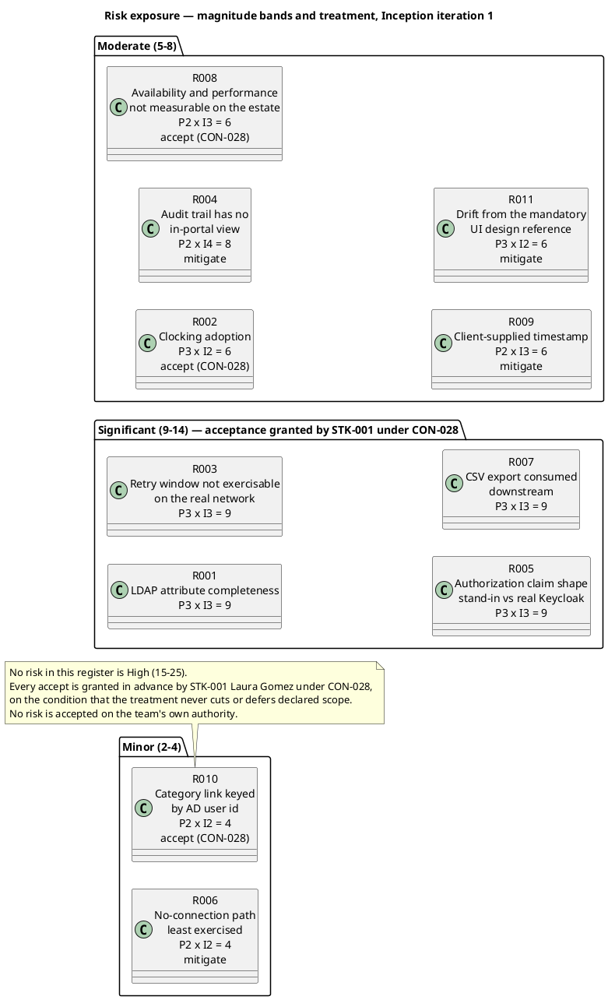

## Document Control

- Phase: Inception
- Status: Draft — iteration 1, submitted for review
- Milestone Target: End of Inception (Lifecycle Objectives) — NOT YET ACHIEVED

## Risk Classification

Every risk is classified by probability (P) and impact (I) on a 1–5 scale; magnitude is their product. R001 and R002 are the business's declared risks and are carried with their identifiers and magnitudes exactly as declared (CON-027) — not renumbered and not reclassified. Risks the team identified are adopted as first-class risks in the same series, R003 onwards, in the order raised (CON-027).

### Scales

| Probability | Meaning | Impact | Meaning |
|---|---|---|---|
| 1 | Remote — no declared condition makes it likely | 1 | Negligible — absorbed without a plan change |
| 2 | Unlikely | 2 | Minor — a work item is reworked |
| 3 | Possible — a declared condition makes it plausible | 3 | Serious — a use case or a declared rule is at risk |
| 4 | Likely | 4 | Critical — a milestone is at risk |
| 5 | Almost certain | 5 | Severe — declared scope cannot be delivered |

| Magnitude | Band | Treatment authority |
|---|---|---|
| 15–25 | High | Acceptance is the stakeholder's decision, never the team's |
| 9–14 | Significant | Acceptance is the stakeholder's decision, never the team's |
| 5–8 | Moderate | Team may accept with a recorded mitigation and contingency |
| 2–4 | Minor | Team may accept with a recorded mitigation and contingency |
| 1 | Low | Team may accept with a recorded mitigation and contingency |

### Strategy definitions used in this register

| Strategy | Applied when | Consequence |
|---|---|---|
| Avoid | The risk can be eliminated by a design or process decision inside the team's control | The condition that creates the risk is removed |
| Mitigate | The probability or the impact can be reduced by work the team performs | A mitigation action is planned into an iteration and a contingency is recorded |
| Transfer | A third party can carry the consequence | No transfer is available in this project: Infrastructure operates the estate and the identity systems, and no contractual instrument is in the team's hands |
| Accept | The mechanism is set by the declared constraints or lies outside the team's control, and no treatment retires it | A mitigation action and a contingency are still recorded; the consequence is carried |

### Acceptance authority

CON-028 grants acceptance in advance, by STK-001 Laura Gómez (project sponsor), for R001, R002 and every risk the team identifies whose mechanism is set by the declared constraints or lies outside the team's control and that cannot be transferred — on the condition that the treatment never cuts or defers declared scope. Every `accept` in this register is granted under that instrument, and the instrument is cited against the risk. No risk in this register is accepted on the team's own authority.

CON-028 also states that the availability, configuration and ownership of Keycloak and Active Directory are not risks of this project and are not registered. They are therefore absent from this register by declaration, not by omission.

### Measurement purpose

| Attribute | Decision it enables |
|---|---|
| Probability and impact | Which risks enter the current iteration's objectives, and which are carried |
| Magnitude | Whether a risk may be accepted by the team or must be escalated to the sponsor |
| Strategy | Whether an iteration objective is a mitigation action or a contingency trigger |
| Status | Whether a risk still consumes an iteration objective or has been retired |

No other risk attribute is recorded. A risk attribute that no decision reads is overhead.

## Risk Register

| ID | Risk | Category | P | I | Magnitude | Band | Strategy | Owner | Status |
|---|---|---|---|---|---|---|---|---|---|
| R001 | Active Directory integration: the LDAP attributes the directory reads may not be filled consistently across the 3 offices (job title, extension). If not tested early the directory shows gaps. | Technical | 3 | 3 | 9 | Significant | Accept (CON-028) | ProjectManager | Open |
| R002 | Digital clocking adoption: some employees may keep using Excel out of habit if the change is not communicated well. | Business | 3 | 2 | 6 | Moderate | Accept (CON-028) | ProjectManager | Open |
| R003 | The clocking retry window (FR-016, AC-005) is a client-side behaviour that cannot be exercised against the real corporate network from the development environment. A retry that works against a stand-in may still lose a press on the real network, and the loss is invisible until an employee reports it. | Technical | 3 | 3 | 9 | Significant | Accept (CON-028) | ProjectManager | Open |
| R004 | The audit trail (NFR-004) is written for compliance and read directly from the database, with no in-portal view. A missing or malformed audit entry is therefore not visible to any user and is discovered only when HR or Infrastructure reads the table. | Technical | 2 | 4 | 8 | Moderate | Mitigate | ProjectManager | Open |
| R005 | The two-level authorization (NFR-005) is derived from AD group membership carried through Keycloak. The team can only exercise it against a stand-in issuer (CON-035), so a claim-shape or group-mapping difference between the stand-in and the real Keycloak would surface at the human validation, after the authorization code is written. | Technical | 3 | 3 | 9 | Significant | Accept (CON-028) | ProjectManager | Open |
| R006 | The directory and the news depend on the corporate network and show a no-connection message (NFR-006). The message is a declared behaviour, but the failure path is the one users meet first when the network is flaky, and it is the path least likely to be exercised in development. | Technical | 2 | 2 | 4 | Minor | Mitigate | ProjectManager | Open |
| R007 | The CSV export (FR-004, CON-015 to CON-017) is the artifact HR hands to other processes. Its empty-versus-zero semantics, its minute-rounded display against its unrounded computation, and its one-row-per-employee-per-day rule are the most likely place for a downstream consumer to find a discrepancy after go-live. | Business | 3 | 3 | 9 | Significant | Accept (CON-028) | ProjectManager | Open |
| R008 | Availability and performance (NFR-001, NFR-002, NFR-003) are declared against the corporate network and the existing Windows Server estate. The team cannot measure them on the target estate; Infrastructure operates it. A page that meets 3 seconds in development may not meet it on the estate. | Technical | 2 | 3 | 6 | Moderate | Accept (CON-028) | ProjectManager | Open |
| R009 | The clocking timestamp is supplied by the client (FR-016). A client clock that is wrong records a wrong clocking, and the portal has no second source to detect it. The exposure is bounded by CON-013 and CON-014 — one pair per employee per day, never crossing midnight — so a wrong timestamp cannot corrupt another employee's record. | Technical | 2 | 3 | 6 | Moderate | Mitigate | ProjectManager | Open |
| R010 | The worker category link (CON-022) is keyed by AD user id. If an AD user id changes — a re-created account, a rename — the link is orphaned and the category silently disappears from the directory and the export, with no reconciliation screen to notice it (CON-022 excludes one). | Technical | 2 | 2 | 4 | Minor | Accept (CON-028) | ProjectManager | Open |
| R011 | The mandatory UI design reference (CON-037) is authoritative for the visual layer. If the implementation drifts from it, the drift is a defect against a declared constraint rather than a design choice, and it is found only by comparing the rendered pages against the reference. | Business | 3 | 2 | 6 | Moderate | Mitigate | ProjectManager | Open |

### Risks retired as not applicable

| Candidate risk | Verdict | Reason |
|---|---|---|
| Development-organization risks — staffing, skills, morale, friction between people, turnover, onboarding | Retired — not applicable | The mechanism of each of these risks requires a development organization. This project is executed by LLM agents; the only human is the stakeholder. There is no staffing decision, no skill gap, no morale and no interpersonal friction to manage, so no actor exists for the mechanism and no probability or impact can be assigned. |
| Estimation-accuracy risk — the plan being wrong about effort | Retired — not applicable | The mechanism requires an effort estimate to be wrong. No effort estimate is made: work items carry no size, and spend is recorded from measurement after a phase closes (CON-034). There is nothing to be inaccurate about. |
| Keycloak and Active Directory availability, configuration and ownership | Retired — not applicable | CON-028 declares these are not risks of this project and are not registered. Recorded here so the absence is a decision, not an omission. |
| Data migration risk — historical Excel data failing to import | Retired — not applicable | CON-036 declares there is no migration. The portal starts empty; the historical sheets stay on the shared drive as a read-only archive. |
| Backup and restore risk | Retired — not applicable | CON-038 declares Infrastructure's existing practice already covers the PostgreSQL instance in restorable form, confirmed in writing with a verified restore test. No backup design is part of this project. |
| Scope-creep risk from undeclared features | Retired — not applicable | The mechanism requires a feature to enter the build without authorisation. The 13 declared exclusions are published verbatim in the Vision, and the Change Control Board is the only path in. The mechanism is closed by process, not carried as a risk. |

## Risk Mitigation and Contingency

Every risk below carries a mitigation action and a contingency, including the accepted ones. Acceptance records who carries the consequence; it does not remove the treatment.

### R001 — LDAP attribute completeness across the 3 offices

| Field | Value |
|---|---|
| Magnitude | 9 (Significant) — P=3, I=3, as declared |
| Strategy | Accept, granted in advance by STK-001 under CON-028 |
| Mitigation action | The stand-in directory built for CON-035 carries the declared attributes **including entries whose job title or extension is empty**. UC-013 and UC-014 are exercised against those entries in the iteration that implements the directory, so the empty-attribute case is a test case, not a production discovery. The directory renders an empty field as empty and invents no placeholder. |
| Contingency | If the human validation against the real AD (CON-035) reports attributes missing in one or more offices, the remedy is another iteration — never a cut to declared scope (CON-028). The directory's field set is not reduced and no value is fabricated to fill a gap. |
| Trigger | The validation feedback from Infrastructure with HR, which must reach the team before Elaboration closes. |
| Iteration that acts on it | Elaboration — the iteration implementing UC-013 and UC-014. |

### R002 — Digital clocking adoption

| Field | Value |
|---|---|
| Magnitude | 6 (Moderate) — P=3, I=2, as declared |
| Strategy | Accept, granted in advance by STK-001 under CON-028 |
| Mitigation action | The clocking act is reduced to one button whose label follows the employee's current status (FR-001), on the main screen, with no training required — which is what AC-001 and AC-004 measure. The portal is the only place a new clocking is recorded (BG-002), so the Excel path is not maintained in parallel. |
| Contingency | If adoption lags BG-003 (80% within three months), the remedy is another iteration of the Transition phase, not a change to the clocking design. |
| Trigger | The adoption measurement against BG-003 and AC-004, taken after go-live. |
| Iteration that acts on it | Transition. |

### R003 — The retry window cannot be exercised on the real network

| Field | Value |
|---|---|
| Magnitude | 9 (Significant) |
| Strategy | Accept, granted in advance by STK-001 under CON-028 — the mechanism is the real corporate network, which the team does not control and cannot reach from the development environment |
| Mitigation action | The retry is exercised against a stand-in that can be made to fail on demand: the POST is blocked, the queue is inspected in localStorage, the network is restored, and the press is asserted to arrive with its original timestamp and to be rejected as a duplicate on replay. The 5-minute boundary and the beyond-5-minute path (AC-005) are both asserted. |
| Contingency | If a press is lost on the real network after go-live, the employee reports the clocking to HR, who corrects or inserts it (UC-005) — the declared fallback in AC-005. The correction is audited (NFR-004), so the loss is recorded rather than silent. |
| Trigger | An employee report of a lost clocking, or the human validation on the real network. |
| Iteration that acts on it | Elaboration — the iteration implementing UC-001 and UC-016. |

### R004 — The audit trail has no in-portal view

| Field | Value |
|---|---|
| Magnitude | 8 (Moderate) |
| Strategy | Mitigate — the mechanism is inside the team's control: the audit write is code the team writes and can assert |
| Mitigation action | Every audited operation (UC-005, UC-006, UC-011, UC-012, UC-015) is asserted at the database level in test: the row exists, it carries who, when, the previous value and — for a clocking correction — the free-text reason. The assertion reads the table directly, which is exactly how HR and Infrastructure read it (NFR-004, CON-010). |
| Contingency | If a gap is found after go-live, the affected operation is re-run through the audited path and the missing entry is reconstructed from the application log; the audit table is never edited in place. |
| Trigger | A test that finds an audited operation writing no row, or a post-go-live read by HR or Infrastructure that finds an entry missing. |
| Iteration that acts on it | Elaboration — the iteration implementing UC-005, UC-006, UC-011, UC-012 and UC-015. |

### R005 — Authorization claim shape differs between the stand-in and the real Keycloak

| Field | Value |
|---|---|
| Magnitude | 9 (Significant) |
| Strategy | Accept, granted in advance by STK-001 under CON-028 — the real Keycloak is outside the team's control and is not ours to configure (CON-001) |
| Mitigation action | The authorization decision is isolated behind one component that reads the group claim and returns one of the two levels (NFR-005). The stand-in issuer is configured to emit the same claim shape the real Keycloak is declared to emit, and the component is the only place the claim is read — so a difference is a configuration change in one place, not a change spread across sixteen use cases. |
| Contingency | If the human validation reports a different claim shape, the mapping is corrected in that one component and the affected use cases are re-tested. The remedy for a milestone delay is another iteration (CON-028). |
| Trigger | The validation feedback from Infrastructure with HR, before Elaboration closes. |
| Iteration that acts on it | Elaboration — the iteration implementing the authorization component. |

### R006 — The no-connection path is the least-exercised path

| Field | Value |
|---|---|
| Magnitude | 4 (Minor) |
| Strategy | Mitigate — the mechanism is inside the team's control: the failure path is code the team writes |
| Mitigation action | The no-connection message (NFR-006) is asserted for the directory and the news in the same iteration that implements them, by making the stand-in directory and the stand-in data source unreachable. The assertion also confirms that nothing is cached locally (CON-039). |
| Contingency | If the message fails to appear on the real network, the page is corrected in the next iteration; the failure is cosmetic — no data is lost, because nothing is cached. |
| Trigger | A test that finds the page rendering stale or empty content instead of the message. |
| Iteration that acts on it | Elaboration — the iteration implementing UC-007, UC-008, UC-009, UC-013 and UC-014. |

### R007 — The CSV export is consumed downstream

| Field | Value |
|---|---|
| Magnitude | 9 (Significant) |
| Strategy | Accept, granted in advance by STK-001 under CON-028 — the downstream consumer is outside the team's control and no contractual instrument is in the team's hands |
| Mitigation action | The export is isolated in its own use case (UC-004) so a format change does not touch the clocking record. Every declared formatting rule is asserted in test: the seven columns in the declared order, ISO 8601 dates, HH:mm with no seconds, decimal hours to two places computed from the recorded times rather than the rounded display, empty rather than zero for a missing clock-out, no row for a day with no clocking, and `Corrected` Y or N. |
| Contingency | If a downstream consumer reports a discrepancy, the export format is changed by Change Request — the column set is declared in FR-004 and is not altered by the team. |
| Trigger | A downstream consumer report, or a test that finds a row violating CON-015, CON-016 or CON-017. |
| Iteration that acts on it | Elaboration — the iteration implementing UC-004. |

### R008 — Availability and performance cannot be measured on the target estate

| Field | Value |
|---|---|
| Magnitude | 6 (Moderate) |
| Strategy | Accept, granted in advance by STK-001 under CON-028 — the estate is operated by Infrastructure and is outside the team's control |
| Mitigation action | The declared budgets are treated as design constraints, not as measurements: the clocking POST is a single insert with no external call on the critical path (NFR-002, under 1 second), and the directory and news pages are rendered server-side with no client-side framework (CON-030), which keeps the page weight low (NFR-001, under 3 seconds). |
| Contingency | If the estate does not meet the budgets, the remedy is another iteration of tuning, not a relaxation of NFR-001 or NFR-002 — those are declared. |
| Trigger | The human validation on the real estate, or a post-go-live report of a slow page. |
| Iteration that acts on it | Elaboration and Construction. |

### R009 — The clocking timestamp is client-supplied

| Field | Value |
|---|---|
| Magnitude | 6 (Moderate) |
| Strategy | Mitigate — the mechanism is inside the team's control: the server can record both timestamps |
| Mitigation action | The server records the client-supplied press timestamp as the clocking time (FR-016) and stores the receipt time alongside it, so a wrong client clock is detectable by reading the table. The exposure is bounded by CON-013 and CON-014: one pair per employee per calendar day, never crossing midnight, so a wrong timestamp cannot corrupt another employee's record and cannot create a second pair. |
| Contingency | If a wrong timestamp is found, HR corrects the clocking (UC-005) and the correction is audited with the previous value and a reason (NFR-004). |
| Trigger | A clocking whose press timestamp and receipt time differ by more than the retry window. |
| Iteration that acts on it | Elaboration — the iteration implementing UC-001 and UC-016. |

### R010 — The category link is keyed by AD user id

| Field | Value |
|---|---|
| Magnitude | 4 (Minor) |
| Strategy | Accept, granted in advance by STK-001 under CON-028 — the AD user id is issued by Active Directory, which the team must not modify (CON-004) |
| Mitigation action | The link table holds two columns and nothing else (CON-022), so an orphaned link is a single row with no matching AD user id and is visible in one query. The directory and the export both render a missing category as blank (CON-024), so an orphan degrades to the declared empty case rather than to an error. |
| Contingency | If an orphan is found, HR re-assigns the category from the directory screen (UC-015) and the change is audited. No reconciliation screen is built — CON-022 excludes one. |
| Trigger | A directory entry or export row whose category is blank for an employee HR had categorised. |
| Iteration that acts on it | Elaboration — the iteration implementing UC-015. |

### R011 — Drift from the mandatory UI design reference

| Field | Value |
|---|---|
| Magnitude | 6 (Moderate) |
| Strategy | Mitigate — the mechanism is inside the team's control: the reference is committed and the rendered pages can be compared against it |
| Mitigation action | `docs/inputs/employee-portal-design.html` is committed at sha `715d4f73d6ef4de18c46242258bc17a67f51ba6f` and is authoritative for the visual layer (CON-037). The three main views are compared against it in the iteration that implements them, and the comparison is a review finding rather than a matter of taste. |
| Contingency | If drift is found, the page is corrected against the reference in the next iteration. The reference is not amended by the team — it is a stakeholder input. |
| Trigger | A review finding that a rendered page differs from the reference. |
| Iteration that acts on it | Elaboration — the iteration implementing the three main views. |

### Risk exposure summary

## Traceability

Each risk traces to the elements whose design must respond to it. A risk with no trace edge carries no design consequence and would not belong in this register.

| Element | Traces From | Link Type | Traces To |
|---|---|---|---|
| R001 | — | DependsOn | UC-013, UC-014, UC-004 |
| R002 | — | DependsOn | UC-001, UC-016, BG-002, AC-004 |
| R003 | — | DependsOn | UC-001, UC-016, AC-005 |
| R004 | — | DependsOn | UC-005, UC-006, UC-011, UC-012, UC-015, NFR-004 |
| R005 | — | DependsOn | UC-001, UC-004, UC-014, UC-015, NFR-005 |
| R006 | — | DependsOn | UC-007, UC-008, UC-009, UC-013, UC-014, NFR-006 |
| R007 | — | DependsOn | UC-004, UC-005, NFR-004 |
| R008 | — | DependsOn | UC-001, UC-004, UC-005, NFR-001, NFR-002, NFR-003 |
| R009 | — | DependsOn | UC-001, UC-016, AC-005 |
| R010 | — | DependsOn | UC-014, UC-015, CON-022 |
| R011 | — | DependsOn | UC-001, UC-004, UC-014, UC-015, CON-037 |
