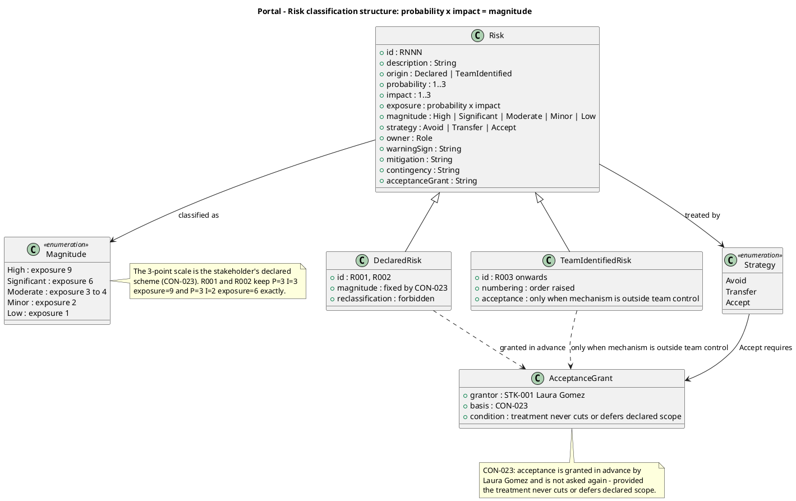
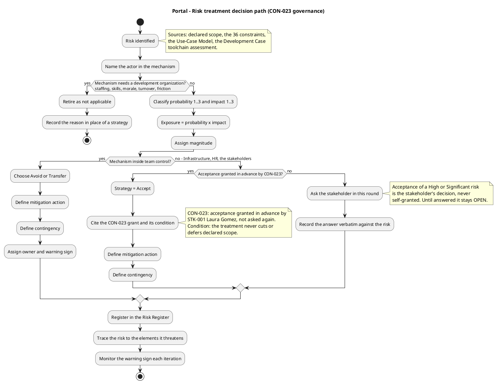

## Document Control
- **Phase:** Inception
- **Status:** Draft — iteration 2, submitted for review
- **Milestone Target:** End of Inception (not yet achieved)

## Risk Classification

The classification scheme is the stakeholder's declared one (CON-023): probability 1–3, impact 1–3,
exposure = probability × impact. R001 and R002 are carried with their declared identifiers and
magnitudes — not renumbered, not reclassified. Team-identified risks are numbered R003 onwards in the
order raised, in the same series and with the same attributes.

**Acceptance authority.** CON-023 grants risk acceptance in advance, by STK-001 Laura Gómez, for
R001, R002 and for every team-identified risk whose mechanism is set by these constraints or lies
outside the team's control and cannot be transferred — on the condition that the treatment never cuts
or defers declared scope. Every `Accept` in this register cites that grant. No risk in this register
is accepted on the Project Manager's own authority, and none is accepted outside the CON-023
condition.

**Retired as not applicable — none.** Every risk below names an actor in its mechanism: the
Infrastructure team, HR, the employees, or the agent team itself. No risk in this register requires a
development organization — no staffing, no skills, no morale, no turnover, no friction between people
— so none is retired on that ground.

## Risk Register
| ID | Risk | Origin | P | I | Exposure | Magnitude | Strategy | Owner |
|---|---|---|---|---|---|---|---|---|
| R001 | The LDAP attributes the directory reads may not be filled consistently across the 3 offices (job title, extension). If not tested early, the directory shows gaps | Declared | 3 | 3 | 9 | High | Accept (CON-023) | SoftwareArchitect |
| R002 | Some employees may keep using Excel out of habit if the change is not communicated well | Declared | 3 | 2 | 6 | Significant | Accept (CON-023) | STK-001 via ProjectManager |
| R003 | The human validation gate CON-031 places before Elaboration close exceeds its 14-day queue-time ceiling, holding the milestone | Team-identified | 2 | 3 | 6 | Significant | Accept (CON-023) | ProjectManager |
| R004 | The stand-in directory is built without the empty job-title and extension entries, so R001 is retired untested | Team-identified | 2 | 3 | 6 | Significant | Avoid | TestManager |
| R005 | An artifact crosses one of the 13 declared exclusions — a self-service correction screen, an audit view screen, a permission screen, a client cache of news or directory, a category read as a permission | Team-identified | 2 | 3 | 6 | Significant | Avoid | Reviewer |
| R006 | The FR-004 export contract is implemented with a misread derivation — column order, empty clock-out, decimal hours, Corrected flag | Team-identified | 2 | 2 | 4 | Moderate | Avoid | Designer |
| R007 | The Elaboration toolchain gaps — test framework, `CONTRIBUTING.md`, lint configuration, CI workflows — are not closed before Construction raises Implementation intensity | Team-identified | 2 | 2 | 4 | Moderate | Avoid | ProcessEngineer |
| R008 | A client clock is wrong, so the timestamp FR-013 makes authoritative records a time that did not happen | Team-identified | 2 | 2 | 4 | Moderate | Accept (CON-023) | Designer |
| R009 | The correction process does not converge: a third Inception iteration produces a further generation of the "a decision another artifact changed, not carried through" defect class, the LCO gate fails again, and the project leaves the 6 ± 3 iteration band | Team-identified | 2 | 3 | 6 | Significant | Avoid | ProcessEngineer |

**R003 is not a CON-024 risk.** CON-024 excludes the availability, configuration and ownership of
Keycloak and Active Directory. R003 is not about either system: it is the timing of the human feedback
loop CON-031 places before Elaboration closes. The distinction is load-bearing — CON-024 forbids
registering the first, and CON-031 makes the second a schedule fact the plan must carry.

**R008 is the risk FR-013 itself names.** FR-013 requires the server to accept the client's timestamp
"otherwise the audit trail records something that did not happen". The requirement fixes the
behaviour; the residual risk is that the client clock is wrong. Its mechanism — the employee's own
machine — lies outside the team's control, which is the CON-023 acceptance ground.

**R009 is registered on the project's own measured history, not on a hypothesis.** Two Inception
iterations have each produced a generation of the same defect class. Iteration 1's corrections
produced seven findings of it. Iteration 2's corrections produced five Major findings of it, three in
one artifact. The class is: a decision one artifact changed, not carried through to the artifacts that
had to follow it. Its mechanism is inside the team's control — the authoring checks and the
cross-artifact sweep — so its strategy is Avoid and no CON-023 grant is cited. Its warning sign is
observable at the next review: a finding that names an artifact not re-based onto a decision another
artifact changed in the same iteration.

**R009 is the risk that decides whether a fourth Inception iteration is the right remedy.** The
roadmap is nine iterations, the ceiling of the 6 ± 3 band. If iteration 3's review raises a third
generation of the class, the correct reading is not that the corrections were insufficient — it is
that the process needs correction, and the Project Manager escalates that reading rather than
scheduling a fourth pass.

```plantuml
@startuml
title Portal - Risk register map: magnitude and the elements each risk threatens

package "High - exposure 9" {
  class "R001 Active Directory attribute gaps\nP=3 I=3 exposure=9\nDeclared, Accept (CON-023)" as R001
}

package "Significant - exposure 6" {
  class "R002 Digital clocking adoption\nP=3 I=2 exposure=6\nDeclared, Accept (CON-023)" as R002
  class "R003 Human validation gate exceeds\n14 days queue time\nP=2 I=3 exposure=6\nAccept (CON-023)" as R003
  class "R004 Stand-in directory omits the\nempty-attribute entries\nP=2 I=3 exposure=6\nAvoid" as R004
  class "R005 An artifact crosses one of the\n13 declared exclusions\nP=2 I=3 exposure=6\nAvoid" as R005
  class "R009 The correction process does not\nconverge; a third generation of the\nsame defect class\nP=2 I=3 exposure=6\nAvoid" as R009
}

package "Moderate - exposure 4" {
  class "R006 FR-004 export contract\nimplemented with a misread derivation\nP=2 I=2 exposure=4\nAvoid" as R006
  class "R007 Elaboration toolchain gaps not\nclosed before Construction\nP=2 I=2 exposure=4\nAvoid" as R007
  class "R008 Wrong client clock makes the\nFR-013 timestamp untrue\nP=2 I=2 exposure=4\nAccept (CON-023)" as R008
}

package "Threatened elements" {
  class "UC-011 Search Employee Directory" as UC011
  class "UC-004 Export Monthly CSV" as UC004
  class "UC-001 Clock In and Clock Out" as UC001
  class "UC-012 Assign or Clear Worker Category" as UC012
  class "UC-010 Read and Filter News" as UC010
}

R001 --> UC011 : empty job title or extension
R001 --> UC004 : empty FullName column
R002 --> UC001 : habit keeps Excel alive
R004 --> UC011 : R001 retired untested
R004 --> UC004 : A5 case never exercised
R005 --> UC012 : category read as a permission
R005 --> UC010 : client cache of news
R006 --> UC004 : column contract misread
R008 --> UC001 : recorded time is not the press time
R003 ..> UC011 : real-AD validation delayed
R003 ..> UC004 : real-AD validation delayed

note right of R003
  Not a CON-024 risk. CON-024 excludes the
  availability, configuration and ownership of
  Keycloak and AD. R003 is the timing of the
  human feedback loop CON-031 places before
  Elaboration closes - a schedule risk.
end note

note bottom of R009
  R009 threatens no labelled element: it is a
  process risk against the iteration sequence
  itself, carried in the register with no trace
  edge. R007 is the same shape.
end note
@enduml
```

## Risk Mitigation and Contingency
| ID | Mitigation action | Contingency if it materializes | Warning sign |
|---|---|---|---|
| R001 | The stand-in directory carries entries whose job title and extension are empty (CON-031). UC-011 A1 renders the field blank with the row intact; UC-004 A5 exports an empty FullName and still produces the row. Test Case coverage is mandatory for both | The empty case is the designed case, so no code change is needed: the directory renders blank fields and HR is told which attributes are unfilled across the offices. No scope change, no new screen | A directory or export test that passes only against fully-populated fixture entries |
| R002 | FR-001 is one press with an obvious confirmation showing the recorded time; AC-004 makes learnability a product requirement, not a communication task. BG-003 adoption is measured after launch | HR (STK-001) runs the communication remedy. If adoption still lags, the remedy is another iteration — never a scope cut (CON-023) | Clockings recorded in the portal falling below the employee count in the first weeks after go-live |
| R003 | Human queue time is measured and reported apart from agent time (Development Case measurement policy), so the gate is visible rather than inferred. The Project Manager escalates at the 14-day ceiling | The process suspends: nothing is auto-filled, no date is projected, and the Project Manager escalates. The remedy is another iteration, not a scope reduction (CON-023) | Queue time on the CON-031 validation gate approaching 14 days with no feedback recorded |
| R004 | CON-031's fixture requirement is written into the Development Case and into the Test Case scope. The CodeReviewer checks the fixture for the empty-attribute entries before the directory tests are accepted | Add the fixture entries and re-run the directory and export tests before Elaboration closes. R001 stays open until they pass | A stand-in fixture whose every entry has a populated job title and extension |
| R005 | The 13 declared exclusions are published verbatim in the Vision as a checkable boundary. The Development Case names the specific traps: no self-service correction screen (CON-017), no audit view screen (NFR-005), no permission screen (CON-008), no client cache of directory or news | A Change Request to the CCM; the artifact is corrected in the next iteration. The exclusion is not renegotiated by the team | An artifact describing a screen, a rule or a cache that the Vision's exclusion list forbids |
| R006 | The column derivation table in UC-004 is the single source for the contract. The Test Case asserts column order, the empty clock-out row, decimal hours to two decimals computed from recorded times, and the Corrected flag | FR-004 is High volatility and is encapsulated behind a dedicated component, so a correction is local to that component rather than spread through the code | An export test that asserts minute-rounded hours, or a row omitted for a missing clock-out |
| R007 | The Development Case iteration preparation checkpoint verifies build, CI, test framework and stand-ins at every iteration open, and requires the guideline references to exist before Implementation intensity rises | Implementation intensity is held until the gaps close; another iteration absorbs the delay. Declared scope is not cut | An iteration opening with no test framework selected, or Implementation work starting with no `CONTRIBUTING.md` |
| R008 | The confirmation shows the recorded time, so a wrong client clock is visible to the employee at the moment it happens. HR corrects or inserts the clocking under UC-005, which is audited with who, when, previous value and reason | HR corrects the affected clockings under UC-005. The original record is never overwritten (CON-013), so the correction is visible in the audit trail | A clocking whose recorded time differs from the employee's account of when they pressed the button |
| R009 | Two controls, both in iteration 3. The Development Case authoring checks are verified against all seven open findings and each is classified as caught or not caught, with the gap closed (W7). The Review Record sweeps every artifact that names an iteration number against the re-based roadmap (W10), and exit criterion E6 makes the sweep a condition of the gate rather than a convention | The Project Manager escalates the reading rather than scheduling a fourth pass: a third generation of the class means the process needs correction, not another iteration. The remedy is a process change recorded in the Development Case, and the LCO gate is re-presented once it is in place. Declared scope is not cut (CON-023) | A finding that names an artifact not re-based onto a decision another artifact changed in the same iteration — the exact shape of `Use-Case Model#F2` (Reviewer) and `Software Architecture Document#F3` |

**Every risk in this register names an actor in its mechanism** — the Infrastructure team, HR, the employees, or the agent team itself. None requires a development organization, so none is retired as not applicable on that ground.

**Every `Accept` cites the CON-023 grant and its condition.** R001, R002, R003 and R008 are accepted under it. R004, R005, R006, R007 and R009 are inside the team's control, so their strategy is Avoid and no acceptance is claimed for them. No risk in this register is accepted on the Project Manager's own authority.
## Traceability

| Element | Traces From | Link Type | Traces To |
|---|---|---|---|
| R001 | — | DependsOn | UC-011, UC-004 |
| R002 | — | DependsOn | UC-001 |
| R003 | — | DependsOn | UC-011, UC-004 |
| R004 | — | DependsOn | UC-011, UC-004 |
| R005 | — | DependsOn | UC-012, UC-010 |
| R006 | — | DependsOn | UC-004 |
| R007 | — | DependsOn | — |
| R008 | — | DependsOn | UC-001 |
