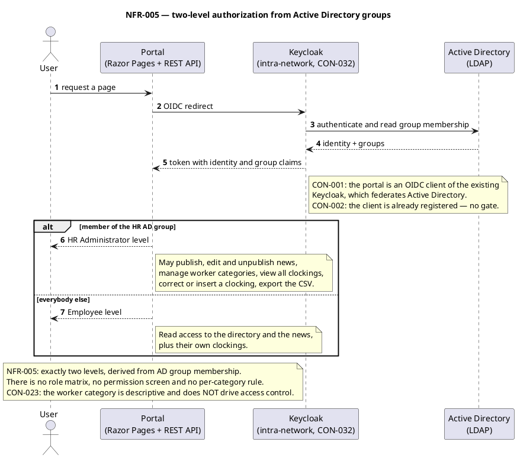
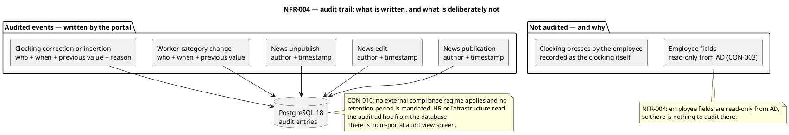
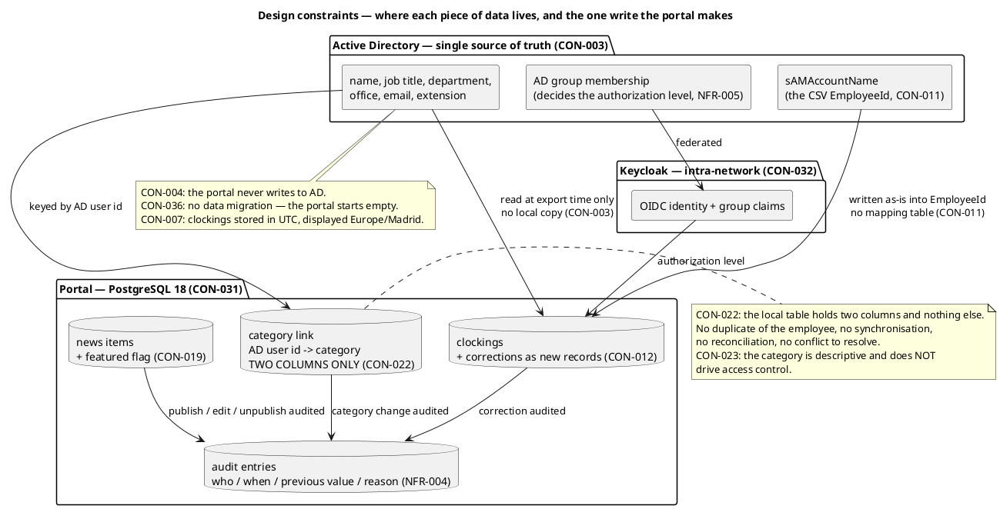
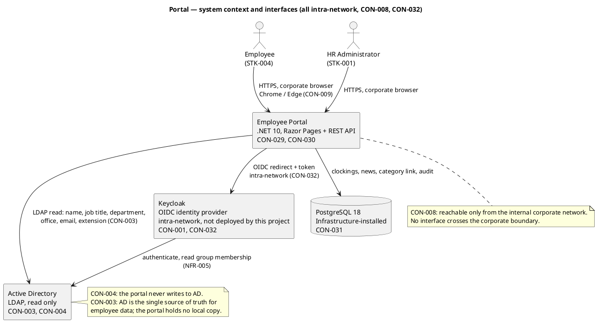

## Document Control

- Phase: Inception
- Status: Draft — iteration 1, submitted for review
- Milestone Target: End of Inception (Lifecycle Objectives) — NOT YET ACHIEVED

## Functionality

### Security and authorization

**NFR-005 — Two-level authorization from Active Directory groups.** Members of the HR AD group publish, edit and unpublish news and manage worker categories; everybody else is an employee with read access to the directory and the news, plus their own clockings. There is no role matrix, no permission screen and no per-category rule.

| ID | Requirement | Threshold |
|---|---|---|
| NFR-005 | Two-level authorization from Active Directory groups. | Exactly two levels, derived from AD group membership. |
| CON-001 | The portal is an OIDC client of the existing Keycloak, which federates Active Directory. Keycloak is not ours to deploy. | OIDC client of the existing Keycloak. |
| CON-002 | The portal's OIDC client is already registered and its credentials are with the development team. | Login testable from day one; no gate. |
| CON-023 | The worker category is descriptive and does NOT drive access control. It is used in exactly two places: as a column of the directory (which also filters by it) and as a column of the CSV export. | Category used in exactly two places; never in an authorization decision. |
| CON-026 | The directory shows corporate data only — no private personal information. | No private personal information rendered. |

**Authentication is a cross-cutting mechanism, not a use case.** Every use case in the Use-Case Model `<<include>>`s authentication: the portal is an OIDC client of Keycloak (CON-001), which federates Active Directory. No use case named "Authenticate" exists, and none is to be added — the mechanism is specified here and realized by the architecture.

### Audit trail

**NFR-004 — Mandatory traceability.** The portal writes an audit entry for: who publishes each news item, who edits it and who unpublishes it (author + timestamp in every case); any change to a worker's category; and every clocking HR corrects or inserts (who, when, previous value, reason). Employee fields are read-only from AD, so there is nothing to audit there. The audit is written for compliance and read directly from the database; there is no in-portal audit view screen.

| ID | Requirement | Threshold |
|---|---|---|
| NFR-004 | Audit trail over news publication, edit and unpublish; worker category changes; and clocking corrections or insertions. | Every listed event carries author + timestamp; corrections also carry previous value + reason. |
| CON-010 | No external compliance regime applies to the audit trail and no retention period is mandated. | No retention period enforced; read ad hoc from the database. |
| CON-012 | Only HR corrects or inserts a clocking. The original record is never overwritten in place and never deleted. | Original record preserved; no self-service correction screen. |
| CON-021 | Unpublishing a news item hides it and never deletes it; deleting would destroy the audit trail. | No hard delete of a news item. |

### Business rules

These rules are declared constraints. They are the specification the Designer and the Test Designer work against; they are not restated in the Use-Case Model.

| ID | Rule | Where it bites |
|---|---|---|
| CON-011 | `EmployeeId` in the CSV export is the AD sAMAccountName (network login) — the only identifier guaranteed to be populated and unique in all three offices. Read from the authenticated session and written as-is. There is no mapping table. | UC-004 |
| CON-013 | A clocking pair never crosses midnight. A pair belongs to one calendar date and every export row is keyed by that date. A clocking still open at midnight is an incomplete day. | UC-001, UC-004 |
| CON-014 | At most one clocking pair per employee per calendar day. | UC-001 |
| CON-015 | The CSV export contains one row per employee per day that has at least one clocking. A day with no clocking produces no row. | UC-004 |
| CON-016 | A day whose clock-out is missing exports with `ClockOut` and `HoursWorked` empty. The row is still exported. | UC-004 |
| CON-017 | CSV formats: `Date` ISO 8601; `ClockIn`/`ClockOut` 24-hour HH:mm with no seconds; `HoursWorked` decimal hours with two decimals, computed from the recorded clocking times — not from the minute-rounded values shown — and empty when the clock-out is missing; `Corrected` is `Y` when HR corrected or inserted any clocking of that day, `N` otherwise. | UC-004 |
| CON-018 | Featuring a news item is a manual flag HR sets, when publishing or when editing — never automatic. | UC-010 |
| CON-019 | At most one news item is featured at any moment: featuring one un-features the previous one. A system invariant, not a screen convention — it must hold wherever the change comes from. | UC-010, UC-009 |
| CON-020 | Unpublishing the featured news item un-features it too: the banner disappears and no other item is promoted to take its place. | UC-012 |
| CON-022 | The worker category is stored as a link — AD user id → category — never as a duplicate of the employee. The local table holds two columns and nothing else. | UC-015, UC-014 |
| CON-024 | A worker has at most one category and it may be empty. An employee with no category still appears in the directory and in the export, with that field blank. No default value is invented. | UC-015, UC-004, UC-014 |
| CON-025 | Worker categories are a closed list of exactly four values, fixed for this project: Full-time, Part-time, Contractor, Intern. Not configurable; no fifth value without a Change Request. | UC-015 |

### Licensing

No third-party licence is declared for this project. The stack is .NET 10 (CON-029), Razor Pages (CON-030) and PostgreSQL 18 (CON-031), all on the corporate estate. No licence obligation is introduced by the declared scope.

## Usability

| ID | Requirement | Threshold |
|---|---|---|
| NFR-006 | The directory and the news require the network and show a 'no connection' message when it is unavailable. Nothing is copied locally, so there is nothing to cache and nothing to sync. | No-connection message shown; no local copy. |
| CON-009 | Compatibility: current Chrome and Edge on the corporate browsers. | Current Chrome and Edge. |
| CON-037 | The custom design at `docs/inputs/employee-portal-design.html` is MANDATORY and authoritative for the UI visual layer, not only for its structure. The portal MUST implement it. | The committed design is implemented. |
| CON-030 | Frontend: Razor Pages. 'No SPA' means no client-side framework and no client-side router — it does not mean no JavaScript. A page-level script on an already-rendered page is Razor Pages as normal, and the clocking page needs one. | Razor Pages; no client-side framework or router. |
| CON-039 | No offline mode beyond the clocking retry: no PWA, no service worker, no installable app, and no client cache of the directory or the news. | No PWA, no service worker, no client cache. |

**Usability acceptance criteria.** AC-001 (an employee clocks in and out without help from HR or the development team), AC-002 (an HR Administrator publishes a news item without technical assistance), AC-003 (any employee finds a colleague's phone/email in under 10 seconds), AC-004 (80% of employees complete at least one clocking with no prior training). These are the measurable usability targets; the design reference (CON-037) is the visual means.

**Documentation.** No user documentation is declared for Inception. The TechnicalWriter produces User Documentation in Transition. The portal is expected to be usable with no prior training (AC-004), which is a design obligation, not a documentation one.

## Reliability

| ID | Requirement | Threshold |
|---|---|---|
| NFR-003 | The portal must be available Monday–Friday 7:00–19:00 with fault tolerance within the corporate network. 24/7 availability is not required. | Available Mon–Fri 07:00–19:00. |
| AC-005 | A clocking made while the corporate network is down for up to 5 minutes is not lost. Beyond 5 minutes the employee reports the clocking to HR. | Retry window 5 minutes; beyond it, manual report to HR. |
| CON-038 | Backups: the Infrastructure team's existing server-backup practice already covers this PostgreSQL instance in restorable form, confirmed in writing with a verified restore test. No backup design, tooling or restore procedure is part of this project. | Covered by existing practice; nothing designed here. |
| CON-008 | The portal is accessible only from the internal corporate network. | Internal network only. |

**Recoverability.** The clocking retry (FR-016, UC-016) is the only recoverability mechanism the portal itself provides: the press is held in the browser in localStorage with an idempotency key and retried for up to 5 minutes. Beyond that window the employee reports the clocking to HR, who corrects or inserts it (UC-005) — the declared remedy, not a portal feature. Database recoverability is Infrastructure's existing practice (CON-038) and is not designed here.

**Frequency of failure.** No failure-rate target is declared. The declared reliability obligation is the availability window (NFR-003) and the clocking retry (AC-005).

## Performance

| ID | Requirement | Threshold |
|---|---|---|
| NFR-001 | Any page must load in under 3 seconds on the corporate network. | < 3 s per page load. |
| NFR-002 | The clock in/out operation must respond in under 1 second. | < 1 s per clocking operation. |

**Throughput and resource usage.** No throughput target and no resource-usage target are declared. The declared population is 200 employees across 3 offices (STK-004) and the declared load is one clocking pair per employee per calendar day (CON-014) — a load the declared stack carries without a scaling design. No scaling requirement is invented here.

**Measurement basis.** Both thresholds are stated against the corporate network (CON-008), not against an arbitrary client. The clocking threshold (NFR-002) is measured on the operation, not on the page load that precedes it.

## Supportability

| ID | Requirement | Threshold |
|---|---|---|
| CON-005 | The portal is a .NET application deployed on the internal Windows Server estate that Infrastructure already runs. | Deployed on the existing estate. |
| CON-006 | Infrastructure has accepted operating the portal on the basis that it is a .NET application on the existing Windows Server estate and requires no AD modification. | No AD modification required. |
| CON-004 | Infrastructure must not be asked to modify Active Directory. | No AD write, no AD schema change. |
| CON-035 | The OIDC client and the LDAP connection are configured with placeholder values (issuer, client id, client secret, LDAP host, bind account, base DN), held in configuration and never in code; Infrastructure puts the real values in at deployment. | All external endpoints configurable; no credential in code. |
| CON-033 | CI: build and test run on the configured SCM provider's hosted CI. CI never holds production data or credentials, and never deploys: Infrastructure does. | Hosted CI; no production data or credentials; no deployment from CI. |
| CON-031 | Database: PostgreSQL 18 — the major is pinned, the patch level floats. Infrastructure installs it on the same Windows Server estate. | PostgreSQL 18, major pinned. |
| CON-029 | Backend: .NET 10, REST API. | .NET 10. |

**Maintainability and configurability.** The two external dependencies are configured, never coded (CON-035), which is what makes the stand-in strategy possible: the team builds and tests against a stand-in OIDC issuer and a stand-in directory, and Infrastructure substitutes the real values at deployment. The worker category list is deliberately *not* configurable (CON-025) — a closed list of four values is a business rule, not a setting.

**Testability.** Every use case is testable against the stand-ins (CON-035), including the empty-attribute case that R001 records: the stand-in directory carries entries whose job title or extension is empty.

## Design Constraints
The constraints below fix where data lives and what the design may not do. They are the boundary the Software Architect decomposes against.

| ID | Constraint | Consequence for the design |
|---|---|---|
| CON-003 | Active Directory is the single source of truth for employee data (name, job title, department, office, email, extension). The portal reads it over LDAP and holds no local copy; those fields are read-only in the portal. | No employee table, no sync job, no reconciliation screen. |
| CON-022 | The worker category is stored as a link — AD user id → category — never as a duplicate of the employee. The local table holds two columns and nothing else. | One two-column table; no conflict to resolve. |
| CON-032 | Keycloak runs INSIDE the corporate network. External to this project is not the same as external to the network: the OIDC redirect is an intra-network call, nothing about login crosses the corporate boundary, and login keeps working with no internet link. | A deployment view that puts Keycloak in a cloud node contradicts this and is wrong. |
| CON-007 | All three offices are in the same timezone (Europe/Madrid). Clockings are stored in UTC and displayed in Europe/Madrid. There is no multi-timezone case and no normalisation to design. | Store UTC, display Europe/Madrid; no timezone handling beyond that. |
| CON-036 | Data migration: there is none. The portal starts empty and records clockings from go-live onwards. The historical Excel sheets stay on the shared drive as a read-only archive and are not imported. | No import path, no migration script. |
| CON-034 | AI token spend: there is no budget or cap, and none is to be set by the team. Declared scope is never cut or deferred to fit an estimate. | Scope decisions are never driven by a spend estimate. |
| CON-027 | Risk register convention: R001 and R002 are carried with their identifiers and magnitudes as declared; a risk the team identifies is numbered R003 onwards, in the order raised. | Every risk carries an identifier so it can be traced into the design. |
| CON-028 | Risk acceptance granted in advance by Laura Gómez for R001, R002 and every risk whose mechanism is set by these constraints or lies outside the team's control, provided the treatment never cuts or defers declared scope. | The availability, configuration and ownership of Keycloak and AD are not risks of this project and are not registered. |
## Interfaces

### External system interfaces

| Interface | Direction | Mechanism | Contract |
|---|---|---|---|
| Active Directory | Inbound read only | LDAP | Supplies name, job title, department, office, email, extension, and the group membership that decides the authorization level. The portal never writes to it (CON-004). |
| Keycloak | Inbound | OIDC | Authenticates the user and returns the identity and group claims the portal authorizes on. Intra-network (CON-032). Not deployed by this project. |

### User interfaces

Three main views, all defined by the mandatory design reference `docs/inputs/employee-portal-design.html` (CON-037): the main page (clocking button, featured news banner, news list with category filter), the clocking history view, and the directory (search, entry, category control for HR). The HR views for all-employee clockings, the CSV export, clocking correction and news administration are HR-level views of the same application.

### Software interfaces

| Interface | Contract |
|---|---|
| Clocking REST endpoint | Accepts a clocking press with a client-supplied timestamp and an idempotency key; records the press timestamp, not the receipt time; returns the already-recorded result for a repeated key. |
| CSV export | Produces the seven declared columns in the declared order (FR-004, CON-017). |

### Communication interfaces

HTTP over the internal corporate network (CON-008). No interface crosses the corporate boundary: the OIDC redirect is intra-network (CON-032) and the LDAP read is intra-network (CON-003).

## Applicable Standards

| Standard | Applies to | Basis |
|---|---|---|
| ISO 8601 | `Date` column of the CSV export | CON-017 |
| 24-hour clock notation (HH:mm) | `ClockIn` and `ClockOut` columns | CON-017 |
| OIDC | Authentication against Keycloak | CON-001 |
| LDAP | Reading employee data from Active Directory | CON-003 |
| UTC storage, Europe/Madrid display | All clocking timestamps | CON-007 |
| CSV (RFC 4180 field conventions) | The monthly clocking export | FR-004 |

No external compliance regime applies to this project (CON-010). No accessibility standard, no data-protection regime and no retention standard is declared, and none is invented here.
