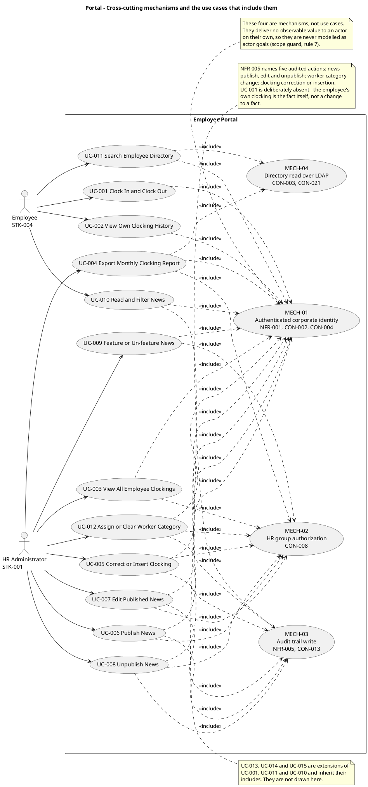
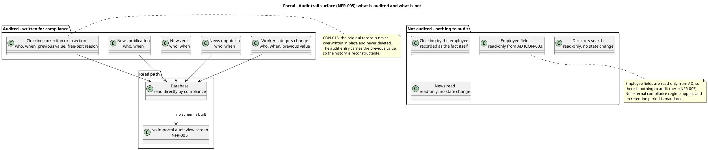

## Document Control

- **Phase:** Inception
- **Status:** Draft — iteration 1, submitted for review
- **Milestone Target:** End of Inception (not yet achieved)

## Functionality
### Authenticated access — the portal-wide mechanism

NFR-001 is not a feature of any single use case. Every portal function requires an authenticated
corporate identity, and the authenticated session supplies the two values the whole portal consumes:
the employee's sAMAccountName (CON-004) and their AD group membership (CON-008). It is recorded here
as a mechanism and included by every use case, never modelled as a use case of its own.

| ID | Requirement | Source |
|---|---|---|
| MECH-01 | Every portal function requires an authenticated corporate identity. The user signs in with their AD credentials through the existing Keycloak OIDC client. The session supplies sAMAccountName and AD group membership | NFR-001, CON-002, CON-004 |
| MECH-02 | Authorization has exactly two levels from AD group membership: members of the HR AD group publish, edit and unpublish news and manage worker categories; everyone else is an employee with read access to the directory and news plus their own clockings | CON-008 |
| MECH-03 | The audit trail is written to the database for the five actions NFR-005 names (see Reliability) | NFR-005, CON-013 |
| MECH-04 | Directory attributes are read from Active Directory over LDAP, read-only, with no local copy | CON-003, CON-021 |

### Business rules

The twelve business rules below are invariants, not UI behaviour. Each must hold wherever the change
comes from — a service call, a scheduled path, a direct database write — not only in the form that
happens to expose it.

| ID | Rule | Where it must hold |
|---|---|---|
| CON-009 | Worker categories are a closed list of exactly four values — Full-time, Part-time, Contractor, Intern. Not configurable; no screen to create or rename; no fifth value without a Change Request | The category value set is a configuration point, not a constant scattered through code |
| CON-010 | At most one news item is featured at any moment; featuring one un-features the previous | Wherever the change comes from, not only the HR form |
| CON-011 | A clocking pair never crosses midnight; a pair belongs to one calendar date and every export row is keyed by that date. A clocking still open at midnight is an incomplete day | The clocking write and the export grouping |
| CON-012 | At most one clocking pair per employee per calendar day | The clocking write |
| CON-013 | Original clocking records are never overwritten in place and never deleted; corrections are audited with who, when, previous value and free-text reason | The schema, not the service layer alone |
| CON-014 | News items are never deleted, only unpublished | The schema |
| CON-015 | Worker category is descriptive and drives no access control. It is used in exactly two places — a directory column that also filters, and a CSV export column | Nowhere else. A category read in an authorization decision is a defect |
| CON-016 | A worker has at most one category and it may be empty; an employee with no category still appears in the directory and the export with that field blank. No default value is invented | The category link and the export |
| CON-017 | There is no self-service clocking correction screen for employees; only HR corrects or inserts clockings | The screen inventory |
| CON-018 | Featuring is a manual flag HR sets when publishing or editing — never automatic; no criteria, dates or rules promote a news item by themselves | No scheduled job, no expiry, no "most read" |
| CON-019 | Unpublishing the featured item un-features it; the banner disappears and no other item is promoted in its place | The unpublish path |
| CON-020 | The directory shows corporate data only — no private personal information | The directory projection |

### Data ownership

| ID | Rule | Consequence |
|---|---|---|
| CON-021 | The worker category is stored as a link — AD user id to category — never as a duplicate of the employee. The local table holds two columns and nothing else; there is no synchronisation, reconciliation or conflict to resolve | The portal owns exactly two things: clockings and this link |
| CON-033 | There is no data migration. The portal starts empty and records clockings from go-live onwards. Historical Excel sheets stay a read-only archive and are not imported | No migration work exists and none may be added |
| CON-036 | The clocking retry is one action, one queue, one entity: two clocking presses by the same employee cannot conflict with anything, so there is nothing to reconcile and no conflict resolution to write. It is not the sync work the scope excludes | The retry is a bounded client-side loop, not a synchronisation mechanism |

### Scope exclusions that constrain the design

These are declared exclusions, not gaps. Each is a defect if it appears in a design, a screen or a
document.

- No native mobile app; responsive web only.
- No push notifications.
- No payroll integration.
- No vacation or sick-leave management.
- No biometric clocking — AD username/password only.
- No Keycloak work of any kind: no realm design, no client provisioning, no Keycloak hosting, and Keycloak never appears in the deployment diagram as something this project installs.
- No writing back to Active Directory and no editing of employee fields anywhere in the portal.
- No local copy of the employee, no sync job, no reconciliation screen, no conflict resolution.
- No news archive screen.
- No hard delete of a news item.
- No offline mode beyond the clocking retry; no PWA, no service worker, no installable app, no client cache of the directory or the news.
- No permission model beyond the two AD-group levels; no role matrix, no permission administration screen, no rule that reads worker category to decide what somebody may do.
- No rule that features a news item by itself — no "most recent", no "most read", no expiry date on the banner.

## Usability

| ID | Requirement | Source | Note |
|---|---|---|---|
| USA-01 | The clocking interaction is one press on the main screen, with the button reflecting the employee's current status, and a confirmation showing the recorded time | FR-001, AC-001, AC-004 | 80% of employees must complete a clocking with no prior training. This is a usability requirement with a measurable threshold, not a preference |
| USA-02 | A colleague's phone or email is found in under 10 seconds | AC-003 | The directory search must be reachable and its result readable without navigating a hierarchy |
| USA-03 | An HR Administrator publishes a news item with no technical assistance | AC-002 | The publish form is self-explanatory to a non-technical user |
| USA-04 | The UI implements the authoritative design at `docs/inputs/employee-portal-design.html` for the visual layer, not only its structure | CON-034 | Mandatory. A defect is "the UI departs from the reference", not "the portal fails WCAG" |
| USA-05 | The portal is usable in current Chrome and Edge | CON-005 | No other browser is supported and none is tested |
| USA-06 | The clocking page's script is part of the page load the employee experiences | NFR-002, CON-026 | "No SPA" means no client-side framework and no client-side router; a page-level script on an already-rendered page is normal Razor Pages and is required by FR-013 |

**Accessibility — not declared for this cycle.** No WCAG level, keyboard-only target or screen-reader
support is declared. The design reference states in its own design-system header that it targets AA
contrast, visible focus, targets of at least 40px and keyboard-only operation; because CON-034 makes
that file mandatory and authoritative, those values are inherited as **design conformance** — the UI
is built to the reference and tested against it. No WCAG level is claimed and no accessibility test
suite is scoped from them. The question returns to the stakeholder when this cycle closes.

## Reliability

### Audit trail — NFR-005

Mandatory traceability. The audit trail is written to the database for compliance and read directly
from the database; **no in-portal audit view screen exists**. No external compliance regime applies
and no retention period is mandated.

| Audited action | What the audit entry records | Source |
|---|---|---|
| News publication | Author and timestamp | NFR-005, FR-006 |
| News edit | Author and timestamp | NFR-005, FR-007 |
| News unpublish | Author and timestamp | NFR-005, FR-008 |
| Worker category change | Who, when, previous value | NFR-005, FR-012 |
| Clocking correction or insertion | Who, when, previous value, free-text reason | NFR-005, FR-005, CON-013 |

**Not audited, because there is nothing to audit.** Employee fields are read-only from AD (CON-003),
so no change to them can originate in the portal. Directory search and news reading change no state.

### Availability

| ID | Requirement | Source |
|---|---|---|
| REL-01 | Available Monday–Friday 7:00–19:00 with fault tolerance within the corporate network. 24/7 availability is not required and must not be designed for | NFR-003 |
| REL-02 | A clocking pressed while the corporate network is down is held in the browser and retried for up to 5 minutes, so a clocking made during an outage of up to 5 minutes is not lost | FR-013, AC-005 |
| REL-03 | The server accepts the timestamp the client sends — the time the employee pressed the button, not the time the server received it. Otherwise the audit trail records something that did not happen | FR-013 |
| REL-04 | Duplicate clocking submissions are rejected by an idempotency key | FR-013 |
| REL-05 | Beyond 5 minutes the retry stops and the employee is told to report the clocking to HR, who corrects or inserts it | FR-013, CON-017 |
| REL-06 | When the corporate network is unavailable, the directory shows a no-connection message instead of stale or partial results. Nothing is copied locally, so there is nothing to cache and nothing to sync | FR-014 |
| REL-07 | When the corporate network is unavailable, the news area shows a no-connection message instead of stale or partial results | FR-015 |
| REL-08 | Backups are the Infrastructure team's existing server-backup practice, which already covers this PostgreSQL instance in restorable form with a verified restore test. No backup design, tooling or restore procedure is part of this project | CON-035 |

**Recoverability note.** REL-06 and REL-07 are deliberately the *absence* of a fallback. There is no
client cache of the directory or the news, so a no-connection message is the only correct behaviour —
a stale result would be worse than no result, because it would look authoritative.

## Performance

| ID | Requirement | Source | Measurement |
|---|---|---|---|
| PERF-01 | Pages load in under 3 seconds on the corporate network, measured as the full page load the employee experiences — from the browser's request to the page displayed and usable, including the clocking page's script | NFR-002 | End-to-end page load, not server response time. Server response time is the engineering target that makes this achievable, not a substitute for it |
| PERF-02 | The clock in/out operation responds in under 1 second | NFR-004 | The one operation with a sub-second target |

**Scale is not a binding concern.** 200 employees across 3 offices is a non-binding load. No
throughput target is declared and none is designed for. This is a deferred question, not a gap: it
returns to the stakeholder when this cycle closes. Over-engineering for scale is a defect on this
project, not a virtue.

**Threshold quantification** is the RequirementsSpecifier's work in Elaboration. The two thresholds
above are the declared ones and are not to be tightened or loosened by the team.

## Supportability

| ID | Requirement | Source |
|---|---|---|
| SUP-01 | The portal is a .NET 10 application with a REST API, deployed on the internal Windows Server estate operated by Infrastructure | CON-001, CON-025 |
| SUP-02 | The frontend is Razor Pages — an intranet application, no SPA. No client-side framework and no client-side router; a page-level script on an already-rendered page is normal Razor Pages | CON-026 |
| SUP-03 | The database is PostgreSQL 18 — the latest stable major at project start. The patch level floats, the major is pinned. Infrastructure installs it on the same Windows Server estate | CON-027 |
| SUP-04 | The OIDC client and the LDAP connection are configured with placeholder values — issuer, client id, client secret, LDAP host, bind account, base DN — held in configuration and never in code. Infrastructure substitutes the real values at deployment | CON-031 |
| SUP-05 | The team builds and tests against stand-ins it controls: a test OIDC issuer and a test directory carrying the declared attributes, including entries whose job title or extension is empty | CON-031 |
| SUP-06 | The Infrastructure team operates the portal in production once live — deployment, monitoring and patching — exactly as it already operates AD and Keycloak. The development team hands over at the end of Transition and does not run it afterwards | CON-032 |
| SUP-07 | CI runs on the hosted SCM provider's CI. It never holds production data or credentials and never deploys; Infrastructure does | CON-029 |
| SUP-08 | There is no budget or cap on token spend, and none is to be set by the team. Each iteration's measured spend is recorded and used to forecast the next; declared scope is never cut or deferred to fit an estimate | CON-030 |

**The stand-ins are the load-bearing supportability item.** CON-031 makes them the team's entire
integration surface: the team never touches the real Keycloak or the real AD, and "every use case
works correctly against the stand-ins" is the team's definition of done. A stand-in that omits the
empty-attribute entries would silently retire R001 without testing it.

## Design Constraints

All 36 declared constraints, grouped by what they decide. A constraint that appears in no design
section is an unproven constraint — the Software Architect owns the conformance argument.

```plantuml
@startuml
title Portal - Constraint conformance map by category (36 constraints)

package "Platform and technology - 5" {
  class "CON-001 .NET on Windows Server estate" as C1
  class "CON-025 .NET 10, REST API" as C25
  class "CON-026 Razor Pages, no SPA" as C26
  class "CON-027 PostgreSQL 18, major pinned" as C27
  class "CON-005 Chrome and Edge" as C5
}

package "Identity, directory and authorization - 6" {
  class "CON-002 OIDC client of existing Keycloak" as C2
  class "CON-003 AD fields read-only over LDAP" as C3
  class "CON-004 EmployeeId is sAMAccountName" as C4
  class "CON-008 Two AD-group levels only" as C8
  class "CON-022 No AD modification" as C22
  class "CON-028 Keycloak inside the corporate network" as C28
}

package "Business rules - 12" {
  class "CON-009 Closed four-value category list" as C9
  class "CON-010 At most one featured item" as C10
  class "CON-011 Pair never crosses midnight" as C11
  class "CON-012 One pair per employee per day" as C12
  class "CON-013 Originals never overwritten" as C13
  class "CON-014 News never deleted" as C14
  class "CON-015 Category drives no access" as C15
  class "CON-016 At most one category, may be empty" as C16
  class "CON-017 No self-service correction" as C17
  class "CON-018 Featuring is manual only" as C18
  class "CON-019 Unpublish promotes nothing" as C19
  class "CON-020 Corporate data only" as C20
}

package "Data ownership - 3" {
  class "CON-021 Category stored as a link" as C21
  class "CON-033 No data migration" as C33
  class "CON-036 Retry is one action, one queue" as C36
}

package "Environment - 3" {
  class "CON-006 Internal network only" as C6
  class "CON-007 Single timezone Europe/Madrid" as C7
  class "CON-031 Stand-ins, never the real AD or Keycloak" as C31
}

package "Operations - 6" {
  class "CON-029 Hosted CI, never deploys" as C29
  class "CON-030 No token budget" as C30
  class "CON-032 Infrastructure operates post-launch" as C32
  class "CON-035 Backups are Infrastructure practice" as C35
  class "CON-023 Risk governance and acceptance" as C23
  class "CON-024 Keycloak and AD are not project risks" as C24
}

package "UI - 1" {
  class "CON-034 Design file mandatory and authoritative" as C34
}

note right of C31
  The load-bearing constraint: the stand-ins are
  the team's entire integration surface, and the
  empty-attribute entries are what retire R001.
end note
@enduml
```

### Architectural constraints

| ID | Constraint | What it decides |
|---|---|---|
| CON-001 | The portal is a .NET application deployed on the internal Windows Server estate operated by Infrastructure | Hosting target; no cloud, no containers |
| CON-002 | The portal is an OIDC client of the existing Keycloak, which federates Active Directory. Keycloak is not deployed by this project; the OIDC client is already registered and credentials are with the development team | No identity work; the client is a configuration surface |
| CON-021 | The worker category is stored as a link — AD user id to category — never a duplicate of the employee. The local table holds two columns and nothing else | The portal's data model is two owned entities, not a copy of the directory |
| CON-025 | Backend: .NET 10, REST API | Framework pin |
| CON-026 | Frontend: Razor Pages, no SPA | No client-side framework, no client-side router; a page-level script is permitted and required |
| CON-027 | Database: PostgreSQL 18, major pinned, patch floats | Version pin |
| CON-028 | Keycloak runs **inside** the corporate network — the company's internal identity provider, on the internal estate Infrastructure operates alongside AD. External to this project is not the same as external to the network. The OIDC redirect is an intra-network call and login keeps working with no internet link | A deployment view that places Keycloak in a cloud node contradicts this and is wrong |
| CON-034 | The custom design at `docs/inputs/employee-portal-design.html` is mandatory and authoritative for the UI visual layer, not only its structure | The UI is built to the reference; it is not pending and needs no confirmation |
| CON-036 | The clocking retry is one action, one queue, one entity. It is not the sync work the scope excludes | No reconciliation, no conflict resolution |

### Environmental constraints

| ID | Constraint | What it decides |
|---|---|---|
| CON-005 | Compatibility: current Chrome and Edge | Browser support surface |
| CON-006 | Access is only from the internal corporate network | No external exposure, no public endpoint |
| CON-007 | All three offices are in Europe/Madrid. Clockings are stored in UTC and displayed in Europe/Madrid; there is no multi-timezone case and no normalisation to design | One conversion at the boundary, nothing more |
| CON-031 | The team works against stand-ins, never the real Keycloak or AD. Placeholder configuration values, never in code. Validation against the real systems is human work by Infrastructure with HR, with feedback before Elaboration closes | The team's entire integration surface; the definition of done |

### Operational constraints

| ID | Constraint | What it decides |
|---|---|---|
| CON-022 | Active Directory is operated by Infrastructure, not by the portal team; the portal must not require any modification to AD | Read-only LDAP; no schema change, no write-back |
| CON-023 | R001 and R002 are carried with their declared identifiers and magnitudes, not renumbered or reclassified. Team-identified risks are numbered R003 onwards in the order raised, with the same probability, impact, mitigation and contingency. Risk acceptance is granted in advance by Laura Gómez and is not asked again, provided the treatment never cuts or defers declared scope. If human validation delays a milestone, the remedy is another iteration | Risk handling; scope is never the lever |
| CON-024 | The availability, configuration and ownership of Keycloak and AD are not risks of this project and are not registered as such | The Risk List must not carry them |
| CON-029 | CI runs on the hosted SCM provider's CI. "No cloud" and "internal network only" govern the portal at runtime, not the development toolchain. CI never holds production data or credentials and never deploys | Toolchain boundary |
| CON-030 | No budget or cap on token spend, and none is to be set by the team | Measurement, not constraint on scope |
| CON-032 | Infrastructure operates the portal in production once live. The development team hands over at the end of Transition and does not run it afterwards | Handover obligation |
| CON-035 | Backups: Infrastructure's existing server-backup practice already covers this PostgreSQL instance in restorable form, confirmed in writing with a verified restore test. No backup design, tooling or restore procedure is part of this project | Explicitly out of scope |

## Interfaces

| ID | Interface | Direction | Contract | Source |
|---|---|---|---|---|
| INT-01 | Keycloak OIDC | Portal to Keycloak | The portal is an OIDC client of the existing Keycloak. The authenticated session supplies sAMAccountName and AD group membership. Configured with placeholder issuer, client id and client secret; Infrastructure substitutes real values at deployment | CON-002, CON-004, CON-031, NFR-001 |
| INT-02 | Active Directory over LDAP | Portal to AD | Read-only. Supplies name, job title, department, office, email and extension. No write, no schema change, no local copy. Configured with placeholder LDAP host, bind account and base DN | CON-003, CON-022, CON-031 |
| INT-03 | Monthly clocking CSV | Portal to HR, outside the portal | Eight columns in the declared order: EmployeeId, FullName, WorkerCategory, Date, ClockIn, ClockOut, HoursWorked, Corrected. Timestamps in Europe/Madrid local time. Date ISO 8601; ClockIn/ClockOut 24-hour HH:mm with no seconds; HoursWorked decimal hours to two decimals computed from recorded times, not minute-rounded; Corrected = Y if HR corrected or inserted any clocking that day, else N. A missing clock-out exports ClockOut and HoursWorked empty and the row is still exported. One row per employee per day with at least one clocking; days with no clocking produce no row | FR-004 |
| INT-04 | Corporate browser | Employee to portal | Current Chrome and Edge, internal network only, responsive web. No native app, no PWA, no service worker | CON-005, CON-006, CON-026 |
| INT-05 | PostgreSQL 18 | Portal to database | Installed by Infrastructure on the same Windows Server estate. Major pinned, patch floats. Backups are Infrastructure's existing practice | CON-027, CON-035 |

**INT-03 is the most volatile interface in the project.** It is consumed by HR outside the portal, its
column set is fixed by FR-004 alone, and a change to it is invisible to the portal's own tests. The
Software Architect should encapsulate the export contract behind a dedicated component rather than
letting the column order leak into the query.

## Applicable Standards

| Standard or convention | Applies to | Basis |
|---|---|---|
| ISO 8601 date format (`2026-06-22`) | The CSV Date column | FR-004 |
| 24-hour `HH:mm`, no seconds | The CSV ClockIn and ClockOut columns | FR-004 |
| Europe/Madrid local time for display and export; UTC for storage | All clocking timestamps | CON-007, FR-004 |
| OIDC | Authentication against the existing Keycloak | CON-002, NFR-001 |
| LDAP | Directory reads against Active Directory | CON-003 |
| Decimal hours to two decimals, computed from recorded times | The CSV HoursWorked column | FR-004 |
| The committed design reference `docs/inputs/employee-portal-design.html` | The UI visual layer | CON-034 |

**No external compliance regime applies and no retention period is mandated** (NFR-005). No WCAG
level is claimed for this cycle. No other standard is declared, and the team does not adopt one on
the stakeholder's behalf.
