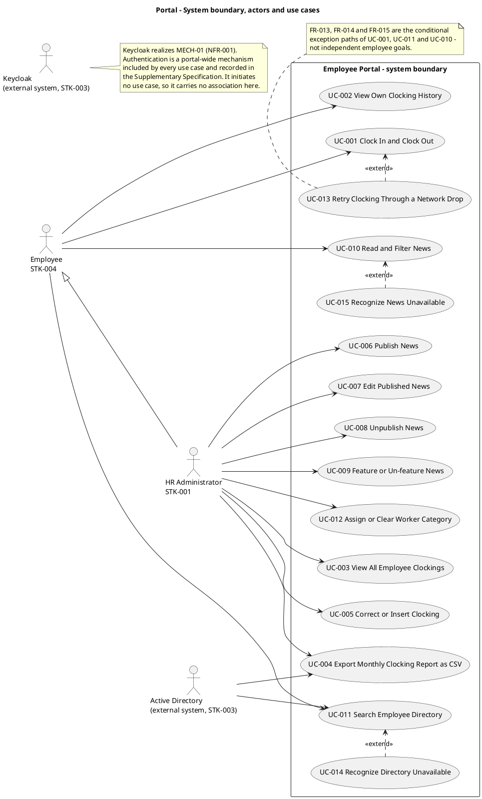
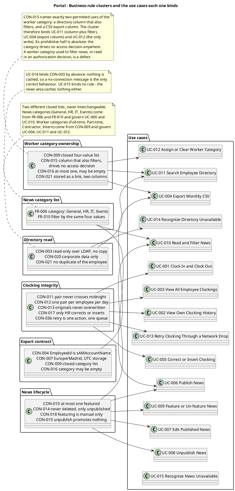
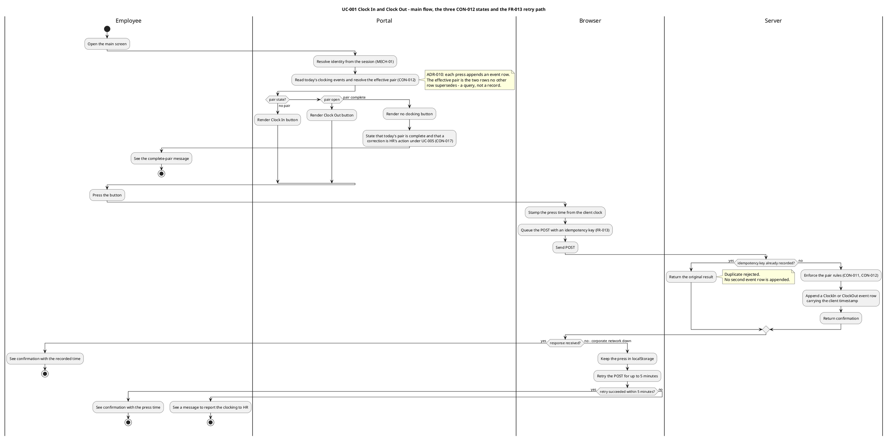
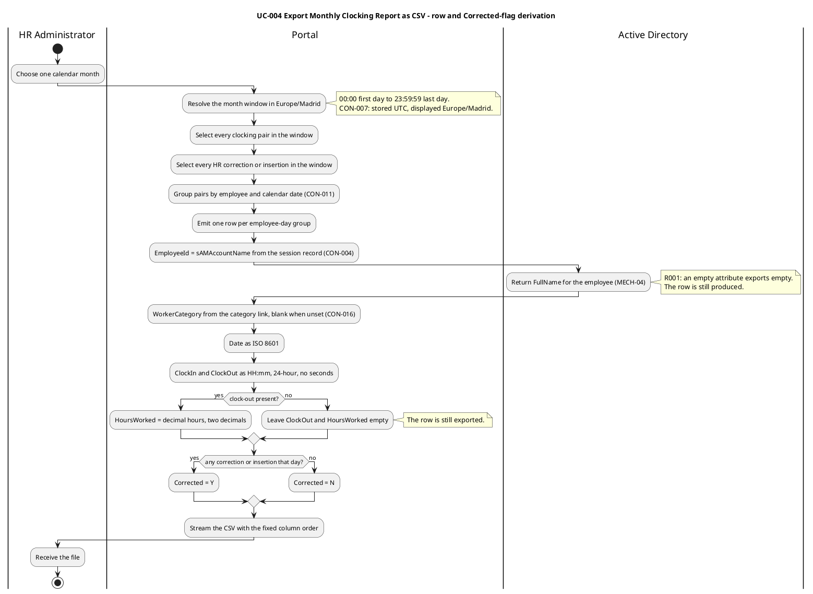
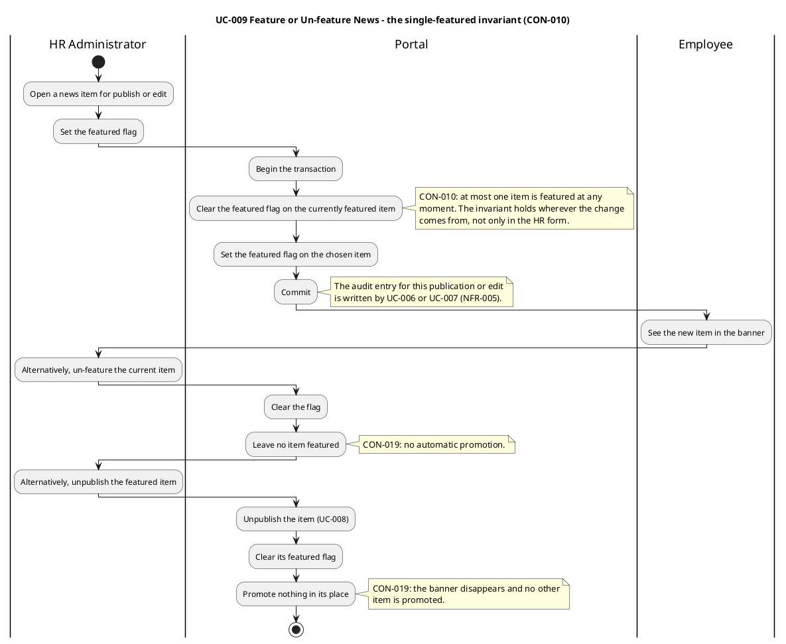
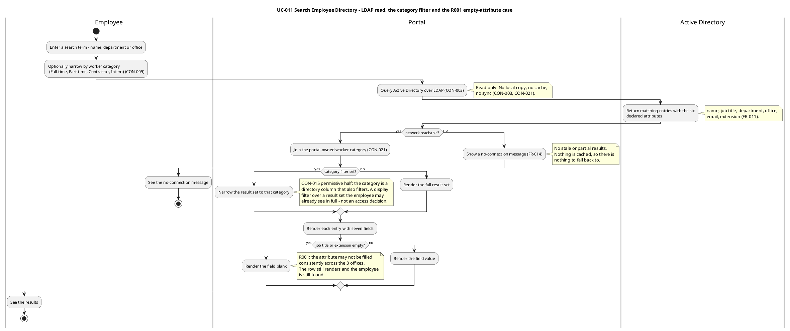

## Document Control
- **Phase:** Inception
- **Status:** Draft — iteration 2, submitted for review
- **Milestone Target:** End of Inception (not yet achieved)
## Use-Case Diagram
Fifteen use cases, one per declared requirement FR-001 to FR-015. Two human actors and two external
systems sit on the boundary. Authentication (NFR-001) is deliberately **not** a use case: it is
mechanism MECH-01 in the Supplementary Specification, included by every use case.

**Why three use cases are drawn as `<<extend>>`.** FR-013, FR-014 and FR-015 are declared
requirements, so each carries its own use case per the Development Case. But none of them is an
independent actor goal: FR-013 is what UC-001 does when the network drops, and FR-014/FR-015 are what
UC-011 and UC-010 do when the network is unreachable. Modelling them as extensions keeps the declared
requirement traceable without inventing three goals the employee does not have.

**Active Directory participates in two use cases, not one.** It supplies the six read-only directory
attributes to UC-011, and it supplies FullName to UC-004 — the export's second column is a directory
value, not a portal-owned one. Keycloak initiates nothing: it is the mechanism behind MECH-01, and a
mechanism is not an actor goal.

## Actors

| Actor | Type | Represents | Goals in the portal | Source |
|---|---|---|---|---|
| Employee | Primary human | STK-004 — 200 people across 3 offices | Clock in and out; see own month; read and filter news; find a colleague | STK-004 |
| HR Administrator | Primary human, generalizes Employee | STK-001 — HR Director and the HR AD group | Everything an Employee can do, plus: see all clockings; export the monthly CSV; correct or insert a clocking; publish, edit, unpublish and feature news; assign or clear a worker category | STK-001, CON-008 |
| Active Directory | External system | STK-003 — operated by Infrastructure | Supplies the six read-only directory attributes over LDAP to UC-011; supplies FullName to UC-004; supplies sAMAccountName and AD group membership through the session | STK-003, CON-003, CON-004 |
| Keycloak | External system | STK-003 — operated by Infrastructure | Authenticates the corporate identity via OIDC and federates AD. Realizes MECH-01; initiates no use case | STK-003, CON-002, NFR-001 |

**HR Administrator generalizes Employee.** CON-008 gives exactly two levels from AD group membership.
An HR Administrator is an Employee who additionally holds the HR group. This is a UML generalization,
not a role matrix — there is no third level and no per-category rule.

**Actor types checked and found absent.** No time-based trigger exists: nothing in the declared scope
runs on a schedule, and CON-018 explicitly forbids any rule that features a news item by itself. No
hardware device exists: CON-002 and the scope statement exclude biometric clocking. No administrative
actor exists beyond HR: there is no permission administration screen (CON-008) and no audit view
screen (NFR-005) — the audit trail is read directly from the database by people outside the portal.

## Use-Case Survey
Fifteen use cases. Inception details the four architecturally significant ones (UC-001, UC-004,
UC-009, UC-011); the RequirementsSpecifier details the remaining eleven in Elaboration.

| UC | Name | Primary actor | Source | Priority | Volatility | Rules bound | Detail in this iteration |
|---|---|---|---|---|---|---|---|
| UC-001 | Clock In and Clock Out | Employee | FR-001 | Must | Low | CON-011, CON-012, CON-013, CON-017, CON-036 | **Detailed** — architecturally significant: the client-timestamp and idempotency contract (FR-013) forces a design decision |
| UC-002 | View Own Clocking History | Employee | FR-002 | Must | Low | CON-011, CON-012 | Outline |
| UC-003 | View All Employee Clockings | HR Administrator | FR-003 | Must | Medium | CON-011, CON-012 | Outline |
| UC-004 | Export Monthly Clocking Report as CSV | HR Administrator | FR-004 | Must | **High** | CON-004, CON-007, CON-009, CON-015, CON-016, CON-021 | **Detailed** — architecturally significant: a fixed external contract with a derived Corrected flag |
| UC-005 | Correct or Insert Clocking | HR Administrator | FR-005 | Must | Medium | CON-011, CON-012, CON-013, CON-017 | Outline |
| UC-006 | Publish News | HR Administrator | FR-006 | Must | Low | CON-010, CON-014, CON-018; news-category list (FR-006) | Outline |
| UC-007 | Edit Published News | HR Administrator | FR-007 | Must | Low | CON-010, CON-014, CON-018 | Outline |
| UC-008 | Unpublish News | HR Administrator | FR-008 | Must | Low | CON-010, CON-014, CON-019 | Outline |
| UC-009 | Feature or Un-feature News | HR Administrator | FR-009 | Must | **High** | CON-010, CON-018, CON-019 | **Detailed** — architecturally significant: a system invariant (CON-010) that must hold wherever the change comes from |
| UC-010 | Read and Filter News | Employee | FR-010 | Must | Medium | CON-014; news-category list (FR-010) | Outline |
| UC-011 | Search Employee Directory | Employee | FR-011 | Must | Medium | CON-003, CON-009, CON-015, CON-016, CON-020, CON-021 | **Detailed** — architecturally significant: the LDAP read, the category filter and the R001 empty-attribute case |
| UC-012 | Assign or Clear Worker Category | HR Administrator | FR-012 | Must | **High** | CON-009, CON-015, CON-016, CON-021 | Outline — the only write the portal makes about a person |
| UC-013 | Retry Clocking Through a Network Drop | Employee | FR-013 | Must | Medium | CON-036, CON-011, CON-012 | Outline — extends UC-001 |
| UC-014 | Recognize Directory Unavailable | Employee | FR-014 | Must | Low | CON-003 | Outline — extends UC-011 |
| UC-015 | Recognize News Unavailable | Employee | FR-015 | Must | Low | — (nothing is cached, so no rule is enforced by absence) | Outline — extends UC-010 |

**ATM test applied to all fifteen.** Each has a primary actor who initiates it, a trigger event, and
an outcome the actor can observe. The three extension use cases pass on the same basis: the actor is
the Employee, the trigger is the network becoming unreachable, and the observable outcome is a
no-connection message or a preserved clocking.

**Priority.** All fifteen are Must. CON-023 forbids cutting or deferring declared scope, so MoSCoW
cannot be used as a scope lever on this project; the lever is iteration count.

### Business-rule binding — the handoff to the RequirementsSpecifier

Every use case is bound to the constraints that govern it. A use case detailed without its bound
rules is under-specified, and a rule bound to no use case is unenforced.

Two closed lists exist in this system and they are never interchangeable. **News categories**
(General, HR, IT, Events) are declared by FR-006 and FR-010 and govern UC-006 and UC-010.
**Worker categories** (Full-time, Part-time, Contractor, Intern) are declared by CON-009 and govern
UC-004, UC-011 and UC-012 — CON-015 names exactly two permitted uses, a directory column that also
filters and a CSV export column, and forbids the category from driving any access decision.

**UC-010 is bound to the news-category list, not the worker-category cluster.** FR-010 filters news
by General, HR, IT and Events — the closed list FR-006 declares. The worker-category cluster
(CON-009, CON-015, CON-016, CON-021) binds UC-004, UC-011 and UC-012. UC-011 renders the worker
category as a column and filters the result set by it, which is CON-015's permissive half; it never
reads the category to decide what the employee may see, which is its prohibitive half.

**Mechanisms every use case includes.** MECH-01 (authenticated corporate identity, NFR-001) is
included by all fifteen. MECH-02 (HR group authorization, CON-008) is included by the eight HR use
cases. MECH-03 (audit trail write, NFR-005) is included by UC-005, UC-006, UC-007, UC-008 and UC-012 —
the five actions NFR-005 names. MECH-04 (directory read over LDAP) is included by UC-004 and UC-011.
The include graph is drawn once, in the Supplementary Specification, and is not duplicated here.

## Use-Case Specifications
### UC-001 Clock In and Clock Out

| Field | Value |
|---|---|
| Primary actor | Employee |
| Source | FR-001, with FR-013 as its exception path |
| Trigger | The employee presses the Clock In or Clock Out button on the main screen |
| Precondition | The employee is authenticated (MECH-01); the session supplies sAMAccountName and AD group membership |
| Postcondition | After a Clock In press one ClockIn event row exists for the employee-day; after a Clock Out press a ClockOut event row exists for the same `WorkDate`; the effective pair is the two rows no other row supersedes. The employee sees a confirmation carrying the press time |
| Priority / Volatility | Must / Low |

**Main flow**

1. The portal resolves the employee's identity from the session.
2. The portal reads today's clocking events for that employee and resolves the effective pair — the rows no other row supersedes (CON-012).
3. The portal renders the button for the state the pair is in: **no pair** → Clock In; **pair open** → Clock Out; **pair complete** → no clocking button, with a message that today's pair is complete and that a correction is HR's action under UC-005 (CON-017).
4. The employee presses the button.
5. The browser stamps the press time from the client clock and queues the POST with an idempotency key.
6. The server rejects a duplicate idempotency key by returning the original result, or appends a ClockIn or ClockOut event row carrying the client timestamp.
7. The employee sees a confirmation showing the recorded time.

**Alternative flows**

- **A1 — Duplicate press.** The idempotency key is already recorded. The server returns the original result; no second event row is appended. The employee sees the same confirmation.
- **A2 — Network down, recovered within 5 minutes.** The POST fails. The browser keeps the press in localStorage and retries for up to 5 minutes. On success the employee sees a confirmation carrying the press time, not the retry time. See UC-013.
- **A3 — Network down beyond 5 minutes.** The retry stops. The employee is told to report the clocking to HR, who corrects or inserts it under UC-005.
- **A4 — Pair already complete.** The employee has already clocked in and out today. CON-012 permits at most one pair per employee per calendar day, so the portal renders no clocking button and appends no event row. The employee is told the pair is complete and that only HR can correct or insert a clocking (CON-017), under UC-005. A second pair is not opened.
- **A5 — Pair open and a Clock In press arrives.** The portal offers Clock Out only in this state. A Clock In POST that arrives anyway is rejected under CON-012 and appends no row; the employee sees the open pair and the Clock Out button.

**Business rules enforced**

CON-011 (a pair never crosses midnight), CON-012 (at most one pair per employee per calendar day),
CON-013 (originals never overwritten), CON-017 (no self-service correction — only HR corrects or
inserts), CON-036 (one action, one queue, one entity — no reconciliation).

**Clocking record shape — the same in UC-002, UC-003 and UC-005.** A press appends an event row; it
never updates one. A complete pair is two rows — one ClockIn, one ClockOut — and an HR correction
appends a further row that names the row it supersedes and carries the previous value. The effective
pair is therefore a query over supersession, not a stored record, and it is the same query in UC-002
(own history), UC-003 (all clockings) and UC-004 (the export). UC-005 appends the correction row and
never overwrites or deletes the original, which is CON-013 holding by construction.

**Not audited.** The employee's own clocking is the fact itself, not a change to a fact. NFR-005
audits only the clockings HR corrects or inserts (UC-005). Writing an audit entry here would record
that the employee did what the clocking event row already says.

### UC-004 Export Monthly Clocking Report as CSV

| Field | Value |
|---|---|
| Primary actor | HR Administrator |
| Source | FR-004 |
| Trigger | HR chooses a calendar month and requests the export |
| Precondition | The HR Administrator is authenticated and holds the HR AD group (MECH-02) |
| Postcondition | A CSV is produced with the eight columns in the declared order, one row per employee per day that has at least one clocking |
| Priority / Volatility | Must / **High** — the column contract is consumed outside the portal and is fixed by FR-004 alone |

**Main flow**

1. HR chooses one calendar month.
2. The portal resolves the month window in Europe/Madrid — 00:00 on the first day to 23:59:59 on the last.
3. The portal selects every clocking pair and every HR correction or insertion in that window.
4. The portal groups pairs by employee and calendar date (CON-011).
5. For each group the portal emits one row: EmployeeId, FullName, WorkerCategory, Date, ClockIn, ClockOut, HoursWorked, Corrected.
6. The portal streams the CSV in the fixed column order.
7. HR receives the file.

**Alternative flows**

- **A1 — Missing clock-out.** ClockOut and HoursWorked are exported empty; the row is still exported.
- **A2 — No clocking on a day.** No row is produced for that employee-day.
- **A3 — Worker has no category.** WorkerCategory is blank (CON-016). No default value is invented.
- **A4 — HR corrected or inserted a clocking that day.** Corrected = Y for that employee-day; otherwise N.
- **A5 — Directory attribute empty.** FullName is the one directory value in the contract; if AD returns it empty the column is exported empty and the row is still produced. This is the R001 case reaching the export, not only the directory screen.

**Column contract**

| Column | Derivation |
|---|---|
| EmployeeId | AD sAMAccountName, read from the session (CON-004) |
| FullName | From the directory over LDAP (MECH-04) |
| WorkerCategory | From the portal-owned category link; blank when unset (CON-016) |
| Date | ISO 8601, e.g. 2026-06-22 |
| ClockIn | 24-hour HH:mm, no seconds, Europe/Madrid |
| ClockOut | 24-hour HH:mm, no seconds, Europe/Madrid; empty when missing |
| HoursWorked | Decimal hours, two decimals, computed from recorded times — not minute-rounded; empty when clock-out is missing |
| Corrected | Y if HR corrected or inserted any clocking that day, else N |

### UC-009 Feature or Un-feature News

| Field | Value |
|---|---|
| Primary actor | HR Administrator |
| Source | FR-009 |
| Trigger | HR sets or clears the featured flag while publishing or editing a news item, or unpublishes the featured item |
| Precondition | The HR Administrator is authenticated and holds the HR AD group (MECH-02) |
| Postcondition | At most one news item is featured; the banner shows that item or no item |
| Priority / Volatility | Must / **High** — the single-featured rule is a policy, and CON-010 requires it to hold wherever the change comes from |

**Main flow**

1. HR opens a news item for publish or edit and sets the featured flag.
2. The portal begins a transaction.
3. The portal clears the featured flag on the currently featured item, if any.
4. The portal sets the featured flag on the chosen item.
5. The portal commits.
6. The employee sees the new item in the banner.

**Alternative flows**

- **A1 — Un-feature.** HR clears the flag. No item is featured; the banner disappears. No automatic promotion (CON-019).
- **A2 — Unpublish the featured item.** The item is unpublished (UC-008) and its featured flag is cleared. Nothing is promoted in its place (CON-019).
- **A3 — No item was featured.** Step 3 is a no-op.

**Business rules enforced**

CON-010 (at most one featured, wherever the change comes from), CON-018 (featuring is manual only — no
criteria, dates or rules promote an item), CON-019 (unpublishing the featured item promotes nothing).

**Audit.** Featuring is set while publishing or editing, so the audit entry NFR-005 requires is the one
UC-006 or UC-007 writes for that publication or edit — author and timestamp. NFR-005 does not name
featuring as a separately audited action, and no second entry is invented for it.

### UC-011 Search Employee Directory

| Field | Value |
|---|---|
| Primary actor | Employee |
| Source | FR-011, with FR-014 as its exception path |
| Trigger | The employee enters a search term — a name, a department or an office — and may narrow it by worker category |
| Precondition | The employee is authenticated (MECH-01); the corporate network is reachable |
| Postcondition | The employee sees matching colleagues with seven fields, optionally narrowed by worker category; no private personal information is shown |
| Priority / Volatility | Must / Medium |

**Main flow**

1. The employee enters a search term — a name, a department or an office.
2. The employee may narrow the result set by worker category, one of the four closed values (CON-009).
3. The portal queries Active Directory over LDAP for the six declared attributes.
4. The portal joins the portal-owned worker category (CON-021).
5. If a category filter is set, the portal narrows the result set to that category (CON-015).
6. The portal renders each entry with name, job title, department, office, email, extension and worker category.
7. The employee sees the results.

**Alternative flows**

- **A1 — Job title or extension empty.** The field renders blank; the row still renders and the employee is still found. This is the R001 case and the stand-in directory must carry it (CON-031).
- **A2 — Network unreachable.** The portal shows a no-connection message instead of stale or partial results. Nothing is cached, so there is nothing to fall back to. See UC-014.
- **A3 — No match.** The employee sees an empty result set, not an error.
- **A4 — Worker has no category.** The entry still appears and the category field renders blank (CON-016); no default value is invented. When a category filter is applied the entry does not match it, because the filter selects one of the four values and blank is not one of them. With no filter applied the entry appears.

**Business rules enforced**

CON-003 (read-only from AD, no local copy), CON-009 (the closed four-value list the filter offers),
CON-015 (the category is a directory column that also filters, and drives no access decision),
CON-016 (a worker with no category still appears, with the field blank), CON-020 (corporate data
only, no private personal information), CON-021 (category stored as a link, never a duplicate of the
employee).

**CON-015's two halves, stated separately.** The *permissive* half: the worker category is rendered as
a directory column and the result set is filterable by it. The *prohibitive* half: it drives no access
decision — no authorization, no visibility rule, no withholding of an entry. The filter narrows a
result set the employee may already see in full; it never removes an entry the employee would
otherwise be entitled to see. This is the position the Software Architecture Document takes for
COMP-005, and the two artifacts now read the same way.

### Remaining use cases — outline

The RequirementsSpecifier details these in Elaboration. Each entry states the actor goal, the trigger,
the observable outcome and the rules it binds — which is what Inception owes and what the detailing
pass needs.

| UC | Actor goal | Trigger | Observable outcome | Rules bound |
|---|---|---|---|---|
| UC-002 View Own Clocking History | See my own hours for the current month | Employee opens their history | The employee's own effective pairs for the current month, resolved over supersession, and no one else's | CON-011, CON-012 |
| UC-003 View All Employee Clockings | See everyone's clockings | HR opens the clocking view | Every employee's effective pairs, resolved over supersession, filterable by employee and date | CON-011, CON-012, MECH-02 |
| UC-005 Correct or Insert Clocking | Fix a clocking an employee forgot | HR corrects or inserts a clocking | A new audited event row naming the row it supersedes and carrying the previous value; the original is never overwritten or deleted | CON-013, CON-017, MECH-02, MECH-03 |
| UC-006 Publish News | Announce something to the company | HR submits a news item | The item is visible to employees, with author and timestamp audited | CON-010, CON-014, CON-018; news-category list (FR-006), MECH-02, MECH-03 |
| UC-007 Edit Published News | Correct a published item | HR edits a published item | The item shows the new content; the edit is audited with who and when | CON-010, CON-014, CON-018, MECH-02, MECH-03 |
| UC-008 Unpublish News | Withdraw an item without destroying it | HR unpublishes an item | The item is hidden from employees and still present in the database | CON-014, CON-019, MECH-02, MECH-03 |
| UC-010 Read and Filter News | Read the news that matters to me | Employee opens the main page | News sorted by date, filterable by category, with the featured item in a banner; read-only | CON-014; news-category list (FR-010) |
| UC-012 Assign or Clear Worker Category | Record what kind of worker someone is | HR sets or clears a category from the directory screen | The category is stored as a link and the change is audited; the only write the portal makes about a person | CON-009, CON-015, CON-016, CON-021, MECH-02, MECH-03 |
| UC-013 Retry Clocking Through a Network Drop | Not lose my clocking to a short outage | The POST fails while the network is down | The press is retried for up to 5 minutes and the press time is preserved; duplicates rejected by idempotency key | CON-036, CON-011 |
| UC-014 Recognize Directory Unavailable | Know the directory is unreachable rather than see wrong data | The network is unreachable during a directory search | A no-connection message; no stale or partial results | CON-003, CON-020 |
| UC-015 Recognize News Unavailable | Know the news is unreachable rather than see wrong data | The network is unreachable while reading news | A no-connection message; no stale or partial results | — (nothing is cached, so no rule is at stake) |

**The two closed lists are not interchangeable.** UC-010 filters news by the four **news categories**
(General, HR, IT, Events) declared by FR-010 and FR-006. The four **worker categories** (Full-time,
Part-time, Contractor, Intern) declared by CON-009 belong to UC-004, UC-011 and UC-012, and CON-015
confines them to the directory column — which also filters — and the export column. A worker category
appearing in UC-010's rules, or in any access decision, is a defect.

**Two detailing notes for the RequirementsSpecifier.**

- **UC-005 and UC-003 are one workflow seen from two sides.** A correction made in UC-005 is what
  UC-003 displays and what UC-004 exports as `Corrected = Y`. They are separate use cases because they
  are separate actor goals, but the correction event row is the shared element — detail it once.
- **UC-013, UC-014 and UC-015 are exception paths, not goals.** Detail them as alternative flows of
  UC-001, UC-011 and UC-010 respectively, and keep the extension use case as the traceable anchor for
  FR-013, FR-014 and FR-015. Do not give them a main flow of their own.

## Traceability

| Element | Traces From | Link Type | Traces To |
|---|---|---|---|
| UC-001 | FR-001 | Refines | — |
| UC-002 | FR-002 | Refines | — |
| UC-003 | FR-003 | Refines | — |
| UC-004 | FR-004 | Refines | — |
| UC-005 | FR-005 | Refines | — |
| UC-006 | FR-006 | Refines | — |
| UC-007 | FR-007 | Refines | — |
| UC-008 | FR-008 | Refines | — |
| UC-009 | FR-009 | Refines | — |
| UC-010 | FR-010 | Refines | — |
| UC-011 | FR-011 | Refines | — |
| UC-012 | FR-012 | Refines | — |
| UC-013 | FR-013 | Refines | — |
| UC-014 | FR-014 | Refines | — |
| UC-015 | FR-015 | Refines | — |
