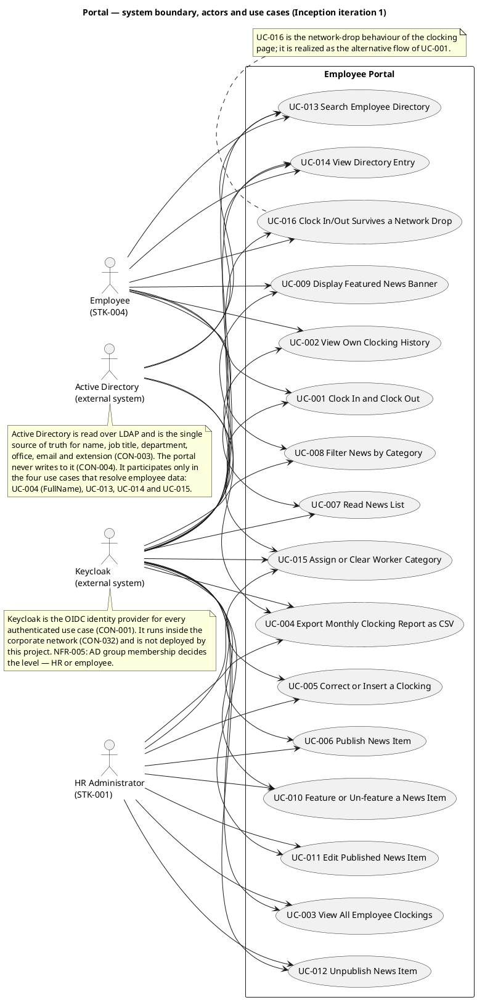
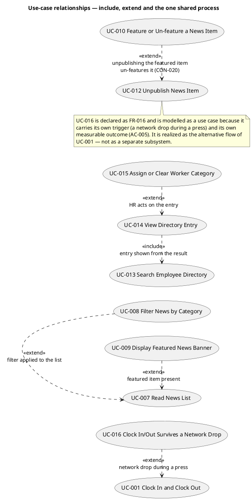
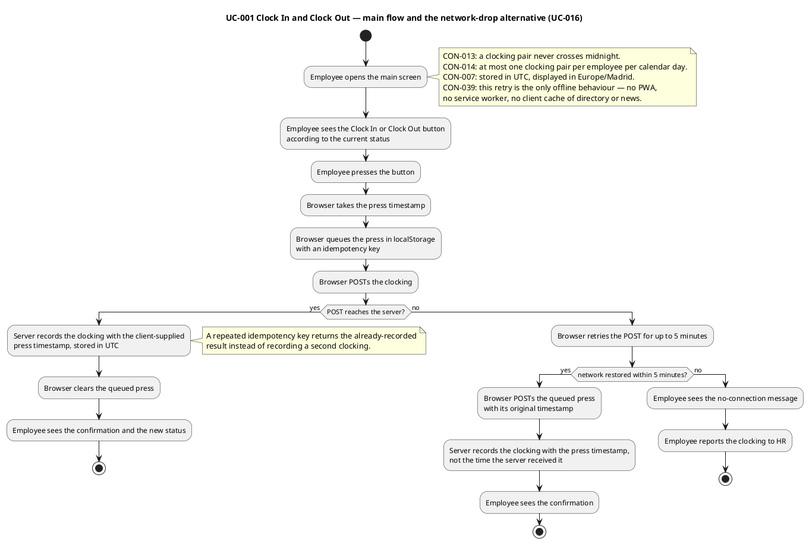
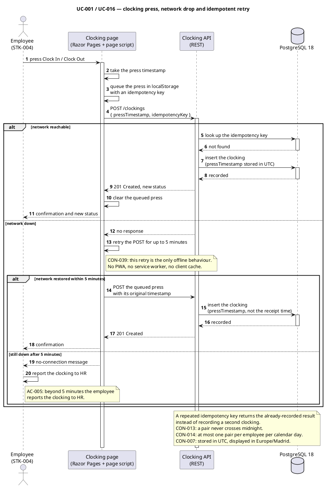
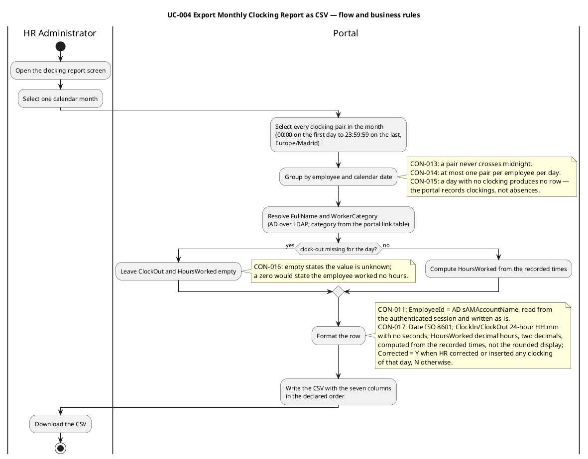
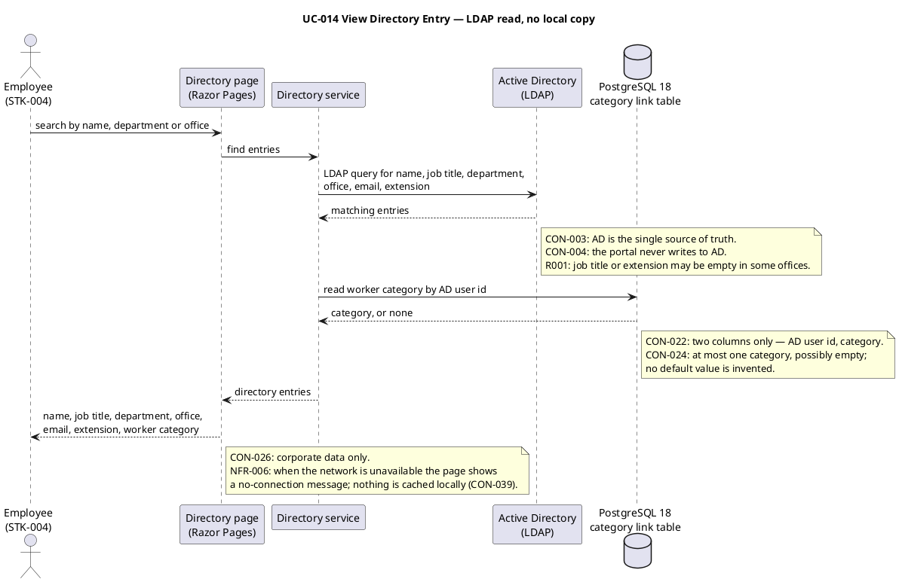
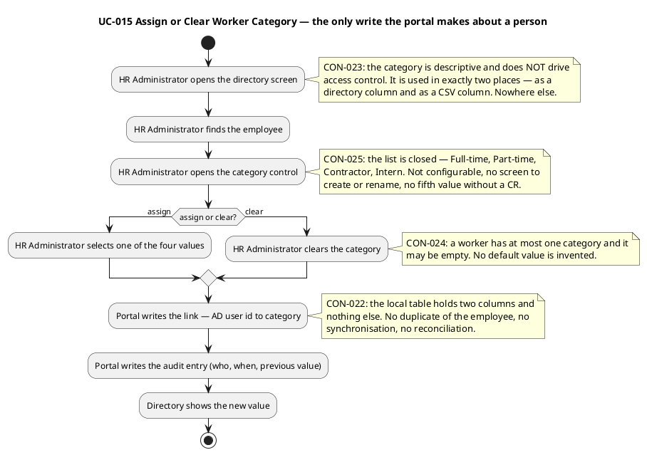
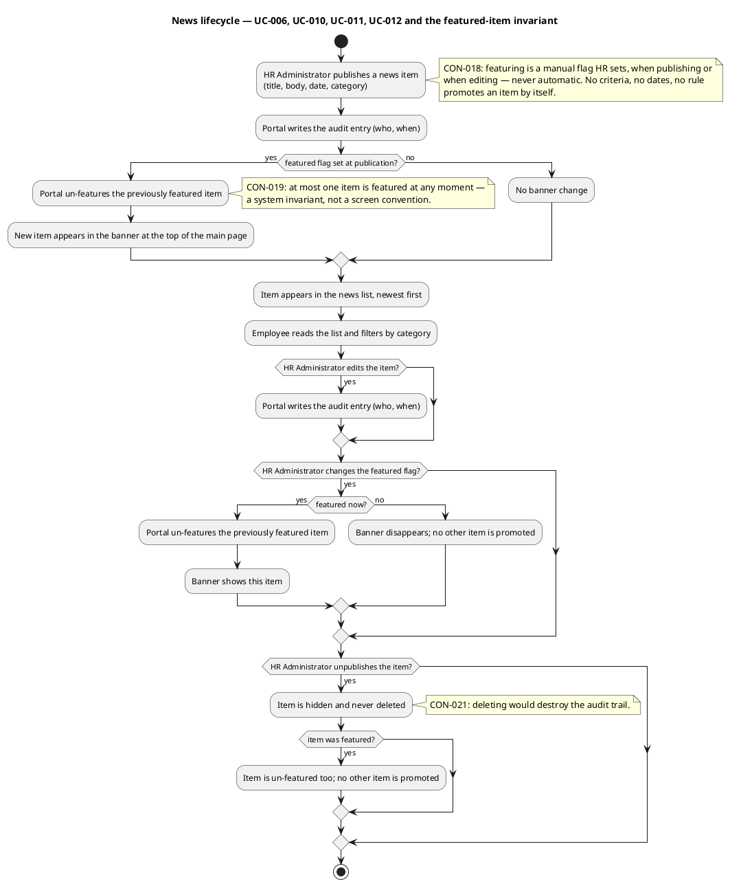

## Document Control

- Phase: Inception
- Status: Draft — iteration 1, submitted for review
- Milestone Target: End of Inception (Lifecycle Objectives) — NOT YET ACHIEVED

## Use-Case Diagram

### System boundary

**Inside the boundary.** The portal's own behaviour: recording a clocking, holding the clocking record and its corrections, publishing and presenting news, presenting the directory, holding the worker-category link, and writing the audit entries. The portal's own database (PostgreSQL 18, CON-031) is inside.

**On the boundary.** Two external systems the portal depends on and does not build: Active Directory, read over LDAP and never written (CON-003, CON-004), and Keycloak, the OIDC identity provider that federates AD (CON-001). Keycloak is external to the project but **inside the corporate network** (CON-032) — the OIDC redirect is an intra-network call and login works with no internet link.

**Outside the boundary, and declared out of scope.** The payroll system, the vacation/sick-leave system, the historical Excel archive on the shared drive (CON-036), and any native mobile app or PWA (CON-039). The full exclusion list is published in the Vision under "Not in scope".

**No time-trigger actor.** No scheduled job, batch export or recurring report is declared. The CSV export is initiated by HR, not by a clock.

**No administrative actor.** NFR-004 states the audit is read directly from the database and there is no in-portal audit view screen, so no auditor or administrator actor interacts with the portal.

**Cross-cutting mechanisms are not use cases.** Authentication, authorization and the audit trail are specified in the Supplementary Specification and `<<include>>`d by the use cases that depend on them — see "Cross-cutting mechanisms" under the Use-Case Survey. No use case named "Authenticate", "Authorize" or "Log" exists, and none is to be added.

## Actors

| ID | Actor | Type | Goal in the portal | Declared source |
|---|---|---|---|---|
| ACT-001 | Employee | Human, primary | Clock in and out, see their own month, read and filter news, find a colleague | STK-004 |
| ACT-002 | HR Administrator | Human, primary | See all clockings, export a month, correct or insert a clocking, publish/edit/unpublish/feature news, assign or clear a worker category | STK-001 |
| ACT-003 | Active Directory | External system, supporting | Supply name, job title, department, office, email and extension over LDAP; supply the AD group membership that decides the authorization level | CON-003, NFR-005 |
| ACT-004 | Keycloak | External system, supporting | Authenticate the user and return the identity and group claims the portal authorizes on | CON-001, CON-032 |

ACT-001 and ACT-002 are the same person in different roles: NFR-005 derives the level from AD group membership, so an HR group member is an HR Administrator and everybody else is an Employee. There is no third level and no role matrix.

## Use-Case Survey

Every use case below realizes a declared requirement. The `Source` column carries the declared `FR-NNN` identifier copied exactly.

| UC | Name | Primary actor | Source | Priority | Volatility | Detail in this iteration |
|---|---|---|---|---|---|---|
| UC-001 | Clock In and Clock Out | ACT-001 Employee | FR-001 | Must | Low | Detailed |
| UC-002 | View Own Clocking History | ACT-001 Employee | FR-002 | Must | Low | Outline |
| UC-003 | View All Employee Clockings | ACT-002 HR Administrator | FR-003 | Must | Low | Outline |
| UC-004 | Export Monthly Clocking Report as CSV | ACT-002 HR Administrator | FR-004 | Must | Medium | Detailed |
| UC-005 | Correct or Insert a Clocking | ACT-002 HR Administrator | FR-005 | Must | Low | Outline |
| UC-006 | Publish News Item | ACT-002 HR Administrator | FR-006 | Must | Low | Outline |
| UC-007 | Read News List | ACT-001 Employee | FR-007 | Must | Low | Outline |
| UC-008 | Filter News by Category | ACT-001 Employee | FR-008 | Must | Low | Outline |
| UC-009 | Display Featured News Banner | ACT-001 Employee | FR-009 | Must | Low | Outline |
| UC-010 | Feature or Un-feature a News Item | ACT-002 HR Administrator | FR-010 | Must | Low | Outline |
| UC-011 | Edit Published News Item | ACT-002 HR Administrator | FR-011 | Must | Low | Outline |
| UC-012 | Unpublish News Item | ACT-002 HR Administrator | FR-012 | Must | Low | Outline |
| UC-013 | Search Employee Directory | ACT-001 Employee | FR-013 | Must | Medium | Outline |
| UC-014 | View Directory Entry | ACT-001 Employee | FR-014 | Must | Medium | Detailed |
| UC-015 | Assign or Clear Worker Category | ACT-002 HR Administrator | FR-015 | Must | Low | Detailed |
| UC-016 | Clock In/Out Survives a Network Drop | ACT-001 Employee | FR-016 | Must | Medium | Detailed |

**Priority.** All sixteen are `Must`. The scope statement's "Includes" list declares every one of them, and no declared item is optional — so no Should/Could split is invented here. A reduction in scope is a Change Request, not a priority decision taken in this artifact.

**Volatility.** `Medium` marks the four use cases where a future change is plausible without a change of business: UC-004 (the export is the artifact HR hands to other processes, so its column set is the most likely place for a request to land), UC-013 and UC-014 (R001 — job title and extension may not be filled consistently across the three offices), and UC-016 (the retry window is a declared parameter). The remaining twelve are `Low`: their behaviour is fixed by a declared business rule. Volatility is annotated so the Software Architect can encapsulate the volatile behaviour rather than let it spread.

**Detail level.** Inception details the architecturally significant use cases only. UC-001, UC-004, UC-014 and UC-015 are detailed below because each forces a decision the architecture must carry: the client-supplied timestamp and idempotency key, the CSV's empty-versus-zero semantics, the LDAP read with no local copy, and the two-column category link that is the portal's only write about a person. The remaining twelve are outlined and are detailed in Elaboration.

### Use-case relationships

## Use-Case Specifications

### UC-001 Clock In and Clock Out

| Field | Value |
|---|---|
| Primary actor | ACT-001 Employee |
| Source | FR-001 |
| Priority | Must |
| Volatility | Low |
| Trigger | The employee presses the Clock In or Clock Out button on the main screen. |
| Precondition | The employee is authenticated (ACT-004 Keycloak) and is on the main screen. |
| Postcondition | A clocking is recorded with the press timestamp, stored in UTC; the employee's status is inverted and the confirmation is shown. |
| Related rules | CON-007, CON-013, CON-014, CON-039 |

**Main flow**

1. The employee opens the main screen.
2. The portal shows one button whose label follows the employee's current status — Clock In when no open clocking exists for today, Clock Out when one does.
3. The employee presses the button.
4. The browser takes the press timestamp and queues the press in localStorage with an idempotency key.
5. The browser POSTs the clocking.
6. The server records the clocking with the client-supplied press timestamp, stored in UTC.
7. The browser clears the queued press and the employee sees the confirmation and the new status.

**Alternative flows**

- **A1 — Network drop during the press (UC-016, FR-016).** The POST does not reach the server. The browser retries for up to 5 minutes. If the network returns, the queued press is POSTed with its original timestamp and the server records the press time, not the receipt time. If it does not return within 5 minutes, the employee sees the no-connection message and reports the clocking to HR (AC-005).
- **A2 — Repeated press with the same idempotency key.** The server returns the already-recorded result instead of recording a second clocking.
- **A3 — A second pair attempted on the same calendar day.** CON-014 permits at most one clocking pair per employee per calendar day; the portal does not open a second pair.

### UC-004 Export Monthly Clocking Report as CSV

| Field | Value |
|---|---|
| Primary actor | ACT-002 HR Administrator |
| Source | FR-004 |
| Priority | Must |
| Volatility | Medium |
| Trigger | HR selects a calendar month and requests the export. |
| Precondition | HR is authenticated and is a member of the HR AD group (NFR-005). |
| Postcondition | A CSV file is produced covering 00:00 on the first day to 23:59:59 on the last day of the month, Europe/Madrid, with the seven declared columns in the declared order. |
| Related rules | CON-011, CON-013, CON-014, CON-015, CON-016, CON-017 |

**Main flow**

1. HR opens the clocking report screen and selects one calendar month.
2. The portal selects every clocking pair in that month.
3. The portal groups the pairs by employee and calendar date.
4. The portal resolves `FullName` from Active Directory and `WorkerCategory` from the portal's category link.
5. The portal computes `HoursWorked` from the recorded clocking times.
6. The portal writes the CSV with the seven columns in the declared order and HR downloads it.

**Alternative flows**

- **A1 — Clock-out missing for a day.** The row is still exported, with `ClockOut` and `HoursWorked` empty (CON-016). A zero would state the employee worked no hours, which is false.
- **A2 — A day with no clocking.** No row is produced — a weekend, a holiday, a sick day or a day before the employee joined (CON-015). The portal records clockings, not absences.
- **A3 — A day HR corrected or inserted.** `Corrected` is `Y`; otherwise `N` (CON-017).
- **A4 — An employee with no category assigned.** The row is exported with `WorkerCategory` blank; no default value is invented (CON-024).

### UC-014 View Directory Entry

| Field | Value |
|---|---|
| Primary actor | ACT-001 Employee |
| Source | FR-014 |
| Priority | Must |
| Volatility | Medium |
| Trigger | The employee opens a directory entry from a search result. |
| Precondition | The employee is authenticated and the corporate network is reachable. |
| Postcondition | The entry shows name, job title, department, office, email, extension phone number and worker category. |
| Related rules | CON-003, CON-004, CON-022, CON-024, CON-026, NFR-006, R001 |

**Main flow**

1. The employee opens a directory entry.
2. The portal reads name, job title, department, office, email and extension from Active Directory over LDAP.
3. The portal reads the worker category from its own category link, keyed by AD user id.
4. The portal renders the seven fields.

**Alternative flows**

- **A1 — Job title or extension empty in AD (R001).** The field renders empty. No value is invented and no placeholder is substituted.
- **A2 — No category assigned.** The category field renders blank (CON-024).
- **A3 — Network unavailable.** The page shows the no-connection message (NFR-006). Nothing is cached locally (CON-039).

### UC-015 Assign or Clear Worker Category

| Field | Value |
|---|---|
| Primary actor | ACT-002 HR Administrator |
| Source | FR-015 |
| Priority | Must |
| Volatility | Low |
| Trigger | HR assigns or clears a worker's category from the directory screen. |
| Precondition | HR is authenticated and is a member of the HR AD group (NFR-005). |
| Postcondition | The category link is written or cleared, the change is audited, and the directory shows the new value. |
| Related rules | CON-022, CON-023, CON-024, CON-025, NFR-004 |

**Main flow**

1. HR opens the directory screen and finds the employee.
2. HR opens the category control, which offers the four closed values.
3. HR selects one value, or clears the category.
4. The portal writes the link — AD user id to category.
5. The portal writes the audit entry: who, when, previous value.
6. The directory shows the new value.

**Alternative flows**

- **A1 — Clearing the category.** The link is removed; the employee still appears in the directory and in the export with the field blank (CON-024).
- **A2 — A fifth value requested.** Not available. The list is closed and fixed for this project; a fifth value requires a Change Request (CON-025).

### UC-002 View Own Clocking History

| Field | Value |
|---|---|
| Primary actor | ACT-001 Employee |
| Source | FR-002 |
| Priority | Must |
| Volatility | Low |
| Trigger | The employee opens their own clocking history. |
| Precondition | The employee is authenticated. |
| Postcondition | The employee's own clockings for the current month are shown. |
| Main flow | 1. The employee opens the history view. 2. The portal selects the employee's own clockings for the current month. 3. The portal shows them, with times displayed in Europe/Madrid (CON-007). |
| Alternative flow | A1 — A day with a missing clock-out is shown as an incomplete day (CON-013). |
| Related rules | CON-007, CON-013 |

### UC-003 View All Employee Clockings

| Field | Value |
|---|---|
| Primary actor | ACT-002 HR Administrator |
| Source | FR-003 |
| Priority | Must |
| Volatility | Low |
| Trigger | HR opens the all-employee clocking view. |
| Precondition | HR is authenticated and is a member of the HR AD group (NFR-005). |
| Postcondition | The clockings of all employees are shown. |
| Main flow | 1. HR opens the view. 2. The portal selects the clockings of all employees. 3. The portal shows them, with times displayed in Europe/Madrid (CON-007). |
| Related rules | CON-007, NFR-005 |

### UC-005 Correct or Insert a Clocking

| Field | Value |
|---|---|
| Primary actor | ACT-002 HR Administrator |
| Source | FR-005 |
| Priority | Must |
| Volatility | Low |
| Trigger | HR corrects or inserts a clocking on behalf of an employee who forgot to clock out. |
| Precondition | HR is authenticated and is a member of the HR AD group (NFR-005). |
| Postcondition | The correction is recorded and audited; the original record is neither overwritten in place nor deleted. |
| Main flow | 1. HR opens the clocking of the employee and the day. 2. HR enters the corrected or inserted value and a free-text reason. 3. The portal records the correction as a new record, leaving the original intact. 4. The portal writes the audit entry: who, when, previous value, reason. |
| Alternative flow | A1 — The day is marked `Corrected = Y` in the CSV export (CON-017). |
| Related rules | CON-012, CON-017, NFR-004 |

### UC-006 Publish News Item

| Field | Value |
|---|---|
| Primary actor | ACT-002 HR Administrator |
| Source | FR-006 |
| Priority | Must | 
| Volatility | Low |
| Trigger | HR publishes an internal news item or announcement. |
| Precondition | HR is authenticated and is a member of the HR AD group (NFR-005). |
| Postcondition | The item is published with title, body, date and category, and the publication is audited. |
| Main flow | 1. HR enters title, body, date and category. 2. HR optionally sets the featured flag (UC-010). 3. The portal publishes the item. 4. The portal writes the audit entry: author and timestamp. |
| Related rules | CON-018, NFR-004 |

### UC-007 Read News List

| Field | Value |
|---|---|
| Primary actor | ACT-001 Employee |
| Source | FR-007 |
| Priority | Must |
| Volatility | Low |
| Trigger | The employee opens the main page. |
| Precondition | The employee is authenticated and the corporate network is reachable. |
| Postcondition | The published news is shown sorted by date, newest first, read-only. |
| Main flow | 1. The employee opens the main page. 2. The portal selects the published items. 3. The portal shows them newest first. |
| Alternative flow | A1 — Network unavailable: the no-connection message is shown (NFR-006). |
| Related rules | CON-021, NFR-006 |

### UC-008 Filter News by Category

| Field | Value |
|---|---|
| Primary actor | ACT-001 Employee |
| Source | FR-008 |
| Priority | Must |
| Volatility | Low |
| Trigger | The employee selects a category filter on the news list. |
| Precondition | The news list is shown. |
| Postcondition | Only the items of the selected category are shown. |
| Main flow | 1. The employee selects one of General, HR, IT, Events. 2. The portal filters the list to that category. |
| Related rules | FR-008 (the four categories are declared) |

### UC-009 Display Featured News Banner

| Field | Value |
|---|---|
| Primary actor | ACT-001 Employee |
| Source | FR-009 |
| Priority | Must |
| Volatility | Low |
| Trigger | The employee opens the main page. |
| Precondition | The employee is authenticated. |
| Postcondition | The featured item appears with a banner at the top of the main page, or no banner appears when no item is featured. |
| Main flow | 1. The employee opens the main page. 2. The portal reads the featured item. 3. If one exists, the portal renders the banner above the list; if none exists, no banner is rendered. |
| Related rules | CON-019, CON-020 |

### UC-010 Feature or Un-feature a News Item

| Field | Value |
|---|---|
| Primary actor | ACT-002 HR Administrator |
| Source | FR-010 |
| Priority | Must |
| Volatility | Low |
| Trigger | HR sets or clears the featured flag, when publishing or when editing. |
| Precondition | HR is authenticated and is a member of the HR AD group (NFR-005). |
| Postcondition | At most one item is featured; featuring one un-features the previous one; HR may leave none featured. |
| Main flow | 1. HR sets the featured flag on an item. 2. The portal un-features the previously featured item. 3. The portal marks the new item featured. |
| Alternative flow | A1 — HR clears the flag: the banner disappears and no other item is promoted (CON-019). |
| Related rules | CON-018, CON-019 |

### UC-011 Edit Published News Item

| Field | Value |
|---|---|
| Primary actor | ACT-002 HR Administrator |
| Source | FR-011 |
| Priority | Must |
| Volatility | Low |
| Trigger | HR edits a news item after publishing. |
| Precondition | HR is authenticated and is a member of the HR AD group (NFR-005). |
| Postcondition | The item is updated and the edit is audited with who and when. |
| Main flow | 1. HR opens the published item. 2. HR changes the content. 3. The portal saves the change. 4. The portal writes the audit entry: who and when. |
| Related rules | NFR-004 |

### UC-012 Unpublish News Item

| Field | Value |
|---|---|
| Primary actor | ACT-002 HR Administrator |
| Source | FR-012 |
| Priority | Must |
| Volatility | Low |
| Trigger | HR unpublishes a news item. |
| Precondition | HR is authenticated and is a member of the HR AD group (NFR-005). |
| Postcondition | The item is hidden and never deleted; the unpublish is audited. |
| Main flow | 1. HR unpublishes the item. 2. The portal hides it. 3. The portal writes the audit entry: who and when. |
| Alternative flow | A1 — The item was featured: it is un-featured too, the banner disappears and no other item is promoted (CON-020). |
| Related rules | CON-020, CON-021, NFR-004 |

### UC-013 Search Employee Directory

| Field | Value |
|---|---|
| Primary actor | ACT-001 Employee |
| Source | FR-013 |
| Priority | Must |
| Volatility | Medium |
| Trigger | The employee searches for a colleague. |
| Precondition | The employee is authenticated and the corporate network is reachable. |
| Postcondition | Matching colleagues are listed. |
| Main flow | 1. The employee enters a name, department or office. 2. The portal queries Active Directory over LDAP. 3. The portal lists the matching entries. |
| Alternative flow | A1 — Network unavailable: the no-connection message is shown (NFR-006). |
| Related rules | CON-003, CON-026, NFR-006, R001 |

### UC-016 Clock In/Out Survives a Network Drop

| Field | Value |
|---|---|
| Primary actor | ACT-001 Employee |
| Source | FR-016 |
| Priority | Must |
| Volatility | Medium |
| Trigger | The corporate network drops while the employee's clocking press is in flight. |
| Precondition | The employee has pressed the Clock In or Clock Out button (UC-001). |
| Postcondition | The clocking is recorded with the timestamp the employee pressed the button, or the employee is told the clocking was not recorded. |
| Main flow | 1. The press is held in the browser in localStorage with an idempotency key. 2. The browser retries the POST for up to 5 minutes. 3. When the network returns, the server records the clocking with the client-supplied press timestamp. 4. The server rejects a duplicate by its idempotency key. |
| Alternative flow | A1 — Still down after 5 minutes: the employee sees the no-connection message and reports the clocking to HR (AC-005). |
| Related rules | CON-013, CON-014, CON-039 |

**Realization note.** UC-016 is declared as FR-016 and is modelled as a use case because it carries its own trigger and its own measurable outcome (AC-005). It is realized as the alternative flow of UC-001, not as a separate subsystem: one action, one queue, one entity. Two clocking presses by the same employee cannot conflict (CON-013, CON-014), so there is nothing to reconcile and no conflict resolution to write.

### News lifecycle across UC-006, UC-010, UC-011 and UC-012

## Traceability

| Element | Traces From | Link Type | Traces To |
|---|---|---|---|
| UC-001 | FR-001 | Refines | — |
| UC-002 | FR-002 | Refines | — |
| UC-003 | FR-003 | Refines | — |
| UC-004 | FR-004 | Refines | — |
| UC-005 | FR-005 | Refines | — |
| UC-006 | FR-006 | Refines | — |
| UC-007 | FR-007 | Refines | — |
| UC-008 | FR-008 | Refines | — |
| UC-009 | FR-009 | Refines | — |
| UC-010 | FR-010 | Refines | — |
| UC-011 | FR-011 | Refines | — |
| UC-012 | FR-012 | Refines | — |
| UC-013 | FR-013 | Refines | — |
| UC-014 | FR-014 | Refines | — |
| UC-015 | FR-015 | Refines | — |
| UC-016 | FR-016 | Refines | — |
