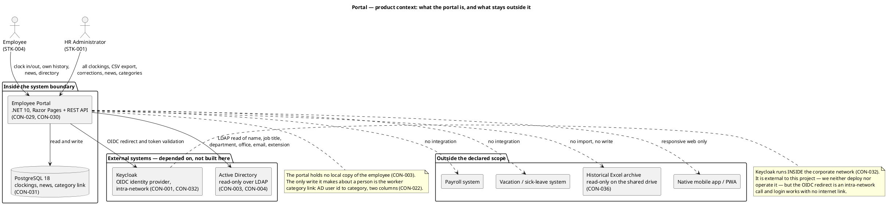
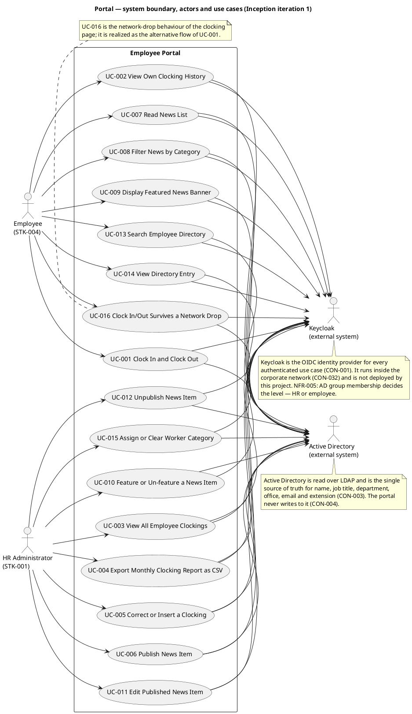

## Document Control

- Phase: Inception
- Status: Draft — iteration 1, submitted for review
- Milestone Target: End of Inception (Lifecycle Objectives) — NOT YET ACHIEVED

## Problem Statement

| Aspect | Statement |
|---|---|
| The problem | Cuba Corp's employee processes are carried by tools that were never designed to hold them: shared Excel sheets for clockings, mass emails for announcements, and an outdated PDF for the phone directory. |
| Root cause | There is no system of record. A clocking exists only as a row somebody typed into a spreadsheet; an announcement exists only as a message in a mailbox; a colleague's extension exists only in a document that was accurate on the day it was printed. Nothing is authoritative, so every process depends on a person remembering to maintain it. |
| Affected stakeholders | STK-001 Laura Gómez (HR Director) carries the manual effort and cannot answer a simple question — who worked when — without assembling it by hand. STK-004 Cuba Corp Employees (200 people, 3 offices) cannot see their own clocking history, cannot find a colleague's extension reliably, and receive announcements mixed into ordinary mail. STK-003 Infrastructure operates the estate the portal will run on and has accepted it on stated terms. |
| Impact if unsolved | HR time is spent on transcription rather than on HR work (BG-001). Clockings recorded in spreadsheets are outside any audit trail, so a correction cannot be attributed and an original cannot be recovered (NFR-004). The directory stays stale, so AC-003 — find a colleague's phone or email in under 10 seconds — is unreachable. |
| Success criteria | Measurable, and declared: HR management time halved (BG-001); no new clocking recorded in a spreadsheet (BG-002); 80% of the 200 employees actively using the portal within three months (BG-003, AC-004); an employee clocks in and out unaided (AC-001); HR publishes news unaided (AC-002); a colleague's phone or email found in under 10 seconds (AC-003); a clocking made during a network drop of up to 5 minutes is not lost (AC-005). |

## Product Position Statement

| Aspect | Statement |
|---|---|
| For | Cuba Corp's 200 employees across 3 offices, and the HR function that administers them. |
| Who | Need one place to record a clocking, read an announcement and find a colleague — reachable from the corporate browser, with no training and no mobile app. |
| The product | Employee Portal is an internal web application that centralizes clock-in/out, HR-published news and the corporate directory in a single .NET 10 application on the existing Windows Server estate. |
| That | Records clockings as the system of record with an audit trail HR cannot lose, publishes news with a single featured item, and presents the directory read live from Active Directory. |
| Unlike | Shared Excel sheets, mass emails and a printed PDF — none of which is authoritative, none of which is auditable, and each of which depends on a person maintaining it by hand. |
| Our product | Makes the portal the only place a new clocking is recorded (BG-002), removes the manual transcription from HR's day (BG-001), and gives every employee the same answer to "who worked when" and "how do I reach this colleague". |

## Stakeholder Summary

| ID | Stakeholder | Role in the project | Needs from the portal | Influence |
|---|---|---|---|---|
| STK-001 | Laura Gómez | HR Director — project sponsor | Clockings that are complete and auditable without manual assembly; a monthly CSV she can hand on; news she can publish, edit, unpublish and feature herself; worker categories she can assign from the directory screen. Grants risk acceptance in advance (CON-028). | High |
| STK-002 | Miguel Torres | Software Engineer — does not build the system; clarifies engineering-related doubts for the technical roles | That the technical roles can resolve engineering questions without guessing. He is a source of clarification, not a consumer of the portal. | High |
| STK-003 | Infrastructure team | Operates Active Directory and Keycloak — both external systems the portal depends on — and operates the portal itself on the existing internal Windows Server estate | A .NET application on the estate they already run, requiring no AD modification (CON-004, CON-006); PostgreSQL 18 installed on that same estate (CON-031); placeholder configuration values they substitute at deployment (CON-035); no backup design from the project, since their existing practice already covers the instance (CON-038). | High |
| STK-004 | Cuba Corp Employees | End users — 200 people across 3 offices | Clock in and out unaided, see their own month, read and filter news, search the directory. No training, no mobile app, no offline mode beyond the clocking retry. | Medium |

## Product Overview

The portal is one web application with three functional areas, all reachable from the corporate browser on the internal network (CON-008, CON-009).

**Clocking.** The employee sees one button whose label follows their current status; pressing it records the exact time. HR sees every employee's clockings, corrects or inserts a clocking on an employee's behalf, and exports a calendar month as CSV. The original record is never overwritten in place and never deleted (CON-012).

**News.** HR publishes, edits, unpublishes and features items. Employees read the list newest-first and filter it by category. At most one item is featured at any moment (CON-019).

**Directory.** Employees search colleagues by name, department or office. Six of the seven fields shown come from Active Directory over LDAP and are read-only in the portal; the seventh — worker category — is owned by the portal and is the only write the portal makes about a person (FR-014, FR-015, CON-022).

### Not in scope

Each line below is a declared exclusion. It is published here so that no later iteration re-proposes it as a gap.

- No native mobile app (responsive web only).
- No push notifications.
- No integration with the payroll system.
- No vacation or sick-leave management (separate system).
- No biometric clocking (AD username/password only).
- No Keycloak work of any kind — no realm design, no client provisioning scripts, no Keycloak hosting, no Keycloak in the deployment diagram as something we install.
- No writing back to Active Directory and no editing of employee fields anywhere in the portal.
- No local copy of the employee — no sync job, no reconciliation screen, no conflict resolution.
- No news archive screen.
- No hard delete of a news item.
- No offline mode beyond the clocking retry — no PWA, no service worker, no installable app, no client cache of the directory or the news.
- No permission model beyond the two levels — no role matrix, no permission administration screen, no rule that reads the worker category to decide what somebody may do.
- No rule that features a news item by itself.

## Features

Every feature below traces to a declared requirement. The identifier in the first column is the declared `FR-NNN`; the Use-Case Model realizes each one as a use case.

### Feature F-01 — Digital clocking (FR-001, FR-002, FR-016)

The employee clocks in and out from the main screen with one button whose label follows their current status, and sees their own clocking history for the current month. A press made while the network is down is held in the browser and retried for up to 5 minutes; the server accepts the timestamp the client sends — the time the employee pressed the button — and rejects duplicates by an idempotency key.

**Success criteria:** AC-001 (an employee clocks in and out without help from HR or the development team); AC-004 (80% of employees complete at least one clocking with no prior training); AC-005 (a clocking made while the network is down for up to 5 minutes is not lost). Measured against BG-002 — no new clocking is recorded in a spreadsheet.

**Volatility: Low.** The clocking act itself is fixed by the business: one pair per employee per day, never crossing midnight (CON-013, CON-014). The retry window is the only parameter, and it is declared.

### Feature F-02 — HR clocking administration and export (FR-003, FR-004, FR-005)

HR views the clockings of all employees, corrects or inserts a clocking on behalf of an employee who forgot to clock out, and exports one calendar month as CSV with the seven declared columns in the declared order.

**Success criteria:** the exported file carries exactly `EmployeeId, FullName, WorkerCategory, Date, ClockIn, ClockOut, HoursWorked, Corrected` in that order (FR-004); a day whose clock-out is missing exports with `ClockOut` and `HoursWorked` empty rather than zero (CON-016); a day with no clocking produces no row (CON-015); every correction is audited with who, when, previous value and reason (NFR-004). Measured against BG-001 — HR management time halved.

**Volatility: Medium.** The column set and the formatting rules are declared and stable (CON-017), but the export is the artifact HR hands to other processes, so it is the most likely place for a future request to land. It is isolated in its own use case (UC-004) so a change to the format does not touch the clocking record.

### Feature F-03 — News publication and reading (FR-006, FR-007, FR-008, FR-011, FR-012)

HR publishes internal news and announcements with title, body, date and category, edits a published item, and unpublishes it — which hides it and never deletes it. Employees read the list on the main page sorted newest-first and filter it by category: General, HR, IT, Events.

**Success criteria:** AC-002 (an HR Administrator publishes a news item without technical assistance); every publication, edit and unpublish is audited with author and timestamp (NFR-004); an unpublished item is hidden and still present in the database (CON-021).

**Volatility: Low.** The four categories are a closed list declared by the stakeholder (FR-008) and the audit obligation is fixed by NFR-004.

### Feature F-04 — Featured news banner (FR-009, FR-010)

HR sets the featured flag manually when publishing or when editing, and can un-feature the current item and leave none featured. The featured item appears with a banner at the top of the main page; when no item is featured, the banner does not appear.

**Success criteria:** at most one item is featured at any moment — featuring one un-features the previous one, and this holds wherever the change comes from (CON-019); unpublishing the featured item un-features it and promotes no other item (CON-020); no rule promotes an item by itself (CON-018).

**Volatility: Low.** The mechanism is a manual flag with a system invariant, and the stakeholder has explicitly excluded any automatic promotion.

### Feature F-05 — Corporate directory (FR-013, FR-014)

The employee searches for colleagues by name, department or office. Each entry shows name, job title, department, office, email, extension phone number and worker category.

**Success criteria:** AC-003 (any employee finds a colleague's phone or email in under 10 seconds); the first six fields come from Active Directory over LDAP and are read-only in the portal (CON-003); the directory shows corporate data only (CON-026); when the network is unavailable the page shows a no-connection message and nothing is cached locally (NFR-006, CON-039).

**Volatility: Medium.** The field set is declared, but R001 records that job title and extension may not be filled consistently across the three offices — the directory must render an entry whose job title or extension is empty without inventing a value.

### Feature F-06 — Worker category management (FR-015)

HR assigns or clears a worker's category from the directory screen itself. This is the only write the portal makes about a person, and it is audited.

**Success criteria:** the category is stored as a link — AD user id to category — in a table of two columns and nothing else (CON-022); a worker has at most one category and it may be empty, with no default value invented (CON-024); the four values are Full-time, Part-time, Contractor, Intern and are not configurable (CON-025); the category does not drive access control and is used only as a directory column and a CSV column (CON-023); every change is audited (NFR-004).

**Volatility: Low.** The list is closed and fixed for this project, and the stakeholder has excluded any per-category permission rule.

### Feature F-07 — Two-level authorization (NFR-005)

Members of the HR AD group publish, edit and unpublish news and manage worker categories; everybody else is an employee with read access to the directory and the news, plus their own clockings.

**Success criteria:** the level is derived from AD group membership through Keycloak (CON-001, NFR-005); there is no role matrix, no permission screen and no per-category rule.

**Volatility: Low.** The two levels are declared and the stakeholder has explicitly excluded a permission model beyond them.

## Assumptions and Dependencies

| ID | Type | Statement |
|---|---|---|
| CON-002 | Dependency | The portal's OIDC client is already registered in Keycloak and its credentials are with the development team. Login can be tested from day one — no request to raise, no queue to wait on and no gate. |
| CON-035 | Dependency | The team builds and tests against stand-ins it controls — a test OIDC issuer and a test directory carrying the declared attributes, including entries whose job title or extension is empty. Validation against the real Keycloak and the real AD is done by people (Infrastructure, with HR) and its feedback reaches the team before Elaboration closes. |
| CON-037 | Dependency | The custom design at `docs/inputs/employee-portal-design.html` is mandatory and authoritative for the UI visual layer, not only its structure. It is committed to the repository with the project inputs. |
| CON-038 | Dependency | The Infrastructure team's existing server-backup practice already covers this PostgreSQL instance in restorable form, confirmed in writing with a verified restore test. No backup design, tooling or restore procedure is part of this project. |
| CON-036 | Assumption | There is no data migration. The portal starts empty and records clockings from go-live onwards; the historical Excel sheets stay on the shared drive as a read-only archive. |
| CON-007 | Assumption | All three offices are in the same timezone (Europe/Madrid). Clockings are stored in UTC and displayed in Europe/Madrid. There is no multi-timezone case and no normalisation to design. |
| CON-010 | Assumption | No external compliance regime applies to the audit trail and no retention period is mandated; HR or Infrastructure read it ad hoc from the database. |
| CON-028 | Assumption | Risk acceptance is granted in advance by Laura Gómez for R001, R002 and every risk the team identifies whose mechanism is set by these constraints or lies outside the team's control, provided the treatment never cuts or defers declared scope. If the human validation of the real Keycloak and AD delays a milestone, the remedy is another iteration. |
| R001 | Risk | The LDAP attributes the directory reads may not be filled consistently across the 3 offices (job title, extension). If not tested early the directory shows gaps. P=3, I=3, exposure=9. |
| R002 | Risk | Some employees may keep using Excel out of habit if the change is not communicated well. P=3, I=2, exposure=6. |

## Constraints

| ID | Category | Constraint |
|---|---|---|
| CON-001 | Technical | Authentication: the portal is an OIDC client of the existing Keycloak, which federates Active Directory. Keycloak is not ours to deploy. |
| CON-003 | Technical | Active Directory is the single source of truth for employee data (name, job title, department, office, email, extension). The portal reads it over LDAP and holds no local copy; those fields are read-only in the portal. |
| CON-004 | Operational | Infrastructure must not be asked to modify Active Directory. |
| CON-005 | Technical | The portal is a .NET application deployed on the internal Windows Server estate that Infrastructure already runs. |
| CON-006 | Operational | Infrastructure has accepted operating the portal on the basis that it is a .NET application on the existing Windows Server estate and requires no AD modification. |
| CON-008 | Environmental | The portal is accessible only from the internal corporate network. |
| CON-009 | Technical | Compatibility: current Chrome and Edge on the corporate browsers. |
| CON-029 | Technical | Backend: .NET 10, REST API. |
| CON-030 | Technical | Frontend: Razor Pages (intranet, no SPA needed). 'No SPA' means no client-side framework and no client-side router — it does not mean no JavaScript. A page-level script on an already-rendered page is Razor Pages as normal, and the clocking page needs one. |
| CON-031 | Technical | Database: PostgreSQL 18 — the latest stable major at project start; the patch level floats, the major is pinned. The Infrastructure team installs it on the same Windows Server estate they already operate. |
| CON-032 | Technical | Keycloak runs INSIDE the corporate network. It is the company's internal identity provider, deployed on the internal estate Infrastructure operates alongside Active Directory, and internal applications authenticate against it. External to this project is not the same as external to the network: the OIDC redirect is an intra-network call, nothing about login crosses the corporate boundary, and login keeps working with no internet link. |
| CON-033 | Operational | CI: the repository lives on the hosted SCM provider this workspace is configured with, so build and test run on that provider's hosted CI. 'No cloud' and 'internal network only' govern the portal at runtime, not the development toolchain. CI never holds production data or credentials, and never deploys: Infrastructure does. |
| CON-034 | Operational | AI token spend: there is no budget or cap on token spend for this project, and none is to be set by the team. Each iteration's measured spend is recorded and used to forecast the next; declared scope is never cut or deferred to fit an estimate. |
| CON-039 | Technical | No offline mode beyond the clocking retry: no PWA, no service worker, no installable app, and no client cache of the directory or the news. |
| CON-011 | BusinessRule | EmployeeId in the CSV export is the AD sAMAccountName (network login). It is the only identifier guaranteed to be populated and unique in all three offices. The portal reads it from the authenticated session and writes it as-is. There is no mapping table. |
| CON-012 | BusinessRule | Only HR corrects or inserts a clocking. The original record is never overwritten in place and never deleted. There is no self-service correction screen for the employee. |
| CON-013 | BusinessRule | A clocking pair never crosses midnight. A pair belongs to one calendar date and every export row is keyed by that date. A clocking still open at midnight is an incomplete day. |
| CON-014 | BusinessRule | At most one clocking pair per employee per calendar day. |
| CON-015 | BusinessRule | The CSV export contains one row per employee per day that has at least one clocking. A day with no clocking produces no row: the portal records clockings, not absences. |
| CON-016 | BusinessRule | A day whose clock-out is missing exports with ClockOut and HoursWorked empty. The row is still exported. A zero would state that the employee worked no hours, which is false; empty states that the value is unknown, which is true. |
| CON-017 | BusinessRule | CSV export formats: Date in ISO 8601; ClockIn and ClockOut as 24-hour HH:mm with no seconds; HoursWorked in decimal hours with two decimals, computed from the recorded clocking times — not from the minute-rounded values shown — and empty when the clock-out is missing; Corrected is Y when HR corrected or inserted any clocking of that day, N otherwise. |
| CON-018 | BusinessRule | Featuring a news item is a manual flag HR sets, when publishing or when editing — never automatic. There are no criteria, no dates and no rules that promote a news item by themselves. |
| CON-019 | BusinessRule | At most one news item is featured at any moment: featuring one un-features the previous one. This is a system invariant, not a screen convention — it must hold wherever the change comes from. HR can un-feature the current item and leave none featured. |
| CON-020 | BusinessRule | Unpublishing the featured news item un-features it too: the banner disappears and no other item is promoted to take its place. |
| CON-021 | BusinessRule | Unpublishing a news item hides it and never deletes it; deleting would destroy the audit trail. |
| CON-022 | Architectural | The worker category is stored as a link — AD user id → category — never as a duplicate of the employee. The local table holds two columns and nothing else. There is no synchronisation, no reconciliation and no conflict to resolve: employee data has exactly one home. |
| CON-023 | BusinessRule | The worker category is descriptive and does NOT drive access control. It is used in exactly two places: as a column of the directory (which also filters by it) and as a column of the CSV export. Nowhere else. |
| CON-024 | BusinessRule | A worker has at most one category and it may be empty. An employee with no category assigned still appears in the directory and in the export, with that field blank. No default value is invented for it. |
| CON-025 | BusinessRule | Worker categories are a closed list of exactly four values, fixed for this project: Full-time, Part-time, Contractor, Intern. They are not configurable, there is no screen to create or rename them, and no fifth value is added without a Change Request. |
| CON-026 | BusinessRule | The directory shows corporate data only — no private personal information. |
| CON-027 | Operational | Risk register convention: R001 and R002 are the business's declared risks, carried with their identifiers and magnitudes as declared. A risk the team identifies is adopted as a first-class risk and numbered in the same series (R003 onwards, in the order raised). |
| CON-028 | Operational | Risk acceptance granted in advance by Laura Gómez (project sponsor): R001, R002 and every risk the team identifies whose mechanism is set by these constraints or lies outside the team's control and that cannot be transferred, are accepted — provided the treatment never cuts or defers declared scope. The availability, configuration and ownership of Keycloak and AD are not risks of this project and are not registered. |
| CON-035 | Operational | How the team works with Keycloak and AD: against stand-ins, never against the real ones. Placeholder values held in configuration and never in code; Infrastructure puts the real values in at deployment. |
| CON-036 | Operational | Data migration: there is none. The portal starts empty and records clockings from go-live onwards. |
| CON-037 | Technical | The custom design at `docs/inputs/employee-portal-design.html` is MANDATORY and authoritative for the UI visual layer, not only for its structure. The portal MUST implement it. |
| CON-038 | Operational | Backups: the Infrastructure team's existing server-backup practice already covers this PostgreSQL instance in restorable form. No backup design, tooling or restore procedure is part of this project. |

## Other Product Requirements

### Non-functional requirements

| ID | Category | Requirement | Threshold |
|---|---|---|---|
| NFR-001 | Performance | Any page must load in under 3 seconds on the corporate network. | < 3 s per page load |
| NFR-002 | Performance | The clock in/out operation must respond in under 1 second. | < 1 s per clocking operation |
| NFR-003 | Reliability | The portal must be available Monday–Friday 7:00–19:00 with fault tolerance within the corporate network. 24/7 availability is not required. | Available Mon–Fri 07:00–19:00 |
| NFR-004 | Functionality / Audit | Mandatory traceability of: who publishes each news item, who edits it and who unpublishes it (author + timestamp in every case); any change to a worker's category; and every clocking HR corrects or inserts (who, when, previous value, reason). Employee fields are read-only from AD, so there is nothing to audit there. The audit is written for compliance and read directly from the database; there is no in-portal audit view screen. | Every listed event carries author + timestamp; corrections also carry previous value + reason |
| NFR-005 | Functionality / Security | Two-level authorization from Active Directory groups: members of the HR AD group publish, edit and unpublish news and manage worker categories; everybody else is an employee with read access to the directory and the news, plus their own clockings. There is no role matrix, no permission screen and no per-category rule. | Exactly two levels, derived from AD group membership |
| NFR-006 | Usability | The directory and the news require the network and show a 'no connection' message when it is unavailable. Nothing is copied locally, so there is nothing to cache and nothing to sync. | No-connection message shown; no local copy |

### Acceptance criteria

| ID | Criterion |
|---|---|
| AC-001 | An employee can clock in and out without help from HR or the development team. |
| AC-002 | An HR Administrator can publish a news item without technical assistance. |
| AC-003 | Any employee finds a colleague's phone/email in under 10 seconds. |
| AC-004 | 80% of employees complete at least one clocking with no prior training. |
| AC-005 | A clocking made while the corporate network is down for up to 5 minutes is not lost. Beyond 5 minutes the employee reports the clocking to HR. |

### Business goals

| ID | Goal | Measure |
|---|---|---|
| BG-001 | Reduce HR management time by 50% | The time HR spends managing employee processes is halved. |
| BG-002 | Eliminate 100% of Excel usage for recording new clockings | No new clocking is recorded in a spreadsheet; the portal becomes the only place clockings are recorded. |
| BG-003 | 80% employee adoption within 3 months | 80% of the 200 employees actively using the portal within three months of launch. |
