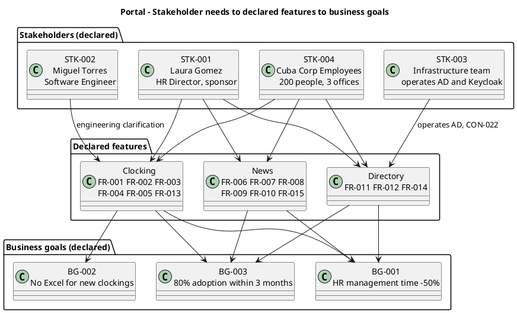

## Document Control
- **Phase:** Inception
- **Status:** Draft — iteration 3, submitted for review
- **Milestone Target:** End of Inception (not yet achieved)

## Problem Statement
Cuba Corp's HR administration runs on three disconnected manual artifacts: shared Excel sheets for
clocking, mass emails for news, and an outdated PDF phone list. Each artifact is maintained by hand,
each has a different owner, and none of them is authoritative.

**Root cause.** The organization has no single authenticated internal application. The data needed to
build one already exists — Active Directory holds every employee's identity, name, job title,
department, office, email and extension, and Keycloak already federates it — but none of it is
exposed to employees, and nothing records attendance at all. The gap is not missing data; it is a
missing application over data the organization already owns.

**Affected stakeholders.**

| Stakeholder | What the problem costs them today |
|---|---|
| STK-001 Laura Gómez, HR Director | Manual clocking administration, manual news distribution, manual directory upkeep — the three activities BG-001 targets for a 50% reduction |
| STK-004 Cuba Corp Employees | No reliable record of their own hours; no fast way to find a colleague's phone or email; news arrives as email they cannot filter or search |
| STK-003 Infrastructure team | Operates the identity and directory estate that the portal will consume; carries the consequence of any solution that requires modifying AD (CON-022 forbids it) |

**Success criteria.** Each criterion below is either measurable now or explicitly marked as awaiting
a declared input. A criterion whose denominator does not exist is recorded as unmeasured — never as
met.

| Criterion | Measure | Source | Status |
|---|---|---|---|
| HR time on clocking, news and directory upkeep halved | 50% reduction against the current manual baseline | BG-001 | **Not yet measurable.** No baseline is declared in the scope and none has been measured. STK-001 (HR) supplies the current manual baseline for the three activities; the 50% reduction is then a post-launch comparison HR performs against that baseline. Until the baseline exists this criterion is unmeasured |
| No shared Excel sheet records a new clocking | 100% of new clockings in the portal; historical sheets stay a read-only archive | BG-002, CON-033 | Measurable — the portal is the only recording path from go-live, and CON-033 fixes the historical sheets as a read-only archive |
| Employees adopt the portal | 80% of 200 employees actively using it within 3 months of launch | BG-003 | Measurable — a post-launch population reading over a declared three-month window |
| An employee clocks in and out unaided | Completed with no help from HR or the development team | AC-001 | Measurable |
| An HR Administrator publishes news unaided | Completed with no technical assistance | AC-002 | Measurable |
| A colleague's phone or email is found fast | Found in under 10 seconds | AC-003 | Measurable |
| Clocking is learnable without training | 80% of employees complete at least one clocking with no prior training | AC-004 | Measurable — the learnability half is testable when UC-001 is implemented; the 80%-of-population half is a post-launch reading over the BG-003 window |
| A short network outage does not lose a clocking | A clocking made during an outage of up to 5 minutes is not lost | AC-005 | Measurable |
## Product Position Statement

**For** Cuba Corp's 200 employees across 3 offices and its HR department
**who** record attendance in shared Excel sheets, receive news as mass email, and look up colleagues
in an outdated PDF phone list,
**the** Employee Portal
**is** an internal web application
**that** centralizes clock-in/out with own monthly history and HR correction, HR news publishing and
reading, and a searchable employee directory — all behind the corporate identity the employee already
has,
**unlike** the three manual artifacts it replaces,
**our product** requires no new identity, no new directory and no modification to Active Directory:
it reads the corporate directory over LDAP, authenticates through the existing Keycloak OIDC client,
and owns only the two things AD does not hold — clockings and worker category.

## Stakeholder Summary

| ID | Stakeholder | Type | What they need from the portal | Influence |
|---|---|---|---|---|
| STK-001 | Laura Gómez — HR Director, project sponsor | Primary, business owner | Clocking administration that no longer needs a spreadsheet (FR-003, FR-004, FR-005); news she can publish, correct and withdraw without a developer (FR-006, FR-007, FR-008, FR-009); a directory whose worker category she controls (FR-012); an audit trail she can hand to compliance (NFR-005) | High |
| STK-002 | Miguel Torres — Software Engineer | Secondary, advisory | Does not build the system. Clarifies engineering-related doubts for the technical roles. Needs the requirements to be unambiguous enough that the technical roles do not have to ask him what the stakeholder meant | High |
| STK-003 | Infrastructure team | Secondary, external-system operator | Operates Active Directory and Keycloak, which the portal depends on. Has accepted operating the portal as a .NET app on the existing internal Windows Server estate. Requires that the portal demand **no modification to AD** (CON-022) and that it be handed over operable (CON-032) | High |
| STK-004 | Cuba Corp Employees — 200 people, 3 offices | Primary, end user | Clock in and out in one press and see their own month (FR-001, FR-002); read and filter news (FR-010); find a colleague's phone or email in under 10 seconds (FR-011, AC-003); not lose a clocking to a short network drop (FR-013) | Medium |

**Negative stakeholder — none declared.** No group is disadvantaged by this system. The one group
whose workload the portal changes without their consent is the Infrastructure team, and their
constraint (no AD modification, CON-022) is declared and honoured rather than traded away.

## Product Overview

The portal is a single internal web application with three capability areas over one authenticated
corporate identity.

**Clocking.** The employee sees one button on the main screen — Clock In or Clock Out, depending on
their current status — and pressing it records the exact time (FR-001). They can see their own
current-month history (FR-002). HR sees everyone's clockings (FR-003), exports any calendar month as
a CSV with a fixed column contract (FR-004), and corrects or inserts a clocking when an employee
forgot to press the button (FR-005). A clocking pressed while the corporate network is down is held
in the browser and retried for up to 5 minutes, carrying the time the employee pressed it rather than
the time the server received it (FR-013).

**News.** HR publishes, edits, unpublishes and features internal news (FR-006 to FR-009). Employees
read it on the main page, filter by category, and see the featured item in a banner (FR-010). Nothing
is ever deleted; unpublishing hides (FR-008, CON-014).

**Directory.** An employee searches colleagues by name, department or office and sees name, job
title, department, office, email, extension and worker category (FR-011). The first six are read from
Active Directory over LDAP and are read-only; worker category is the portal's own and HR assigns or
clears it (FR-012). When the corporate network is unavailable, the directory and the news area say so
rather than showing stale or partial results (FR-014, FR-015).

**What the portal owns.** Only two things: clockings (with their corrections and audit entries) and
the worker-category link. Everything else about a person is read from AD and never written back.

### Not in scope

The stakeholder declared the following excluded. Each line is a boundary the team must not cross, and
each is a defect if it appears in a design, a screen or a document.

- No native mobile app (responsive web only).
- No push notifications.
- No integration with the payroll system.
- No vacation or sick-leave management (separate system).
- No biometric clocking (AD username/password only).
- No Keycloak work of any kind — no realm design, no client provisioning scripts, no Keycloak hosting, no Keycloak in the deployment diagram as something we install.
- No writing back to Active Directory and no editing of employee fields anywhere in the portal.
- No local copy of the employee, no sync job, no reconciliation screen, no conflict resolution.
- No news archive screen.
- No hard delete of a news item.
- No offline mode beyond the clocking retry; no PWA, no service worker, no installable app, no client cache of the directory or the news.
- No permission model beyond the two AD-group levels; no role matrix, no permission administration screen, no rule that reads worker category to decide what somebody may do.
- No rule that features a news item by itself — no "most recent", no "most read", no expiry date on the banner.

Two further questions are deferred, not excluded: whether an accessibility target is declared, and
whether throughput is a binding concern. Neither is designed for this cycle and neither is a gap.
Both return to the stakeholder when this cycle closes.

## Features
Every feature below traces to a declared requirement. There is no feature in this Vision that the
stakeholder did not declare.

**Prioritization note.** All fifteen declared requirements are **Must**. MoSCoW is not available as a
scope-management lever on this project: CON-023 states that treatment of a risk never cuts or defers
declared scope, and the remedy for a delayed milestone is another iteration. The lever the team
actually has is iteration count, not priority. Recording everything as Must is the honest reading, and
it tells the ProjectManager where the schedule pressure will land.

**Success-criterion column.** Each cell names an independent measure — a declared acceptance
criterion, a declared constraint, or a declared business goal. A cell never restates the feature's own
requirement identifier: a criterion that repeats the requirement cannot be tested against it. Where
no declared AC or CON covers a feature, the cell states the observable check derived from the
requirement text and says so.

### Clocking

| Feature | Source | Priority | Volatility | Success criterion |
|---|---|---|---|---|
| Clock In and Clock Out — one button reflecting current status, records the exact time, confirms | FR-001 | Must | Low | AC-001, AC-004 |
| View Own Clocking History — current month, own records only | FR-002 | Must | Low | AC-001 |
| View All Employee Clockings — HR sees every employee's clockings | FR-003 | Must | Medium | BG-001 |
| Export Monthly Clocking Report as CSV — one calendar month, fixed column order, Europe/Madrid, empty clock-out exported as empty | FR-004 | Must | **High** | BG-001, BG-002 |
| Correct or Insert Clocking — HR only, audited with who, when, previous value and reason, original never overwritten | FR-005 | Must | Medium | NFR-005 |
| Retry Clocking Through a Network Drop — browser-held press, retried up to 5 minutes, client timestamp accepted, idempotency key rejects duplicates | FR-013 | Must | Medium | AC-005 |

### News

| Feature | Source | Priority | Volatility | Success criterion |
|---|---|---|---|---|
| Publish News — title, body, date, category from the closed four-value list | FR-006 | Must | Low | AC-002 |
| Edit Published News — audited exactly like publication | FR-007 | Must | Low | NFR-005 |
| Unpublish News — hides, never deletes | FR-008 | Must | Low | CON-014 |
| Feature or Un-feature News — manual flag, at most one featured at any moment, unpublishing the featured item promotes nothing | FR-009 | Must | **High** | CON-010, CON-019 |
| Read and Filter News — sorted by date, filter by category, featured item in a banner, read-only | FR-010 | Must | Medium | BG-003 |
| Recognize News Unavailable — "no connection" instead of stale or partial results | FR-015 | Must | Low | Observable check derived from FR-015 (no declared AC or CON covers it): with the corporate network unreachable, the news area displays a no-connection message and zero news rows — no stale item, no partial list, no cached copy |

### Directory

| Feature | Source | Priority | Volatility | Success criterion |
|---|---|---|---|---|
| Search Employee Directory — by name, department or office; seven displayed fields; no private personal information | FR-011 | Must | Medium | AC-003 |
| Assign or Clear Worker Category — HR only, closed four-value list or empty, audited | FR-012 | Must | **High** | CON-009, CON-016 |
| Recognize Directory Unavailable — "no connection" instead of stale or partial results | FR-014 | Must | Low | Observable check derived from FR-014 (no declared AC or CON covers it): with the corporate network unreachable, the directory area displays a no-connection message and zero result rows — no stale entry, no partial result set, no cached copy |

### Volatility map — input to architectural decomposition

Volatility is assessed on two axes: will this change for the same customer over time, and does this
differ across customers right now. The three High items are the ones the Software Architect must
encapsulate behind a dedicated component rather than scatter through the code.

```plantuml
@startuml
title Portal - Feature volatility map (input to architectural decomposition)

package "Volatility: Low - stable, fully specified by the stakeholder" {
  class "FR-001 Clock In and Clock Out" as L1
  class "FR-002 View Own Clocking History" as L2
  class "FR-006 Publish News" as L3
  class "FR-007 Edit Published News" as L4
  class "FR-008 Unpublish News" as L5
  class "FR-014 Directory unavailable message" as L6
  class "FR-015 News unavailable message" as L7
}

package "Volatility: Medium - stable shape, values or sources may shift" {
  class "FR-003 View All Employee Clockings" as M1
  class "FR-005 Correct or Insert Clocking" as M2
  class "FR-010 Read and Filter News" as M3
  class "FR-011 Search Employee Directory" as M4
  class "FR-013 Retry Clocking Through a Network Drop" as M5
}

package "Volatility: High - policy or format likely to change per customer or over time" {
  class "FR-004 CSV export format\ncolumn order, date and time format,\nCorrected flag semantics" as H1
  class "FR-009 Feature or Un-feature News\nsingle-featured invariant is a policy" as H2
  class "FR-012 Assign or Clear Worker Category\nclosed four-value list, CON-009" as H3
}

note right of H1
  The export contract is the most volatile
  element of the system: it is consumed by
  HR outside the portal and its column set
  is fixed by FR-004 alone.
end note

note right of H3
  CON-009 forbids a fifth value without a
  Change Request. The value set is therefore
  a configuration point, not a constant.
end note
@enduml
```

## Assumptions and Dependencies

| ID | Assumption or dependency | Consequence if it does not hold |
|---|---|---|
| CON-002 | The OIDC client is already registered in the existing Keycloak and its credentials are with the development team | No login path exists; the project cannot start |
| CON-031 | The team works against stand-ins it controls — a test OIDC issuer and a test directory carrying the declared attributes, including entries whose job title or extension is empty | The team would have to touch the real Keycloak and AD, which CON-022 and CON-031 forbid. A stand-in without the empty-attribute entries silently retires R001 without testing it |
| CON-031 | Validation against the real Keycloak and the real AD is human work by Infrastructure with HR, with feedback before Elaboration closes | The gate is bounded at 14 days of queue time; beyond that the process suspends and the ProjectManager escalates. The remedy is another iteration, not a scope cut (CON-023) |
| CON-034 | `docs/inputs/employee-portal-design.html` is committed and authoritative for the UI visual layer | The UI has no reference; the UserInterfaceDesigner would be inventing a design the stakeholder already fixed |
| CON-004 | sAMAccountName is populated and unique across all three offices | EmployeeId has no reliable source; the export and the category link both break |
| CON-035 | The Infrastructure team's existing server-backup practice covers this PostgreSQL instance in restorable form | No backup design is in scope; a gap here is an operational risk outside the project |
| CON-033 | The portal starts empty; historical Excel sheets are not imported | No migration work exists, and none may be added |
| CON-007 | All three offices are in Europe/Madrid; clockings stored in UTC, displayed in Europe/Madrid | No multi-timezone normalisation is designed |

## Constraints

The full record of all 36 constraints is the Supplementary Specification. This section states only
the ones that shape the product itself, grouped by what they decide.

| Group | Constraints | What they decide about the product |
|---|---|---|
| Platform | CON-001, CON-025, CON-026, CON-027 | A .NET 10 REST API with Razor Pages on the internal Windows Server estate, PostgreSQL 18. No SPA, no client-side router — but a page-level script on the clocking page is normal Razor Pages and is required by FR-013 |
| Identity and directory | CON-002, CON-003, CON-004, CON-022, CON-028 | The portal is an OIDC client of the existing Keycloak, which federates AD and runs **inside** the corporate network. Employee fields are read from AD over LDAP and are read-only. EmployeeId is sAMAccountName, read from the session, written as-is. No AD modification |
| Authorization | CON-008 | Exactly two levels from AD group membership: HR and everyone else. No role matrix, no permission screen |
| Data ownership | CON-021, CON-003, CON-033 | The portal owns clockings and the two-column worker-category link. It holds no copy of the employee, runs no sync, and migrates nothing |
| Business rules | CON-009 to CON-020 | Closed four-value category list; at most one featured item; a clocking pair never crosses midnight; at most one pair per employee per day; originals never overwritten or deleted; news never deleted; category is descriptive and drives no access decision; featuring is manual only |
| Environment | CON-005, CON-006, CON-007 | Current Chrome and Edge, internal network only, single timezone |
| Operations | CON-029, CON-030, CON-032, CON-035 | Hosted CI that never deploys and never holds production data; no token budget; Infrastructure operates the portal post-launch; backups are Infrastructure's existing practice |
| Risk governance | CON-023, CON-024 | R001 and R002 carried with their declared identifiers and magnitudes; team-identified risks numbered R003 onwards; risk acceptance granted in advance; Keycloak and AD availability are not project risks |
| UI | CON-034 | The committed design file is mandatory and authoritative for the visual layer, not only its structure |
| Clocking retry | CON-036 | One action, one queue, one entity. Not the sync work the scope excludes |

## Other Product Requirements

### Non-functional requirements — outline

Thresholds are quantified by the RequirementsSpecifier in the Supplementary Specification. This is
the product-level statement of what each one means.

| ID | Requirement | Product consequence |
|---|---|---|
| NFR-001 | Authenticated access via corporate credentials | Every portal function requires an authenticated corporate identity. The session supplies sAMAccountName and AD group membership, which the whole portal consumes. This is a portal-wide mechanism, not a feature of any single use case — it is a Supplementary Specification entry included by every use case, never a use case of its own |
| NFR-002 | Page load under 3 seconds | Measured as the full page load the employee experiences, including the clocking page's script. Server response time is the engineering target that makes it achievable, not a substitute for it |
| NFR-003 | Availability Monday–Friday 7:00–19:00 | Fault tolerance within the corporate network. 24/7 is not required and must not be designed for |
| NFR-004 | Clock in/out response under 1 second | The one operation with a sub-second target |
| NFR-005 | Audit trail for compliance | Who publishes, edits and unpublishes each news item; any change to a worker's category; every clocking HR corrects or inserts, with who, when, previous value and reason. Written for compliance and read directly from the database — no in-portal audit view screen. No external compliance regime applies and no retention period is mandated |

### Acceptance criteria

| ID | Criterion | Verifies |
|---|---|---|
| AC-001 | An employee can clock in and out without help from HR or the development team | FR-001 |
| AC-002 | An HR Administrator can publish a news item without technical assistance | FR-006 |
| AC-003 | Any employee finds a colleague's phone/email in under 10 seconds | FR-011 |
| AC-004 | 80% of employees complete at least one clocking with no prior training | FR-001 |
| AC-005 | A clocking made while the corporate network is down for up to 5 minutes is not lost | FR-013 |

### Declared risks carried into the product

| ID | Risk | Product consequence |
|---|---|---|
| R001 | P=3, I=3, exposure=9 — the LDAP attributes the directory reads may not be filled consistently across the 3 offices (job title, extension) | The directory must render an entry whose job title or extension is empty without breaking the row or hiding the employee. The stand-in directory must carry such entries (CON-031) or the risk is retired untested |
| R002 | P=3, I=2, exposure=6 — some employees may keep using Excel out of habit if the change is not communicated well | The clocking interaction must be one press with an obvious confirmation (FR-001), and the portal must be learnable with no training (AC-004). This is a product requirement, not only a communication task |
