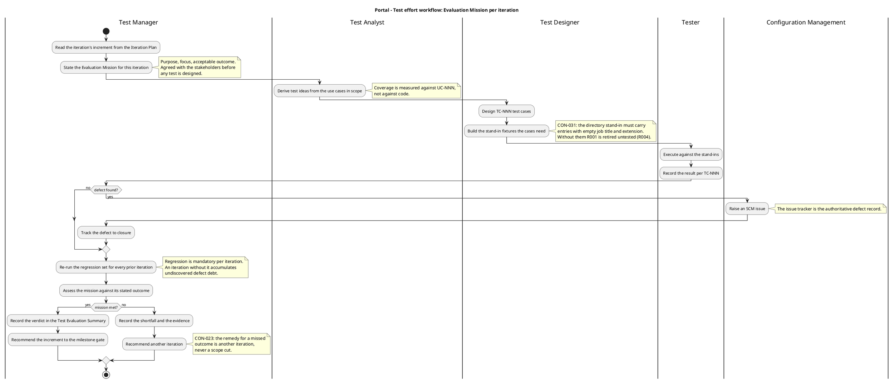
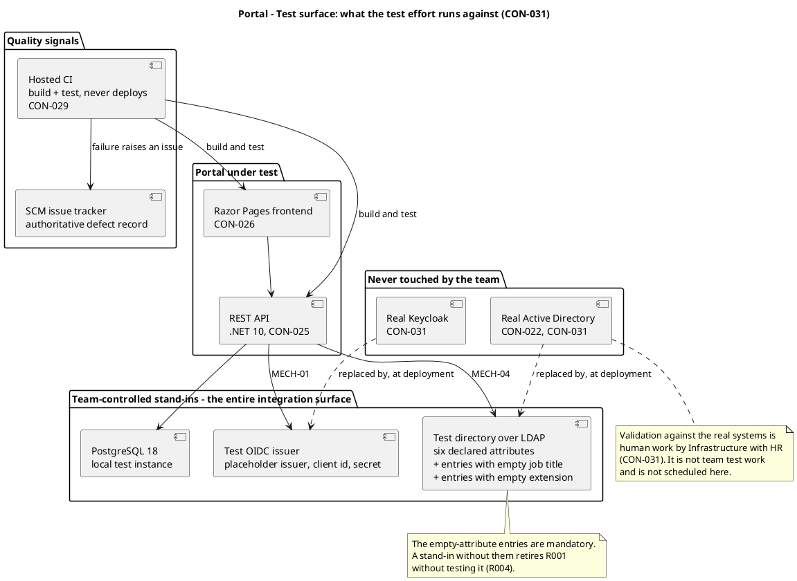
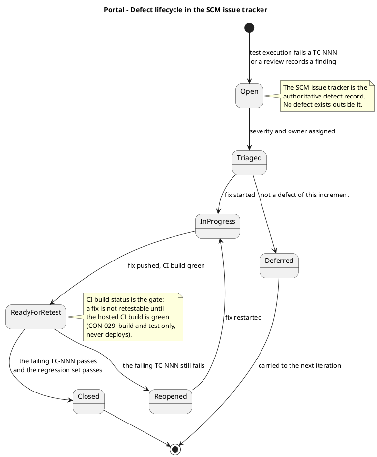

## Document Control

- **Phase:** Inception
- **Status:** Draft — iteration 1, submitted for review
- **Milestone Target:** End of Inception (not yet achieved)

## Test Scope
### Evaluation Mission — Inception iteration 1

The Evaluation Mission is the agreement with the stakeholders on the purpose, focus and acceptable
outcome of the test effort for this iteration. It is stated before any test is designed, and the
iteration is judged against it — not against a coverage percentage.

| Element | Statement |
|---|---|
| **Purpose** | Establish a test position the project can be held to: what will be tested, against what, at which level, and what evidence will count as proof. Inception produces no working software, so the mission is to make the test effort *decidable* in Elaboration and Construction, not to prove the system works |
| **Focus** | The four architecturally significant use cases detailed this iteration — UC-001, UC-004, UC-009, UC-011 — and the four risks that decide whether the test effort can succeed at all: R001, R004, R006, R008 |
| **Acceptable outcome** | Every one of the 15 use cases has a named test level and a named iteration in which it is executed; the stand-in fixture requirement that retires R001 is recorded as a test obligation, not a convention; the defect record and the quality signals are named; the test framework gap is carried as an Elaboration obligation with an owner |
| **Not the outcome** | A pass rate. No test is executed this iteration and none can be. A mission that claimed otherwise would be reporting a result that does not exist |

**Why the mission is scoped this way.** The declared scope is constraint-dense — 36 constraints
against 15 requirements — so the stakeholder has already fixed most behaviour. The test effort's
value is therefore *conformance evidence*: proving the system does exactly what CON-001 to CON-036
say, and proving it against the stand-ins that CON-031 makes the team's entire integration surface.
That is a different mission from exploratory testing, and it is the one this project needs.

### Test effort workflow

### Coverage plan — use-case driven

Coverage is measured against the use cases, not against lines of code. Every one of the 15 declared
use cases has a named test level and a named iteration of execution. None is unassigned.

| UC | Source | Risk it carries | Test level | Executed in |
|---|---|---|---|---|
| UC-001 Clock In and Clock Out | FR-001 | R002 (adoption), R008 (client clock) | Component + acceptance | Iteration 4 |
| UC-002 View Own Clocking History | FR-002 | — | Component | Iteration 4 |
| UC-003 View All Employee Clockings | FR-003 | — | Component | Iteration 4 |
| UC-004 Export Monthly Clocking Report as CSV | FR-004 | R006 (column contract), R001 (empty FullName) | Component + contract | Iteration 4 |
| UC-005 Correct or Insert Clocking | FR-005 | — | Component + audit | Iteration 4 |
| UC-006 Publish News | FR-006 | — | Component + acceptance | Iteration 5 |
| UC-007 Edit Published News | FR-007 | — | Component + audit | Iteration 5 |
| UC-008 Unpublish News | FR-008 | — | Component + audit | Iteration 5 |
| UC-009 Feature or Un-feature News | FR-009 | — | Component + invariant | Iteration 5 |
| UC-010 Read and Filter News | FR-010 | — | Component | Iteration 5 |
| UC-011 Search Employee Directory | FR-011 | R001 (empty attributes), R004 (fixture) | Component + acceptance | Iteration 6 |
| UC-012 Assign or Clear Worker Category | FR-012 | — | Component + audit | Iteration 6 |
| UC-013 Retry Clocking Through a Network Drop | FR-013 | R008 (client clock) | Component + fault injection | Iteration 4 |
| UC-014 Recognize Directory Unavailable | FR-014 | — | Component + fault injection | Iteration 6 |
| UC-015 Recognize News Unavailable | FR-015 | — | Component + fault injection | Iteration 5 |

**The three extension use cases are tested as exception paths, not as goals.** UC-013, UC-014 and
UC-015 are the network-failure behaviour of UC-001, UC-011 and UC-010. They are executed by injecting
the failure into the parent use case's test, and they are reported separately because each carries its
own declared requirement and its own acceptance criterion (AC-005 for UC-013).

### Coverage plan — architecture-centric quality attributes

The non-functional requirements in the Supplementary Specification define the second dimension of the
mission. Each is measured by the method the requirement itself names — not by a substitute the team
finds convenient.

| NFR | Requirement | How it is measured | Executed in |
|---|---|---|---|
| NFR-001 | Authenticated access via corporate credentials | Every use case is exercised unauthenticated and must be refused; the session must supply sAMAccountName and AD group membership. Tested against the stand-in OIDC issuer | Iteration 3 |
| NFR-002 | Page load under 3 seconds | Full page load the employee experiences, browser request to page displayed and usable, including the clocking page's script. Server response time is not accepted as a substitute | Iteration 6 |
| NFR-003 | Availability Monday–Friday 7:00–19:00 | Fault tolerance within the corporate network. No 24/7 target is tested, and no redundancy beyond the network is expected | Iteration 6 |
| NFR-004 | Clock in/out response under 1 second | The one operation with a sub-second target, measured on the clocking POST | Iteration 4 |
| NFR-005 | Audit trail for compliance | The five audited actions are asserted at the database, read directly — not through a screen, because no audit view screen exists. The previous value and the free-text reason are columns, not an opaque blob | Iterations 4, 5, 6 |

**NFR-005 is tested at the database, and that is the point.** The audit trail is read directly from
the database by people outside the portal. A test that asserts an audit row exists through the
application proves less than a test that reads the row and checks the actor, the timestamp, the
previous value and the reason are legible without the application.

### Test levels across the lifecycle

Testing is distributed across all four phases. Deferring it to Construction is the single most
expensive planning error available on this project, because R001 is retired by a fixture that must
exist before the directory is built.

| Phase | What is tested | Evidence produced |
|---|---|---|
| Inception (this iteration) | Nothing is executed. The mission, the coverage plan, the fixture obligation and the quality signals are established | This document |
| Elaboration | The stand-ins themselves; the architecture's risk position; the two High-volatility contracts (FR-004 export, FR-009 single-featured invariant) | Test Cases designed; stand-in fixtures verified to carry the empty-attribute entries |
| Construction | Every use case against the stand-ins, capability area by capability area, with the regression set re-run each iteration | Executed TC-NNN results; SCM issues for every failure |
| Transition | The declared acceptance criteria AC-001 to AC-005, and handover readiness for Infrastructure (CON-032) | Acceptance evidence; release recommendation |

### Test infrastructure and resources

Every resource below is justified against the mission. Nothing is provisioned because it is customary.

| Resource | Justification against the mission | State |
|---|---|---|
| Test OIDC issuer stand-in | NFR-001 is a portal-wide mechanism included by all 15 use cases. Without a stand-in issuer no use case can be exercised at all, and CON-031 forbids using the real Keycloak | Required — built in Elaboration |
| Test directory stand-in over LDAP | UC-011 and UC-004 read six attributes from AD. The stand-in must carry entries with empty job title and empty extension, or R001 is retired untested (R004) | Required — built in Elaboration |
| Local PostgreSQL 18 | NFR-005 is asserted at the database, and CON-013/CON-014 are schema-level rules. A test cannot prove "never overwritten" without a real store | Required — Infrastructure installs per CON-027 |
| Hosted CI (build and test) | The regression set must run every iteration. CON-029 fixes the provider and forbids deployment from CI | Available — build green on `main` |
| SCM issue tracker | The authoritative defect record. Defect metrics are read from it, never compiled by hand | Available — no issues recorded |
| Test framework | Not declared by the stakeholder. The Development Case records it as a gap for the Test Manager to close in Elaboration | **Gap — Elaboration obligation** |
| Real Keycloak and real AD | Not a test resource. Validation against them is human work by Infrastructure with HR (CON-031) and is not scheduled by the team | Out of the team's test surface |

**No performance test environment is provisioned.** NFR-002 and NFR-004 are measured on the corporate
network against the deployed application, and scale is explicitly non-binding at 200 employees. A
load-testing rig would be a resource with no decision behind it.

### Entry and exit criteria

Criteria are per iteration and measurable. They are not "when QA is satisfied".

| Gate | Criterion |
|---|---|
| **Entry to test execution** (from Elaboration onward) | The stand-ins are running and the directory stand-in is verified to carry the empty job-title and empty extension entries; the hosted CI build is green; the test framework is selected and the test projects are discovered by the CI glob |
| **Exit from an iteration's test effort** | Every use case in that iteration's scope has been executed against the stand-ins; the regression set for all prior iterations has been re-run; every failure is recorded as an SCM issue; the Evaluation Mission for that iteration is assessed as met or not met |
| **Exit is not** | A 100% pass rate. The criterion is that the mission is met and the evidence supports it. A known defect with a recorded issue and an accepted treatment does not block the mission; an unrecorded one does |
| **Regression** | Mandatory every iteration. The set grows by the use cases closed in the previous iteration and is never reduced to make room for new work |

## Test Summary
### What was executed this iteration

**No test was executed in Inception iteration 1, and none could be.** The iteration produces no
working software: no code, no stand-ins, no test cases. Reporting a pass rate here would be reporting
a result that does not exist.

| Measure | Value | Basis |
|---|---|---|
| Test cases designed | 0 | Test Case is an Elaboration artifact; the four detailed use cases are the input to it |
| Test cases executed | 0 | No code exists to execute against |
| Use cases with a named test level and iteration | 15 of 15 | Coverage plan above |
| Non-functional requirements with a named measurement method | 5 of 5 | Quality-attribute plan above |
| Stand-in fixture obligations recorded | 1 | The empty job-title and empty extension entries (R001, R004) |
| Test framework selected | No | Recorded gap; Test Manager closes it in Elaboration |

### Quality signals observed

These are read from the project's SCM, not compiled by hand.

| Signal | Value | Source |
|---|---|---|
| Hosted CI build on `main` | Success — run `39932821851`, started 2026-10-23 09:34:14Z, completed 09:35:04Z | `scm_get_build_status` |
| Open issues in the tracker | None | `scm_list_issues` |
| Closed issues in the tracker | None | `scm_list_issues` |

**How to read the green build.** It is a real signal and a weak one. The repository currently holds
project inputs and artifacts, not the portal; a green build proves the pipeline runs, not that
anything works. Its value this iteration is that the CI path CON-029 requires is live and that the
first red build will mean something. It is not evidence about the product.

### Coverage achieved against the mission

| Mission element | Achieved | Evidence |
|---|---|---|
| Every use case has a named test level and iteration | Yes | Coverage plan — 15 of 15 |
| Every NFR has a named measurement method | Yes | Quality-attribute plan — 5 of 5 |
| The R001 fixture obligation is recorded as a test obligation | Yes | Test infrastructure table; entry criterion |
| The defect record and quality signals are named | Yes | SCM issue tracker; hosted CI |
| The test framework gap has an owner and a phase | Yes | Test Manager, Elaboration |
| Test execution evidence | **No — and not expected this iteration** | No code exists |

## Defects and Incidents
### Defect record

The SCM issue tracker is the authoritative defect record. A defect that exists only in a conversation
or a document does not exist, and a defect count compiled by hand is not a metric.

| Measure | Value | Source |
|---|---|---|
| Defects raised this iteration | 0 | `scm_list_issues`, state `all` |
| Defects closed this iteration | 0 | `scm_list_issues`, state `all` |
| Defects carried from a prior iteration | 0 | This is the first iteration |
| Incidents (build failures, environment outages) | 0 | CI build success on `main` |

**Zero defects is the correct reading of this iteration, not a quality achievement.** No test was
executed, so no defect could be found. The number becomes meaningful from Elaboration onward, when
the stand-ins exist and the first test cases run.

### Defect lifecycle

**A defect is closed by a passing test, not by a merged fix.** The transition from `ReadyForRetest` to
`Closed` requires the failing test case to pass and the regression set to pass with it. A fix that
breaks a previously passing use case reopens the defect rather than closing it.

### Defect severity scale

| Severity | Meaning on this project | Example |
|---|---|---|
| Critical | A declared exclusion is crossed, or a business rule is violated wherever the change comes from | A category read in an authorization decision (CON-015); a second featured item (CON-010); a news item hard-deleted (CON-014) |
| Major | A declared requirement is not met, or an acceptance criterion cannot be satisfied | The export omits a row for a missing clock-out (FR-004); the directory hides an employee whose extension is empty (R001) |
| Minor | A departure from the authoritative UI reference (CON-034) that does not block a use case | Spacing or colour differing from `docs/inputs/employee-portal-design.html` |
| Cosmetic | Presentation only, no requirement at stake | A label wording that is not fixed by any constraint |

**The Critical band is deliberately narrow and specific.** On a project with 13 declared exclusions,
the most damaging defect is not a crash — it is a feature the stakeholder excluded appearing in the
product. That is why the exclusion list is the first thing the severity scale names.

## Conclusions
### Mission verdict — Inception iteration 1

**The Evaluation Mission for this iteration is MET.** The test effort is now decidable: every use case
has a test level and an iteration, every non-functional requirement has a measurement method, the
fixture obligation that retires R001 is recorded as a test obligation rather than a convention, and
the defect record and quality signals are named and live.

This verdict is about the *test position*, not about the product. No product evidence exists, and the
verdict does not claim any.

### What the verdict rests on

| Basis | Strength |
|---|---|
| 15 of 15 use cases assigned a test level and an execution iteration | Strong — the coverage plan is complete against the declared scope |
| 5 of 5 NFRs assigned the measurement method the requirement itself names | Strong — no substitute metric was accepted |
| R001's fixture obligation recorded as an entry criterion, not a guideline | Strong — R004 is the risk that R001 is retired untested, and the criterion is what prevents it |
| Defect record and CI signal named and observed | Adequate — the pipeline is live; it carries no product evidence yet |
| Test framework selected | **Absent** — carried as an Elaboration obligation with an owner |

### Recommendation

**Proceed to Elaboration.** The test effort has no blocking gap for this phase. The one open item —
the test framework — is an Elaboration obligation, not an Inception one, and the Development Case
already records it as a toolchain gap to close before Implementation intensity rises.

### Obligations this document places on the next iteration

| Obligation | Owner | Why it cannot slip |
|---|---|---|
| Select the test framework and confirm the CI glob discovers the test projects | Test Manager | Without it no test case can run, and R007 records the consequence of the gap surviving into Construction |
| Verify the directory stand-in carries entries with empty job title and empty extension | Test Designer, checked by CodeReviewer | This is the only mechanism that retires R001. A stand-in without them makes every directory test pass while the risk stays live (R004) |
| Design test cases for the four detailed use cases — UC-001, UC-004, UC-009, UC-011 | Test Analyst, Test Designer | These carry the client-timestamp contract, the export column contract, the single-featured invariant and the LDAP read — the four places a wrong decision is expensive to reverse |
| Assert the FR-004 export contract column by column, including the empty clock-out row and decimal hours computed from recorded times | Test Designer | R006 records the misread derivation as the failure mode; the contract is consumed outside the portal and a change to it is invisible to the portal's own tests |
| Assert NFR-005 at the database, not through the application | Test Designer | No audit view screen exists, so a test that reads through the application proves less than the requirement demands |

### What this document does not claim

- It does not claim the Inception milestone is achieved. That verdict belongs to the ReviewCoordinator.
- It does not claim any acceptance criterion is closed. AC-001 to AC-005 are verified by working
  software, which does not exist yet.
- It does not claim the product is tested. It claims the test effort is defined, resourced and
  decidable.
