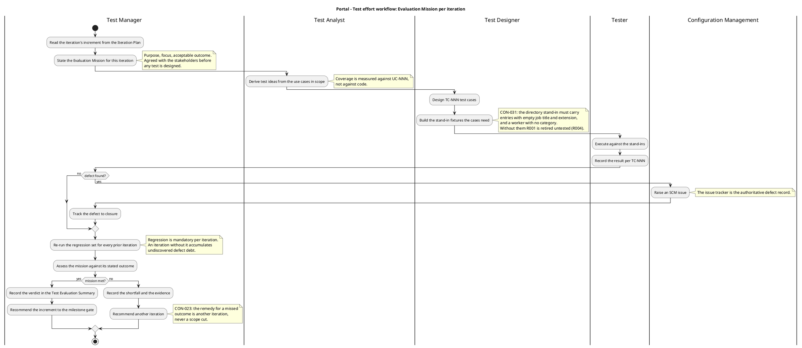
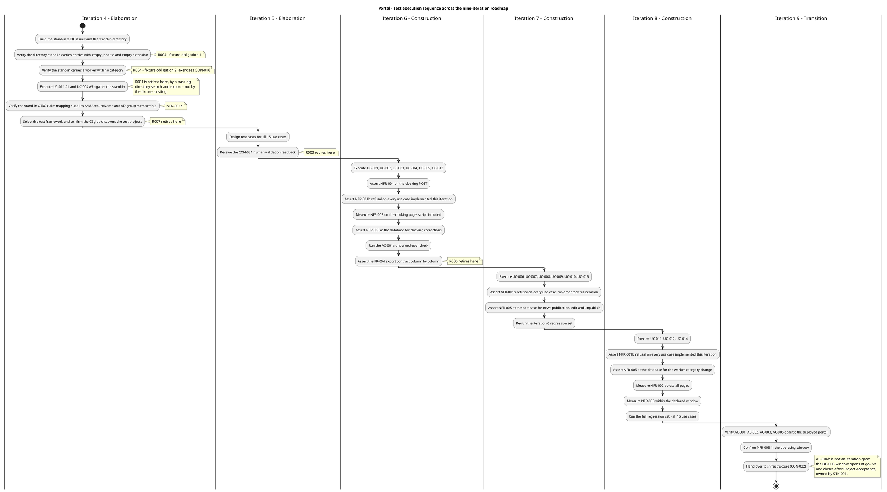
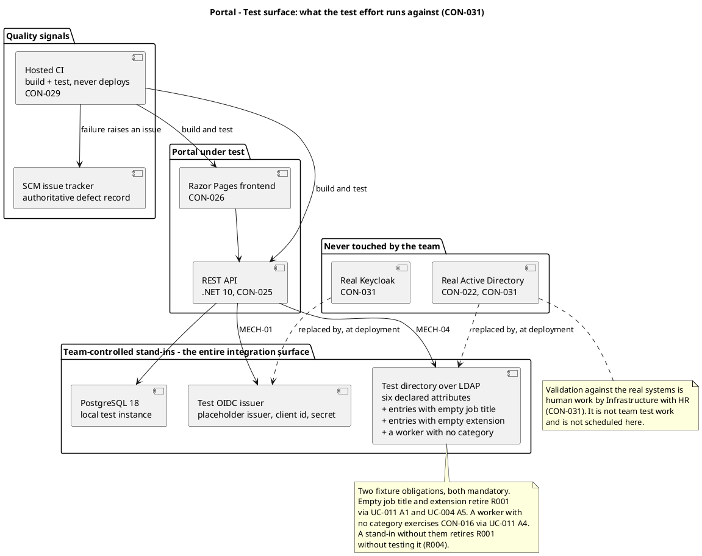
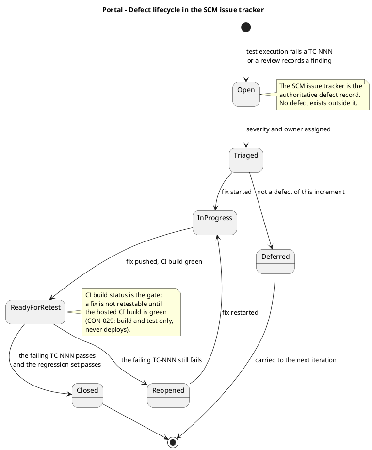

## Document Control
- **Phase:** Inception
- **Status:** Draft — iteration 3, submitted for review
- **Milestone Target:** End of Inception (not yet achieved)

## Test Scope
### Evaluation Mission — Inception iteration 3

The Evaluation Mission is the agreement with the stakeholders on the purpose, focus and acceptable
outcome of the test effort for this iteration. It is stated before any test is designed, and the
iteration is judged against it — not against a coverage percentage.

| Element | Statement |
|---|---|
| **Purpose** | Keep the test position decidable and make every execution iteration in it the iteration in which the behaviour it tests exists. Inception produces no working software, so the mission is to make the test effort *decidable* in Elaboration and Construction, not to prove the system works |
| **Focus** | The four architecturally significant use cases — UC-001, UC-004, UC-009, UC-011 — and the five risks that decide whether the test effort can succeed at all: R001, R004, R006, R007, R008. This iteration adds two obligations: every execution iteration must match the nine-iteration roadmap, and every alternative flow the Use-Case Model gained this iteration must be named as a test obligation |
| **Acceptable outcome** | Every one of the 15 use cases has a named test level and an execution iteration drawn from the nine-iteration roadmap; every NFR is measured by the method the requirement itself names, in an iteration where the behaviour exists; both stand-in fixture obligations that retire R001 and exercise CON-016 are recorded with the iteration in which they are executed; the alternative flows that enforce CON-012 and CON-016 are named as test obligations; the defect record and the quality signals are read from the SCM at the moment of writing |
| **Not the outcome** | A pass rate. No test is executed this iteration and none can be. A mission that claimed otherwise would be reporting a result that does not exist |

**Why the mission is scoped this way.** The declared scope is constraint-dense — 36 constraints
against 15 requirements — so the stakeholder has already fixed most behaviour. The test effort's
value is therefore *conformance evidence*: proving the system does exactly what CON-001 to CON-036
say, and proving it against the stand-ins that CON-031 makes the team's entire integration surface.
That is a different mission from exploratory testing, and it is the one this project needs.

**The roadmap moved and this document follows it.** The Iteration Plan now carries nine iterations:
Elaboration is 4 and 5, Construction 6 to 8, Transition 9. Every execution iteration below is read
from that table. The test position names no iteration number that the roadmap does not contain, and
the sweep that checks this is exit criterion E6 of the iteration plan.

### Test effort workflow

### Coverage plan — use-case driven

Coverage is measured against the use cases, not against lines of code. Every one of the 15 declared
use cases has a named test level and a named iteration of execution, and every execution iteration
below is the iteration in which the Iteration Plan implements that use case. None is unassigned and
none is assigned to an iteration where the behaviour does not yet exist.

| UC | Source | Risk it carries | Test level | Executed in |
|---|---|---|---|---|
| UC-001 Clock In and Clock Out | FR-001 | R002 (adoption), R008 (client clock) | Component + acceptance | Iteration 6 |
| UC-002 View Own Clocking History | FR-002 | — | Component | Iteration 6 |
| UC-003 View All Employee Clockings | FR-003 | — | Component | Iteration 6 |
| UC-004 Export Monthly Clocking Report as CSV | FR-004 | R006 (column contract), R001 (empty FullName) | Component + contract | Iteration 6 — with the empty-attribute case executed in iteration 4 |
| UC-005 Correct or Insert Clocking | FR-005 | — | Component + audit | Iteration 6 |
| UC-006 Publish News | FR-006 | — | Component + acceptance | Iteration 7 |
| UC-007 Edit Published News | FR-007 | — | Component + audit | Iteration 7 |
| UC-008 Unpublish News | FR-008 | — | Component + audit | Iteration 7 |
| UC-009 Feature or Un-feature News | FR-009 | — | Component + invariant | Iteration 7 |
| UC-010 Read and Filter News | FR-010 | — | Component | Iteration 7 |
| UC-011 Search Employee Directory | FR-011 | R001 (empty attributes), R004 (fixture) | Component + acceptance | Iteration 8 — with the empty-attribute case executed in iteration 4 |
| UC-012 Assign or Clear Worker Category | FR-012 | — | Component + audit | Iteration 8 |
| UC-013 Retry Clocking Through a Network Drop | FR-013 | R008 (client clock) | Component + fault injection | Iteration 6 |
| UC-014 Recognize Directory Unavailable | FR-014 | — | Component + fault injection | Iteration 8 |
| UC-015 Recognize News Unavailable | FR-015 | — | Component + fault injection | Iteration 7 |

**The three extension use cases are tested as exception paths, not as goals.** UC-013, UC-014 and
UC-015 are the network-failure behaviour of UC-001, UC-011 and UC-010. They are executed by injecting
the failure into the parent use case's test, and they are reported separately because each carries its
own declared requirement and its own acceptance criterion (AC-005 for UC-013).

**Two scenarios execute in iteration 4, ahead of their capability area.** UC-011 A1 (empty attribute)
and UC-004 A5 (empty directory attribute) are the cases that retire R001. They need no production
code beyond the directory read path and the export derivation, so they run in the iteration that
builds the stand-ins. The full use-case tests for UC-004 and UC-011 remain in Construction with the
rest of their capability areas. This is the sequencing the Iteration Plan's risk retirement table
records, and the test effort follows it rather than the other way round.

### Alternative flows that must be executed

A rule is not tested by the use case that names it; it is tested by the flow that enforces it. The
Use-Case Model gained three alternative flows this iteration, and each is the enforcement point of a
declared constraint. They are named here so the Test Designer cannot design a use-case test that
passes while the rule it carries is unexercised.

| Flow | Enforces | What the test must assert | Executed in |
|---|---|---|---|
| UC-001 A4 — pair already complete | CON-012, CON-017 | After a complete pair, no clocking button renders and no event row is appended; the employee is routed to HR under UC-005. A second pair is not opened | Iteration 6 |
| UC-001 A5 — Clock In press while the pair is open | CON-012 | A Clock In POST arriving in the open-pair state is rejected and appends no row; the open pair and the Clock Out button remain | Iteration 6 |
| UC-001 A1 — duplicate press | FR-013, CON-036 | The same idempotency key returns the original result and appends no second row | Iteration 6 |
| UC-001 A2, A3 — network down within and beyond 5 minutes | FR-013, AC-005 | Within 5 minutes the press is retried and the recorded time is the press time, not the retry time; beyond 5 minutes the retry stops and the employee is told to report to HR | Iteration 6 |
| UC-004 A1, A2, A3, A4, A5 | FR-004, CON-011, CON-013, CON-016 | Missing clock-out exports empty with the row present; a day with no clocking produces no row; a worker with no category exports blank; a corrected day exports `Corrected = Y`; an empty directory attribute exports empty with the row present | Iteration 6 |
| UC-009 A1, A2, A3 | CON-010, CON-019 | Un-featuring leaves none featured; unpublishing the featured item clears the flag and promotes nothing; no item featured makes the clear a no-op | Iteration 7 |
| UC-011 A1 — job title or extension empty | R001, CON-031 | The field renders blank, the row still renders and the employee is still found | **Iteration 4** |
| UC-011 A2 — network unreachable | FR-014, CON-003 | A no-connection message, with no stale or partial result | Iteration 8 |
| UC-011 A3 — no match | FR-011 | An empty result set, not an error | Iteration 8 |
| UC-011 A4 — worker has no category | CON-016 | The entry still appears with the category blank; with a category filter applied it does not match, because blank is not one of the four values | Iteration 8 — fixture obligation verified in iteration 4 |

**UC-001 A4 and A5 are the flows that make CON-012 testable.** Before they existed the use case
permitted the state the rule declares impossible, so a test written against it would have passed
while the rule was violated. A use-case test for UC-001 that does not execute A4 and A5 does not test
CON-012 at all.

### Coverage plan — architecture-centric quality attributes

The non-functional requirements in the Supplementary Specification define the second dimension of the
mission. Each is measured by the method the requirement itself names — not by a substitute the team
finds convenient — and in an iteration where the behaviour being measured exists.

| NFR | Requirement | How it is measured | Executed in |
|---|---|---|---|
| NFR-001a | Authenticated access — the session supplies the identity | The stand-in OIDC issuer's claim mapping is verified to supply sAMAccountName and AD group membership, and the two AD-group levels resolve to HR and to employee. This is a claim-mapping check against the stand-in, not a use-case test | Iteration 4 |
| NFR-001b | Authenticated access — every portal function requires it | Every use case implemented in the iteration is exercised unauthenticated and must be refused, and exercised with the wrong AD group and must be refused where CON-008 reserves the function to HR | Iterations 6, 7, 8 — each against the use cases that iteration implements |
| NFR-002 | Page load under 3 seconds | Full page load the employee experiences, browser request to page displayed and usable, including the clocking page's script. Server response time is not accepted as a substitute | Iteration 6 for the clocking page; iteration 8 across all pages |
| NFR-003 | Availability Monday–Friday 7:00–19:00 | Fault tolerance within the corporate network, observed inside the declared window. No 24/7 target is tested, and no redundancy beyond the network is expected | Iteration 8, confirmed in iteration 9 |
| NFR-004 | Clock in/out response under 1 second | The one operation with a sub-second target, measured on the clocking POST | Iteration 6 |
| NFR-005 | Audit trail for compliance | The five audited actions are asserted at the database, read directly — not through a screen, because no audit view screen exists. The previous value and the free-text reason are columns, not an opaque blob | Iteration 6 for clocking corrections; iteration 7 for news publication, edit and unpublish; iteration 8 for the worker-category change |

**NFR-001 is split because its two halves become executable at different points.** The claim mapping
is a property of the stand-in and can be verified the moment the stand-in exists — iteration 4. The
refusal assertion is a property of each use case and cannot be executed before that use case is
implemented. Assigning the whole requirement to one iteration would either test nothing or claim a
result that does not exist; splitting it puts each half where it can actually run.

**NFR-005 is tested at the database, and that is the point.** The audit trail is read directly from
the database by people outside the portal. A test that asserts an audit row exists through the
application proves less than a test that reads the row and checks the actor, the timestamp, the
previous value and the reason are legible without the application.

### Acceptance criteria verification

Every declared acceptance criterion has a point at which it can close. AC-004 is verified in two
parts at two different points, because it fuses a learnability check with a population measure whose
window opens at go-live.

| AC | Criterion | Verified by | Verified in |
|---|---|---|---|
| AC-001 | An employee can clock in and out without help from HR or the development team | UC-001 executed end to end against the stand-ins, with the confirmation observed | Iteration 6 |
| AC-002 | An HR Administrator can publish a news item without technical assistance | UC-006 executed as an HR-group user, with no console or database step | Iteration 7 |
| AC-003 | Any employee finds a colleague's phone/email in under 10 seconds | UC-011 timed from search entry to the result row showing phone and email | Iteration 8 |
| AC-004a | Learnability half — an employee completes at least one clocking with no prior training | A small untrained-user check in the iteration that implements UC-001 | Iteration 6 |
| AC-004b | Population half — 80% of employees complete at least one clocking within three months of launch | The BG-003 adoption reading, owned by STK-001. Not a gate on any iteration | Post-Project-Acceptance |
| AC-005 | A clocking made while the corporate network is down for up to 5 minutes is not lost | UC-013 executed with the network injected down for the full 5 minutes, then restored; the recorded timestamp is the press time, not the receipt time | Iteration 6 |

**AC-004b is not an iteration gate and this document does not treat it as one.** A population measure
whose window opens at go-live cannot be verified by the iteration in which the window opens. It is
recorded here with its owner and its point of closure so that the project's accountability to it is
visible, and it is not assigned to a gate that could never close on it.

### Test levels across the lifecycle

Testing is distributed across all four phases. Deferring it to Construction is the single most
expensive planning error available on this project, because R001 is retired by a test that must run
in the iteration that builds the stand-ins.

| Phase | What is tested | Evidence produced |
|---|---|---|
| Inception (iterations 1–3) | Nothing is executed. The mission, the coverage plan, the fixture obligations and the quality signals are established | This document |
| Elaboration (iterations 4–5) | The stand-ins themselves; the empty-attribute case of UC-011 and UC-004, which retires R001; the NFR-001 claim mapping; the two High-volatility contracts (FR-004 export, FR-009 single-featured invariant) | Executed results for the R001 retirement case; Test Cases designed for all 15 use cases; stand-in fixtures verified to carry both obligations |
| Construction (iterations 6–8) | Every use case against the stand-ins, capability area by capability area, with the regression set re-run each iteration | Executed TC-NNN results; SCM issues for every failure |
| Transition (iteration 9) | The declared acceptance criteria AC-001 to AC-005 against the deployed portal, and handover readiness for Infrastructure (CON-032) | Acceptance evidence; release recommendation |

### Test execution sequence across the roadmap

### Test infrastructure and resources

Every resource below is justified against the mission. Nothing is provisioned because it is customary.

| Resource | Justification against the mission | State |
|---|---|---|
| Test OIDC issuer stand-in | NFR-001 is a portal-wide mechanism included by all 15 use cases. Without a stand-in issuer no use case can be exercised at all, and CON-031 forbids using the real Keycloak | Required — built in iteration 4 |
| Test directory stand-in over LDAP | UC-011 and UC-004 read six attributes from AD. The stand-in must carry entries with empty job title and empty extension, or R001 is retired untested (R004), and a worker with no category, or CON-016 is never exercised | Required — built in iteration 4 |
| Local PostgreSQL 18 | NFR-005 is asserted at the database, and CON-013/CON-014 are schema-level rules. A test cannot prove "never overwritten" without a real store | Required — Infrastructure installs per CON-027 |
| Hosted CI (build and test) | The regression set must run every iteration. CON-029 fixes the provider and forbids deployment from CI | Available — build green on `main` |
| SCM issue tracker | The authoritative defect record. Defect metrics are read from it, never compiled by hand | Available — two issues recorded |
| Test framework | Not declared by the stakeholder. The Development Case records it as a toolchain gap; R007 carries the consequence of it surviving into Construction | **Gap — closes in iteration 4** |
| Real Keycloak and real AD | Not a test resource. Validation against them is human work by Infrastructure with HR (CON-031) and is not scheduled by the team | Out of the team's test surface |

**No performance test environment is provisioned.** NFR-002 and NFR-004 are measured on the corporate
network against the deployed application, and scale is explicitly non-binding at 200 employees. A
load-testing rig would be a resource with no decision behind it.

### Entry and exit criteria

Criteria are per iteration and measurable. They are not "when QA is satisfied".

| Gate | Criterion |
|---|---|
| **Entry to test execution** (from iteration 4 onward) | The stand-ins are running and the directory stand-in is verified to carry both fixture obligations — the empty job-title and empty extension entries, and a worker with no category; the hosted CI build is green; the test framework is selected and the test projects are discovered by the CI glob |
| **Entry to a Construction iteration's use-case tests** | The use cases in that iteration's scope are implemented and reachable through the portal; the stand-ins are the only external dependency in play |
| **Exit from an iteration's test effort** | Every use case in that iteration's scope has been executed against the stand-ins, including the alternative flows named in the table above; the regression set for all prior iterations has been re-run; every failure is recorded as an SCM issue; the Evaluation Mission for that iteration is assessed as met or not met |
| **Exit is not** | A 100% pass rate. The criterion is that the mission is met and the evidence supports it. A known defect with a recorded issue and an accepted treatment does not block the mission; an unrecorded one does |
| **Regression** | Mandatory every iteration. The set grows by the use cases closed in the previous iteration and is never reduced to make room for new work |

## Test Summary
### What was executed this iteration

**No test was executed in Inception iteration 3, and none could be.** The iteration produces no
working software: no code, no stand-ins, no test cases. Reporting a pass rate here would be reporting
a result that does not exist.

| Measure | Value | Basis |
|---|---|---|
| Test cases designed | 0 | Test Case is an Elaboration artifact; the four detailed use cases are the input to it |
| Test cases executed | 0 | No code exists to execute against |
| Use cases with a named test level and an execution iteration matching the roadmap | 15 of 15 | Coverage plan above |
| Non-functional requirements with a named measurement method and an iteration where the behaviour exists | 5 of 5 | Quality-attribute plan above |
| Acceptance criteria with a point at which they can close | 5 of 5, with AC-004 split into two parts | Acceptance criteria verification above |
| Alternative flows named as test obligations | 10 flows across 4 use cases | Alternative flows table above |
| Stand-in fixture obligations recorded | 2 | Empty job-title and extension entries (R001, R004); a worker with no category (CON-016, R004) |
| Test framework selected | No | Recorded gap; closes in iteration 4 |

### Quality signals observed

These are read from the project's SCM at the moment of writing, not compiled by hand.

| Signal | Value | Source |
|---|---|---|
| Hosted CI build on `main` | Success — run `39940933643`, started 2026-10-23 10:41:58Z, completed 10:42:50Z | `scm_get_build_status` |
| Issues in the tracker | Two — `Issue #1` and `Issue #2`, both documentation staleness, both minor | `scm_list_issues`, state `all` |

**How to read the green build.** It is a real signal and a weak one. The repository currently holds
project inputs and artifacts, not the portal; a green build proves the pipeline runs, not that
anything works. Its value this iteration is that the CI path CON-029 requires is live and that the
first red build will mean something. It is not evidence about the product.

**How to read the two issues.** Both are documentation-staleness defects raised by review, not by a
test: `Issue #1` against the branching strategy document and `Issue #2` against the Development Case,
each stating that a build-and-test pipeline does not exist when it is committed and green. Neither is
a product defect and neither bears on the test position. They are cited because the tracker is the
authoritative defect record and a defect count that omitted them would be a count compiled by hand.

### Coverage achieved against the mission

| Mission element | Achieved | Evidence |
|---|---|---|
| Every use case has a named test level and an execution iteration | Yes | Coverage plan — 15 of 15, drawn from the nine-iteration roadmap |
| Every execution iteration is one in which the behaviour exists | Yes | Coverage plan and quality-attribute plan; NFR-001 split into a claim-mapping check and a per-iteration refusal assertion |
| Every NFR has a named measurement method | Yes | Quality-attribute plan — 5 of 5 |
| Every acceptance criterion has a point at which it can close | Yes | AC-004 split into a learnability check at iteration 6 and a post-Project-Acceptance population measure owned by STK-001 |
| Both R001 fixture obligations are recorded as test obligations with their execution iteration | Yes | Test infrastructure table; entry criterion; iteration 4 in the execution sequence |
| The alternative flows that enforce CON-012 and CON-016 are named as test obligations | Yes | Alternative flows table — UC-001 A4, A5 and UC-011 A4 |
| The defect record and quality signals are named and read from the SCM | Yes | SCM issue tracker; hosted CI run `39940933643` |
| The test framework gap has an owner and an iteration | Yes | Test Manager, iteration 4 |
| Test execution evidence | **No — and not expected this iteration** | No code exists |

## Defects and Incidents
### Defect record

The SCM issue tracker is the authoritative defect record. A defect that exists only in a conversation
or a document does not exist, and a defect count compiled by hand is not a metric.

| Measure | Value | Source |
|---|---|---|
| Issues in the tracker | 2 | `scm_list_issues`, state `all` |
| Product defects raised by test execution | 0 | No test has been executed |
| Defects raised by review | 2 — `Issue #1` and `Issue #2`, documentation staleness | `scm_list_issues` |
| Defects closed | 0 | `scm_list_issues`, state `all` |
| Incidents (build failures, environment outages) | 0 | CI build success on `main`, run `39940933643` |

**Zero product defects is the correct reading of this iteration, not a quality achievement.** No test
was executed, so no product defect could be found. The number becomes meaningful from iteration 4
onward, when the stand-ins exist and the first test cases run.

**Neither recorded issue is a product defect and neither is counted as one.** Both were raised by
review against documentation artifacts. They are reported because the tracker is the authoritative
record and omitting them would make this table a hand-compiled count.

### Defect lifecycle

**A defect is closed by a passing test, not by a merged fix.** The transition from `ReadyForRetest` to
`Closed` requires the failing test case to pass and the regression set to pass with it. A fix that
breaks a previously passing use case reopens the defect rather than closing it.

### Defect severity scale

| Severity | Meaning on this project | Example |
|---|---|---|
| Critical | A declared exclusion is crossed, or a business rule is violated wherever the change comes from | A category read in an authorization decision (CON-015); a second featured item (CON-010); a news item hard-deleted (CON-014) |
| Major | A declared requirement is not met, or an acceptance criterion cannot be satisfied | The export omits a row for a missing clock-out (FR-004); the directory hides an employee whose extension is empty (R001) |
| Minor | A departure from the authoritative UI reference (CON-034) that does not block a use case | Spacing or colour differing from `docs/inputs/employee-portal-design.html` |
| Cosmetic | Presentation only, no requirement at stake | A label wording that is not fixed by any constraint |

**The Critical band is deliberately narrow and specific.** On a project with 13 declared exclusions,
the most damaging defect is not a crash — it is a feature the stakeholder excluded appearing in the
product. That is why the exclusion list is the first thing the severity scale names.

## Conclusions
### Mission verdict — Inception iteration 3

**The Evaluation Mission for this iteration is MET.** The test effort is decidable and it follows the
plan it is measured against: every use case has a test level and an execution iteration drawn from the
nine-iteration roadmap, every non-functional requirement is measured by the method the requirement
itself names in an iteration where the behaviour exists, every acceptance criterion has a point at
which it can close, both fixture obligations that retire R001 and exercise CON-016 are recorded with
the iteration in which they are executed, and the alternative flows that enforce CON-012 and CON-016
are named as test obligations rather than left to the use case that cites the rule.

This verdict is about the *test position*, not about the product. No product evidence exists, and the
verdict does not claim any.

### What the verdict rests on

| Basis | Strength |
|---|---|
| 15 of 15 use cases assigned a test level and an execution iteration matching the roadmap | Strong — the coverage plan is complete against the declared scope and consistent with the Iteration Plan's nine-iteration table |
| 5 of 5 NFRs assigned the measurement method the requirement itself names, in an iteration where the behaviour exists | Strong — no substitute metric was accepted, and NFR-001 is split so neither half is assigned to an iteration that cannot execute it |
| 5 of 5 acceptance criteria given a point at which they can close, with AC-004 split | Strong — no criterion is assigned to a gate that could never close on it |
| Both R001 fixture obligations recorded as entry criteria with their execution iteration | Strong — R004 is the risk that R001 is retired untested, and the criteria plus the iteration 4 execution are what prevent it |
| The alternative flows enforcing CON-012 and CON-016 named as test obligations | Strong — a use-case test that skips UC-001 A4 and A5 does not test CON-012 at all |
| Defect record and CI signal named and read from the SCM at the moment of writing | Adequate — the pipeline is live; it carries no product evidence yet |
| Test framework selected | **Absent** — carried as an obligation with an owner and an iteration |

### Recommendation

**Proceed to Elaboration.** The test effort has no blocking gap for this phase. The one open item —
the test framework — is an Elaboration obligation with a named owner and a named iteration, and R007
records the consequence of it surviving into Construction.

### Obligations this document places on iteration 4

| Obligation | Owner | Why it cannot slip |
|---|---|---|
| Select the test framework and confirm the CI glob discovers the test projects | Test Manager | Without it no test case can run, and R007 records the consequence of the gap surviving into Construction |
| Verify the directory stand-in carries entries with empty job title and empty extension | Test Designer, checked by CodeReviewer | This is the only mechanism that retires R001. A stand-in without them makes every directory test pass while the risk stays live (R004) |
| Verify the stand-in carries a worker with no category | Test Designer, checked by CodeReviewer | CON-016 is exercised only by UC-011 A4 and UC-004 A3. A stand-in where every worker has a category leaves the rule untested (R004) |
| Execute UC-011 A1 and UC-004 A5 against the stand-in | Tester | This is the event that retires R001 — a passing directory search and export, not the fixture existing. It is the project's first executed test |
| Verify the stand-in OIDC claim mapping supplies sAMAccountName and AD group membership | Test Designer | NFR-001a is the half of the authentication requirement that can be verified before any use case is implemented |
| Design test cases for all 15 use cases, including the ten alternative flows named above | Test Analyst, Test Designer | Iteration 5 is the last point at which design precedes implementation; a contract discovered wrong after implementation is expensive to reverse |
| Assert the FR-004 export contract column by column, including the empty clock-out row and decimal hours computed from recorded times | Test Designer | R006 records the misread derivation as the failure mode; the contract is consumed outside the portal and a change to it is invisible to the portal's own tests |
| Assert NFR-005 at the database, not through the application | Test Designer | No audit view screen exists, so a test that reads through the application proves less than the requirement demands |

### What this document does not claim

- It does not claim the Inception milestone is achieved. That verdict belongs to the ReviewCoordinator.
- It does not claim any acceptance criterion is closed. AC-001 to AC-005 are verified by working
  software, which does not exist yet.
- It does not claim the product is tested. It claims the test effort is defined, resourced, decidable
  and sequenced against the plan it is measured against.
