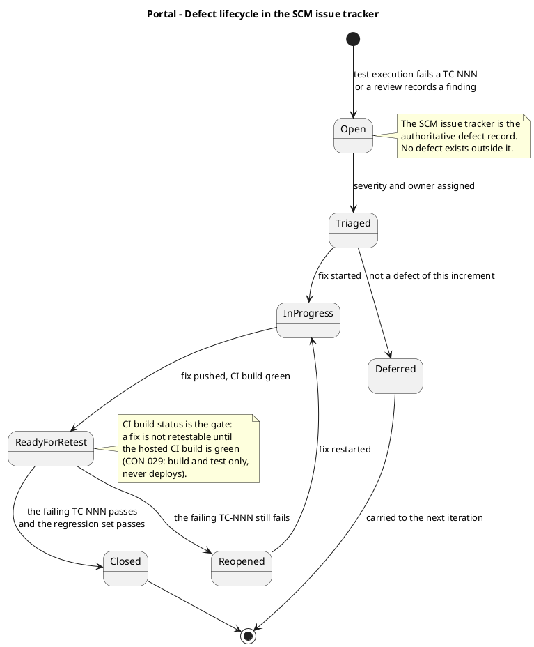

## Document Control
- **Phase:** Inception
- **Status:** Draft — iteration 2, submitted for review
- **Milestone Target:** End of Inception (not yet achieved)

## Test Scope

## Test Summary
### What was executed this iteration

**No test was executed in Inception iteration 2, and none could be.** The iteration produces no
working software: no code, no stand-ins, no test cases. Reporting a pass rate here would be reporting
a result that does not exist.

| Measure | Value | Basis |
|---|---|---|
| Test cases designed | 0 | Test Case is an Elaboration artifact; the four detailed use cases are the input to it |
| Test cases executed | 0 | No code exists to execute against |
| Use cases with a named test level and an execution iteration matching the roadmap | 15 of 15 | Coverage plan above |
| Non-functional requirements with a named measurement method and an iteration where the behaviour exists | 5 of 5 | Quality-attribute plan above |
| Acceptance criteria with a point at which they can close | 5 of 5, with AC-004 split into two parts | Acceptance criteria verification above |
| Stand-in fixture obligations recorded | 1 | The empty job-title and empty extension entries (R001, R004), executed in iteration 3 |
| Test framework selected | No | Recorded gap; closes in iteration 3 |

### Quality signals observed

These are read from the project's SCM at the moment of writing, not compiled by hand.

| Signal | Value | Source |
|---|---|---|
| Hosted CI build on `main` | Success — run `39940062277`, started 2026-10-23 10:34:26Z, completed 10:35:16Z | `scm_get_build_status` |
| Issues in the tracker | One — `Issue #1`, recorded against a documentation artifact, not against the portal | `scm_list_issues`, state `all` |

**How to read the green build.** It is a real signal and a weak one. The repository currently holds
project inputs and artifacts, not the portal; a green build proves the pipeline runs, not that
anything works. Its value this iteration is that the CI path CON-029 requires is live and that the
first red build will mean something. It is not evidence about the product.

**How to read the one issue.** It is a documentation-staleness defect in the branching strategy
document, raised by review rather than by a test. It is not a product defect and it does not bear on
the test position. It is cited here because the tracker is the authoritative defect record and a
defect count that omitted it would be a count compiled by hand.

### Coverage achieved against the mission

| Mission element | Achieved | Evidence |
|---|---|---|
| Every use case has a named test level and an execution iteration | Yes | Coverage plan — 15 of 15, re-based onto the eight-iteration roadmap |
| Every execution iteration is one in which the behaviour exists | Yes | Coverage plan and quality-attribute plan; NFR-001 split into a claim-mapping check and a per-iteration refusal assertion |
| Every NFR has a named measurement method | Yes | Quality-attribute plan — 5 of 5 |
| Every acceptance criterion has a point at which it can close | Yes | AC-004 split into a learnability check at iteration 5 and a post-Project-Acceptance population measure owned by STK-001 |
| The R001 fixture obligation is recorded as a test obligation with its execution iteration | Yes | Test infrastructure table; entry criterion; iteration 3 in the execution sequence |
| The defect record and quality signals are named and read from the SCM | Yes | SCM issue tracker; hosted CI run `39940062277` |
| The test framework gap has an owner and an iteration | Yes | Test Manager, iteration 3 |
| Test execution evidence | **No — and not expected this iteration** | No code exists |

## Defects and Incidents
### Defect record

The SCM issue tracker is the authoritative defect record. A defect that exists only in a conversation
or a document does not exist, and a defect count compiled by hand is not a metric.

| Measure | Value | Source |
|---|---|---|
| Issues in the tracker | 1 | `scm_list_issues`, state `all` |
| Product defects raised by test execution | 0 | No test has been executed |
| Defects raised by review | 1 — `Issue #1`, documentation staleness in the branching strategy document | `scm_list_issues` |
| Defects closed | 0 | `scm_list_issues`, state `all` |
| Incidents (build failures, environment outages) | 0 | CI build success on `main`, run `39940062277` |

**Zero product defects is the correct reading of this iteration, not a quality achievement.** No test
was executed, so no product defect could be found. The number becomes meaningful from iteration 3
onward, when the stand-ins exist and the first test cases run.

**The one recorded issue is not a product defect and is not counted as one.** It was raised by review
against a documentation artifact. It is reported because the tracker is the authoritative record and
omitting it would make this table a hand-compiled count.

### Defect lifecycle

**A defect is closed by a passing test, not by a merged fix.** The transition from `ReadyForRetest` to
`Closed` requires the failing test case to pass and the regression set to pass with it. A fix that
breaks a previously passing use case reopens the defect rather than closing it.

### Defect severity scale

| Severity | Meaning on this project | Example |
|---|---|---|
| Critical | A declared exclusion is crossed, or a business rule is violated wherever the change comes from | A category read in an authorization decision (CON-015); a second featured item (CON-010); a news item hard-deleted (CON-014) |
| Major | A declared requirement is not met, or an acceptance criterion cannot be satisfied | The export omits a row for a missing clock-out (FR-004); the directory hides an employee whose extension is empty (R001) |
| Minor | A departure from the authoritative UI reference (CON-034) that does not block a use case | Spacing or colour differing from `docs/inputs/employee-portal-design.html` |
| Cosmetic | Presentation only, no requirement at stake | A label wording that is not fixed by any constraint |

**The Critical band is deliberately narrow and specific.** On a project with 13 declared exclusions,
the most damaging defect is not a crash — it is a feature the stakeholder excluded appearing in the
product. That is why the exclusion list is the first thing the severity scale names.

## Conclusions
### Mission verdict — Inception iteration 2

**The Evaluation Mission for this iteration is MET.** The test effort is decidable and it now follows
the plan it is measured against: every use case has a test level and an execution iteration that
matches the eight-iteration roadmap, every non-functional requirement is measured by the method the
requirement itself names in an iteration where the behaviour exists, every acceptance criterion has a
point at which it can close, and the fixture obligation that retires R001 is recorded as a test
obligation with the iteration in which it is executed.

This verdict is about the *test position*, not about the product. No product evidence exists, and the
verdict does not claim any.

### What the verdict rests on

| Basis | Strength |
|---|---|
| 15 of 15 use cases assigned a test level and an execution iteration matching the roadmap | Strong — the coverage plan is complete against the declared scope and consistent with the Iteration Plan |
| 5 of 5 NFRs assigned the measurement method the requirement itself names, in an iteration where the behaviour exists | Strong — no substitute metric was accepted, and NFR-001 is split so neither half is assigned to an iteration that cannot execute it |
| 5 of 5 acceptance criteria given a point at which they can close, with AC-004 split | Strong — no criterion is assigned to a gate that could never close on it |
| R001's fixture obligation recorded as an entry criterion with its execution iteration | Strong — R004 is the risk that R001 is retired untested, and the criterion plus the iteration 3 execution is what prevents it |
| Defect record and CI signal named and read from the SCM at the moment of writing | Adequate — the pipeline is live; it carries no product evidence yet |
| Test framework selected | **Absent** — carried as an obligation with an owner and an iteration |

### Recommendation

**Proceed to Elaboration.** The test effort has no blocking gap for this phase. The one open item —
the test framework — is an Elaboration obligation with a named owner and a named iteration, and the
Development Case already records it as a toolchain gap to close before Implementation intensity rises.

### Obligations this document places on iteration 3

| Obligation | Owner | Why it cannot slip |
|---|---|---|
| Select the test framework and confirm the CI glob discovers the test projects | Test Manager | Without it no test case can run, and R007 records the consequence of the gap surviving into Construction |
| Verify the directory stand-in carries entries with empty job title and empty extension | Test Designer, checked by CodeReviewer | This is the only mechanism that retires R001. A stand-in without them makes every directory test pass while the risk stays live (R004) |
| Execute UC-011 A1 and UC-004 A5 against the stand-in | Tester | This is the event that retires R001 — a passing directory search and export, not the fixture existing. It is the project's first executed test |
| Verify the stand-in OIDC claim mapping supplies sAMAccountName and AD group membership | Test Designer | NFR-001a is the half of the authentication requirement that can be verified before any use case is implemented |
| Design test cases for all 15 use cases | Test Analyst, Test Designer | Iteration 4 is the last point at which design precedes implementation; a contract discovered wrong after implementation is expensive to reverse |
| Assert the FR-004 export contract column by column, including the empty clock-out row and decimal hours computed from recorded times | Test Designer | R006 records the misread derivation as the failure mode; the contract is consumed outside the portal and a change to it is invisible to the portal's own tests |
| Assert NFR-005 at the database, not through the application | Test Designer | No audit view screen exists, so a test that reads through the application proves less than the requirement demands |

### What this document does not claim

- It does not claim the Inception milestone is achieved. That verdict belongs to the ReviewCoordinator.
- It does not claim any acceptance criterion is closed. AC-001 to AC-005 are verified by working
  software, which does not exist yet.
- It does not claim the product is tested. It claims the test effort is defined, resourced, decidable
  and sequenced against the plan it is measured against.

